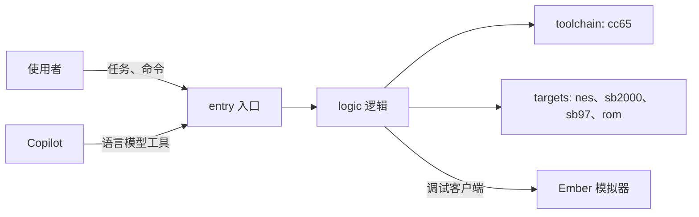

# 软件架构设计

fcdev 是 6502 兼容机的开发工具：一个 VS Code 扩展（源码在仓库的 `vscode/`），包括 cc65 编译器、各机型的头文件与运行库、项目模板、构建任务与命令、反汇编核心，以及给 Copilot 用的反汇编、模拟器与构建工具。用 C 或 ca65 汇编开发，构建出各机型的可运行程序。运行与调试用的模拟器 Ember 不随扩展发布，使用者在设置里指定它的位置。首批目标是 NES、小霸王学习机 SB2000 与小霸王 97（SB97，只有汇编），另有“整机 ROM 工程”目标 rom（构建各机型的 BIOS 与固件），之后按“目标”加入步步高、裕兴等机型。

本文说明扩展的范围、目录、分层规则和设计决策。各部分的细节见第 9 节列出的文档。

## 1. 范围

范围内：

- 构建任务与命令、目标定义、cc65 工具链、新建项目与模板、反汇编核心、模拟器的运行与调试命令。
- 目标：NES、SB2000、SB97，以及整机 ROM 工程目标 rom；其他机型按 [02-目标规范](02-目标规范.md) 加入。
- 智能感知与语法高亮：见 [06-VS Code扩展](06-VS%20Code扩展.md)。
- 给 Copilot 用的反汇编、模拟器与构建工具、指令、skill 与自定义智能体：见 [09-AI反汇编工具](09-AI反汇编工具.md)。

范围外：

- 命令行工具、npm 包与创建包：不再提供，能力都经扩展的命令、任务、设置与语言模型工具给出。
- BIOS 与固件的反汇编整理，BIOS 迁移到 ca65：不属于 fcdev，各机型的这类工作放在仓库的 `machines/<机型>/`（如 `machines/sb2000/`）。
- 把模拟器内核集成进 VS Code 面板，以及调试适配器协议（DAP）。
- 步步高、裕兴的目标定义：缺少资料，加入前先调研。
- 任何机型的 BIOS、ROM 文件，以及模拟器 Ember 本身：不随扩展发布，由用户提供。
- 其他平台：工具链是 Windows 可执行文件，扩展只支持 Windows 64 位。

## 2. 设计决策

| 编号 | 决策 | 原因 |
| --- | --- | --- |
| D01 | 只维护一个 VS Code 扩展 `sungbin.fcdev`，用任务、命令、设置与语言模型工具提供全部能力 | 用 VS Code 的方式提供能力，不再另维护命令行与 npm 包 |
| D02 | 扩展用 TypeScript 按“契约、共享、逻辑、基础设施、入口、平台、组装”分层，层内按功能分目录，依赖方向由结构测试检查 | 与仓库的架构规则一致，功能之间互相隔离 |
| D03 | 工具链、目标、项目模板与使用文档随扩展发布，放在扩展目录下；扩展不使用系统里已装的 cc65，也不提供自备 cc65 的设置 | 运行库与增量构建的指纹绑定随扩展的 cc65 版本，工具链只有一个来源，错误最容易定位 |
| D04 | 模拟器位置由设置 `fcdev.emulator.path` 给出（作用域 `machine`，工作区设置不能指定要运行的程序），调试端口由 `fcdev.emulator.debugPort` 给出 | 模拟器不随扩展发布；防止打开别人的工作区时运行被指定的程序 |
| D05 | 一种机型是一个“目标”，是 `vscode/targets/<名>/` 一个目录；新增机型只加目录，不改构建流程 | 多机型扩展 |
| D06 | 目标声明可选能力：磁盘镜像、模拟器运行；没有该能力的目标，对应命令明确报错 | NES 没有磁盘，学习机有 |
| D07 | 构建由扩展自己判断增量，不用 `make` | Windows 上不必另装 `make` |
| D08 | 目标运行库在打包前用 `cc65`、`ca65`、`ar65` 编译成 `.lib` 随扩展发布（C 与汇编源码都可以，一个函数一个目标文件） | 目标文件格式与平台无关，使用者不必再编译库 |
| D09 | 许可证分区，见第 7 节 | 各自保留原许可证，作为独立程序互不影响 |
| D10 | 模拟器 Ember 的源码放在仓库根目录的 `ember/`，cc65 的源码放在扩展目录的 `vscode/third_party/cc65/`，都由本仓库维护 | 以后在本仓库里直接修改与升级，来源仍可核对；cc65 只有扩展使用，所以随扩展放 |
| D11 | 反汇编核心自己生成 ca65 工程（不经 `da65`），用 `ca65`、`ld65` 回读校验 | 能按功能分文件、控制注释与逐字节形式，见 [07-反汇编设计](07-反汇编设计.md) |
| D12 | 调试服务的客户端（TypeScript）是扩展的内部功能，不对外提供 `import` 入口；调试协议是开放的，第三方可以按协议自行连接 | 只维护这一个扩展；接口文档与类型由 Ember 的 Schema 生成 |
| D13 | 仓库里的 Node 脚本（`vscode/tools/`、各样例的开发脚本、Ember 的开发脚本）引用扩展的编译产物 `vscode/out/`（脚本共用的入口是 `tools/extension.mjs`）；样例项目用 `.vscode/tasks.json` 里的 `fcdev` 任务构建 | 一份能力一份实现 |

## 3. 能力与扩展的对应



| 能力 | 提供方式 |
| --- | --- |
| 新建项目 | 命令“fcdev：新建项目”、工具 `fcdev_new_project` |
| 构建、磁盘镜像 | 任务类型 `fcdev`（`build`、`disk`）、命令“构建项目”等、工具 `fcdev_build` |
| 运行、调试运行 | 任务 `run`、命令“运行”“调试运行”、工具 `fcdev_run` |
| 调试服务 | 命令“调用调试请求”等 5 个、工具 `emu_*` |
| 反汇编 | 命令“反汇编映像文件”、工具 `disasm_*` |
| 智能感知 | 命令“同步 C/C++ 智能感知配置”与自动同步、ca65 语言功能 |
| 项目信息、C 接口、使用文档 | 命令“显示项目信息”“查询 C 接口”“打开使用文档”、工具 `fcdev_info`、`fcdev_api`、`fcdev_docs` |

- 模拟器的定位：只用设置 `fcdev.emulator.path`，没有设置或文件不存在时报错并说明去哪里设置；扩展不去 `PATH` 里猜。规则见使用文档 [02-模拟器与调试](../vscode/docs/02-模拟器与调试.md)。
- 找不到工具链时报错并说明原因；工具链只来自扩展目录里的 `toolchain/`。

## 4. 仓库目录

```text
famiclone/
  LICENSE                      Apache-2.0
  README.md                    使用说明
  vscode/                      VS Code 扩展（唯一的 npm 项目），见 [06-VS Code扩展](06-VS%20Code扩展.md)
    package.json               扩展清单与脚本（构建、工具链、运行库、文档、测试、打包）
    src/                       分层源码，见第 5 节
    test/                      vitest 测试，按功能分目录
    toolchain/                 cc65 的 bin、include、asminc、cfg、lib（生成物，不入库，随 .vsix 发布）
    third_party/cc65/          cc65 源码（删减版，本仓库维护；不随 .vsix 发布）
    targets/                   nes、sb2000、sb97、rom：目标定义、头文件、启动代码、运行库源码、链接配置、接口参考；运行库 lib/ 是生成物
    templates/                 四个项目模板与公共文件
    docs/                      使用文档与 topics.json，随扩展发布
    debug/openrpc.json         调试服务的接口描述（由 Ember 的 npm run schema 生成）
    chat/  syntaxes/  resources/   Copilot 指令与智能体、ca65 语法、图标
    tools/                     扩展的维护脚本：build、check、gen、release 与 test，不随扩展发布，见第 8 节
  docs/                        开发文档（本目录），不随扩展发布，清单见第 9 节
  ember/                       模拟器 Ember 的源码（本仓库维护，设计与调试服务见 ember/docs）
  tools/                       各部分脚本共用的入口 extension.mjs，见第 8 节
  apps/                        应用程序与示例（apps/sb2000：SB-DOS 的 asm、edit、runnes、disk 与 examples 示例），见 [sb2000/01-开发指南](../vscode/docs/sb2000/01-开发指南.md) 第 10 节
  machines/                    各机型的资料与工程（不属于扩展，不随扩展发布），一个机型一个目录，如 machines/sb2000
  build/                       构建产物目录（不入库）：vscode/ 是扩展的构建产物（.vsix 与 cc65 的构建副本 cc65/），ember/ 是 Ember 的构建产物
```

## 5. 扩展分层

`vscode/src/` 下每个目录是一层，层内按功能分目录；目录之间只能按下表引用，由 `vscode/test/structure.test.ts` 检查，新增层或改规则时同步改本节。

| 目录 | 职责 | 允许引用 |
| --- | --- | --- |
| `contracts` | 功能之间的契约：接口与数据类型 | `contracts`、`shared` |
| `shared` | 纯函数与数据：错误类型、JSON、参数检查、解析、字节处理、反汇编的指令表与映像格式 | `shared` |
| `logic` | 各功能的业务逻辑：构建计划与增量、反汇编分析与生成、模拟器操作与会话、调试客户端、新建项目、使用文档与 C 接口查询 | `contracts`、`shared`、`platform` |
| `infra` | 与外部交互的实现：文件、进程、WebSocket、端点文件、工具链定位、资源位置 | `contracts`、`shared`、`platform` |
| `entry` | 与 VS Code 的交互：任务提供者、命令、语言模型工具、语言功能、设置读取 | `contracts`、`shared`、`platform`、`vscode` |
| `platform` | 日志等通用能力 | `platform` |
| `bootstrap` | 组装根：创建全部实现并按接口注入 | 全部层 |

- 功能目录之间互相隔离：一个功能不引用另一个功能的目录，只经 `contracts` 的接口协作。
- 只有 `entry`、`platform`、`bootstrap` 与登记的少数基础设施文件可以引用 `vscode`，其余层不引用，保证测试不依赖 VS Code。
- 读取扩展目录里的资源（工具链、目标、模板、文档）一律经 `contracts/resources` 的“扩展资源位置”抽象取得路径，不直接用 `__dirname`，测试时注入临时目录。
- “反汇编核心里除映像格式目录外不出现机型名”的检查在结构测试里，见 [07-反汇编设计](07-反汇编设计.md) 第 5 节。
- 每个源文件有文件头；注释行不超过 100 列（生成文件 `generated/` 除外）。

## 6. 错误处理

- 可预期的使用错误（配置有误、找不到工具、构建失败等）一律抛 `FcdevError`，带错误码 `code` 和下一步建议 `hint`；它们是 `UserFacingError`，入口层把说明与建议作为提示显示，不当作程序缺陷。
- 其他异常是程序自身的缺陷，入口层记日志（“输出”面板的 fcdev 通道）并提示“详情见输出面板”。
- 外部工具（cc65、ca65、ld65）的输出原样透传，不改写，供 VS Code 问题匹配器 `$fcdev` 使用。
- 启动外部程序不经过 shell，参数逐个传递，带超时（默认 120 秒）。
- Ember 进程与扩展脱离；会话与工具启动的 Ember 在扩展停用时关闭，只结束自己启动的进程。

## 7. 许可证分区

| 部分 | 许可证 |
| --- | --- |
| 仓库与扩展自己的代码 | Apache-2.0，见根目录 `LICENSE` |
| `vscode/third_party/cc65/` 及扩展里的工具链 | zlib，见 `vscode/third_party/cc65/LICENSE` |
| `ember/` | GPL-3.0-only，见 `ember/LICENSE`；扩展只把 Ember 当作独立的程序启动，不链接它的代码，也不随扩展发布它 |

## 8. 维护脚本

扩展的维护脚本在 `vscode/tools/`，按用途分 `build/`、`check/`、`gen/`、`release/` 四个子目录，脚本的测试在 `vscode/tools/test/`。仓库里的 Node 脚本引用扩展的编译产物，所以先在 `vscode/` 里运行 `npm run build`；仓库根的 `tools/extension.mjs` 是各部分脚本（样例、机型、Ember 的开发脚本）共用的入口。

| 脚本 | 作用 |
| --- | --- |
| `vscode/tools/build/build-cc65.mjs` | 构建 cc65 工具与运行库，输出到 `vscode/toolchain/`，见 [03-cc65工具链](03-cc65工具链.md) |
| `vscode/tools/build/build-libs.mjs` | 按各目标的 `lib-build.json` 用 `cc65`、`ca65`、`ar65` 编出 `lib/` 下的运行库（`.c` 与 `.s` 源码，目录项递归展开） |
| `vscode/tools/gen/gen-sb2000-header.mjs` | 由 `sb2000.inc` 生成 `sb2000-symbols.h` |
| `vscode/tools/check/check-sb2000-api.mjs` | 检查 SB2000 的 C 接口：函数文档完整、有且只有一处实现、每个功能号被封装或写明不封装的原因，见 [08-目标运行库维护](08-目标运行库维护.md) 第 2.2 节 |
| `vscode/tools/gen/gen-sb2000-api-doc.mjs` | 由头文件文档注释生成 `targets/sb2000/api-reference.md` |
| `vscode/tools/gen/gen-sb2000-symbols-doc.mjs` | 由 `sb2000.inc` 生成 `targets/sb2000/symbols-reference.md`（汇编名、C 名、值与说明） |
| `vscode/tools/gen/gen-sb2000-examples-doc.mjs` | 由 `apps/sb2000/examples` 的示例项目生成 `targets/sb2000/examples-source.md`（每个示例的程序名与完整源码） |
| `vscode/tools/check/check-package.mjs` | 核对 `.vsix` 的内容（`npm run check:package`），见 [05-发布](05-发布.md) |
| `vscode/tools/release/release.mjs` | 发布扩展：检查版本与更新记录、运行 `npm run check` 与 `npm run package`、核对 `.vsix`，加 `--publish` 才上传到市场（`npm run release`），见 [05-发布](05-发布.md) |
| `tools/extension.mjs` | 脚本共用的入口：引用扩展编译产物里的指令表、工具链、磁盘打包、开机步骤、调试客户端等 |

## 9. 文档清单

文档分两处：

- 使用文档放在扩展的 `docs/` 目录（`vscode/docs/`），随扩展一起发布。命令“fcdev：打开使用文档”与工具 `fcdev_docs` 列出全部主题，主题登记在 `vscode/docs/topics.json`；新增、改名或删除使用文档时同步改登记，测试会核对登记与目录一致。
- 开发文档放在仓库根目录的 `docs/`（本目录），不随扩展发布，不登记主题。

使用文档里指向开发文档或仓库其他目录（`tools/`、`ember/` 等，不随扩展发布）的地方只写路径，不做链接；开发文档指向使用文档用相对路径。`api` 主题是例外：它指向目标目录里由头文件文档注释生成的接口参考，不放进 `docs/`，避免两份不一致。`symbols` 主题同理，指向由 `sb2000.inc` 生成的符号参考；`examples` 主题指向由示例项目生成的源码文档。这三个主题在 `topics.json` 里用 `"root": "extension"` 标明文件相对扩展目录。

使用文档同时是 Ember 帮助文档“fcdev 开发手册”的来源：Ember 构建帮助站点时按 `topics.json` 的登记把这些文档（含 `api`、`symbols`、`examples`）导入，只在这里维护，不在 Ember 里另存一份；因此使用文档里不能写“见开发文档某篇”这类在帮助里读不到的引用。

### 9.1 使用文档

| 主题 | 文档 | 内容 |
| --- | --- | --- |
| `install` | [00-安装与入门](../vscode/docs/00-安装与入门.md) | 安装方式与位置、环境要求、Ember 位置设置、第一次使用 |
| `build` | [01-构建](../vscode/docs/01-构建.md) | 任务与命令、构建规则、配置文件、构建流程 |
| `emulator` | [02-模拟器与调试](../vscode/docs/02-模拟器与调试.md) | 运行方案、Ember 位置设置、调试运行与调试命令 |
| `disasm` | [03-反汇编](../vscode/docs/03-反汇编.md) | 反汇编的命令、输入、追踪规则与限制 |
| `create` | [04-新建项目与模板](../vscode/docs/04-新建项目与模板.md) | 新建项目命令、生成的项目与模板 |
| `nes` | [nes/01-开发指南](../vscode/docs/nes/01-开发指南.md) | NES 目标的构建与接口 |
| `sb97` | [sb97/01-开发指南](../vscode/docs/sb97/01-开发指南.md) | SB97 目标的程序格式、内存与段、显示文字、硬件寄存器、构建与运行 |
| `rom` | [rom/01-开发指南](../vscode/docs/rom/01-开发指南.md) | 整机 ROM 工程目标：底固件与覆盖、机型与磁盘镜像的配置、构建与运行 |
| `sb2000` | [sb2000/01-开发指南](../vscode/docs/sb2000/01-开发指南.md) | SB2000 目标的程序格式、内存布局、运行库、常用做法与示例 |
| `examples` | [examples-source](../vscode/targets/sb2000/examples-source.md) | SB2000 示例程序的完整源码（由 `apps/sb2000/examples` 生成） |
| `syscall` | [sb2000/02-系统调用手册](../vscode/docs/sb2000/02-系统调用手册.md) | SB-DOS 的系统调用：参数、结果、出错码与可靠程度 |
| `hardware` | [sb2000/03-硬件说明](../vscode/docs/sb2000/03-硬件说明.md) | SB2000 的硬件行为 |
| `api` | [api-reference](../vscode/targets/sb2000/api-reference.md) | SB2000 运行库全部函数的接口参考（由头文件文档注释生成，查询用命令“fcdev：查询 C 接口”） |
| `symbols` | [symbols-reference](../vscode/targets/sb2000/symbols-reference.md) | SB2000 的功能号、子功能号、系统变量地址、出错码、硬件寄存器与位、运行库入口的汇编名与 C 名（由 `sb2000.inc` 生成） |

### 9.2 开发文档

| 文档 | 内容 |
| --- | --- |
| 01-软件架构设计 | 本文：范围、决策、目录、分层、错误处理、许可证、维护脚本 |
| [02-目标规范](02-目标规范.md) | 目标定义、打包器、新增机型与模板的步骤 |
| [03-cc65工具链](03-cc65工具链.md) | cc65 源码、构建与随扩展发布的工具链 |
| [04-测试与验证](04-测试与验证.md) | 测试分层、环境变量与运行方法 |
| [05-发布](05-发布.md) | 扩展的打包、检查与发布 |
| [06-VS Code扩展](06-VS%20Code扩展.md) | 扩展的功能、智能感知、语法高亮、目录分层与打包 |
| [07-反汇编设计](07-反汇编设计.md) | 反汇编核心的做法、源文件与信息文件 |
| [08-目标运行库维护](08-目标运行库维护.md) | 各目标运行库的构建、接口文档与符号头文件的生成、测试 |
| [09-AI反汇编工具](09-AI反汇编工具.md) | 给 Copilot 用的 6502 反汇编与模拟器调试工具、指令、skill 与智能体的设计与开发记录 |
| [10-迁移到VS Code扩展计划](10-迁移到VS%20Code扩展计划.md) | 把命令行与 npm 包的功能并入 VS Code 扩展并删除 `packages/` 的方案、阶段计划与进度 |
| [待办备忘](待办备忘.md) | 已确定以后再做的事项 |
| [缺陷记录](缺陷记录.md) | 发现的缺陷及修复情况 |
