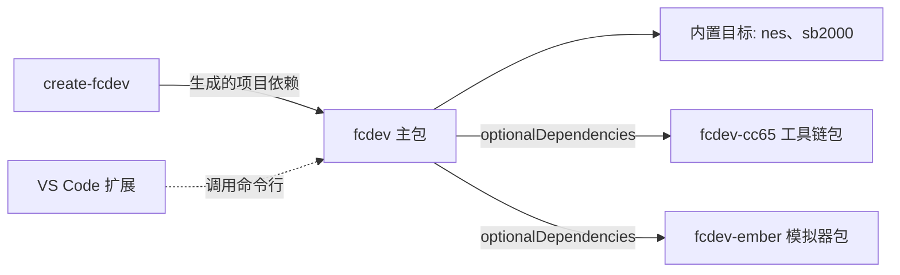

# 软件架构设计

fcdev 是 6502 兼容机的开发工具集：一套用 npm 发布的开发环境，包括命令行、cc65 编译器、各机型的头文件与运行库、项目模板和反汇编工具，运行与调试用的模拟器（Ember）随包安装（Windows 64 位，在依赖包 `fcdev-ember` 里）。用 C 或 ca65 汇编开发，构建出各机型的可运行程序。首批目标是 NES 与小霸王学习机 SB2000，之后按“目标”加入步步高、裕兴等机型。

本文说明包的划分、目录、分层规则和设计决策。各部分的细节见第 9 节列出的文档。

## 1. 范围

范围内：

- 命令行构建工具、目标定义、cc65 工具链包、创建包与模板、反汇编核心。
- 首批目标：NES、SB2000；其他机型按 [02-目标规范](02-目标规范.md) 加入。
- VS Code 扩展的智能感知与语法高亮：见 [06-VS Code扩展](06-VS%20Code扩展.md)。
- VS Code 扩展里给 Copilot 用的反汇编与模拟器工具、指令、skill 与自定义智能体：见 [09-AI反汇编工具](09-AI反汇编工具.md)。

范围外：

- VS Code 扩展的任务、命令与调试：登记在 [待办备忘](待办备忘.md)。
- BIOS 与固件的反汇编整理，BIOS 迁移到 ca65：不属于 fcdev，各机型的这类工作放在仓库的 `machines/<机型>/`（如 `machines/sb2000/`）。
- 把模拟器内核集成进 VS Code 面板，以及调试适配器协议（DAP）。
- 步步高、裕兴的目标定义：缺少资料，加入前先调研。
- 任何机型的 BIOS、ROM 文件：不随包发布，由用户提供。
- 安装脚本：不使用 `postinstall` 之类的钩子。

## 2. 设计决策

| 编号 | 决策 | 原因 |
| --- | --- | --- |
| D01 | 用 npm 包发布命令行、目标、模板与编译器 | 项目锁定版本；终端、CI 与 Copilot 都能构建，不依赖 VS Code |
| D02 | 包名：主包 `fcdev`，创建包 `create-fcdev`，工具链包 `fcdev-cc65`，模拟器包 `fcdev-ember`；四个包都不带作用域，目录名与包名相同 | `npm create fcdev` 会自动运行 `create-fcdev`；工具链包与模拟器包只被主包依赖，使用者不直接输入名字 |
| D03 | 命令行与库用 Node 22 的 ESM（`.mjs`）加 JSDoc，运行时无依赖，不需要构建步骤 | 发布内容就是源码，便于核对 |
| D04 | 用 npm workspaces 管理多个包，发布的四个包同一个版本号，同步发布；主包对工具链包与模拟器包写精确版本，被依赖的包先发布；Ember 调试服务的客户端 SDK（TypeScript）并入主包（源码在 `packages/fcdev/debug-sdk/`，构建到 `dist/debug/`），`fcdev` 的 `debug` 与 `run --debug` 经它连接 Ember | 命令行、目标与编译器必须配套；使用者只需记一个版本号；调试 SDK 不单独发布 |
| D05 | 一种机型是一个“目标”，是主包内 `targets/<名>/` 一个目录；新增机型只加目录，不改构建流程 | 多机型扩展 |
| D06 | 目标声明可选能力：磁盘镜像、模拟器运行；没有该能力的目标，对应命令明确报错 | NES 没有磁盘，学习机有 |
| D07 | 构建由 `fcdev` 自己判断增量，不用 `make` | Windows 上不必另装 `make` |
| D08 | 目标运行库在发布前用 `cc65`、`ca65`、`ar65` 编译成 `.lib` 随包发布（C 与汇编源码都可以，一个函数一个目标文件） | 目标文件格式与平台无关，使用者不必再编译库 |
| D09 | 工具链与模拟器是体积较大的二进制，各放在独立的包里，主包用 `optionalDependencies` 引用 | 不适用的环境可以跳过安装，也不拖慢主包 |
| D10 | 许可证分区，见第 7 节 | 各自保留原许可证，作为独立程序互不影响 |
| D11 | cc65 与模拟器 Ember 的源码放在仓库根目录的 `cc65/` 与 `ember/`，由本仓库维护 | 以后在本仓库里直接修改与升级，来源仍可核对 |
| D12 | 反汇编核心自己生成 ca65 工程（不经 `da65`），用 `ca65`、`ld65` 回读校验 | 能按功能分文件、控制注释与逐字节形式，见 [07-反汇编设计](07-反汇编设计.md) |

## 3. 包与依赖



| 包 | 内容 | 是否入库 |
| --- | --- | --- |
| `fcdev` | 命令行、构建核心、内置目标、反汇编核心 | 是 |
| `create-fcdev` | 创建项目的命令与四个模板 | 是 |
| `fcdev-cc65` | cc65、ca65、ld65、ar65、da65，头文件、库与链接配置 | 只入库 `package.json`，其余由脚本生成 |
| `fcdev-ember` | Ember 模拟器（`Ember.exe`，Windows 64 位）、许可文件、第三方声明与清单 | 只入库 `package.json`，其余由 `tools/build-ember.mjs` 从 Ember 的发布产物组装 |

- 主包不引用具体机型的代码，只读取 `targets/` 下的目标定义。
- 主包找不到工具链或模拟器时，不去 `PATH` 里猜，报错并说明可选的解决办法。
- 模拟器的定位与安装：配置项 `emulator`、环境变量 `FCDEV_EMULATOR`、随包的 Ember；随包的 Ember 第一次用到时复制到用户级目录 `%LOCALAPPDATA%\fcdev\ember\` 并只运行那一份（Ember 自带升级，升级会覆盖自己所在位置的程序，放在 `node_modules` 里每个项目一份且 `npm install` 会还原成旧版），实现在 `src/emulator/emulator-install.mjs`，规则见使用文档 [02-模拟器与调试](../packages/fcdev/docs/02-模拟器与调试.md) 第 1 节。

## 4. 仓库目录

```text
famiclone/
  LICENSE                      Apache-2.0
  README.md                    使用说明
  package.json                 工作区根（private）
  packages/
    fcdev/                     主包
      bin/fcdev.mjs
      debug-sdk/               调试 SDK（TypeScript）的源码、测试、脚本与配置，构建到 dist/debug（不入库），说明见它的 README
      docs/                    使用文档，随主包发布；nes/、sb2000/ 是各目标的文档
      src/                     见第 5 节
      targets/                 内置目标：nes、sb2000
      test/
    create-fcdev/              创建包
      bin/  src/  templates/  test/
    fcdev-cc65/                工具链包
    fcdev-ember/               模拟器包（只入库 package.json，程序等由 tools/build-ember.mjs 组装）
  docs/                        开发文档（本目录），不随包发布，清单见第 9 节
  cc65/                        cc65 源码（删减版，本仓库维护）
  ember/                       模拟器 Ember 的源码（本仓库维护，设计与调试服务见 ember/docs）
  vscode/                      VS Code 扩展（独立的 npm 项目，不在工作区里），见 [06-VS Code扩展](06-VS%20Code扩展.md)
  tools/                       维护脚本，见第 8 节
  apps/                        应用程序与示例（apps/sb2000：SB-DOS 的 asm、edit、runnes、disk 与 examples 示例；apps/disasm-example：反汇编工作流的示例工程），不在工作区里，见 [sb2000/01-开发指南](../packages/fcdev/docs/sb2000/01-开发指南.md) 第 10 节
  test/                        仓库级测试：目录结构、cc65 工具链包、SB2000 头文件
  machines/                    各机型的资料与工程（不属于 fcdev 包，不随包发布），一个机型一个目录，如 machines/sb2000
  build/                       构建产物目录（不入库）：cc65/ 是 cc65 的构建副本，ember/ 是 Ember 的构建产物（Win32 构建、测试构建、预装插件、资源包、第三方许可、发布包）
```

## 5. 主包分层

`packages/fcdev/src/` 下每个目录是一层功能，目录之间只能按下表引用，并且只经对方的 `index.mjs`：

| 目录 | 职责 | 允许引用 |
| --- | --- | --- |
| `shared` | 错误类型、文件与进程小工具 | 无 |
| `api` | 目标的 C 接口文档：解析头文件文档注释、查询与格式化 | 无 |
| `docs` | 使用文档的主题登记表：主题名、文件、标题、说明，以及本机路径 | `shared` |
| `config` | 查找与读取 `fcdev.json` | `shared` |
| `targets` | 目标注册表、程序名规则 | `shared` |
| `toolchain` | 定位与调用 cc65 工具链 | `shared` |
| `packagers` | 打包器：平铺映像、iNES、FAT12 软盘镜像 | `shared` |
| `emulator` | 定位与启动 Ember、定位调试 SDK 的终端客户端 | `shared` |
| `disasm` | 反汇编核心：指令表与解码、映像格式、工程模型、静态追踪、源码生成与回读 | `shared`、`toolchain` |
| `build` | 构建计划、增量、调用工具链、打包 | `shared`、`config`、`targets`、`toolchain`、`packagers` |
| `cli` | 参数解析与各命令 | `shared`、`config`、`targets`、`toolchain`、`build`、`emulator`、`disasm`、`api`、`docs` |

- `bin/fcdev.mjs` 只调用 `cli` 的 `runCli`。
- `targets`、`toolchain`、`packagers` 之间不互相引用，由 `build` 组装。
- `disasm` 里除 `formats/` 外不出现机型名与映像格式名，同样由 `npm run boundaries` 检查，见 [07-反汇编设计](07-反汇编设计.md) 第 5 节。
- 依赖表在 `tools/check-structure.mjs` 里登记，`npm run boundaries` 检查；新增目录要先登记，改表时同步改本节。

## 6. 错误处理

- 可预期的使用错误（配置有误、找不到工具、构建失败等）一律抛 `FcdevError`，带错误码 `code` 和下一步建议 `hint`。
- `runCli` 捕获 `FcdevError`，向标准错误写“错误：”加说明，再写建议，返回退出码 1；其他异常是程序自身的缺陷，不捕获，直接抛出。
- 外部工具（cc65、ca65、ld65）的输出原样透传，不改写，供 VS Code 问题匹配器使用。
- 启动外部程序不经过 shell，参数逐个传递，带超时（默认 120 秒）。

## 7. 许可证分区

| 部分 | 许可证 |
| --- | --- |
| 仓库与 `fcdev`、`create-fcdev` 自己的代码 | Apache-2.0，见根目录 `LICENSE` |
| `cc65/` 及工具链包 | zlib，见 `cc65/LICENSE` |
| `ember/` 及模拟器包 | GPL-3.0-only，见 `ember/LICENSE`；`fcdev` 只把 Ember 当作独立的程序启动，不链接它的代码，模拟器包里带着它的许可文件与第三方声明 |

## 8. 维护脚本

| 脚本 | 作用 |
| --- | --- |
| `tools/build-cc65.mjs` | 构建 cc65 工具与运行库，组装 `fcdev-cc65`，见 [03-cc65工具链](03-cc65工具链.md) |
| `tools/build-ember.mjs` | 把 Ember 的发布产物（`build/ember/release/Ember-<版本>.exe` 等）组装成 `fcdev-ember`，加 `--package` 先运行 Ember 的 `npm run package:win`，见 [05-发布](05-发布.md) |
| `tools/build-libs.mjs` | 按各目标的 `lib-build.json` 用 `cc65`、`ca65`、`ar65` 编出 `lib/` 下的运行库（`.c` 与 `.s` 源码，目录项递归展开）；`fcdev` 的 `prepack` 与 `npm test` 前自动运行 |
| `tools/gen-sb2000-header.mjs` | 由 `sb2000.inc` 生成 `sb2000-symbols.h` |
| `tools/check-sb2000-api.mjs` | 检查 SB2000 的 C 接口：函数文档完整、有且只有一处实现、每个功能号被封装或写明不封装的原因，见 [08-目标运行库维护](08-目标运行库维护.md) 第 2.2 节 |
| `tools/gen-sb2000-api-doc.mjs` | 由头文件文档注释生成 `targets/sb2000/api-reference.md` |
| `tools/gen-sb2000-symbols-doc.mjs` | 由 `sb2000.inc` 生成 `targets/sb2000/symbols-reference.md`（汇编名、C 名、值与说明） |
| `tools/gen-sb2000-examples-doc.mjs` | 由 `apps/sb2000/examples` 的示例项目生成 `targets/sb2000/examples-source.md`（每个示例的程序名与完整源码） |
| `tools/check-structure.mjs` | 检查主包各层的依赖方向（`npm run boundaries`） |
| `tools/release-check.mjs` | 发布前检查（`npm run release:check`），见 [05-发布](05-发布.md) |
| `tools/verify-install.mjs` | 打包后在临时目录里创建、安装并构建四个模板（`npm run release:verify`） |
| `tools/release.mjs` | 发布脚本：升版本号、检查、试发布与按顺序发布（`npm run release:prepare`、`npm run release:publish`），见 [05-发布](05-发布.md) 第 6 节 |

## 9. 文档清单

文档分两处：

- 使用文档放在主包的 `docs/` 目录（`packages/fcdev/docs/`），随 `fcdev` 包一起发布：安装后在 `node_modules/fcdev/docs/`。`npx fcdev docs` 列出全部主题并给出本机路径，主题登记在 `src/docs/doc-topics.mjs`；新增、改名或删除使用文档时同步改登记，测试会核对登记与目录一致。
- 开发文档放在仓库根目录的 `docs/`（本目录），不随包发布，不登记主题。

使用文档里指向开发文档或仓库其他目录（`tools/`、`vscode/` 等，不随包发布）的地方只写路径，不做链接；开发文档指向使用文档用相对路径。`api` 主题是例外：它指向目标目录里由头文件文档注释生成的接口参考，不放进 `docs/`，避免两份不一致。`symbols` 主题同理，指向由 `sb2000.inc` 生成的符号参考；`examples` 主题指向由示例项目生成的源码文档。

使用文档同时是 Ember 帮助文档“fcdev 开发手册”的来源：Ember 构建帮助站点时按 `doc-topics.mjs` 的登记把这些文档（含 `api`、`symbols`、`examples`）导入，只在这里维护，不在 Ember 里另存一份；因此使用文档里不能写“见开发文档某篇”这类在帮助里读不到的引用。

### 9.1 使用文档

| 主题 | 文档 | 内容 |
| --- | --- | --- |
| `build` | [01-命令行与构建](../packages/fcdev/docs/01-命令行与构建.md) | 命令、构建规则、配置文件、构建流程 |
| `emulator` | [02-模拟器与调试](../packages/fcdev/docs/02-模拟器与调试.md) | 运行方案、Ember 定位、调试服务与 debug 命令 |
| `disasm` | [03-反汇编](../packages/fcdev/docs/03-反汇编.md) | 反汇编的命令、输入、追踪规则与限制 |
| `create` | [04-创建包与模板](../packages/fcdev/docs/04-创建包与模板.md) | 创建命令、生成的项目与模板 |
| `nes` | [nes/01-开发指南](../packages/fcdev/docs/nes/01-开发指南.md) | NES 目标的构建与接口 |
| `sb2000` | [sb2000/01-开发指南](../packages/fcdev/docs/sb2000/01-开发指南.md) | SB2000 目标的程序格式、内存布局、运行库、常用做法与示例 |
| `examples` | [examples-source](../packages/fcdev/targets/sb2000/examples-source.md) | SB2000 示例程序的完整源码（由 `apps/sb2000/examples` 生成） |
| `syscall` | [sb2000/02-系统调用手册](../packages/fcdev/docs/sb2000/02-系统调用手册.md) | SB-DOS 的系统调用：参数、结果、出错码与可靠程度 |
| `hardware` | [sb2000/03-硬件说明](../packages/fcdev/docs/sb2000/03-硬件说明.md) | SB2000 的硬件行为 |
| `api` | [api-reference](../packages/fcdev/targets/sb2000/api-reference.md) | SB2000 运行库全部函数的接口参考（由头文件文档注释生成，查询用 `npx fcdev api`） |
| `symbols` | [symbols-reference](../packages/fcdev/targets/sb2000/symbols-reference.md) | SB2000 的功能号、子功能号、系统变量地址、出错码、硬件寄存器与位、运行库入口的汇编名与 C 名（由 `sb2000.inc` 生成） |

### 9.2 开发文档

| 文档 | 内容 |
| --- | --- |
| 01-软件架构设计 | 本文 |
| [02-目标规范](02-目标规范.md) | 目标定义、打包器、新增机型与模板的步骤 |
| [03-cc65工具链](03-cc65工具链.md) | cc65 源码、构建与工具链包 |
| [04-测试与验证](04-测试与验证.md) | 测试分层、环境变量与运行方法 |
| [05-发布](05-发布.md) | 发布顺序、前提与检查 |
| [06-VS Code扩展](06-VS%20Code扩展.md) | 扩展的智能感知、语法高亮、项目信息来源、目录分层与打包 |
| [07-反汇编设计](07-反汇编设计.md) | 反汇编前端的做法、源文件与信息文件 |
| [08-目标运行库维护](08-目标运行库维护.md) | 各目标运行库的构建、接口文档与符号头文件的生成、测试 |
| [09-AI反汇编工具](09-AI反汇编工具.md) | 给 Copilot 用的 6502 反汇编与模拟器调试工具、指令、skill 与智能体的设计与开发记录 |
| [待办备忘](待办备忘.md) | 已确定以后再做的事项 |
| [缺陷记录](缺陷记录.md) | 发现的缺陷及修复情况 |
