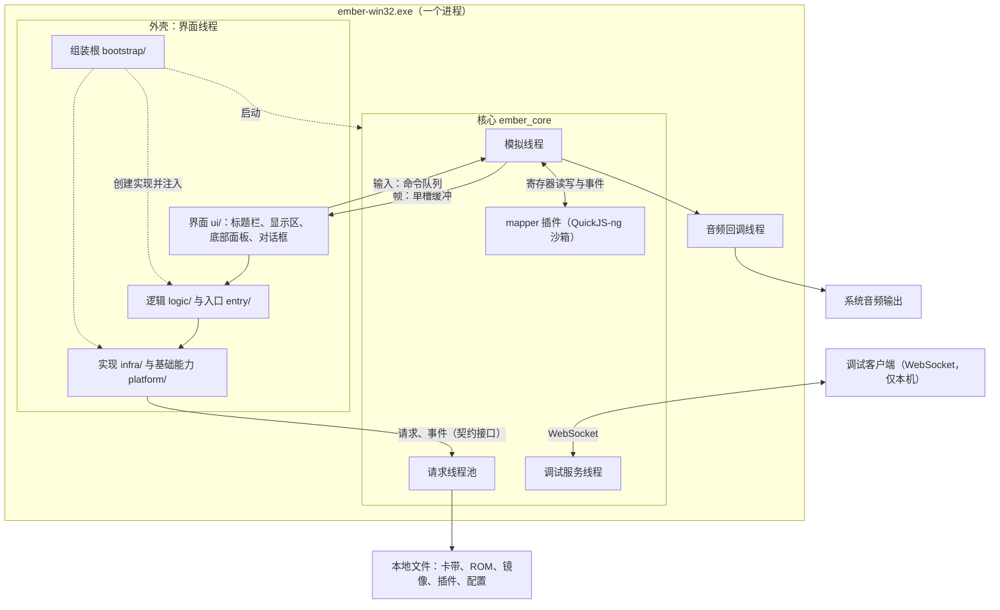

# 软件架构设计

Ember 的整体架构：设计决策、运行结构、外壳与核心的分工、目录分层、依赖规则、通信方式。硬件结构见 [02-硬件模块.md](02-硬件模块.md)，mapper 插件见 [03-mapper插件规范.md](03-mapper插件规范.md)，调试服务见 [04-调试服务.md](04-调试服务.md)，界面见 [05-界面.md](05-界面.md)，原生外壳与控件库见 [08-Win32原生外壳.md](08-Win32原生外壳.md)。

项目的结构与做法参照如见客户端（rujian-client）的开发规则。

状态说明：“已定”为用户已决定；“拟定”为设计提议，待用户审阅；“待定”为实现前须向用户确认。

## 1. 设计决策

| 决策项 | 结论 | 状态 |
| --- | --- | --- |
| 定位 | 面向 NES 与学习机应用开发者，提供可运行的模拟环境、较完整的调试能力和配套开发文档，也供 FC 爱好者运行程序；帮助首页说明开发工具、调试服务与手册入口，GitHub 链接指向整个 famiclone 仓库 | 已定 |
| 目标机型 | 经典 FC（`fc`），以及学习机整机的七个型号：小霸王 97（`sb97`）、小霸王 2000（`sb2000`）、步步高 软驱一号（`bbg1`）、步步高 98（`bbg98`）、金字塔 PEC-9588（`pec9588`）、金字塔 PEC-586(686)（`pec586`，同时接受 PEC-586 与 PEC-686F 两个 ROM）、裕兴（`yuxing`，V8.0-C、V8.2-D、V8.3-D、V9.0-98 四个学习卡的 ROM 任选一个）；所有学习机都是内置的整机机型，没有“插卡学习机”这一类；`sb97`、`sb2000` 的映射结构各不相同，各是独立的主机型号，`bbg1` 与 `bbg98` 是同一块主板的两个容量变体，用同一个主机型号 `bbg`，`pec9588` 与 `pec586` 是金字塔主板的两个型号，用同一个主机类 `PyramidMachine`；先做 `fc`，再做 `sb2000`、`bbg1`、`bbg98`，然后 `sb97`、金字塔两个机型、裕兴（都已做），见 02 第 6.6 节 | 已定 |
| 开放的运行环境 | 模拟器提供硬件、运行环境与主机型号（含学习机整机的译码与胶合逻辑）；不含任何具体卡带的规则，卡带的规则全部在 mapper 插件里 | 已定 |
| 真机对齐 | 按真机的结构运行：主机、卡槽、卡带分开；卡带由存储芯片和 mapper 芯片组成，插入卡槽后接入主机总线；学习机整机的程序 ROM（有的机型是 BIOS，有的是 BIOS 与系统 ROM 合成一个文件）是主机自带的，不经卡槽；不为了方便偏离真机，见 02 | 已定 |
| mapper | 只描述卡带（含学习卡）；以插件安装，不内置在程序里；清单声明卡带的存储区、窗口、寄存器与状态，脚本实现 mapper 芯片的行为；更新 mapper 只需更新插件，见 03 | 已定 |
| 启动入口 | “机器→选择机型”里点一个整机机型（如 `sb2000`）就记住它并直接用已设置的 ROM 开机（以后点“开机”也直接开这个机型），没有 ROM 时置灰并提示去“设置→机型与 ROM”添加；经典 FC 不在这个菜单里，用“文件→打开卡带”选 NES 文件，按 mapper 号和变体匹配插件，没有对应插件的文件无法运行，选后直接开机；“打开卡带”按卡带清单的 `host` 自动装配主机（目前只有 fc），不会把 NES 文件识别成整机，见 02、05 | 已定 |
| 硬件模块 | CPU、PPU、声音、功能模块（DMA、定时器、软驱控制器、并口、键盘接口等）与外部设备（软驱驱动器、磁带机、键盘、手柄、鼠标、打印机）都是独立模块，一个型号一个模块，功能模块各机型共用一份，模块之间互不依赖，见 02 | 已定 |
| 主机型号 | 主机型号是固定硬件的组合；学习机的整机逻辑（地址译码表、胶合逻辑、主板存储）都在各自的主机型号里；卡带 mapper 的清单按名字选择主机型号（目前只有 `fc`），不能修改芯片内部与主板上的固定资源，见 02 | 已定 |
| 存储 | 按位置分三档：芯片内、主板上的（含学习机整机的存储）写死在模块与主机型号里；卡带上的由 mapper 清单声明，见 02 | 已定 |
| ROM | 程序不自带任何 ROM，也不在系统里到处寻找；用户在“设置→机型与 ROM”里手动添加，文件复制进用户数据目录；仓库里的 `roms/` 只供开发与测试，不随发布包分发 | 已定 |
| 调试 | 可开关的调试服务（WebSocket 加 JSON-RPC 2.0，只监听本机，令牌必须）；模拟器全部功能的接口都向外开放；界面不做调试窗口，见 04 | 已定 |
| 应用形态 | Win32 原生桌面应用，单机运行，发布为单个可执行文件（帮助文档、预装插件、许可全文嵌在文件里，不需要安装程序） | 已定 |
| 支持平台 | Windows 7 SP1 到 Windows 11 的 64 位系统，尤其是系统与硬件较旧的电脑；只做 Windows | 已定 |
| 外壳与核心 | 外壳与界面用 C++20、Win32、Direct2D/DirectWrite 与自己的控件库（`win32/ui-kit`，见 08）；核心用 C++20，编译为静态库 `ember_core`，与外壳在同一个进程里，核心的线程与外壳的界面线程之间只经契约接口、命令队列与消息投递协作 | 已定 |
| 构建 | CMake 与 MSVC（v143，静态链接运行库）；Windows 7 导入基线由 `npm run win32:check` 检查；脚本用 Node 编写，测试 TypeScript 部分的脚本用 Vitest | 已定 |
| 画面、声音、输入 | 声音由核心直接输出到系统，画面由核心交给外壳的单槽缓冲再由界面线程用 Direct3D 11 显示，输入由外壳采集后交给核心，见第 7 节 | 已定 |
| 许可证 | GPLv3；使用的其他第三方开源代码在“关于”对话框列出清单 | 已定 |
| 代码规范 | 遵循 copilot-plugins 插件的规则，本项目特有约定写在本文档与 `.github/copilot-instructions.md` | 已定 |
| 测试框架 | C++ 部分用 GoogleTest；脚本与代码生成工具用 Vitest | 已定 |
| 项目位置 | `famiclone/ember/` | 已定 |

- Ember 以前还有一套 Electron 外壳，已经停止使用并从仓库移除，存档在 `ember/electron-archive.zip`（只作历史参考，不再构建、不再同步）；以后只维护 Win32 外壳。

## 2. 运行结构



| 部分 | 职责 | 不做的事 |
| --- | --- | --- |
| 界面线程 | 窗口、菜单、对话框、系统集成；控件绘制与交互；采集键盘、手柄、鼠标；校验界面与调试服务之外的请求入口（外壳自己处理的请求）；启动与停止核心 | 不写模拟与业务规则，不阻塞（文件读写、网络下载、解压都放到别的线程，结果投递回界面线程） |
| 核心 | 全部模拟与业务逻辑、数据读写、声音输出、调试服务 | 不依赖外壳与界面，不引用 Win32 界面类型 |
| mapper 插件 | 在沙箱中实现 mapper 芯片的行为 | 不直接访问文件、网络与进程，一切经宿主对象 |

- 核心与外壳在同一个进程，是为了发布物只有一个文件、没有进程间通信的开销；核心的慢操作都在请求线程池，模拟线程出错时暂停并报告，不会让界面线程阻塞。
- 调试服务在核心里直接监听本机端口（WebSocket，网络与协议在 `platform/network/` 自己实现，不依赖第三方网络库），不经外壳与界面，所以界面卡住或关闭时调试仍可用。
- 外壳的界面线程只有一个：全部控件、窗口与应用逻辑都在它上面；其他线程的结果一律经投递回界面线程再处理，详见 08。
- 窗口与对话框的约定同如见（见如见的架构设计文档第 2 节），具体做法见 08 第 5.2、5.3 节：主窗口隐藏系统标题栏，标题栏由控件库自绘（保留系统的拖动、贴靠与窗口按钮行为）；窗口每次启动都是 524x500（大小不记忆，只记位置），最小尺寸按画面的 1 倍算（见 05 第 2 节），“设置→画面尺寸”可把窗口调成画面的 1 倍、2 倍、3 倍；面板向内展开，窗口大小不变，显示区里的画面按剩余空间等比缩放；窗口动作只有最小化、最大化与还原、全屏、置顶（保存，下次启动沿用）、关闭、退出；退出走“关闭全部窗口 → 保存界面状态 → 停止核心 → 退出”的流程。

## 3. 外壳与核心的分工

| 部分 | 内容 |
| --- | --- |
| 外壳（`win32/app`） | 窗口外框、标题栏、显示区、底部面板、系统栏、通知、对话框、画面显示、输入采集、首选项与手柄设置的界面、帮助与升级 |
| 控件库（`win32/ui-kit`） | 与 Ember 无关的原生控件、布局、主题与绘制，见 08 第 4 节 |
| 核心（`core`） | 硬件模块、卡槽与卡带、mapper 插件宿主、机型与 ROM、介质、输入映射、调试服务、本地数据 |

- 判断一段代码放在哪里：与界面显示和系统窗口无关的判断、模拟、数据读写，一律放核心。
- mapper 脚本是插件的一部分，不属于程序代码，在核心的沙箱里运行。

## 4. 目录结构

```text
ember/
  schema/<模块>.schema.json     请求、事件与数据类型的唯一定义，生成 C++ 代码与接口文档
  core/                        C++ 核心
    CMakeLists.txt
    third_party/               第三方库源码，每个目录有 third-party.json
    src/
      contracts/hardware/      硬件契约：总线、中断线、时钟、CPU、PPU、设备、存储区、端口、卡槽
      contracts/<模块>/        业务模块的契约
      logic/hardware/<模块>/   硬件模块：主板与主机上的芯片，每个型号一个目录，如 cpu-6502、ppu-um6576
      logic/hardware/mapper-chips/<芯片>/ mapper 电路（MMC3 等，可装在卡带上，也可在学习机主板上）：硬件模块的一类，每个芯片一个目录，实现契约 MapperCircuit
      logic/<模块>/            业务模块的逻辑
      infra/mappers/           mapper 插件的沙箱、插件包读取、清单解析
      infra/<模块>/            文件读写、介质读写（含用静态链接的 libav 解码磁带音频）等外部能力
      requests/<模块>/         把请求名映射到服务方法
      platform/                请求路由、线程、调试服务的网络（TCP 与 WebSocket）、文件、日志、音频输出
      shared/                  共用的类型与纯规则
      bootstrap/               组装根：按主机型号装配硬件，按模块清单登记
        machines/<主机型号>.cpp  主机型号的装配
        modules/<模块>.cpp
    test/
  win32/
    ui-kit/                    原生控件库（rujian::ui，Direct2D），有自己的画廊程序与对照工具
    app/                       原生外壳：src/ 下分 contracts、logic、infra、entry、ui、platform、shared、bootstrap 八层，test/ 是外壳的测试，resources/ 是图标、清单与版本信息
    baseline/、probe/、tools/  Windows 7 SP1 的导出基线（导入审计用）、兼容探针程序与生成它们的辅助工具
  plugins/                     官方 mapper 插件的源码，一个插件一个目录，如 nrom
  help/                        帮助文档（给使用者看，VitePress 站点的源码）：使用说明 manual/、插件开发手册 plugin/、调试接口手册 debug/、由接口定义生成的 api/（不提交）、从 vscode（fcdev 扩展）导入的 fcdev 开发手册 fcdev/（不提交）
  roms/                       开发与测试用的 ROM 文件（不随发布包分发）：没有文件头的纯 bin，按机型命名，真正的 BIOS 文件名里带 `bios`（`sb97.bin`、`sb2000_bios.bin`、`bbg1_bios.bin`、`bbg98_bios.bin`、`pec9588.bin`、`pec586.bin`、`pec686f.bin`、`yuxing_v8.0-c.bin`、`yuxing_v8.2-d.bin`、`yuxing_v8.3-d.bin`、`yuxing_v9.0-98.bin`）
  resources/                   应用图标 icon.ico 与标志图
  tools/                       Schema 代码生成、依赖检查、第三方清单生成、FFmpeg 编译、插件打包、资源打包、帮助文档构建、发布与升级签名
  test/                        脚本与代码生成工具的测试
  docs/                        开发文档（只放给开发者看的设计与开发文档）
  electron-archive.zip         已停用的 Electron 外壳的存档，只作历史参考
```

- 模块目录名在 `schema`、核心的各层与外壳的 `contracts`、`logic`、`infra`、`entry`、`ui` 中保持一致。
- 业务模块（有请求、事件的功能）清单：

| 模块 | 职责 |
| --- | --- |
| `system` | 应用与核心版本；外壳自己处理的打开日志目录、打开帮助文档与升级的三个请求 |
| `preferences` | 设置项的登记、校验、保存（`config/preferences.json`）与变化通知，已实现，见 04 第 4.8 节 |
| `runtime` | 机器的运行：电源、复位、暂停、速度、运行状态 |
| `cartridges` | 打开 NES 文件（只走卡带路线，主机按插件的 `host` 装配）、解析文件头、匹配插件 |
| `mappers` | mapper 插件的安装、卸载、预装、热重载 |
| `machines` | 机型清单（`fc` 与六个整机机型）、整机机型 ROM 的添加与移除、开机所需的信息，已实现，见 04 第 4.7 节 |
| `media` | 软驱、磁带机与打印机（已实现，见 04 第 4.3 节）：软驱盘片的插拔、保存、写保护、故障注入，磁带的载入、取出、播放、录音与状态，打印机的输出与状态；软盘里文件的查看与管理以后再做（见待办备忘） |
| `input` | 手柄绑定（键盘与实体手柄）、手柄输入路由、鼠标捕获 |
| `output` | 画面显示与声音输出的设置 |
| `inspector` | 调试专用：读写内存与寄存器、断点、跟踪、状态快照，只经调试服务开放 |
| `debug` | 调试服务本身：握手、事件订阅、状态查询、接口发现；开关、端口、令牌是首选项里的设置项，已实现，见 04 |
| `logs` | 运行消息日志 |

- 硬件不是业务模块，没有请求；它们由 `runtime`、`media`、`input` 等业务模块经契约使用，装配见 02。

## 5. 依赖规则

核心（C++）：

| 层 | 可以依赖 | 不可依赖 |
| --- | --- | --- |
| `contracts` | `contracts`、`shared` | 其他任何层与第三方库 |
| `logic` | `contracts`、`shared`、`platform` 的抽象 | `infra`、`requests`、`bootstrap`、`platform` 的实现、第三方库 |
| `infra` | `contracts`、`shared`、`platform`、第三方库 | `logic`、`requests`、`bootstrap` |
| `requests` | `contracts`、`shared`、`platform` 的请求路由 | `logic`、`infra` 的具体类 |
| `platform` | `platform`、`shared`、第三方库 | 其他任何层 |
| `shared` | `shared`、标准库 | 其他任何层 |
| `bootstrap` | 全部 | 不写业务判断 |

- 外壳 `win32/app/src` 的八层（`contracts`、`logic`、`infra`、`entry`、`ui`、`platform`、`shared`、`bootstrap`）的依赖规则与模块之间的规则见 08 第 3 节；外壳只经核心的两个头文件（`bootstrap/core.hpp` 与 `platform/streams/frame-output.hpp`）使用核心，只有 `infra` 与 `bootstrap` 可以包含它们。
- 硬件模块（`logic/hardware/<模块>/`，含 mapper 电路 `logic/hardware/mapper-chips/<芯片>/`）之间不互相引用，只经 `contracts/hardware/` 的抽象；同一型号的模块（如 `cpu-um6576`）也不引用同族的其他模块。硬件模块只能包含 `contracts/hardware`、`shared` 与 `platform` 的抽象；`contracts/hardware` 只能包含标准库、自己与 `shared`，不引用 `logic` 与第三方库。
- 抽象用纯虚类，依赖通过构造函数注入，不用全局单例；硬件的实例只在 `bootstrap/machines/` 里创建并连线。
- 主机型号的装配按机型分目录：`bootstrap/machines/<机型>/`（如 `fc`、`sb2000`）放这个机型自己的装配与板级逻辑，`bootstrap/machines/common/` 放多个机型共用的转接设备与中转，`machine-catalog` 直接放在 `bootstrap/machines/` 下（按型号名创建主机，可以包含各机型）。机型的文件只能包含 `contracts/hardware`、`logic/hardware`、`shared`、`platform` 的两个抽象头文件与自己目录和 `common` 里的文件，不能包含其他机型、`machine-catalog` 与业务模块，`common` 也不能包含任何机型，由 `npm run boundaries` 检查。
- `logic` 只能包含 `platform` 的六个抽象头文件：`platform/events/event-sink.hpp`、`platform/requests/cancellation.hpp`、`platform/logging/error-log.hpp`、`platform/streams/frame-output.hpp`（帧输出）、`platform/audio/audio-output.hpp`（声音输出）、`platform/files/file-watcher.hpp`（文件监视：靠系统的文件变化通知，用 `ReadDirectoryChangesW`，不轮询，系统实现由组装根注入）；硬件模块只能包含前两个（声音经 `Machine::takeAudio` 由运行服务取走）。
- 第三方库的头文件只能出现在规定的位置：libav 只在 `infra/media`，QuickJS 只在 `infra/mappers`，miniz 只在 `infra`，miniaudio 只在 `platform/audio`，由依赖检查负责。
- 依赖检查沿用如见的做法（自写脚本，检查 `#include` 与 Schema 的 `$ref`），并增加对硬件模块之间的检查。

## 6. 消息约定

外壳、核心与调试服务使用同一套请求和事件，只在各模块的 `schema/<模块>.schema.json` 中定义一次，C++ 代码由脚本生成。

| 消息 | 内容 |
| --- | --- |
| 请求 | 请求标识、请求名 `<模块>.<操作>`、参数 |
| 响应 | 请求标识；成功时为结果，失败时为错误码与面向用户的说明 |
| 事件 | 事件名 `<模块>.<事件>`、数据 |

- 请求在 Schema 中可标记使用范围：默认界面与调试服务都能用；`debugOnly` 只经调试服务开放，界面不发；`mainOnly` 只能由外壳自己发起（如参数带磁盘路径的请求），同如见。
- 外壳自己处理、不进入核心的请求写在 Schema 的 `mainRequests` 里，由外壳的 `entry` 层按请求名登记处理函数（见 08 第 5.4 节）：请求名属于哪个模块、有没有登记处理函数、参数是否合格都在入口处检查，未登记的请求直接拒绝。例：`cartridges.open` 弹出系统文件选择窗口，把用户选定的路径以外壳的身份交给核心的 `cartridges.load`（界面不能传任意路径）；`cartridges.recent` 与 `cartridges.openRecent` 给界面“最近打开”的清单（只有编号与显示名）并按编号重新打开，路径只在外壳里；`mappers.openPackage` 弹出文件选择窗口，把选定的 `.emap` 插件包交给 `mappers.install`；`system.openLogDirectory` 用系统的文件管理器打开日志目录，路径由外壳决定；`system.openHelp` 用系统默认浏览器打开帮助文档（站点由外壳在本机回环地址上提供，可选参数 `page` 只能从固定的页面名里选，目前只有 `changelog`，界面不能传地址，见 05 第 8 节与 08 第 5.6 节）；`system.updateStatus`、`system.checkUpdate`、`system.installUpdate` 读取升级状态、开始检查更新、重启并安装已下载好的新版本，状态变化推给界面，见第 11 节。核心运行状态（启动中、就绪、不可用）的变化也推给界面，界面据此在核心重启后重新读取机器状态。
- 外壳还可以在启动时按命令行参数 `--cartridge=路径`，或直接写在命令行里的卡带路径（只接受 `.nes`，双击文件时系统这样传）以外壳的身份加载一张卡带。外壳启动时把 `.nes` 的打开方式登记为本程序（只写当前用户的注册表，细节见 08 第 5.7 节）；已有实例在运行时，后启动的进程把当前目录与命令行交给它，由它打开这张卡带。
- 调试服务收到的 JSON-RPC 请求按同一份 Schema 校验后交给核心的请求路由，所以界面能做的操作，调试服务都能做，没有第二套接口。
- 每个请求名只登记一次，由所属模块登记；未登记的请求直接拒绝。
- 画面与输入不走请求，用单独的通道，见第 7 节。
- 大文件（卡带、磁盘镜像）不经消息传递，消息里传用户选定文件的路径，由核心读取。

## 7. 画面、声音与输入

| 通道 | 做法 |
| --- | --- |
| 画面 | 核心每帧把完成颜色转换的帧缓冲（经典 FC 为 256x240，每像素 4 字节、内存顺序 R、G、B、A，见 02 第 6.1 节）交给外壳登记的帧处理函数（`Core::setFrameHandler`）；外壳把它拷贝进一个单槽缓冲并通知界面线程，界面线程取最新一帧上传为纹理，用 Direct3D 11 显示，缩放、比例、滤镜在着色器里做；帧缓冲只含 PPU 输出。每帧恰好结算一次：被取走，或被更新的帧顶掉后计为丢弃，不积压，所以界面线程变慢时不会拖住模拟线程，见 08 第 5.5 节 |
| 声音 | 核心把混好的采样写入环形缓冲，由系统音频输出的回调取走；不经界面，延迟只取决于缓冲大小；界面只通过请求改音量与静音；实现与同步策略见下 |
| 输入 | 外壳采集键盘（物理键位，用扫描码得出键位名，与键盘布局无关）、鼠标与游戏手柄，转成原始事件，经 `Core::sendInput` 交给核心；界面不做键位映射。核心在模拟线程里先把事件交给输入钩子（`input` 模块的手柄输入路由器）：游戏手柄的事件全部由它按“手柄绑定”（全局一份，两个玩家各有键盘的 10 个键与可选的一个实体手柄，见 04 第 4.4 节与 05 第 4.6 节）换算成手柄口的按键；键盘按键只在主机的键盘不用作机器输入时（红白机一直如此，学习机在红白机兼容模式下）才按绑定当手柄用，学习机在 DOS 下键盘整个交给机器；没有被钩子截下的键盘、鼠标事件交给主机，卡带的 mapper 脚本经 `onKey`、`onMouse` 处理（03 第 6 节），整机机型的键盘经键盘模块（02）。手柄 10 个键：A、B、选择、开始、上、下、左、右，加连发 A、连发 B（连发由钩子按帧翻转，机器只收到普通的 8 位掩码）；程序里的默认只有玩家 1 的键盘键位，没有默认的实体手柄 |
| 鼠标 | 画面区里的指针位置（换算成标准帧 256x240 的坐标）、位移、按键与滚轮作为鼠标事件交给核心，由 mapper 脚本的 `onMouse` 处理；点击画面捕获鼠标（指针锁定）与退出捕获的方式见 05，已实现 |

- 画面是否保持原始比例、是否整数缩放等只影响显示，不影响核心。
- 速度控制（快进、慢放、最快播放声音）由核心的时钟控制，不由界面决定。
- 开机与复位后的前几帧（`display.hideStartupFrames`，默认关）由核心遮黑，外壳不用判断。

输入消息（`type` 为 `key`、`mouse` 或 `gamepad`，字段与范围见 `core/src/bootstrap/input-message.cpp`）经 `Core::sendInput` 以 JSON 交给核心，核心先按格式校验，不合格的丢弃，合格的经命令队列在模拟线程里先交给输入钩子，钩子没有截下的再交给主机，主机转给卡带的 mapper 脚本。

画面与输入通道在外壳一侧的实现（窗口消息、原始键盘输入的独占、XInput 读手柄、鼠标换算、文件拖放、Direct3D 显示）见 08 第 5.5 节。

声音通道的实现（不经界面）：

| 环节 | 做法 |
| --- | --- |
| 生成与交接 | APU 按 CPU 周期生成混音电平，带限降采样为 48000 Hz 的单声道浮点 PCM（见 02 第 6.2 节）；运行服务每帧完成后用 `Machine::takeAudio` 取走，写入 `platform/audio/audio-output.hpp` 的 `AudioOutput`（纯虚类：写入、水位、音量与静音、播放状态、清空、统计） |
| 实现 | `MiniaudioOutput`（miniaudio 的系统输出，Windows 为 WASAPI，单声道 f32，设备周期 10 毫秒，低延迟档）与 `NullAudioOutput`（只计数，测试与降级用）；miniaudio 的头文件只在 `platform/audio/` 出现，它的实现文件 `core/third_party/miniaudio/miniaudio-impl.c` 单独编译，只编译播放设备部分，关闭警告 |
| 环形缓冲 | `SampleRingBuffer`：单生产者单消费者的无锁缓冲，8192 个采样（约 170 毫秒）；模拟线程写、音频回调线程读；写满时丢弃多出来的最新采样并计数，缓冲不足时回调补静音并计数（`AudioStats`）；回调里不加锁、不分配内存，设置（音量、播放状态、清空）经原子量传递，清空由回调一侧执行 |
| 同步策略 | 模拟线程仍按帧节拍休眠运行，声卡消耗采样的速度与模拟产生的速度有微小漂移，用缓冲水位校正：目标水位 1600 个采样（约 33 毫秒）；每次回调把水位做指数平滑，高于目标就读得略快、低于目标就略慢，重采样比限制在 ±0.5% 以内（约 ±8.6 音分，听不出音调变化），水位偏离目标 25% 时调到上限，其间线性，用线性插值重采样；缓冲大小可在首选项里选三档：低延迟（目标水位 800、预填充 600）、标准（1600、1200，默认）、稳定（3200、2400），改后下一次回调起采用；缓冲不足时先让最后一个采样衰减，攒够 1200 个采样的预填充后再继续播放，避免断断续续。真实声卡上跑 8 秒的观察：水位稳定在 900 到 1700 个采样之间，没有欠载与丢弃 |
| 暂停、断电、继续 | 运行服务按“运行中”设置播放状态：暂停、断电、取出卡带、出错时回调在 10 毫秒内淡出到静音（不留爆音），继续时先清空过时的采样，从静音淡入；上电、硬复位、软复位时清空缓冲 |
| 音量 | `output.setVolume`：音量 0 到 100（增益按平方曲线，50 约为 -12 dB）与静音，音量保存到首选项的 `sound.volume`（重启后保持；静音不保存，启动时由 `sound.startMuted` 决定），变化同样经 10 毫秒的淡入淡出；省略的参数保持不变 |
| 设备不可用 | 打开设备失败（没有声卡、被独占，或 miniaudio 只找到它自带的“空后端”）时，`output` 模块降级为 `NullAudioOutput`，向系统错误日志写一条 `output.deviceUnavailable`（模块 `output`，上下文里有原因），核心照常运行，只是没有声音；本阶段没有单独的警告事件 |
| 登记顺序 | `output` 模块排在 `runtime` 之前，运行模块取用它提供的声音输出；核心停止时设备随声音输出一起释放 |

## 8. 线程模型

| 线程 | 内容 |
| --- | --- |
| 界面线程 | 外壳的窗口、控件、逻辑与全部界面状态；其他线程的结果经投递回到这里，见 08 |
| 模拟线程 | 推进时钟，运行 CPU、PPU 和各设备，生成画面与声音；是硬件状态的唯一拥有者 |
| 音频回调 | 系统音频输出的实时线程，只从环形缓冲读采样，不加锁、不分配内存 |
| 请求线程池 | 处理不碰硬件状态的请求（插件管理、卡带解析、首选项等）和文件读写 |
| 调试服务线程 | 一条监听线程接受连接；每条连接一个读线程（握手、解析、按到达顺序处理请求）和一个写线程（发送响应与事件，事件队列有上限）；不碰模拟线程，只经请求路由与命令队列与核心交互 |
| 外壳的辅助线程 | 帮助文档的本机服务（每个连接一个工作线程）、升级的检查与下载（一个工作线程，结果投递回界面线程）、手柄读取等，都只做自己的事，不直接改界面状态 |

- 访问硬件状态的请求（读写内存和寄存器、电源与复位、介质插拔、断点）不直接执行，投递到模拟线程的命令队列，由模拟线程在指令边界执行。所以模拟器自由运行时读写内存也是可靠的，不需要先暂停。
- 模拟线程的运行模式：`free` 按真实速度连续运行；`paused` 停止；`stepping` 由请求授权运行的帧数、周期数或指令数，用完后回到 `paused`，遇到断点提前停止。
- 慢操作（保存磁盘镜像、读取大文件）在请求线程池执行，不阻塞模拟线程。

运行服务的实现（`logic/runtime/simulation-runtime.*`）：

- 模拟线程拥有主机与卡带（卡带先于主机销毁）；其他线程的电源、复位、暂停、继续、装入与取出卡带、按键都投递到命令队列，由模拟线程在**帧边界**执行（按遇到的先后顺序，不在一帧中间执行；指令边界的执行随调试阶段的读写内存请求实现），调用方等它执行完（按键不等）；状态查询读模拟线程发布的快照，不走队列。
- 本阶段只有 `free`（按当前主机自己的帧率连续运行：`Machine::framesPerSecond()`，FC 约 60.0988 帧/秒，学习机与步步高每帧 312 行约 50.007 帧/秒；装入卡带或启动整机机型时按新主机更新，`SimulationRuntimeOptions::framesPerSecond` 为 0 时不限速、为正数时固定帧率，测试用）与 `paused`；帧节拍按绝对时间表休眠（休眠中收到命令会提前醒来处理，处理完接着睡到帧节拍，命令不会让下一帧提前开始（否则连续的输入会让机器与声音加速）；落后超过 5 帧就放弃追赶），不忙等；Windows 上由 `platform/time/timer-resolution.*` 把系统定时器精度提高到 1 毫秒，模拟线程由 `platform/time/thread-priority.*` 提到“最高”优先级（装配时经 `SimulationRuntimeOptions::threadScope` 在模拟线程里创建，线程结束时释放；帧节拍晚了几十毫秒声音缓冲就会被抽空而爆音；其他线程把 CPU 占满时不提高优先级，帧间隔的抖动可达 60 毫秒、一次运行欠载近 3000 个采样，提高后抖动在 5 毫秒内、没有欠载）。`stepping` 与速度调节以后再做。
- 每帧完成后：把帧缓冲交给帧输出，把这一帧生成的声音采样写进声音输出（暂停、断电、出错时让声音输出淡出，继续时清空过时的采样再淡入，上电与复位时清空缓冲，见第 7 节），更新状态快照，发 `runtime.frame`（间隔为 0 时不发，默认不发），检查卡带脚本是否出错（出错就暂停并发 `runtime.error`、状态变化原因 `error`）；硬件抛出的异常（如 CPU 长时间被 RDY 暂停）同样暂停并报告。
- 装入卡带先在模拟线程里装配好新主机与卡带，全部成功后才拆掉旧的，所以运行中换卡带失败时原来的主机继续运行；没有主机时设置的按键被记住，主机装入后生效。
- 停止：拒绝新命令、结束模拟线程、排队中的命令以 `core.unavailable` 完成（等待它们的请求线程不会死锁），再销毁卡带与主机。

## 9. 本地数据与文件

- 用户数据目录：与 Mesen 一样二选一。可执行文件所在目录里有 `ember-data` 目录就用它（便携用法，整个文件夹拷走即带走数据）；否则用 `%APPDATA%\Ember`。命令行参数 `--user-data-dir=目录` 可以临时指定（测试与调试用）。首选项“应用”分组里显示当前目录（点击用文件管理器打开）与切换按钮：“改用软件所在目录”或“改用用户数据目录”，切换时由新启动的实例（`--move-user-data=<executable|profile> --wait-pid=<旧进程号>`）等旧进程退出后复制（排除 `lockfile` 与 `run/`）、核对大小、改名并删除旧目录；目标目录已有数据时拒绝，exe 所在目录不可写时“改用软件所在目录”置灰。见 08 第 5.7 节。
- 用户数据目录保存：本地配置（外壳状态 `config/shell-state.json`、首选项 `config/preferences.json`、文件选择窗口上次打开的目录 `config/last-directories.json`：格式 `{ version: 1, directories: { 用途: 目录 } }`，用途有载入软盘镜像、打开卡带、添加 ROM、安装插件、载入磁带、保存录音、选择文件夹各一个，同一用途的窗口从上次选定的目录打开、选定后记下新的，目录不存在时系统退回默认位置，文件不存在或损坏时什么都不记、不报错，防抖写盘、退出前立即写盘），以及调试服务运行时的端点文件 `run/debug-endpoint.json`（地址与令牌，服务停止时删除，见 04 第 2.5 节）、用户安装的 mapper 插件、整机机型的 ROM、运行消息日志、解压出来的预装插件 `bundled-plugins/`、下载好的升级文件 `updates/`。数据都是普通文件，核心不用数据库。
- 随程序分发的资源（帮助文档站点、预装的官方插件、第三方许可全文）打成一个 zip，作为资源嵌进可执行文件（`EMBER_RESOURCES`）：帮助文档由本机服务直接从内存里的包提供，不解压；预装插件在首次启动或程序版本变化（资源包指纹不同）时解压到 `bundled-plugins/`，核心从那里装载；所以发布物只有一个文件。
- 界面状态（窗口的位置、窗口是否始终置顶、已选机型、各面板手动关掉的“自动收缩”开关与用户修改过的快捷键，见 05 第 9 节；窗口大小与是否最大化不保存，每次启动都是默认尺寸、不恢复最大化；底部面板的展开状态与当前面板不保存，每次启动都是关闭；底部面板的高度由内容决定，也不保存）保存在用户数据目录的 `config/shell-state.json`，由外壳读写：启动时同步读出并逐项校验（文件不存在或损坏时用默认值，不报错，不弹窗），修改后防抖约 0.5 秒写盘（先写临时文件再改名），退出前立即写盘；界面只经外壳的界面状态服务读取与修改，对收到的修改整条校验，含未知字段或值不合格的整条丢弃；窗口位置由外壳在窗口移动、改变大小、最大化、还原与关闭时自己记下，不经界面；同一个文件里还有“上次显示更新记录时的应用版本”（`releaseNotesVersion`，写法不合格时当作没有），只由外壳在升级后提示更新记录时写（见第 11 节）。最近打开的卡带（最多 10 个，只存卡带路径）单独保存在 `config/recent-cartridges.json`，由外壳读写，做法与损坏回退同界面状态，界面只能经 `cartridges.recent`、`cartridges.openRecent` 拿到编号与显示名，不接触路径。
- ROM 目录（`<用户数据目录>/roms/`，已实现）：每个整机机型一个目录 `roms/<机型标识>/`，里面只有一个文件，沿用用户添加时的文件名；用户在“设置→机型与 ROM”里添加，文件复制进来，所以开机不依赖用户原文件是否还在；替换时先删旧文件，移除即删文件。`fc` 不需要 ROM，没有目录。添加与移除由 `machines` 模块处理，见 04 第 4.7 节、05 第 4.7 节。程序不自带 ROM，也不到别处寻找，没有 ROM 的机型不能开机；ROM 文件的格式：只含程序的纯文件，添加时也接受带 iNES 文件头的 `.nes`（读取时去掉文件头）。
- 卡带、磁盘镜像、磁带文件是用户自己的文件，保存用户选定的路径，不复制进应用的数据目录；路径的使用只经核心的文件存储接口。ROM 是例外，见上一条。
- 虚拟打印机输出的 PNG 保存到用户在首选项里设置的目录（没有设置时保存到用户数据目录下的 `printer-output`），文件名自动生成，不弹出保存窗口，见 02 第 6.5 节。
- 与如见不同：如见的业务数据按文件标识引用，不保存磁盘路径；模拟器的卡带和镜像是用户的外部文件，必须保存路径。

## 10. 第三方依赖

| 库 | 用途 | 许可 | 状态 |
| --- | --- | --- | --- |
| QuickJS-ng | mapper 插件的沙箱 | MIT | 已定 |
| miniz | 读取插件包与资源包（zip）、编码打印机输出的 PNG | MIT | 已定 |
| nlohmann/json | JSON | MIT | 已定 |
| miniaudio | 系统音频输出（单头文件） | MIT-0 或公有领域 | 已定 |
| FFmpeg（libavformat、libavcodec、libswresample、libavutil） | 磁带（数据磁带与声像磁带）的音频解码，以只含音频解码的静态库链接进核心（源码子集在 `core/third_party/ffmpeg/source`，编译配置与脚本在 `tools/ffmpeg`，目标是 Windows 7 基线）；磁带录音由核心自己写 WAV，不用它编码；只在 `infra/media` 使用 | LGPL-2.1-or-later | 已定 |
| GoogleTest | C++ 测试 | BSD-3-Clause | 已定 |

- 第三方源码放在 `core/third_party/`，随代码提交，编译时不联网；每个目录有 `third-party.json`，“关于”对话框的开源清单与许可全文由 `tools/third-party/third-party.mjs` 在配置构建时生成，声明或许可缺失时构建失败，做法同如见。
- 外壳用到的控件库是 `win32/ui-kit`（本仓库自己的代码，不是第三方），见 08。
- 帮助文档站点分发的页面框架（VitePress、Vue 等，MIT）和字体（Inter，OFL-1.1，许可与声明在 `help/third_party/`）也登记在同一份清单里，只登记随可执行文件分发的包本身，见 06 第 10 节。

## 11. 应用升级

升级就是“用新的可执行文件替换自己”：发布物是单个文件，不需要安装程序。检查、下载、校验在外壳的 `infra/updates` 里完成，升级只涉及外壳的系统能力，不进入核心。

| 部分 | 位置 | 内容 |
| --- | --- | --- |
| 契约 | `contracts/system/app-updater.hpp`、`update-engine.hpp`、`update-transport.hpp` | `AppUpdater`（状态、检查、重启安装、订阅）、它背后的 `UpdateEngine`（引擎）与 `UpdateTransport`（取清单、下载文件）；状态类型 `UpdateStatus` 由 Schema 生成 |
| 清单规则 | `shared/update/update-manifest.*` | 清单的格式与校验、版本号比较、base64 解码、被签名的文字；`update-public-key.hpp` 是编译进程序的升级公钥（由发布脚本的密钥生成命令导出，提交进仓库） |
| 密码学 | `platform/crypto/signature-verifier.*` | SHA-256 与 RSA（PKCS#1 v1.5、SHA-256）签名校验，用 Windows 自带的 BCrypt，Windows 7 可用 |
| 网络 | `platform/network/https-client.*`、`infra/updates/winhttp-update-transport.*` | WinHTTP 取清单与下载文件：只接受 https 地址（本机回环的 http 只供演练与测试），清单与文件有大小上限，下载可取消；Windows 7 默认不启用 TLS 1.2，程序显式启用 TLS 1.0 到 1.2，干净的 Windows 7 要安装 KB3140245 才能协商 TLS 1.2，失败时提示这一点 |
| 引擎 | `infra/updates/signed-exe-update-engine.*` | 在工作线程里：取 `latest.json` → 校验格式与签名 → 不比当前版本新就清掉旧的暂存文件并报告“已是最新” → 否则下载到 `<用户数据目录>/updates/Ember-<版本>.exe.part` → 核对大小与 SHA-256 → 改名为正式文件（已暂存且校验通过的不重复下载，旧版本的暂存文件清掉）；结果投递回界面线程；重启安装时启动暂存的新程序（`--apply-update=<当前程序路径> --wait-pid=<当前进程号>`）并退出 |
| 服务 | `infra/updates/engine-app-updater.*` | 维护状态：`unsupported`、`idle`、`checking`、`downloading`、`ready`、`upToDate`、`error`；检查阶段 60 秒超时；`ready` 之后不再检查，也不再响应引擎的事件 |
| 应用新版本 | `bootstrap/update-apply.*` | 新程序以 `--apply-update` 启动时：确认自己是名为 `Ember-<版本>.exe` 的暂存文件、目标是一个已存在的 exe，等旧进程退出（最多 30 秒），把自己复制覆盖到目标（文件被占用时重试），启动目标程序并退出；失败时弹出错误说明 |
| 请求 | `entry/system/system-handlers.*` | 三个外壳请求，没有路径或地址参数；`system.installUpdate` 在没有可安装的新版本或新版本无法启动时返回 `system.updateNotReady` |
| 自动检查 | `logic/system/auto-update-check.*` | 核心就绪后读首选项 `update.autoCheck`（默认开），开启时等 5 秒检查一次；等待期间关闭会取消，之后重新开启会再安排；每次运行只自动检查一次 |
| 更新记录提示 | `logic/system/release-notes-prompt.*` | 核心启动后调用一次：支持升级的运行方式下，界面状态里记的“上次显示更新记录时的版本”与当前版本不同就打开帮助文档的更新记录页并记下当前版本；没有记录（第一次使用）只记录不打开 |

- 清单 `latest.json` 有 `version`、`file`（必须是 `Ember-<版本>.exe`）、`size`、`sha256` 与 `signature`（对“`ember-update`、版本、文件名、大小、SHA-256”五行文字的 RSA-SHA256 签名，base64）。升级公钥写在程序里，私钥保存在文档仓库的 `01-文档/密钥/ember-update-signing-key.pem`（与 famiclone 并列，RSA 3072，不进 Ember 仓库，丢失后已发布的程序无法再接受升级；环境变量 `EMBER_UPDATE_KEY` 可指定别的文件）；换了升级地址也无法让程序接受没有签名的文件。
- 升级地址只写在外壳的组装根（`bootstrap/application.cpp` 的 `kUpdateFeedUrl`），界面与首选项都不能指定。目前是自有域名 `fcdev.cn` 下的 `updates/ember/windows/`（文件在仓库根目录的 `updates/ember/windows/`，由 GitHub Pages 对外，仅 HTTPS；域名由自己管理，换托管平台只需改解析），里面放 `latest.json` 与 `Ember-<版本>.exe`；0.3.18 及更早的版本从阿里云 OSS 取升级，0.3.19 是最后一次上传到 OSS，之后不再更新那里。环境变量 `EMBER_UPDATE_FEED_URL` 可以改用别的地址，只接受 https 或指向 `127.0.0.1` 的 http（本地演练升级流程用）。
- 升级只在发布构建里开启（CMake 选项 `EMBER_ENABLE_UPDATES`，由 `npm run package:win` 打开）；开发与测试的构建状态固定是 `unsupported`，不会覆盖构建目录里的程序；可执行文件所在目录不可写（如放在 Program Files）时也是 `unsupported`；带 `--debug-port` 启动的调试会话（如 fcdev 扩展的“调试运行”启动的实例，用临时的用户数据目录）也是 `unsupported`，调试中途不会自行下载新版本并重启（规则在 `shared/update/update-policy.hpp`）。
- 状态读取与变化：界面启动时用 `system.updateStatus` 读当前状态，之后订阅推送；自动检查（启动时）只在新版本下载好时用通知告知，用户在“帮助”菜单手动检查时才通知“正在检查”“已是最新版本”“发现新版本”“检查失败”等结果；通知只有文字，没有按钮，所以下载好后的重启有两个入口：标题栏右侧（系统窗口按钮左边）出现蓝色的“更新”按钮，以及“帮助”菜单里的“重启并安装更新”，见 05。
- 失败（检查或下载出错）写进错误日志，不弹窗；错误说明是固定的中文句子，带网络错误码。
- 发布：把 `package.json` 的 `version` 升到新版本，在 `help/manual/changelog.md` 写好该版本一节，用 `npm run package:win` 生成 `build/ember/release/Ember-<版本>.exe`（升级用，原样上传）与 `Ember-<版本>-学习机开发模拟器.zip`（发给用户：`Ember.exe`、`LICENSE.txt`、`THIRD_PARTY_NOTICES.txt`，以及 `roms/` 目录下的文件），再用 `npm run update:publish` 签名，先复制程序文件、最后复制 `latest.json` 到仓库的 `updates/ember/windows/`（让新版本在文件复制好之后才对外可见；`--dry-run` 只检查并写出 `latest.json`，不写仓库），提交并推送后由 fcdev.cn 对外，见 06 第 11 节。fcdev 扩展不自带 Ember，使用者在扩展设置 `fcdev.emulator.path` 里指向发布出来的 `Ember.exe`（见 `vscode/docs/02-模拟器与调试.md`）。
- 升级内容：每个版本的更新说明写在帮助文档的“更新记录”页（`help/manual/changelog.md`，按版本分节、最新的在最上面，只写用户可见的功能变化），嵌在可执行文件里。新版第一次启动时自动打开这一页，每个版本只打开一次，“帮助→更新记录”随时可以再看；说明在新版里，所以只能在升级之后显示，升级之前（“更新”按钮、下载完成的通知）看不到。
- 只支持 Windows；没有 macOS 版。
