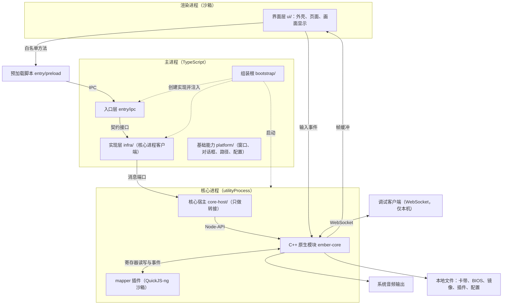
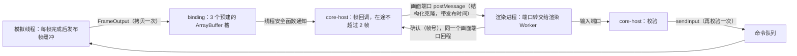

# 软件架构设计

Ember 的整体架构：设计决策、进程划分、TypeScript 与 C++ 的分工、目录分层、依赖规则、通信方式。硬件结构见 [02-硬件模块.md](02-硬件模块.md)，mapper 插件见 [03-mapper插件规范.md](03-mapper插件规范.md)，调试服务见 [04-调试服务.md](04-调试服务.md)，界面见 [05-界面.md](05-界面.md)。

Ember 与旧版 VirtuaNES 没有关系，是全新的项目：不沿用旧版的代码结构，只参考旧版的模拟逻辑。项目的结构与做法参照如见客户端（rujian-client）的开发规则。

状态说明：“已定”为用户已决定；“拟定”为设计提议，待用户审阅；“待定”为实现前须向用户确认。

## 1. 设计决策

| 决策项 | 结论 | 状态 |
| --- | --- | --- |
| 定位 | 面向 FC 爱好者与开发者，主要用户是学习机重度爱好者；用于引流 | 已定 |
| 目标机型 | 经典 FC（`fc`），以及学习机整机的四个型号：小霸王 97（`sb97`）、小霸王 2000（`sb2000`）、步步高 1.0（`bbk10`）、步步高 2.0（`bbk20`）；四个整机型号的映射结构各不相同，是四个独立的主机型号；先做 `fc`，再做 `sb2000`，其余以后做，见 02 第 6.6 节 | 已定 |
| 开放的运行环境 | 模拟器提供硬件、运行环境与主机型号（含学习机整机的译码与胶合逻辑）；不含任何具体卡带的规则，卡带的规则全部在 mapper 插件里 | 已定 |
| 真机对齐 | 按真机的结构运行：主机、卡槽、卡带分开；卡带由存储芯片和 mapper 芯片组成，插入卡槽后接入主机总线；学习机整机的 BIOS 是主机自带的 ROM，不经卡槽；不为了方便偏离真机，见 02 | 已定 |
| mapper | 只描述卡带（含学习卡）；以插件安装，不内置在程序里；清单声明卡带的存储区、窗口、寄存器与状态，脚本实现 mapper 芯片的行为；更新 mapper 只需更新插件，见 03 | 已定 |
| 启动入口 | “文件→选择机型”只选机型，不开机；已选 `sb2000` 等整机机型时用已设置的 BIOS 开机，没有 BIOS 时置灰并提示去首选项的“机型与 BIOS”添加；已选经典 FC 时用“文件→打开卡带”选 NES 文件，按 mapper 号和变体匹配插件，没有对应插件的文件无法运行，选后直接开机；“打开卡带”按卡带清单的 `host` 自动装配主机（目前只有 fc），不会把 NES 文件识别成整机，见 02、05 | 已定 |
| 硬件模块 | CPU、PPU、声音、功能模块（DMA、定时器、软驱控制器、并口、键盘接口等）与外部设备（软驱驱动器、磁带机、键盘、手柄、鼠标、打印机）都是独立模块，一个型号一个模块，功能模块各机型共用一份，模块之间互不依赖，见 02 | 已定 |
| 主机型号 | 主机型号是固定硬件的组合；学习机的整机逻辑（地址译码表、胶合逻辑、主板存储、BIOS）都在各自的主机型号里；卡带 mapper 的清单按名字选择主机型号（目前只有 `fc`），不能修改芯片内部与主板上的固定资源，见 02 | 已定 |
| 存储 | 按位置分三档：芯片内、主板上的（含学习机整机的存储与 BIOS）写死在模块与主机型号里；卡带上的由 mapper 清单声明，见 02 | 已定 |
| 调试 | 可开关的调试服务（WebSocket 加 JSON-RPC 2.0，只监听本机，令牌必须）；模拟器全部功能的接口都向外开放；界面不做调试窗口，见 04 | 已定 |
| 应用形态 | Electron 桌面应用，单机运行 | 拟定 |
| 支持平台 | Windows 10 及以上 x64；macOS arm64；先在 Windows 上开发与调试，macOS 的编译与打包脚本同时写齐，不在 Windows 上测试 | 拟定 |
| 外壳与核心 | 外壳与界面用 TypeScript、React 和 rujian-ui-kit；核心用 C++20，编译为 Node-API 原生模块，在独立的核心进程中运行 | 拟定 |
| 构建 | Electron Forge、Vite、CMake、cmake-js，同如见 | 拟定 |
| 画面、声音、输入 | 声音由核心直接输出到系统，画面经消息端口交给界面绘制，输入由界面采集后交给核心，见第 7 节 | 拟定 |
| 许可证 | GPLv3；不声明旧版 VirtuaNES 的来源；使用的其他第三方开源代码在“关于”对话框列出清单 | 已定 |
| 代码规范 | 遵循 copilot-plugins 插件的规则，本项目特有约定写在本文档与 `.github/copilot-instructions.md` | 已定 |
| 测试框架 | TypeScript 部分用 Vitest；C++ 部分用 GoogleTest | 拟定 |
| 项目位置 | `famiclone/ember/`，与旧版 `famiclone/virtuanes/` 并列 | 已定 |

## 2. 进程与运行结构



| 进程 | 职责 | 不做的事 |
| --- | --- | --- |
| 渲染进程 | 外壳与页面的显示和交互，画面显示，采集键盘、手柄、鼠标 | 不访问 Node、文件系统和 IPC 原始接口 |
| 主进程 | 窗口、菜单、对话框、系统集成；校验渲染进程的请求并转给核心进程；启动与监控核心进程；建立画面与输入的消息端口 | 不写业务逻辑，不转发每一帧画面 |
| 核心进程 | 加载 C++ 原生模块，转接请求、响应与事件 | 不写业务逻辑 |
| C++ 原生模块 | 全部模拟与业务逻辑、数据读写、声音输出、调试服务 | 不依赖 Electron 与界面 |
| mapper 插件 | 在沙箱中实现 mapper 芯片的行为 | 不直接访问文件、网络与进程，一切经宿主对象 |

- 核心放在独立进程的原因：C++ 崩溃或长时间计算不会拖垮主进程和界面；主进程检测到核心进程退出后提示用户并重新启动它。
- 调试服务在 C++ 核心里直接监听本机端口（WebSocket，网络与协议在 `platform/network/` 自己实现，不依赖第三方网络库），不经主进程与渲染进程，所以界面卡住或关闭时调试仍可用。
- 渲染进程开启 `contextIsolation`、`sandbox`，关闭 `nodeIntegration`；预加载脚本只暴露按模块登记的白名单方法。
- 窗口与对话框的约定同如见（见如见的架构设计文档第 2 节）。
- 主窗口隐藏系统标题栏，标题栏由界面用组件库绘制：Windows 保留系统绘制的窗口按钮（Electron 的 `titleBarOverlay`，高度与颜色按主题同步，系统主题变化时立即更新），macOS 保留红绿灯；窗口每次启动都是最小尺寸 480x463（大小不记忆，只记位置）：宽度保证标题栏的图标、名称、菜单不被挤压并留出拖动空白，高度让最小窗口下画面框四周的间距一致。面板向内展开，窗口大小不变，显示区里的画面按剩余空间等比缩放。界面能发起的窗口动作只有白名单里的 `minimize`、`toggleMaximize`、`toggleFullScreen`、`close`、`quit`（`shell.windowAction`），主进程先检查发送方是应用自己的页面，再检查动作名在白名单里，其余一律丢弃；窗口关闭、退出应用仍走“全部窗口关闭 → 保存界面状态 → 停止核心进程 → 退出”的流程，渲染进程的 `contextIsolation`、`sandbox` 与关闭 `nodeIntegration` 不变。

## 3. TypeScript 与 C++ 的分工

| 部分 | 语言 | 内容 |
| --- | --- | --- |
| 外壳与页面 | TypeScript + React | 窗口外框、标题栏、显示区、底部面板、系统栏、通知、对话框、画面显示 |
| 主进程 | TypeScript | 入口校验、核心进程客户端、窗口与系统能力、组装根 |
| 核心宿主 | TypeScript | 在核心进程中加载原生模块，转接消息，不含业务判断 |
| 核心 | C++ | 硬件模块、卡槽与卡带、mapper 插件宿主、机型与 BIOS、介质、输入映射、调试服务、本地数据 |

- 判断一段代码放在哪里：与界面显示和系统窗口无关的判断、模拟、数据读写，一律放 C++。
- mapper 脚本是插件的一部分，不属于程序代码，在核心的沙箱里运行。

## 4. 目录结构

```text
ember/
  schema/<模块>.schema.json     请求、事件与数据类型的唯一定义，生成 TypeScript 与 C++ 代码
  src/                         TypeScript：外壳、主进程、核心宿主
    contracts/<模块>/           契约层：由 Schema 生成的请求与事件类型、只在界面使用的类型
    contracts/core-gateway/    核心网关接口、主进程与核心进程之间的消息、通用错误码
    contracts/shell/           外壳的 IPC 通道、外壳服务接口（含文件选择窗口、界面状态服务、窗口控制）与 window.ember 的类型
    contracts/stream-ports/    画面与输入消息端口的消息格式与抽象
    entry/
      ipc/core/                全部模块共用的请求处理：检查发送方，按 Schema 校验参数后委派给核心网关；主进程自己处理的请求（mainRequests）的统一入口
      ipc/shell/               外壳能力的 IPC 处理：读取界面状态、保存布局修改、窗口动作（白名单）、窗口状态
      ipc/streams/             画面与输入端口的请求入口
      ipc/<模块>/           模块由主进程自己处理的请求（如 cartridges.open 的系统对话框）
      preload/                 预加载脚本：按请求名暴露具名方法
    infra/core-client/         核心网关的实现：经消息端口与核心进程通信
    infra/stream-ports/        画面与输入的消息端口：端口集线器
    infra/shell-state/         界面状态服务：从本地文件读出并校验、修改后防抖写盘
    infra/recent-cartridges/   最近打开的卡带服务：从本地文件读出并校验、编号与显示名、修改后防抖写盘
    ui/shell/                  外壳：布局组装、登记表、标签、命令与快捷键、消息表
    ui/<模块>/                 各模块的页面
    platform/                  窗口（无系统标题栏、窗口动作、位置恢复）、对话框（文件选择）、核心进程、消息端口的 Electron 实现、启动参数、本地日志、本地 JSON 文件存储
    shared/                    共用的类型与纯规则（含界面状态的类型与校验 shared/shell-state、最近打开清单的规则 shared/recent-cartridges）
    core-host/                 核心进程入口：加载原生模块，转接消息
    bootstrap/                 组装根：main 与 renderer 各一套，按模块清单登记
  core/                        C++ 核心
    CMakeLists.txt
    third_party/               第三方库源码，每个目录有 third-party.json
    src/
      contracts/hardware/      硬件契约：总线、中断线、时钟、CPU、PPU、设备、存储区、端口、卡槽
      contracts/<模块>/        业务模块的契约
      logic/hardware/<模块>/   硬件模块：每个型号一个目录，如 cpu-6502、ppu-um6576
      logic/<模块>/            业务模块的逻辑
      infra/mappers/           mapper 插件的沙箱、插件包读取、清单解析
      infra/<模块>/            文件读写、介质读写等外部能力
      requests/<模块>/         把请求名映射到服务方法
      platform/                请求路由、线程、调试服务的网络（TCP 与 WebSocket）、文件、日志、音频输出
      shared/                  共用的类型与纯规则
      bootstrap/               组装根：按主机型号装配硬件，按模块清单登记
        machines/<主机型号>.cpp  主机型号的装配
        modules/<模块>.cpp
      binding/                 Node-API 绑定
    test/
  plugins/                     官方 mapper 插件的源码，一个插件一个目录，如 nrom
  sdk/                         mapper 插件的 SDK：声明文件、假宿主、打包工具
  resources/                   应用图标 icon.ico（与 src/ui/shell/ember-logo.png 都由 tools/build/make-icons.cjs 生成）
  tools/                       Schema 代码生成、依赖检查、第三方清单生成、插件打包、图标生成
  test/                        跨层测试与界面测试
  docs/                        开发文档与界面原型
```

- 模块目录名在 `schema`、`src` 的 `contracts`、`entry/ipc`、`ui` 与 `core` 的各层中保持一致。
- 业务模块（有请求、事件的功能）清单（拟定）：

| 模块 | 职责 |
| --- | --- |
| `system` | 应用与核心版本 |
| `preferences` | 设置项的登记、校验、保存（`config/preferences.json`）与变化通知，已实现，见 04 第 4.8 节 |
| `runtime` | 机器的运行：电源、复位、暂停、速度、运行状态 |
| `cartridges` | 打开 NES 文件（只走卡带路线，主机按插件的 `host` 装配）、解析文件头、匹配插件 |
| `mappers` | mapper 插件的安装、卸载、预装、热重载 |
| `machines` | 机型清单（`fc` 与四个整机机型）、整机机型 BIOS 的添加与移除、开机所需的信息，已实现，见 04 第 4.7 节 |
| `media` | 软驱与打印机（已实现，见 04 第 4.3 节）：软驱盘片的插拔、保存、写保护、故障注入，打印机的输出与状态；磁带的录放、软盘里文件的查看与管理以后再做（见待办备忘） |
| `input` | 手柄绑定（键盘与实体手柄）、手柄输入路由、鼠标捕获 |
| `output` | 画面显示与声音输出的设置 |
| `inspector` | 调试专用：读写内存与寄存器、断点、跟踪、状态快照，只经调试服务开放 |
| `debug` | 调试服务本身：握手、事件订阅、状态查询、接口发现；开关、端口、令牌是首选项里的设置项，已实现，见 04 |
| `logs` | 运行消息日志 |

- 硬件不是业务模块，没有请求；它们由 `runtime`、`media`、`input` 等业务模块经契约使用，装配见 02。

## 5. 依赖规则

TypeScript 部分与如见相同：

| 层 | 可以依赖 | 不可依赖 |
| --- | --- | --- |
| `contracts` | `contracts`、`shared` | 其他任何层与 `electron` |
| `entry` | `contracts`、`shared`、`electron` | `infra` 的具体类、`ui` |
| `infra` | `contracts`、`shared`、`platform` | `entry`、`ui`、`bootstrap` |
| `ui` | `contracts` 中的类型、预加载脚本暴露的方法、React、`@rujianjs/ui-kit` | `entry`、`infra`、`platform`、Node 与 `electron` |
| `platform` | `platform`、第三方库、`electron` | 其他任何层 |
| `shared` | `shared` | 其他任何层 |
| `core-host` | `contracts`、`shared`、原生模块 | `entry`、`infra`、`ui`、`platform` |
| `bootstrap` | 全部 | 不写业务判断 |

C++ 部分：

| 层 | 可以依赖 | 不可依赖 |
| --- | --- | --- |
| `contracts` | `contracts`、`shared` | 其他任何层与第三方库 |
| `logic` | `contracts`、`shared`、`platform` 的抽象 | `infra`、`requests`、`binding`、`bootstrap`、`platform` 的实现、第三方库 |
| `infra` | `contracts`、`shared`、`platform`、第三方库 | `logic`、`requests`、`binding`、`bootstrap` |
| `requests` | `contracts`、`shared`、`platform` 的请求路由 | `logic`、`infra` 的具体类 |
| `platform` | `platform`、`shared`、第三方库 | 其他任何层 |
| `shared` | `shared`、标准库 | 其他任何层 |
| `binding` | `bootstrap/core.hpp`、`shared`、node-addon-api | 其他任何层 |
| `bootstrap` | 全部 | 不写业务判断 |

- 硬件模块（`logic/hardware/<模块>/`）之间不互相引用，只经 `contracts/hardware/` 的抽象；同一型号的模块（如 `cpu-um6576`）也不引用同族的其他模块。硬件模块只能包含 `contracts/hardware`、`shared` 与 `platform` 的抽象；`contracts/hardware` 只能包含标准库、自己与 `shared`，不引用 `logic` 与第三方库。
- 抽象用纯虚类，依赖通过构造函数注入，不用全局单例；硬件的实例只在 `bootstrap/machines/` 里创建并连线。
- `logic` 只能包含 `platform` 的五个抽象头文件：`platform/events/event-sink.hpp`、`platform/requests/cancellation.hpp`、`platform/logging/error-log.hpp`、`platform/streams/frame-output.hpp`（帧输出）、`platform/audio/audio-output.hpp`（声音输出）；硬件模块只能包含前两个（声音经 `Machine::takeAudio` 由运行服务取走）。
- TypeScript 一侧的 `platform` 不引用 `contracts`，它的 Electron 实现（消息端口、文件选择窗口）用自己声明的结构类型，与 `contracts` 里的接口按结构一致，由组装根注入给 `infra` 与 `entry`。
- 渲染 Worker（`ui` 层里以 `-worker.ts` 结尾的入口，目前是 `ui/runtime/render-worker.ts`）与 `ui` 层同属渲染侧：不能引用 `electron` 与 Node 内置模块（`ui` 层的规则），入口与它依赖的全部文件还不能引用 React、组件库、`.tsx` 与样式文件，只能放在 `ui` 层；这条由依赖检查负责。
- 依赖检查沿用如见的做法（自写脚本，检查 `import`、`#include` 与 Schema 的 `$ref`），并增加对硬件模块之间的检查。

## 6. 消息约定

渲染进程、主进程、核心进程与调试服务使用同一套请求和事件，只在各模块的 `schema/<模块>.schema.json` 中定义一次，两侧代码由脚本生成。

| 消息 | 内容 |
| --- | --- |
| 请求 | 请求标识、请求名 `<模块>.<操作>`、参数 |
| 响应 | 请求标识；成功时为结果，失败时为错误码与面向用户的说明 |
| 事件 | 事件名 `<模块>.<事件>`、数据 |

- 请求在 Schema 中可标记使用范围：默认界面与调试服务都能用；`debugOnly` 只经调试服务开放，界面的预加载脚本不暴露；`mainOnly` 只能由主进程发起（如参数带磁盘路径的请求），同如见。
- 主进程自己处理、不进入核心的请求写在 Schema 的 `mainRequests` 里（只生成 TypeScript），由预加载脚本按 `window.ember.main.<模块>.<操作>` 暴露，经统一的主进程请求 IPC（`entry/ipc/core/main-request-ipc.ts`）检查发送方、只接受已登记模块与已登记处理函数的请求名、按 Schema 校验参数，再交给模块在组装根登记的处理函数（模块登记项 `MainModule.createMainHandlers`）。例：`cartridges.open` 弹出系统文件选择窗口，把用户选定的路径以主进程的身份交给核心的 `cartridges.load`（渲染进程不能传任意路径）；`cartridges.recent` 与 `cartridges.openRecent` 给界面“最近打开”的清单（只有编号与显示名）并按编号重新打开，路径只在主进程里；`mappers.openPackage` 弹出文件选择窗口，把选定的 `.emap` 插件包交给 `mappers.install`；`system.openLogDirectory` 用系统的文件管理器打开日志目录，路径由主进程决定。核心运行状态（启动中、就绪、不可用，核心进程重启时依次变化）由主进程经 `core:status-changed` 通道推给页面（预加载脚本的 `onCoreStatusChange`），页面据此在核心重启后重新读取机器状态。
- 主进程还可以在启动时按命令行参数 `--cartridge=路径`（只接受 `.nes`）直接以主进程的身份加载一张卡带，用于冒烟测试和以后的文件关联。
- 调试服务收到的 JSON-RPC 请求按同一份 Schema 校验后交给核心的请求路由，所以界面能做的操作，调试服务都能做，没有第二套接口。
- 每个请求名只登记一次，由所属模块登记；未登记的请求直接拒绝。
- 画面与输入不走请求，用单独的消息端口，见第 7 节。
- 大文件（卡带、磁盘镜像）不经消息传递，消息里传用户选定文件的路径，由核心读取。

## 7. 画面、声音与输入

| 通道 | 做法 |
| --- | --- |
| 画面 | 核心每帧把完成颜色转换的帧缓冲（经典 FC 为 256x240，每像素 4 字节、内存顺序 R、G、B、A，可直接上传为 RGBA8 纹理，见 02 第 6.1 节），经主进程在页面请求时建立的消息端口交给渲染进程（实现见下）；渲染进程在 Worker 里用 WebGL（`OffscreenCanvas`）显示，每帧上传纹理，缩放、比例、滤镜在着色器里做；帧缓冲只含 PPU 输出。渲染进程每处理完一帧回发确认，核心宿主据此限制在途帧数（背压）。做界面前先测了 60 帧每秒的延迟与丢帧（阶段 3b，结果见本节“延迟与丢帧测量”），WebGL 加 Worker 的方案满足要求，不再考虑别的显示方式 |
| 声音 | 核心把混好的采样写入环形缓冲，由系统音频输出的回调取走；不经界面，延迟只取决于缓冲大小；界面只通过请求改音量与静音；实现与同步策略见下 |
| 输入 | 渲染进程采集键盘（物理键位）、鼠标与游戏手柄，转成原始事件，经消息端口交给核心；界面不做键位映射。核心在模拟线程里先把事件交给输入钩子（`input` 模块的手柄输入路由器）：游戏手柄的事件全部由它按“手柄绑定”（全局一份，两个玩家各有键盘的 10 个键与可选的一个实体手柄，见 04 第 4.4 节与 05 第 4.6 节）换算成手柄口的按键；键盘按键只在主机的键盘不用作机器输入时（红白机一直如此，学习机在红白机兼容模式下）才按绑定当手柄用，学习机在 DOS 下键盘整个交给机器；没有被钩子截下的键盘、鼠标事件交给主机，卡带的 mapper 脚本经 `onKey`、`onMouse` 处理（03 第 6 节），整机机型的键盘经键盘模块（02）。手柄 10 个键：A、B、选择、开始、上、下、左、右，加连发 A、连发 B（连发由钩子按帧翻转，机器只收到普通的 8 位掩码）；程序里的默认只有玩家 1 的键盘键位，没有默认的实体手柄 |
| 鼠标 | 画面区里的指针位置（换算成标准帧 256x240 的坐标）、位移、按键与滚轮作为鼠标事件交给核心，由 mapper 脚本的 `onMouse` 处理；点击画面捕获鼠标（指针锁定）与退出捕获的方式见 05，已实现 |

- 画面是否保持原始比例、是否整数缩放等只影响显示，不影响核心。
- 速度控制（快进、慢放、最快播放声音）由核心的时钟控制，不由界面决定。

画面与输入通道的实现（核心一侧在阶段 2b-2，界面的 WebGL 显示与键盘采集、背压与测量在阶段 3b）：



| 环节 | 做法 |
| --- | --- |
| 帧输出 | `platform/streams/frame-output.hpp` 的 `FrameOutput`（纯虚类）：模拟线程每完成一帧调用 `publish`，像素只在调用期间有效，实现不能阻塞；核心入口 `Core::setFrameHandler` 把它转给 binding |
| binding | Electron 不允许外部 ArrayBuffer，所以在 JavaScript 线程上预建 3 个大小与帧相同的 ArrayBuffer（初始 256x240x4 字节，画面尺寸变化时自动重建）；模拟线程把帧直接拷贝到空闲的槽里（唯一的一次拷贝，不为每帧分配大对象），经线程安全函数通知 JavaScript 线程调用回调 `(pixels, width, height, frame)`；回调返回后槽释放，没有空闲槽时丢弃这一帧，模拟线程不等待 |
| core-host | 帧回调里把 `FrameMessage`（`type: 'frame'`、`width`、`height`、`format: 'rgba8'`、`frame`、`publishedAt`、`hostDropped`、`pixels`，定义在 `src/contracts/stream-ports/stream-messages.ts`）经画面端口发出；`publishedAt` 是发出时的 `Date.now()`（毫秒，用来测量延迟），`hostDropped` 是本组端口上因背压累计丢弃的帧数；Electron 的 `MessagePortMain` 只能转移端口、不能转移 ArrayBuffer，`postMessage` 在调用时就复制像素，所以槽在回调返回后可以直接复用（这是边界上的第二次复制，避不开）；输入端口收到的输入消息（`type` 为 `key`、`mouse` 或 `gamepad`，字段与范围见 `stream-messages.ts`）按格式校验，不合格的丢弃，合格的调用原生模块的 `sendInput`（binding 只把对象转成 JSON 文本，核心在 `bootstrap/input-message.cpp` 里再校验一次），经命令队列在模拟线程里先交给输入钩子（手柄绑定，见上表“输入”一行），钩子没有截下的再交给主机，主机转给卡带的 mapper 脚本；画面端口收到的确认（`type: 'ack'`、`frame`）同样校验后释放一个在途名额 |
| 主进程 | `infra/stream-ports` 的端口集线器：页面调用 `window.ember.streams.requestPorts()` 后，用 `MessageChannelMain` 建立两条通道（画面、输入），一端随 `streams` 消息转移给核心进程，另一端经 `webContents.postMessage` 交给请求的窗口；只有应用自己的页面、主窗口、主框架的请求才会得到端口。页面重载后再次请求得到新的端口；核心进程重启（旧端口随进程失效）时，网关通知集线器，自动给当前窗口新的端口，页面会再次收到端口消息；核心进程不在运行时只记住窗口，等核心启动后再建立 |
| 预加载脚本 | `window.ember.streams.requestPorts()`（发 IPC 请求）；收到主进程发来的端口时检查标记与端口数量，再用 `window.postMessage({ type: 'ember.stream-ports' }, 源, [画面端口, 输入端口])` 交给页面（上下文隔离下 contextBridge 传不了端口）；页面先监听 `message` 事件、检查 `event.source` 是自己的窗口再调用 `requestPorts()`，收到端口数组 `[画面端口, 输入端口]`；不暴露 `ipcRenderer` |

- 背压（阶段 3b）：核心宿主记下已发出、还没收到确认的帧号，在途超过 `MAX_FRAMES_IN_FLIGHT`（2）时丢弃新帧并计入 `hostDropped`，所以渲染进程卡住时端口队列里最多积压两帧；确认按帧号释放名额，重复、乱序、没发过的确认忽略，格式不对的丢弃；换端口时在途数与丢弃数清零，旧端口迟到的确认不影响新端口。渲染 Worker 对每一帧恰好确认一次：画出后确认，被更新的帧顶掉时确认，格式不符但能读出帧号时也确认，这样名额不会被占住。

渲染进程的画面与输入（阶段 3b，代码在 `src/ui/runtime/`）：

| 环节 | 做法 |
| --- | --- |
| 页面与端口 | 运行页（`RuntimePage`）里的画面组件（`RuntimeScreen`）先监听窗口消息、检查来源是自己的窗口，再调用 `requestPorts()`；收到 `[画面端口, 输入端口]` 后把画面端口转移给渲染 Worker，输入端口留在页面里发输入事件；再次收到端口（核心进程重启、页面重复请求）时旧输入端口关闭，Worker 换用新画面端口 |
| 渲染 Worker | `render-worker.ts`（`new Worker(new URL(...), { type: 'module' })`，开发与打包都由 Vite 处理）：画布由组件在效果里创建，经 `transferControlToOffscreen()` 交给 Worker（严格模式会重复执行效果，所以不能复用同一个画布）；Worker 与界面层同属渲染侧，不访问 Node 与 Electron，也不引用 React 与组件库，这条由 `npm run boundaries` 检查；主线程发来的消息按类型与字段校验，不合格的丢弃 |
| 收帧 | 画面端口的接收端在 Worker 里，主线程不参与每一帧；每条消息按格式校验（类型、帧号、尺寸 1 到 4096、像素格式 `rgba8`、发布时间、丢弃数、像素是 `ArrayBuffer` 且字节数等于宽乘高乘 4），不符的丢弃并计数，不抛异常；合格的帧放进“只保留最新一帧”的待画槽，新帧顶掉还没画的旧帧（计入丢弃，并立即确认旧帧） |
| 绘制 | Worker 里的 `requestAnimationFrame` 驱动：每次触发时画待画槽里的最新一帧，来得及就画、来不及就丢旧帧；没有新帧但版面变了就重画上一帧；WebGL 用一张 RGBA8 纹理，尺寸变化时重新分配，之后每帧 `texSubImage2D` 更新，着色器做缩放，最近邻采样，画面之外清成黑底；画完后回发确认（帧号）；WebGL 上下文丢失时暂停绘制，恢复后重建资源 |
| 版面 | 画布跟随容器的设备像素尺寸（`ResizeObserver` 的设备像素内容框，没有时按设备像素比换算），设备像素比变化时重新量；画面比例两种：`4:3` 是整帧的显示宽高比为 4:3，`8:7` 是像素宽高比 8:7（整帧显示宽高比约 1.219）；缩放方式两种：`fit` 适应窗口（尽量放大并居中），`integer` 整数倍（画面高度取帧高度的整数倍，宽度随比例，放不下就取最大的整数倍，一倍也放不下时退回适应窗口，整数倍按设备像素算）；四个取值是组件的属性，默认 `8:7` 与 `fit`，运行页取自首选项（`use-display-settings.ts`，改后立即生效），并有第三个属性 `showAllLines`（默认 `true`；`false` 时上下各裁掉 8 行，版面消息带 `cropLines`，着色器按比例裁剪纹理坐标，版面与鼠标坐标按裁剪后的 256x224 计算）；运行页在页面区里放一个按标准帧（256x240）显示比例（默认 128:105）居中缩放的画面框，黑底只在框里，渲染 Worker 在收到版面消息、画布尺寸改变后立即用上一帧重画 |
| 键盘 | 画面区可聚焦（`tabIndex`），页面显示时自动聚焦，只在它获得焦点时采集 `KeyboardEvent.code`，每次按下与松开原样上报 `{ type: 'key', code, down }`，界面不做键位映射，由核心按手柄绑定处理（`key-capture.ts`）；重复的 keydown 不重复发送；没有键盘独占时，F1 到 F24、Tab、Escape 与带 Ctrl、Alt、Meta 的组合键不上报，留给应用的快捷键与焦点移动（键盘独占时全部上报，见下一行）；上报的键阻止默认行为（Enter、空格、方向键不会触发页面上的按钮与滚动）；画面区失焦、窗口失焦、页面隐藏、卸载时对按着的键各发一次松开；焦点在输入框、文字区、下拉框等可编辑元素上时不采集（已按着的键仍能松开） |
| 键盘独占 | Windows 上画面区获得焦点（且窗口在前台）时，界面请主进程独占键盘：主进程加载原生模块 `ember_keyboard.node`（`core/src/binding/keyboard-capture-win.cpp`，只依赖 Windows 与 Node-API，与核心模块分开），向系统登记键盘的原始输入（`RIDEV_NOLEGACY`，目标是主窗口）并子类化主窗口接收 `WM_INPUT`；登记后本进程不再产生传统的键盘消息，页面（含 Chromium 对指针锁定中 Esc 的处理）收不到任何按键，所以 Esc、Tab、F 键与 Ctrl、Alt 组合都只交给机器；不使用全局键盘钩子，也不接收窗口不在前台时的按键。主进程把扫描码转成键位名（`platform/keyboard-capture`，E0 前缀区分左右与数字键盘，数字键盘的“假 Shift”与 Pause 丢弃），经 IPC（`shell:native-key`）发给页面，页面交给 `KeyboardCapture.nativeKey`，再走上面同一个输入端口，不保留任何键。独占在画面区失去焦点、窗口失去焦点、隐藏、最小化、关闭、页面重新加载时关闭（主进程用 `shell:keyboard-released` 通知页面，页面松开全部按键）；独占期间应用里所有窗口（含对话框）都收不到键盘，所以只在画面区真正持有焦点时开启。Win 键、Ctrl+Alt+Del、Alt+Tab 仍由系统处理，窗口随之失去激活。不是 Windows 或原生模块加载失败时 `shell.setKeyboardCapture` 返回 `false`，界面继续使用页面内的键盘事件；macOS 的实现见待办备忘 |
| 鼠标 | 画面区上的指针事件（移动、按下、松开、滚轮、离开）转成 `{ type: 'mouse', kind, x, y, dx, dy, buttons, wheel }`（`pointer-capture.ts`）：`x`、`y` 是指针在标准帧（256x240）上的坐标，按画面在画布里的实际矩形换算，不受画面比例、缩放方式、“显示全部 240 行”与窗口大小影响（裁剪时坐标仍是整帧上的行号），指针在画面之外时可以超出 0 到 256、0 到 240；`dx`、`dy` 是相对上一次事件的位移；`buttons` 是按键位（1 左键、2 右键、4 中键）；`wheel` 向下为正，约一格为 1；按下时设置指针捕获，拖到画面外松开也能收到；画面区上的右键菜单被禁用；指针锁定（相对位移）已做，见 05 第 7 节；主进程的权限策略默认拒绝全部权限请求，只放行应用自己页面的 `pointerLock` |
| 游戏手柄 | 画面组件每个画面帧用 `navigator.getGamepads()` 读一次（`gamepad-capture.ts`），状态变化时上报 `{ type: 'gamepad', index, id, connected, buttons, axes }`（`id` 是设备标识 `Gamepad.id`，不超过 256 个字符，核心的手柄绑定按它认出是哪个手柄；整个手柄的当前状态，按键为布尔数组，轴取两位小数，顺序同浏览器的标准映射，最多 32 个按键、16 个轴）；手柄被拔掉时上报一次 `connected: false`，页面卸载时对已知的手柄上报断开 |
| 诊断 | 统计放在 Worker 内；开发期（`import.meta.env.DEV`）画面组件把 `window.emberRuntimeDiagnostics.read(reset)` 挂到页面上，经诊断消息读出，正式包没有这个入口；`tools/dev/smoke-run.mjs` 与 `tools/dev/latency-run.mjs` 经 CDP 使用它 |

延迟与丢帧测量（阶段 3b，`node tools/dev/latency-run.mjs`，运行 30 秒，预热 3 秒后开始统计）：

| 统计项 | 口径 |
| --- | --- |
| 核心帧率 | 帧号增量除以发布时间增量，目标 60.10 帧每秒 |
| 收到帧率、渲染帧率 | Worker 里收到、画出的帧数除以时间跨度 |
| 丢弃帧数 | Worker 内被新帧顶掉的、核心宿主背压丢弃的（`hostDropped`）、帧号缺口（核心一侧没送到的，含 binding 没有空槽的丢帧）、格式无效的 |
| 核心发布到收到 | 收到时的 `Date.now()` 减帧里的 `publishedAt`，跨进程，分辨率 1 毫秒 |
| 收到到画出 | Worker 里单调时钟的间隔，“画出”指 WebGL 绘制命令提交完成，不含合成器与显示器的延迟 |
| 画面节拍 | `requestAnimationFrame` 的触发率，近似显示器的刷新率，用来解释渲染帧率与丢帧 |

实测结果（开发版，Windows，Electron 45，nestest 在选单画面运行，画布 1899x920，设备像素比 1.5，显示器刷新约 120 Hz，两次各 30 秒）：

| 项 | 第一次 | 第二次 |
| --- | --- | --- |
| 核心帧率 / 收到帧率 / 渲染帧率（帧每秒） | 60.09 / 60.09 / 60.11 | 60.10 / 60.10 / 59.96 |
| 画面节拍（次每秒） | 未统计 | 119.8 |
| 收到 / 画出（帧） | 1809 / 1808 | 1804 / 1800 |
| Worker 丢弃 / 宿主背压丢弃 / 帧号缺口 / 无效（帧） | 0 / 0 / 0 / 0 | 4 / 0 / 0 / 0 |
| 核心发布到收到：平均 / p95 / 最大（毫秒） | 1.27 / 2.00 / 2.00 | 1.19 / 2.00 / 2.00 |
| 收到到画出：平均 / p95 / 最大（毫秒） | 4.08 / 7.70 / 8.50 | 4.06 / 7.70 / 8.70 |

- 结论：在这台 120 Hz 显示器的机器上，渲染帧率与核心帧率一致（第二次为核心帧率的 99.8%），满足 60 帧每秒；丢帧最多 0.22%（4 帧，都是 Worker 里两帧在同一个画面节拍之间到达、后到的顶掉先到的），核心宿主背压没有触发，帧号没有缺口；核心发布到画出的延迟 p95 约 9.7 毫秒（两段 p95 相加的保守估计，小于一帧的 16.6 毫秒），可以接受。
- 没有测到的：60 Hz 的显示器（本机是 120 Hz）；核心帧率 60.0988 略高于 60，在 60 Hz 的显示器上每约 10 秒会有一帧在同一个画面节拍里被后一帧顶掉（推算，没有实测）；按键到画面变化的端到端延迟（按键在帧边界执行，再加这里测到的显示延迟，最多约两帧，没有实测）；合成器与显示器的延迟；打包后的版本（只截图确认了画面，诊断入口只在开发版里）；机器负载高、渲染进程被拖慢时的表现（背压只有单元测试覆盖）。
- 如果 60 Hz 显示器上的周期性丢帧让人觉得不平滑，可选的改进：一、让渲染 Worker 测出显示刷新率并告诉核心，核心在 ±0.5% 内调整帧节拍，声音的重采样本来就按缓冲水位微调，能吸收这点差别（显示同步，同 RetroArch 的做法）；二、渲染端不丢旧帧，改为排队最多两帧，用一帧的延迟换取不丢帧；三、用 `desynchronized` 画布降低合成延迟（对丢帧没有帮助）。目前不需要改，等 60 Hz 显示器上实测后再定。

- 画面与输入的已知问题：核心进程重启后新核心里没有卡带，画面停在最后一帧，不过运行页会在收到核心运行状态变化（`onCoreStatusChange`，核心进入启动中、就绪）时清掉旧状态并在就绪后重新读取，运行面板、系统栏与画面提示随之刷新（阶段 3a-2 已处理，旧的开发期操作条已删除）。

声音通道的实现（阶段 2c，不经界面，也不经消息端口）：

| 环节 | 做法 |
| --- | --- |
| 生成与交接 | APU 按 CPU 周期生成混音电平，带限降采样为 48000 Hz 的单声道浮点 PCM（见 02 第 6.2 节）；运行服务每帧完成后用 `Machine::takeAudio` 取走，写入 `platform/audio/audio-output.hpp` 的 `AudioOutput`（纯虚类：写入、水位、音量与静音、播放状态、清空、统计） |
| 实现 | `MiniaudioOutput`（miniaudio 的系统输出，Windows 为 WASAPI，单声道 f32，设备周期 10 毫秒，低延迟档）与 `NullAudioOutput`（只计数，测试与降级用）；miniaudio 的头文件只在 `platform/audio/` 出现，它的实现文件 `core/third_party/miniaudio/miniaudio-impl.c` 单独编译，只编译播放设备部分，关闭警告 |
| 环形缓冲 | `SampleRingBuffer`：单生产者单消费者的无锁缓冲，8192 个采样（约 170 毫秒）；模拟线程写、音频回调线程读；写满时丢弃多出来的最新采样并计数，缓冲不足时回调补静音并计数（`AudioStats`）；回调里不加锁、不分配内存，设置（音量、播放状态、清空）经原子量传递，清空由回调一侧执行 |
| 同步策略 | 模拟线程仍按帧节拍休眠运行，声卡消耗采样的速度与模拟产生的速度有微小漂移，用缓冲水位校正：目标水位 1600 个采样（约 33 毫秒）；每次回调把水位做指数平滑，高于目标就读得略快、低于目标就略慢，重采样比限制在 ±0.5% 以内（约 ±8.6 音分，听不出音调变化），水位偏离目标 25% 时调到上限，其间线性，用线性插值重采样；缓冲大小可在首选项里选三档：低延迟（目标水位 800、预填充 600）、标准（1600、1200，默认）、稳定（3200、2400），改后下一次回调起采用；缓冲不足时先让最后一个采样衰减，攒够 1200 个采样的预填充后再继续播放，避免断断续续。真实声卡上跑 8 秒的观察：水位稳定在 900 到 1700 个采样之间，没有欠载与丢弃 |
| 暂停、断电、继续 | 运行服务按“运行中”设置播放状态：暂停、断电、取出卡带、出错时回调在 10 毫秒内淡出到静音（不留爆音），继续时先清空过时的采样，从静音淡入；上电、硬复位、软复位时清空缓冲 |
| 音量 | `output.setVolume`：音量 0 到 100（增益按平方曲线，50 约为 -12 dB）与静音，音量保存到首选项的 `sound.volume`（重启后保持；静音不保存，启动时由 `sound.startMuted` 决定），变化同样经 10 毫秒的淡入淡出；省略的参数保持不变 |
| 设备不可用 | 打开设备失败（没有声卡、被独占，或 miniaudio 只找到它自带的“空后端”）时，`output` 模块降级为 `NullAudioOutput`，向系统错误日志写一条 `output.deviceUnavailable`（模块 `output`，上下文里有原因），核心照常运行，只是没有声音；本阶段没有单独的警告事件 |
| 登记顺序 | `output` 模块排在 `runtime` 之前，运行模块取用它提供的声音输出；核心停止时设备随声音输出一起释放 |

## 8. 线程模型

| 线程 | 内容 |
| --- | --- |
| 模拟线程 | 推进时钟，运行 CPU、PPU 和各设备，生成画面与声音；是硬件状态的唯一拥有者 |
| 音频回调 | 系统音频输出的实时线程，只从环形缓冲读采样，不加锁、不分配内存 |
| 请求线程池 | 处理不碰硬件状态的请求（插件管理、卡带解析、首选项等）和文件读写 |
| 调试服务线程 | 一条监听线程接受连接；每条连接一个读线程（握手、解析、按到达顺序处理请求）和一个写线程（发送响应与事件，事件队列有上限）；不碰模拟线程，只经请求路由与命令队列与核心交互 |

- 访问硬件状态的请求（读写内存和寄存器、电源与复位、介质插拔、断点）不直接执行，投递到模拟线程的命令队列，由模拟线程在指令边界执行。所以模拟器自由运行时读写内存也是可靠的，不需要先暂停。
- 模拟线程的运行模式：`free` 按真实速度连续运行；`paused` 停止；`stepping` 由请求授权运行的帧数、周期数或指令数，用完后回到 `paused`，遇到断点提前停止。
- 慢操作（保存磁盘镜像、读取大文件）在请求线程池执行，不阻塞模拟线程。

运行服务的实现（阶段 2b-2，`logic/runtime/simulation-runtime.*`）：

- 模拟线程拥有主机与卡带（卡带先于主机销毁）；其他线程的电源、复位、暂停、继续、装入与取出卡带、按键都投递到命令队列，由模拟线程在**帧边界**执行（按遇到的先后顺序，不在一帧中间执行；指令边界的执行随调试阶段的读写内存请求实现），调用方等它执行完（按键不等）；状态查询读模拟线程发布的快照，不走队列。
- 本阶段只有 `free`（按 NTSC 约 60.0988 帧/秒连续运行）与 `paused`；帧节拍按绝对时间表休眠（休眠中收到命令会提前醒来，落后超过 5 帧就放弃追赶），不忙等；Windows 上由 `platform/time/timer-resolution.*` 把系统定时器精度提高到 1 毫秒。`stepping` 与速度调节以后再做。
- 每帧完成后：把帧缓冲交给帧输出，把这一帧生成的声音采样写进声音输出（暂停、断电、出错时让声音输出淡出，继续时清空过时的采样再淡入，上电与复位时清空缓冲，见第 7 节），更新状态快照，发 `runtime.frame`（间隔为 0 时不发，默认不发），检查卡带脚本是否出错（出错就暂停并发 `runtime.error`、状态变化原因 `error`）；硬件抛出的异常（如 CPU 长时间被 RDY 暂停）同样暂停并报告。
- 装入卡带先在模拟线程里装配好新主机与卡带，全部成功后才拆掉旧的，所以运行中换卡带失败时原来的主机继续运行；没有主机时设置的按键被记住，主机装入后生效。
- 停止：拒绝新命令、结束模拟线程、排队中的命令以 `core.unavailable` 完成（等待它们的请求线程不会死锁），再销毁卡带与主机。

## 9. 本地数据与文件

- 用户数据目录保存：本地配置（外壳状态 `config/shell-state.json`、首选项 `config/preferences.json`），以及调试服务运行时的端点文件 `run/debug-endpoint.json`（地址与令牌，服务停止时删除，见 04 第 2.5 节）、用户安装的 mapper 插件、整机机型的 BIOS、运行消息日志。预装的官方插件随安装包放在应用的资源目录，不放用户数据目录。
- 界面状态（窗口的位置、底部面板高度、已选机型与各面板的“自动收缩”开关，见 05 第 9 节；窗口大小与是否最大化不保存，每次启动都是最小尺寸、不恢复最大化，旧文件里的这两项读取时忽略；底部面板的展开状态与当前面板不保存，每次启动都是关闭）保存在用户数据目录的 `config/shell-state.json`，由主进程读写：启动时同步读出并逐项校验（文件不存在或损坏时用默认值，不报错，不弹窗；旧文件里的展开状态读取时忽略），修改后防抖约 0.5 秒写盘（先写临时文件再改名），退出前立即写盘；界面只经预加载脚本的 `shell.getState`、`shell.setLayout` 读取与修改（`setLayout` 目前有底部面板高度、已选机型 `selectedMachine` 与开着“自动收缩”的底部面板清单 `autoCollapsePanels`），主进程对收到的修改整条校验，含未知字段或值不合格的整条丢弃；窗口位置由主进程在窗口移动、改变大小、最大化、还原与关闭时自己记下（扣掉展开的面板占用的尺寸后保存），不经界面。最近打开的卡带（最多 10 个，只存卡带路径）单独保存在 `config/recent-cartridges.json`，由主进程读写，做法与损坏回退同界面状态（读不到或不合格时用空清单，不报错，不弹窗，防抖写盘，退出前立即写盘），渲染进程只能经 `cartridges.recent`、`cartridges.openRecent` 拿到编号与显示名，不接触路径。
- BIOS 目录（`<用户数据目录>/bios/`，已实现）：每个整机机型一个目录 `bios/<机型标识>/`，里面只有一个文件，沿用用户添加时的文件名；用户在首选项的“机型与 BIOS”里添加，文件复制进来，所以开机不依赖用户原文件是否还在；替换时先删旧文件，移除即删文件。`fc` 不需要 BIOS，没有目录。添加与移除由 `machines` 模块处理，见 04 第 4.7 节、05 第 4.5 节。
- 卡带、磁盘镜像、磁带文件是用户自己的文件，保存用户选定的路径，不复制进应用的数据目录；路径的使用只经核心的文件存储接口。BIOS 是例外，见上一条。
- 虚拟打印机输出的 PNG 保存到用户在首选项里设置的目录（没有设置时保存到用户数据目录下的 `printer-output`），文件名自动生成，不弹出保存窗口，见 02 第 6.5 节。
- 与如见不同：如见的业务数据按文件标识引用，不保存磁盘路径；模拟器的卡带和镜像是用户的外部文件，必须保存路径。
- 本地数据库与日志的做法沿用如见（SQLite，C++ 核心直接读写），具体表在实现时写进对应模块的文档。

## 10. 第三方依赖

| 库 | 用途 | 许可 | 状态 |
| --- | --- | --- | --- |
| QuickJS-ng | mapper 插件的沙箱 | MIT | 已定 |
| miniz | 读取插件包（zip）、编码打印机输出的 PNG | MIT | 已定 |
| nlohmann/json | JSON | MIT | 已定 |
| SQLite | 本地数据库 | 公有领域 | 已定 |
| miniaudio | 系统音频输出（单头文件） | MIT-0 或公有领域 | 已定 |
| FFmpeg | 声像磁带与磁带录音的音频解码、编码；沿用如见的精简编译版本，随应用附带 | LGPL-2.1-or-later | 已定 |
| GoogleTest | C++ 测试 | BSD-3-Clause | 已定 |

- 第三方源码放在 `core/third_party/`，随代码提交，编译时不联网；每个目录有 `third-party.json`，“关于”对话框的开源清单与许可全文由脚本生成，做法同如见。
- 旧版 VirtuaNES 的代码不进入本项目，不在清单里声明。
- 界面组件库 rujian-ui-kit（Apache-2.0）按如见的方式直接引用本机源码，位置待定，见 05。
