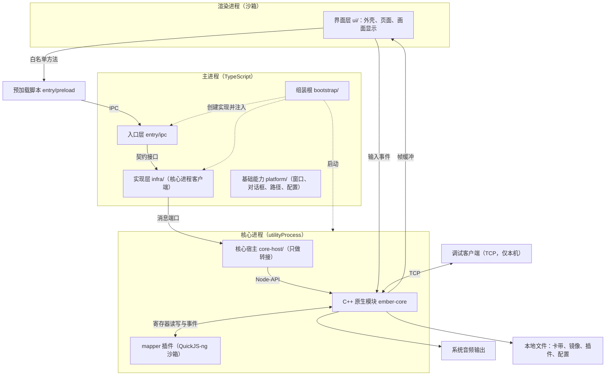

# 软件架构设计

Ember 的整体架构：设计决策、进程划分、TypeScript 与 C++ 的分工、目录分层、依赖规则、通信方式。硬件结构见 [02-硬件模块.md](02-硬件模块.md)，mapper 插件见 [03-mapper插件规范.md](03-mapper插件规范.md)，调试服务见 [04-调试服务.md](04-调试服务.md)，界面见 [05-界面.md](05-界面.md)。

Ember 与旧版 VirtuaNES 没有关系，是全新的项目：不沿用旧版的代码结构，只参考旧版的模拟逻辑。项目的结构与做法参照如见客户端（rujian-client）的开发规则。

状态说明：“已定”为用户已决定；“拟定”为设计提议，待用户审阅；“待定”为实现前须向用户确认。

## 1. 设计决策

| 决策项 | 结论 | 状态 |
| --- | --- | --- |
| 定位 | 面向 FC 爱好者与开发者，主要用户是学习机重度爱好者；用于引流 | 已定 |
| 目标机型 | 前期支持小霸王 SB97、SB2000、步步高软驱一号、步步高 98、裕兴，以及经典 FC；先做 SB2000 的 mapper | 已定 |
| 开放的运行环境 | 模拟器只提供硬件与运行环境，不含任何具体卡带与机型的规则；规则全部在 mapper 插件里 | 已定 |
| 真机对齐 | 按真机的结构运行：主机、卡槽、卡带分开；卡带由存储芯片和 mapper 芯片组成，插入卡槽后接入主机总线；不为了方便偏离真机，见 02 | 已定 |
| mapper | 以插件安装，不内置在程序里；清单声明卡带的元件与连线，脚本实现 mapper 芯片的行为；更新 mapper 只需更新插件，见 03 | 已定 |
| 启动入口 | 只有一个入口：加载 NES 文件，按 mapper 号和变体匹配插件；没有对应插件的文件无法运行；不单独做 BIOS 入口 | 已定 |
| 硬件模块 | CPU、PPU、声音、片上外设、软驱、磁带、键盘、手柄、鼠标等都是独立模块，一个型号一个模块，模块之间互不依赖，见 02 | 已定 |
| 主机型号 | 主机型号是固定硬件的组合，由 mapper 清单按名字选择；mapper 不能修改芯片内部与主板上的固定资源，见 02 | 已定 |
| 存储 | 按位置分三档：芯片内、主板上的写死在模块里；卡带上的由 mapper 清单声明，见 02 | 已定 |
| 调试 | 可开关的 TCP 调试服务，有状态的长连接；模拟器全部功能的接口都向外开放；界面不做调试窗口，见 04 | 已定 |
| 应用形态 | Electron 桌面应用，单机运行 | 拟定 |
| 支持平台 | Windows 10 及以上 x64；macOS arm64；先在 Windows 上开发与调试，macOS 的编译与打包脚本同时写齐，不在 Windows 上测试 | 拟定 |
| 外壳与核心 | 外壳与界面用 TypeScript、React 和 rujian-ui-kit；核心用 C++20，编译为 Node-API 原生模块，在独立的核心进程中运行 | 拟定 |
| 构建 | Electron Forge、Vite、CMake、cmake-js，同如见 | 拟定 |
| 画面、声音、输入 | 声音由核心直接输出到系统，画面经消息端口交给界面绘制，输入由界面采集后交给核心，见第 7 节 | 拟定 |
| 许可证 | GPLv3；不声明旧版 VirtuaNES 的来源；使用的其他第三方开源代码在“关于”对话框列出清单 | 已定 |
| 代码规范 | 遵循 copilot-plugins 插件的规则，本项目特有约定写在本文档与 `.github/copilot-instructions.md` | 已定 |
| 测试框架 | TypeScript 部分用 Vitest；C++ 部分用 GoogleTest | 拟定 |
| 项目位置 | `famiclone/ember/`，与旧版 `famiclone/virtuanes/` 并列 | 已定 |

## 2. 进程与运行结构



| 进程 | 职责 | 不做的事 |
| --- | --- | --- |
| 渲染进程 | 外壳与页面的显示和交互，画面显示，采集键盘、手柄、鼠标 | 不访问 Node、文件系统和 IPC 原始接口 |
| 主进程 | 窗口、菜单、对话框、系统集成；校验渲染进程的请求并转给核心进程；启动与监控核心进程；建立画面与输入的消息端口 | 不写业务逻辑，不转发每一帧画面 |
| 核心进程 | 加载 C++ 原生模块，转接请求、响应与事件 | 不写业务逻辑 |
| C++ 原生模块 | 全部模拟与业务逻辑、数据读写、声音输出、调试服务 | 不依赖 Electron 与界面 |
| mapper 插件 | 在沙箱中实现 mapper 芯片的行为 | 不直接访问文件、网络与进程，一切经宿主对象 |

- 核心放在独立进程的原因：C++ 崩溃或长时间计算不会拖垮主进程和界面；主进程检测到核心进程退出后提示用户并重新启动它。
- 调试服务在 C++ 核心里直接监听 TCP，不经主进程与渲染进程，所以界面卡住或关闭时调试仍可用。
- 渲染进程开启 `contextIsolation`、`sandbox`，关闭 `nodeIntegration`；预加载脚本只暴露按模块登记的白名单方法。
- 窗口与对话框的约定同如见（见如见的架构设计文档第 2 节）。

## 3. TypeScript 与 C++ 的分工

| 部分 | 语言 | 内容 |
| --- | --- | --- |
| 外壳与页面 | TypeScript + React | 窗口外框、标题栏、活动栏、边栏、标签页、通知、画面显示、各页面 |
| 主进程 | TypeScript | 入口校验、核心进程客户端、窗口与系统能力、组装根 |
| 核心宿主 | TypeScript | 在核心进程中加载原生模块，转接消息，不含业务判断 |
| 核心 | C++ | 硬件模块、卡槽与卡带、mapper 插件宿主、介质、输入映射、调试服务、本地数据 |

- 判断一段代码放在哪里：与界面显示和系统窗口无关的判断、模拟、数据读写，一律放 C++。
- mapper 脚本是插件的一部分，不属于程序代码，在核心的沙箱里运行。

## 4. 目录结构

```text
ember/
  schema/<模块>.schema.json     请求、事件与数据类型的唯一定义，生成 TypeScript 与 C++ 代码
  src/                         TypeScript：外壳、主进程、核心宿主
    contracts/<模块>/           契约层：由 Schema 生成的请求与事件类型、只在界面使用的类型
    contracts/core-gateway/    核心网关接口、主进程与核心进程之间的消息、通用错误码
    contracts/shell/           外壳的 IPC 通道、外壳服务接口（含文件选择窗口）与 window.ember 的类型
    contracts/stream-ports/    画面与输入消息端口的消息格式与抽象
    entry/
      ipc/core/                全部模块共用的请求处理：检查发送方，按 Schema 校验参数后委派给核心网关；主进程自己处理的请求（mainRequests）的统一入口
      ipc/shell/               外壳能力的 IPC 处理
      ipc/streams/             画面与输入端口的请求入口
      ipc/<模块>/           模块由主进程自己处理的请求（如 cartridges.open 的系统对话框）
      preload/                 预加载脚本：按请求名暴露具名方法
    infra/core-client/         核心网关的实现：经消息端口与核心进程通信
    infra/stream-ports/        画面与输入的消息端口：端口集线器
    ui/shell/                  外壳的布局组装
    ui/<模块>/                 各模块的页面
    platform/                  窗口、对话框（文件选择）、核心进程、消息端口的 Electron 实现、启动参数、本地日志
    shared/                    共用的类型与纯规则
    core-host/                 核心进程入口：加载原生模块，转接消息
    bootstrap/                 组装根：main 与 renderer 各一套，按模块清单登记
  core/                        C++ 核心
    CMakeLists.txt
    third_party/               第三方库源码，每个目录有 third-party.json
    src/
      contracts/hardware/      硬件契约：总线、中断线、时钟、CPU、PPU、设备、存储区、端口、卡槽
      contracts/<模块>/        业务模块的契约
      logic/hardware/<模块>/   硬件模块：每个型号一个目录，如 cpu-6502、ppu-um6576
      logic/<模块>/            业务模块的逻辑
      infra/mappers/           mapper 插件的沙箱、插件包读取、清单解析
      infra/<模块>/            文件读写、介质读写等外部能力
      requests/<模块>/         把请求名映射到服务方法
      platform/                请求路由、线程、调试服务的 TCP、文件、日志、音频输出
      shared/                  共用的类型与纯规则
      bootstrap/               组装根：按主机型号装配硬件，按模块清单登记
        machines/<主机型号>.cpp  主机型号的装配
        modules/<模块>.cpp
      binding/                 Node-API 绑定
    test/
  plugins/                     官方 mapper 插件的源码，一个机型一个目录，如 nrom、sb2000
  sdk/                         mapper 插件的 SDK：声明文件、假宿主、打包工具
  resources/                   应用图标
  tools/                       Schema 代码生成、依赖检查、第三方清单生成、插件打包
  test/                        跨层测试与界面测试
  docs/                        开发文档与界面原型
```

- 模块目录名在 `schema`、`src` 的 `contracts`、`entry/ipc`、`ui` 与 `core` 的各层中保持一致。
- 业务模块（有请求、事件的功能）清单（拟定）：

| 模块 | 职责 |
| --- | --- |
| `system` | 应用与核心版本 |
| `preferences` | 全局设置与各模块的默认值 |
| `runtime` | 机器的运行：电源、复位、暂停、速度、运行状态 |
| `cartridges` | 打开 NES 文件、解析文件头、匹配插件、卡带库 |
| `mappers` | mapper 插件的安装、卸载、预装、热重载 |
| `media` | 软驱、磁带与打印机：介质插拔、保存、录放，软盘里文件的查看与管理，打印机的输出与状态 |
| `input` | 输入设备与按键映射、鼠标捕获 |
| `output` | 画面显示与声音输出的设置 |
| `inspector` | 调试专用：读写内存与寄存器、断点、跟踪、状态快照，只经调试服务开放 |
| `debug` | 调试服务本身：开关、端口、令牌、连接状态 |
| `logs` | 运行消息日志 |

- 硬件不是业务模块，没有请求；它们由 `runtime`、`media`、`input` 等业务模块经契约使用，装配见 02。

## 5. 依赖规则

TypeScript 部分与如见相同：

| 层 | 可以依赖 | 不可依赖 |
| --- | --- | --- |
| `contracts` | `contracts`、`shared` | 其他任何层与 `electron` |
| `entry` | `contracts`、`shared`、`electron` | `infra` 的具体类、`ui` |
| `infra` | `contracts`、`shared`、`platform` | `entry`、`ui`、`bootstrap` |
| `ui` | `contracts` 中的类型、预加载脚本暴露的方法、React、`@rujianjs/ui-kit` | `entry`、`infra`、`platform`、Node 与 `electron` |
| `platform` | `platform`、第三方库、`electron` | 其他任何层 |
| `shared` | `shared` | 其他任何层 |
| `core-host` | `contracts`、`shared`、原生模块 | `entry`、`infra`、`ui`、`platform` |
| `bootstrap` | 全部 | 不写业务判断 |

C++ 部分：

| 层 | 可以依赖 | 不可依赖 |
| --- | --- | --- |
| `contracts` | `contracts`、`shared` | 其他任何层与第三方库 |
| `logic` | `contracts`、`shared`、`platform` 的抽象 | `infra`、`requests`、`binding`、`bootstrap`、`platform` 的实现、第三方库 |
| `infra` | `contracts`、`shared`、`platform`、第三方库 | `logic`、`requests`、`binding`、`bootstrap` |
| `requests` | `contracts`、`shared`、`platform` 的请求路由 | `logic`、`infra` 的具体类 |
| `platform` | `platform`、`shared`、第三方库 | 其他任何层 |
| `shared` | `shared`、标准库 | 其他任何层 |
| `binding` | `bootstrap/core.hpp`、`shared`、node-addon-api | 其他任何层 |
| `bootstrap` | 全部 | 不写业务判断 |

- 硬件模块（`logic/hardware/<模块>/`）之间不互相引用，只经 `contracts/hardware/` 的抽象；同一型号的模块（如 `cpu-um6576`）也不引用同族的其他模块。硬件模块只能包含 `contracts/hardware`、`shared` 与 `platform` 的抽象；`contracts/hardware` 只能包含标准库、自己与 `shared`，不引用 `logic` 与第三方库。
- 抽象用纯虚类，依赖通过构造函数注入，不用全局单例；硬件的实例只在 `bootstrap/machines/` 里创建并连线。
- `logic` 只能包含 `platform` 的五个抽象头文件：`platform/events/event-sink.hpp`、`platform/requests/cancellation.hpp`、`platform/logging/error-log.hpp`、`platform/streams/frame-output.hpp`（帧输出）、`platform/audio/audio-output.hpp`（声音输出）；硬件模块只能包含前两个（声音经 `Machine::takeAudio` 由运行服务取走）。
- TypeScript 一侧的 `platform` 不引用 `contracts`，它的 Electron 实现（消息端口、文件选择窗口）用自己声明的结构类型，与 `contracts` 里的接口按结构一致，由组装根注入给 `infra` 与 `entry`。
- 依赖检查沿用如见的做法（自写脚本，检查 `import`、`#include` 与 Schema 的 `$ref`），并增加对硬件模块之间的检查。

## 6. 消息约定

渲染进程、主进程、核心进程与调试服务使用同一套请求和事件，只在各模块的 `schema/<模块>.schema.json` 中定义一次，两侧代码由脚本生成。

| 消息 | 内容 |
| --- | --- |
| 请求 | 请求标识、请求名 `<模块>.<操作>`、参数 |
| 响应 | 请求标识；成功时为结果，失败时为错误码与面向用户的说明 |
| 事件 | 事件名 `<模块>.<事件>`、数据 |

- 请求在 Schema 中可标记使用范围：默认界面与调试服务都能用；`debugOnly` 只经调试服务开放，界面的预加载脚本不暴露；`mainOnly` 只能由主进程发起（如参数带磁盘路径的请求），同如见。
- 主进程自己处理、不进入核心的请求写在 Schema 的 `mainRequests` 里（只生成 TypeScript），由预加载脚本按 `window.ember.main.<模块>.<操作>` 暴露，经统一的主进程请求 IPC（`entry/ipc/core/main-request-ipc.ts`）检查发送方、只接受已登记模块与已登记处理函数的请求名、按 Schema 校验参数，再交给模块在组装根登记的处理函数（模块登记项 `MainModule.createMainHandlers`）。例：`cartridges.open` 弹出系统文件选择窗口，把用户选定的路径以主进程的身份交给核心的 `cartridges.load`（渲染进程不能传任意路径）。
- 主进程还可以在启动时按命令行参数 `--cartridge=路径`（只接受 `.nes`）直接以主进程的身份加载一张卡带，用于冒烟测试和以后的文件关联。
- 调试服务收到的 TCP 消息按同一份 Schema 校验后交给核心的请求路由，所以界面能做的操作，调试服务都能做，没有第二套接口。
- 每个请求名只登记一次，由所属模块登记；未登记的请求直接拒绝。
- 画面与输入不走请求，用单独的消息端口，见第 7 节。
- 大文件（卡带、磁盘镜像）不经消息传递，消息里传用户选定文件的路径，由核心读取。

## 7. 画面、声音与输入

| 通道 | 做法 |
| --- | --- |
| 画面 | 核心每帧把完成颜色转换的帧缓冲（经典 FC 为 256x240，每像素 4 字节、内存顺序 R、G、B、A，可直接上传为 RGBA8 纹理，见 02 第 6.1 节），经主进程在页面请求时建立的消息端口交给渲染进程（实现见下）；渲染进程在 Worker 里用 WebGL（`OffscreenCanvas`）显示，每帧上传纹理，缩放、比例、滤镜在着色器里做；帧缓冲只含 PPU 输出。做界面前先测 60 帧每秒的延迟与丢帧，达不到再考虑别的显示方式 |
| 声音 | 核心把混好的采样写入环形缓冲，由系统音频输出的回调取走；不经界面，延迟只取决于缓冲大小；界面只通过请求改音量与静音；实现与同步策略见下 |
| 输入 | 渲染进程采集键盘（物理键位）、手柄和鼠标，转成设备事件，经消息端口交给核心；键位到学习机键盘的映射由键盘模块提供，用户的按键映射在首选项里改 |
| 鼠标 | 点击画面捕获鼠标，把相对位移作为鼠标事件交给核心；退出捕获的方式见 05 |

- 画面是否保持原始比例、是否整数缩放等只影响显示，不影响核心。
- 速度控制（快进、慢放、最快播放声音）由核心的时钟控制，不由界面决定。

画面与输入通道的实现（阶段 2b-2，界面的 WebGL 显示与键盘采集在阶段 3）：


| 环节 | 做法 |
| --- | --- |
| 帧输出 | `platform/streams/frame-output.hpp` 的 `FrameOutput`（纯虚类）：模拟线程每完成一帧调用 `publish`，像素只在调用期间有效，实现不能阻塞；核心入口 `Core::setFrameHandler` 把它转给 binding |
| binding | Electron 不允许外部 ArrayBuffer，所以在 JavaScript 线程上预建 3 个大小与帧相同的 ArrayBuffer（初始 256x240x4 字节，画面尺寸变化时自动重建）；模拟线程把帧直接拷贝到空闲的槽里（唯一的一次拷贝，不为每帧分配大对象），经线程安全函数通知 JavaScript 线程调用回调 `(pixels, width, height, frame)`；回调返回后槽释放，没有空闲槽时丢弃这一帧，模拟线程不等待 |
| core-host | 帧回调里把 `FrameMessage`（`type: 'frame'`、`width`、`height`、`format: 'rgba8'`、`frame`、`pixels`，定义在 `src/contracts/stream-ports/stream-messages.ts`）经画面端口发出；Electron 的 `MessagePortMain` 只能转移端口、不能转移 ArrayBuffer，`postMessage` 在调用时就复制像素，所以槽在回调返回后可以直接复用（这是边界上的第二次复制，避不开）；输入端口收到的按键消息（`type: 'buttons'`、`port` 0 或 1、`buttons` 0 到 255 的整数，位 0 为 A、位 7 为右）按格式校验，不合格的丢弃，合格的调用原生模块的 `setButtons`，经命令队列在模拟线程里生效 |
| 主进程 | `infra/stream-ports` 的端口集线器：页面调用 `window.ember.streams.requestPorts()` 后，用 `MessageChannelMain` 建立两条通道（画面、输入），一端随 `streams` 消息转移给核心进程，另一端经 `webContents.postMessage` 交给请求的窗口；只有应用自己的页面、主窗口、主框架的请求才会得到端口。页面重载后再次请求得到新的端口；核心进程重启（旧端口随进程失效）时，网关通知集线器，自动给当前窗口新的端口，页面会再次收到端口消息；核心进程不在运行时只记住窗口，等核心启动后再建立 |
| 预加载脚本 | `window.ember.streams.requestPorts()`（发 IPC 请求）；收到主进程发来的端口时检查标记与端口数量，再用 `window.postMessage({ type: 'ember.stream-ports' }, 源, [画面端口, 输入端口])` 交给页面（上下文隔离下 contextBridge 传不了端口）；页面先监听 `message` 事件、检查 `event.source` 是自己的窗口再调用 `requestPorts()`，收到端口数组 `[画面端口, 输入端口]`；不暴露 `ipcRenderer` |

- 已知缺口：目前渲染进程不回传“已显示”的确认，页面卡住时帧会堆在端口的队列里；阻塞与丢帧的处理随阶段 3 的“60 帧延迟与丢帧测试”一起做。

声音通道的实现（阶段 2c，不经界面，也不经消息端口）：

| 环节 | 做法 |
| --- | --- |
| 生成与交接 | APU 按 CPU 周期生成混音电平，带限降采样为 48000 Hz 的单声道浮点 PCM（见 02 第 6.2 节）；运行服务每帧完成后用 `Machine::takeAudio` 取走，写入 `platform/audio/audio-output.hpp` 的 `AudioOutput`（纯虚类：写入、水位、音量与静音、播放状态、清空、统计） |
| 实现 | `MiniaudioOutput`（miniaudio 的系统输出，Windows 为 WASAPI，单声道 f32，设备周期 10 毫秒，低延迟档）与 `NullAudioOutput`（只计数，测试与降级用）；miniaudio 的头文件只在 `platform/audio/` 出现，它的实现文件 `core/third_party/miniaudio/miniaudio-impl.c` 单独编译，只编译播放设备部分，关闭警告 |
| 环形缓冲 | `SampleRingBuffer`：单生产者单消费者的无锁缓冲，8192 个采样（约 170 毫秒）；模拟线程写、音频回调线程读；写满时丢弃多出来的最新采样并计数，缓冲不足时回调补静音并计数（`AudioStats`）；回调里不加锁、不分配内存，设置（音量、播放状态、清空）经原子量传递，清空由回调一侧执行 |
| 同步策略 | 模拟线程仍按帧节拍休眠运行，声卡消耗采样的速度与模拟产生的速度有微小漂移，用缓冲水位校正：目标水位 1600 个采样（约 33 毫秒）；每次回调把水位做指数平滑，高于目标就读得略快、低于目标就略慢，重采样比限制在 ±0.5% 以内（约 ±8.6 音分，听不出音调变化），水位偏离目标 25% 时调到上限，其间线性，用线性插值重采样；缓冲不足时先让最后一个采样衰减，攒够 1200 个采样的预填充后再继续播放，避免断断续续。真实声卡上跑 8 秒的观察：水位稳定在 900 到 1700 个采样之间，没有欠载与丢弃 |
| 暂停、断电、继续 | 运行服务按“运行中”设置播放状态：暂停、断电、取出卡带、出错时回调在 10 毫秒内淡出到静音（不留爆音），继续时先清空过时的采样，从静音淡入；上电、硬复位、软复位时清空缓冲 |
| 音量 | `output.setVolume`：音量 0 到 100（增益按平方曲线，50 约为 -12 dB）与静音，保存在核心内存里（首选项的持久化以后做），变化同样经 10 毫秒的淡入淡出；省略的参数保持不变 |
| 设备不可用 | 打开设备失败（没有声卡、被独占，或 miniaudio 只找到它自带的“空后端”）时，`output` 模块降级为 `NullAudioOutput`，向系统错误日志写一条 `output.deviceUnavailable`（模块 `output`，上下文里有原因），核心照常运行，只是没有声音；本阶段没有单独的警告事件 |
| 登记顺序 | `output` 模块排在 `runtime` 之前，运行模块取用它提供的声音输出；核心停止时设备随声音输出一起释放 |

## 8. 线程模型

| 线程 | 内容 |
| --- | --- |
| 模拟线程 | 推进时钟，运行 CPU、PPU 和各设备，生成画面与声音；是硬件状态的唯一拥有者 |
| 音频回调 | 系统音频输出的实时线程，只从环形缓冲读采样，不加锁、不分配内存 |
| 请求线程池 | 处理不碰硬件状态的请求（插件管理、卡带解析、首选项等）和文件读写 |
| 调试服务线程 | 接收 TCP 连接，解析消息，投递请求，推送事件 |

- 访问硬件状态的请求（读写内存和寄存器、电源与复位、介质插拔、断点）不直接执行，投递到模拟线程的命令队列，由模拟线程在指令边界执行。所以模拟器自由运行时读写内存也是可靠的，不需要先暂停。
- 模拟线程的运行模式：`free` 按真实速度连续运行；`paused` 停止；`stepping` 由请求授权运行的帧数、周期数或指令数，用完后回到 `paused`，遇到断点提前停止。
- 慢操作（保存磁盘镜像、读取大文件）在请求线程池执行，不阻塞模拟线程。

运行服务的实现（阶段 2b-2，`logic/runtime/simulation-runtime.*`）：

- 模拟线程拥有主机与卡带（卡带先于主机销毁）；其他线程的电源、复位、暂停、继续、装入与取出卡带、按键都投递到命令队列，由模拟线程在**帧边界**执行（按遇到的先后顺序，不在一帧中间执行；指令边界的执行随调试阶段的读写内存请求实现），调用方等它执行完（按键不等）；状态查询读模拟线程发布的快照，不走队列。
- 本阶段只有 `free`（按 NTSC 约 60.0988 帧/秒连续运行）与 `paused`；帧节拍按绝对时间表休眠（休眠中收到命令会提前醒来，落后超过 5 帧就放弃追赶），不忙等；Windows 上由 `platform/time/timer-resolution.*` 把系统定时器精度提高到 1 毫秒。`stepping` 与速度调节以后再做。
- 每帧完成后：把帧缓冲交给帧输出，把这一帧生成的声音采样写进声音输出（暂停、断电、出错时让声音输出淡出，继续时清空过时的采样再淡入，上电与复位时清空缓冲，见第 7 节），更新状态快照，发 `runtime.frame`（间隔为 0 时不发，默认不发），检查卡带脚本是否出错（出错就暂停并发 `runtime.error`、状态变化原因 `error`）；硬件抛出的异常（如 CPU 长时间被 RDY 暂停）同样暂停并报告。
- 装入卡带先在模拟线程里装配好新主机与卡带，全部成功后才拆掉旧的，所以运行中换卡带失败时原来的主机继续运行；没有主机时设置的按键被记住，主机装入后生效。
- 停止：拒绝新命令、结束模拟线程、排队中的命令以 `core.unavailable` 完成（等待它们的请求线程不会死锁），再销毁卡带与主机。

## 9. 本地数据与文件

- 用户数据目录保存：本地配置（外壳状态、首选项、按键映射）、用户安装的 mapper 插件、卡带库、运行消息日志。预装的官方插件随安装包放在应用的资源目录，不放用户数据目录。
- 卡带、磁盘镜像、磁带文件是用户自己的文件，保存用户选定的路径，不复制进应用的数据目录；路径的使用只经核心的文件存储接口。
- 虚拟打印机输出的 PNG 保存到用户在首选项里设置的目录，文件名自动生成，不弹出保存窗口，见 02 第 6.5 节。
- 与如见不同：如见的业务数据按文件标识引用，不保存磁盘路径；模拟器的卡带和镜像是用户的外部文件，必须保存路径。
- 本地数据库与日志的做法沿用如见（SQLite，C++ 核心直接读写），具体表在实现时写进对应模块的文档。

## 10. 第三方依赖

| 库 | 用途 | 许可 | 状态 |
| --- | --- | --- | --- |
| QuickJS-ng | mapper 插件的沙箱 | MIT | 已定 |
| miniz | 读取插件包（zip）、编码打印机输出的 PNG | MIT | 已定 |
| nlohmann/json | JSON | MIT | 已定 |
| SQLite | 本地数据库 | 公有领域 | 已定 |
| miniaudio | 系统音频输出（单头文件） | MIT-0 或公有领域 | 已定 |
| FFmpeg | 声像磁带与磁带录音的音频解码、编码；沿用如见的精简编译版本，随应用附带 | LGPL-2.1-or-later | 已定 |
| GoogleTest | C++ 测试 | BSD-3-Clause | 已定 |

- 第三方源码放在 `core/third_party/`，随代码提交，编译时不联网；每个目录有 `third-party.json`，“关于”对话框的开源清单与许可全文由脚本生成，做法同如见。
- 旧版 VirtuaNES 的代码不进入本项目，不在清单里声明。
- 界面组件库 rujian-ui-kit（Apache-2.0）按如见的方式直接引用本机源码，位置待定，见 05。
