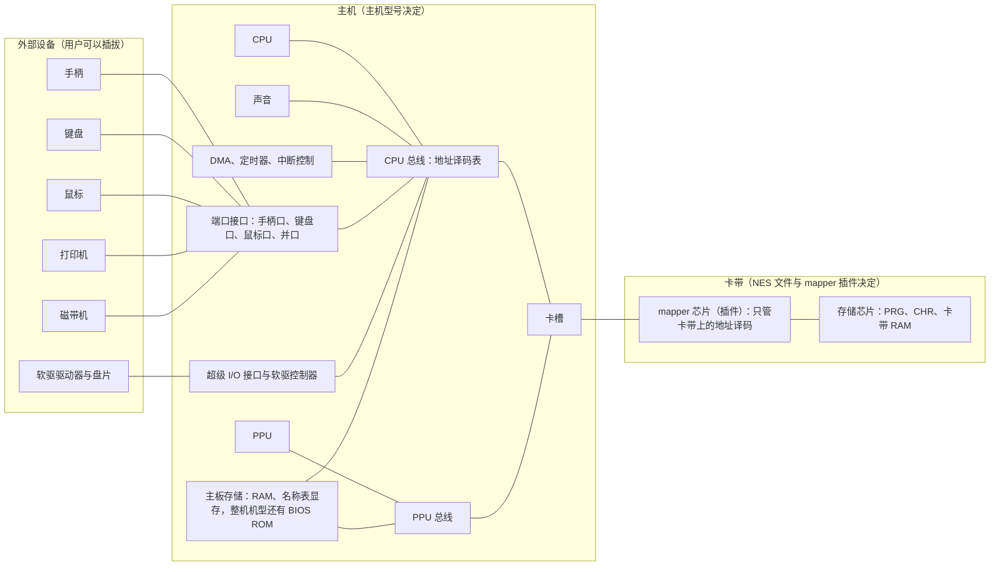

# 硬件模块

模拟器的硬件结构：主机、卡槽、卡带的关系，总线与时钟，芯片与功能模块，主机型号，存储区的归属，电源与复位。整体架构见 [01-软件架构设计.md](01-软件架构设计.md)，mapper 插件见 [03-mapper插件规范.md](03-mapper插件规范.md)。

状态说明同 01。

## 1. 决策

| 决策项 | 结论 | 状态 |
| --- | --- | --- |
| 结构 | 按真机分为主机、卡槽、卡带三部分；卡带插入卡槽，卡槽接入主机总线；宿主的总线只认识卡槽；学习机整机的 BIOS 是主机自带的 ROM，不经卡槽 | 已定 |
| 模块粒度 | 一个型号一个模块；CPU、PPU、声音、每个功能模块、每种外部设备各自独立 | 已定 |
| 模块之间 | 互不依赖，只经宿主定义的总线、中断线、时钟等契约通信；实例只在组装根创建并连线 | 已定 |
| 主机型号 | 固定硬件的组合（芯片组、功能模块与存储、端口；`fc` 有卡槽，整机机型有 BIOS）；一个机型一个主机型号；学习机整机的地址译码表与胶合逻辑都在主机型号里；卡带 mapper 的清单只能按名字选择主机型号 | 已定 |
| 模块复用与译码表 | 软驱控制器与驱动器、打印机、声音（PSG、DAC 等）、磁带机等功能模块各机型共用一份实现；模块本身与总线地址无关，只提供寄存器读写与事件；每个机型在主机装配里用自己的地址译码表把模块挂到 CPU 总线（例如软驱控制器在 `sb2000` 的 `$4100-$42FF`，在步步高机型的 `$FF80-$FFB8`）；机型各自的是键盘键位与协议、鼠标协议、手柄接法、主机私有的整机寄存器逻辑（如步步高 `$FF00` 起的视频控制与语音）、软驱中断等胶合逻辑，见第 6.3 节 | 已定 |
| 芯片内部 | 芯片内的寄存器与存储写死在芯片模块里，任何 mapper 都不能修改 | 已定 |
| 存储归属 | 芯片内、主板上的（含学习机整机的存储）由芯片模块与主机型号写死；卡带上的由 mapper 清单声明，见第 5 节 | 已定 |
| BIOS | 学习机的 BIOS 不当卡带：不走 mapper 匹配，不经卡槽；每个整机机型只有一个 BIOS，用户在首选项的“机型与 BIOS”里选机型后添加文件，文件复制进软件的 BIOS 目录（用户数据目录下 `bios/`，一个机型一个文件）；开机处先选机型：`fc` 再选 NES 文件，整机机型直接用已设置的 BIOS 开机，没有 BIOS 时提示去设置添加，见 01、05 | 已定 |
| 学习机机型清单 | 内置的整机机型只有四个：`sb97`（小霸王 97）、`sb2000`（小霸王 2000）、`bbk10`（步步高 1.0）、`bbk20`（步步高 2.0）；它们的映射结构各不相同，是四个独立的主机型号；目前只做 `sb2000`，其余以后做 | 已定 |
| 插卡学习机 | 裕兴等学习机是“主机加卡带”：主机自带软驱控制器、声卡、键盘与鼠标口等功能模块，没有 BIOS，系统在卡带（学习卡）里；卡带上的 mapper 做地址译码，选中主机上的功能模块并读写其寄存器（脚本里用 `ctx.device`），软驱等的中断经 `ctx.irq` 接到 CPU；哪个地址对应软驱的哪个寄存器由各卡的脚本决定，主机只提供有哪些功能模块与它们的参数（旧版 mapper 169 就是这样用）；这类主机是独立的主机型号，由卡带清单的 `host` 自动装配，用户“打开卡带…”时不选机型；放在经典 FC 之后做，不在 M1、M2 里 | 已定 |
| 功能模块的时间参数 | 软驱控制器等功能模块的时钟频率、数据速率、转速等数值不写死在模块里，由主机型号装配时传入；模块的时间由调度器按主时钟推进（向调度器登记事件），mapper 脚本不需要也不能手动推进；各机型的数值待核对后在装配里填 | 已定 |
| 时钟模型 | 调度器按主时钟推进；CPU 每次总线访问推进时钟，PPU 等芯片在被访问前或事件到期时追赶到当前时间；PPU 按点时钟（dot）精度 | 拟定 |
| 首批主机型号 | `fc`（经典 FC）先做，再做 `sb2000`；`sb97`、`bbk10`、`bbk20` 以后各加一个；PAL、Dendy 的经典机以后加 | 拟定 |
| 芯片命名 | `sb2000` 的学习机芯片统一叫 6576，模块名带 `um6576`；仓库的 SH6578 资料是同系列芯片的手册，两者有差异，以真机实测为准；`sb97` 与步步高机型的芯片组待核对，不套用 6576 的模块 | 拟定 |
| 打印机 | 虚拟针式打印机，按 ESC/P 命令打印，插在并口上，每页输出一张 PNG，不弹窗，见第 6.5 节 | 拟定 |

## 2. 结构

学习机的整机 BIOS 是主机自带的 ROM，不经卡槽；`fc` 机型用卡槽。

| 术语 | 含义 |
| --- | --- |
| 主机型号 | 固定硬件的组合：芯片组、功能模块与存储、端口、卡槽（`fc`）或 BIOS（整机机型），以及时钟与制式；一个机型一个主机型号 |
| 芯片 | 一个硬件模块：如 CPU、PPU、PSG；芯片内部的寄存器和存储属于它自己 |
| 功能模块 | 主机里的一个独立硬件模块，如 DMA、定时器、软驱控制器、并口、PSG、DAC；只提供寄存器读写与事件，与总线地址无关；各机型共用一份实现，契约里叫 `Device` |
| 地址译码表 | 主机型号在装配时登记的“地址范围对应哪个功能模块、存储或卡槽”；同一个功能模块在不同机型上可以挂在不同地址 |
| 外部设备 | 插在主机端口上、用户可以插拔的东西：手柄、键盘、鼠标、打印机、软驱盘片、磁带 |
| 卡槽 | 主机上的卡带插座，规定引脚；总线上属于卡带的地址都转交给卡槽 |
| 卡带 | 存储芯片和 mapper 芯片的组合 |
| mapper 芯片 | 卡带上的地址译码与寄存器逻辑，只管卡带上的地址，由 mapper 插件提供，见 03 |
| BIOS | 整机机型自带的程序 ROM，不是卡带，不走 mapper 匹配；一个整机机型一个，由用户在首选项里添加，复制进软件的 BIOS 目录，见 01 第 9 节 |
| 存储区 | 一块 ROM 或 RAM，有唯一的所有者 |
| 端口 | 主机上接外部设备的插座，如手柄口 |

划分规则只看两点：一是这段地址由谁译码，是主机的地址译码表，还是卡带上的 mapper；二是外设能否由用户插拔，即端口上的外部设备（手柄、键盘、鼠标、打印机、软驱盘片、磁带）。物理上在不在同一颗芯片里不是规则。

学习机整机：旧的 NES 文件格式把“BIOS 卡带”和“学习机主板上的译码电路”合成了一个 mapper（171），文件里无法拆开。本项目不沿用：整机的地址译码表与软驱中断等胶合逻辑属于主机型号，BIOS 只是主机自带的 ROM，由用户添加文件；NES 文件只走卡带路线（主机按卡带清单的 `host` 自动装配），mapper 171 的文件没有匹配的插件时按“没有匹配的插件”报错，不自动识别成学习机，也不允许改 mapper 号强行运行。学习卡（mapper 241、178 等）是卡带，系统在卡里；它们要用主机上的软驱、声卡等功能模块，由卡带上的 mapper 译码并读写，这类主机是独立的“插卡学习机”主机型号（如裕兴系列，见第 6.6 节），目前只做 `fc`。

## 3. 总线与时钟

### 3.1 总线

| 总线 | 宽度 | 内容 |
| --- | --- | --- |
| CPU 总线 | 16 位地址、8 位数据 | 由主机型号的地址译码表规定：功能模块的寄存器、主板 RAM、整机机型的 BIOS 与扩展存储由主机处理；其余地址转给卡槽 |
| PPU 总线 | 14 位地址、8 位数据 | 图案表地址（`$0000-$1FFF`）转给卡槽；名称表地址（`$2000-$3EFF`）按卡槽的显存控制线选择主板显存或卡带；调色板在 PPU 内 |

- 开放总线：没有任何芯片驱动的数据位，读到总线上最近一次的值（读或写留下的），行为与真机一致；这个值由总线模块保存，不由各芯片猜。设备的读结果带“驱动掩码”：`$FF` 表示八位都由设备驱动，`$00` 表示都不驱动，只驱动低 5 位的手柄口为 `$1F`；没有设备的地址等同于掩码 `$00`，写到没有设备的地址会被丢弃，但数据仍留在总线上。
- 地址宽度：CPU 总线 16 位，PPU 总线 14 位；超出宽度的高位被忽略（PPU 访问 `$4000` 以上等同于访问 `$0000` 以上）。
- 6576 的程序存储器分页（`$4040-$4047`）由 6576 芯片组的分页模块提供，输出更宽的物理地址；卡槽的地址线宽度由主机型号声明。

### 3.2 契约

硬件契约放在 `core/src/contracts/hardware/`，均为纯虚类：

| 契约 | 内容 |
| --- | --- |
| `Clock`、`Scheduler` | 主时钟，各芯片的分频，按时间点调度事件 |
| `CpuBus`、`PpuBus` | 总线的读写入口，以及“把地址范围挂给某个 `BusDevice`”的登记；两者共用基类 `Bus`，只有地址宽度不同 |
| `BusDevice` | 响应一个地址范围的读写，地址为总线上的绝对地址；读的结果带“驱动了哪些数据位”的掩码 |
| `IrqLine` | 中断线：IRQ 与 NMI 各创建一根，多个来源是线或关系；RESET 不是线，复位直接调用 `Cpu::reset` |
| `RdyLine` | CPU 的暂停线，DMA 用它暂停 CPU；与 `IrqLine` 是不同的类型，同样是线或关系 |
| `Cpu` | 复位、按周期数运行、读取寄存器状态；总线、时钟与三根线在构造时接入 |
| `Ppu` | 复位、按时间追赶、输出帧缓冲（每像素 4 字节，内存顺序为 R、G、B、A，A 恒为 255，可直接上传为 RGBA8 纹理）；寄存器读写经 `BusDevice` 挂在 CPU 总线上 |
| `Device` | 总线设备加复位与事件到期；中断输出经构造时接入的 `IrqLine` 发出 |
| `StorageRegion` | 存储区：容量、种类、字节读写、批量读取；ROM 拒绝写 |
| `ControllerPort`、`ControllerDevice`、`ButtonInput`、`PadSink` | 手柄口（锁存线、时钟线、数据线）、插在口上的设备、设置标准手柄按键的输入接口（8 位掩码，位 0 为 A，位 7 为右），以及主机上全部手柄口的集合 `PadSink`（输入钩子按手柄绑定、卡带的脚本经它设置各口的按键） |
| `ParallelPort` | 并口：8 位数据线，选通、自动换行、选择、复位线，忙、应答、缺纸、联机、出错线；打印机阶段再加 |
| `CartridgeSlot`、`Cartridge`、`InputEvent` | 卡槽的引脚与卡带的对外接口，卡槽的复位转给插着的卡带，见第 4 节；用户输入（键盘 `KeyInput`、鼠标 `MouseInput`、游戏手柄 `GamepadInput`（带设备标识 `id`）的原始事件）先交给运行服务的输入钩子，钩子按手柄绑定截下游戏手柄的事件与当手柄用的键盘按键，经 `PadSink` 设置手柄口；没有被截下的键盘、鼠标事件经主机与卡槽的 `input` 转给插着的卡带，由卡带的 mapper 脚本决定怎么用，游戏手柄事件不再交给主机 |
| `IrqOutput` | 中断输出引脚：卡带经它向 CPU 的 IRQ 线发出中断（拉低、释放）；引脚由主机型号在卡槽上提供，在 IRQ 线上占一个固定来源，所以换卡带不会增加线的来源数量 |
| `Machine` | 一台装配好的主机：电源、复位、按时间运行、运行到 PPU 完成一帧、取帧缓冲、取走声音采样与采样率（单声道浮点，-1 到 1）、设置手柄按键、读 CPU 寄存器（测试与调试用）、取卡槽与卡槽的 IRQ 引脚；`keyboardIsMachineInput()`（默认 `false`）告诉输入钩子键盘现在是不是机器自己的输入：整机机型在键盘由机器处理时返回 `true`（`sb2000` 在 FC 兼容模式下返回 `false`），此时键盘按键全部交给机器，不当手柄用 |

- 契约只写当前里程碑用得上的方法；状态快照（见第 9 节）在调试服务阶段加到 `Device`、`Machine` 上。
- 契约头文件只能包含标准库、`contracts/hardware` 与 `shared`，不引用 `logic` 与第三方库，由 `npm run boundaries` 检查。

### 3.3 时钟与调度

- 主机型号声明主时钟与各芯片的分频（如 CPU 与 PPU 的比例），并声明制式（每帧行数、帧率）。
- 调度器按主时钟推进。CPU 每完成一次总线访问就推进时钟；PPU、PSG 等不逐周期运行，在 CPU 访问它们之前、以及自己的事件到期时，追赶到当前时间。
- 需要定时的功能模块（定时器、软驱控制器、DAC）向调度器登记事件：“某个时间点回调我”，不要求每周期被调用。
- mapper 脚本只能登记“若干 CPU 周期后回调”的事件，不能每周期回调，见 03。
- 声音按时钟生成采样（`Machine::takeAudio`），由运行服务每帧交给声音输出的环形缓冲，不依赖界面的帧率，见 01 第 7 节。

实现细则（`ClockDomain`、`Scheduler` 的契约与实现）：

| 项 | 内容 |
| --- | --- |
| 时间 | 主时钟计数 `MasterTime`（有符号 64 位），从上电起计；`ClockDomain` 给出芯片周期与主时钟周期的换算（NTSC：CPU 12，PPU 4） |
| 推进 | `Clock::advance` 向前推进；推进过程中到期的事件按（时间点，登记先后）顺序先于时钟到达终点被触发；事件回调里 `now()` 等于事件的时间点，回调中可以登记、取消事件，但不能推进时钟；时间点已过的事件在下一次推进时立即触发 |
| 总线访问时刻 | CPU 的每个总线周期先推进半个周期，再访问总线，再推进剩余的半个周期；PPU 等被访问时追赶到访问时刻 |
| 暂停 | `RdyLine` 有效时，CPU 在读周期暂停：每个暂停周期只推进时钟，不访问总线，暂停方靠调度器事件推进传输并释放；写周期不暂停；连续暂停超过 100 万个周期按错误处理 |

### 3.4 硬件基础模块

硬件基础模块在 `core/src/logic/hardware/<模块>/`，命名空间 `ember::logic::hardware`，互不引用，只经 `contracts/hardware`：

| 模块 | 内容 |
| --- | --- |
| `scheduler` | `MasterScheduler`：主时钟与事件队列 |
| `bus` | `BusMap`（地址范围登记、分发、开放总线）、`CpuAddressBus`（16 位）、`PpuAddressBus`（14 位）；挂载范围起点大于终点、超出地址宽度、与已挂载的重叠，都明确报错（`hardware.busRangeInvalid`、`hardware.busRangeConflict`），报错后已有的挂载不变 |
| `lines` | `WiredOrIrqLine`、`WiredOrRdyLine`：线或信号线，每根线最多 32 个来源；`LineIrqOutput`：占用 IRQ 线上一个来源的中断输出引脚（卡槽的 IRQ 引脚） |
| `cpu-6502` | 经典 FC 的 CPU 核，见第 6.1 节 |
| `ppu-2c02` | 经典 FC 的 PPU，见第 6.1 节 |
| `dma-2a03`、`pad-2a03` | 经典 FC 的 2A03 里的功能模块：精灵 DMA 与手柄口，见第 6.3 节 |
| `apu-2a03` | 经典 FC 的 APU：两个方波、三角波、噪声、DMC，帧计数器与混音，见第 6.2 节 |
| `joypad` | 标准手柄，见第 6.4 节 |
| `ram` | `RamBlock`（可读写的存储区）与 `MirroredRam`（按容量镜像挂到总线上的设备） |
| `cartridge-slot` | `StandardCartridgeSlot`：卡槽，把 CPU 总线与 PPU 总线上属于卡带的访问转给卡带，空槽时开放总线 |
| `nametable-ram` | `NametableRam`：主板上 2K 的名称表显存，按卡槽的显存控制线选择哪一页响应，或交给卡带自带的显存 |
| `null-device` | `NullDevice`：空设备，读不驱动数据线，写被忽略，给还没实现的芯片占位（目前没有主机型号使用） |

硬件的错误码在 `contracts/hardware/hardware-error.hpp`，以 `hardware.` 开头，经 `shared::CoreError` 抛出；这些错误都是装配或调用方的错误，不是运行中的正常情况。

## 4. 卡槽与卡带

卡槽与卡带用于 `fc` 机型与以后的插卡学习机主机（见第 6.6 节），学习卡（mapper 241、178 等）也是卡带；学习机整机的 BIOS 不是卡带，不经卡槽，见第 2 节。

### 4.1 卡槽引脚（拟定）

| 侧 | 引脚 | 说明 |
| --- | --- | --- |
| CPU 侧 | 地址线、数据线、读写线、PRG 片选（A15 与时钟的组合）、时钟 | 卡槽把 CPU 总线上属于卡带的访问交给卡带 |
| PPU 侧 | 地址线、数据线、读写线 | 图案表访问 |
| 显存控制 | CIRAM 的 A10 与片选 | 决定名称表用主板显存的哪一页，或由卡带自带显存接管 |
| 中断 | IRQ 输出 | 卡带向 CPU 的 IRQ 线输出 |
| 声音 | 扩展音频输入 | 卡带带音源时混入 |

- 卡槽引脚细节在实现时对照真机资料逐项定；地址线的宽度由主机型号声明。

### 4.2 卡带的组成与加载

卡带由两部分组成，加载 NES 文件时由卡带模块创建：

1. 存储芯片：PRG-ROM、CHR（ROM 或 RAM）、卡带 RAM，数据来自 NES 文件，大小与种类由 mapper 清单声明。
2. mapper 芯片：由匹配到的插件创建，只决定卡槽上的访问由哪个存储芯片的哪个位置响应，并处理寄存器、计时与中断；不连接、不控制主机上的任何功能模块。

卡带上没有功能模块：软驱控制器、DAC 等都在主机上，见第 6 节。

加载流程见 03 第 5 节。实现（已完成）：`logic/cartridges` 解析 iNES 文件得到卡带映像（PRG、CHR 与规范化的描述），`infra/mappers` 的 `PluginRegistry` 按描述匹配插件并创建卡带（`MapperChip`，实现 `Cartridge`）。卡带的行为：卡槽上的 CPU 侧与 PPU 侧访问先查译码表，落在窗口上就直接访问存储区（ROM 拒绝写入），落在寄存器范围内才回调脚本，都不落在的地址不驱动数据线（开放总线）；名称表连法经 `ciramControl` 给主板显存，四屏时由卡带自带 4K 显存响应；卡带的 IRQ 输出经主机提供的 `IrqOutput` 引脚。上电复位时不带电池的 RAM 清零、窗口与状态回到初始值，软复位只调用脚本的 `reset`，RAM 保持；细节见 03 第 4、6 节。

## 5. 存储区的归属

| 位置 | 例子 | 谁定 | mapper 能否改 |
| --- | --- | --- | --- |
| 芯片内 | PPU 的 OAM、调色板；6576 的片内 2K RAM | 芯片模块写死 | 否 |
| 主板上 | 经典 FC 的 2K RAM、2K 名称表显存；学习机整机的 RAM、显存、扩展内存与 BIOS ROM | 主机型号写死 | 否 |
| 卡带上 | PRG-ROM、CHR、卡带 RAM | mapper 清单声明 | 是 |

- 一块存储区只有一个所有者，只经所有者访问；调试读取内存也经所有者的接口，不绕过。
- 6576 的片内 RAM：真机实测只有 2K，`$0800-$1FFF` 是 `$0000-$07FF` 的镜像；`$4400-$5FFF` 读出 `$68`，写入无效，所以 `$5000-$57FF` 不是 RAM；这些是芯片行为，写死在芯片模块里。
- 学习机的存储（RAM、显存、扩展内存、BIOS）属于主机型号（学习机整机）；每块的容量与位置要对照 `machines/sb2000` 的资料和实测逐项核对后写进主机型号；原则是真机属于哪一边就放哪一边，不为方便挪动。

## 6. 芯片与功能模块

首批模块清单（拟定）。寄存器与位定义以 `machines/` 资料、sh6578-chipset 手册与真机实测为准，两者不一致时以实测为准。

### 6.1 CPU 与 PPU

| 模块 | 内容 | 状态 |
| --- | --- | --- |
| `cpu-6502` | 经典 FC 的 CPU 核：6502 指令集，无十进制模式 | 拟定 |
| `cpu-um6576` | 6576 的 CPU 核：核对后与 `cpu-6502` 相同（标准 6502，无十进制模式），`sb2000` 直接用 `cpu-6502`，不单独做这个模块 | 已定 |
| `ppu-2c02` | 经典 FC 的 PPU（默认 NTSC；选项可设每帧行数与奇数帧跳点，`sb2000` 的 FC 兼容模式用它，见第 6.8 节）；Dendy 的 PPU 以后加 | 已完成 |
| `ppu-um6576` | 6576 的 PPU：增强的颜色位、不同的调色板与精灵规则、`$2008` 等寄存器 | 已完成 |

`cpu-6502` 的实现（已完成，nestest 通过）：

| 项 | 内容 |
| --- | --- |
| 指令 | 全部官方指令；非官方指令只做 nestest 用到的：LAX、SAX、DCP、ISB、SLO、RLA、SRE、RRA、各种 NOP 变体与 `$EB` 的 SBC；其余操作码按 2 周期的单字节 NOP 处理；无十进制模式，D 标志可以设置与清除，但不影响运算 |
| 周期 | 每个总线周期（含空读、读改写的假写、跨页修正前的空读、分支的空读）都经 `CpuBus` 完成并推进主时钟；写与读改写的带索引寻址一定有修正前的空读，读只在跨页时有 |
| 复位 | 7 个周期：两次空读、三次只读不写的“压栈”（栈指针下移 3）、读 `$FFFC/$FFFD`；上电复位寄存器清零、状态为 `$24`、周期重新计数，软复位保留寄存器与累计周期 |
| 中断 | 每个周期结束时采样 IRQ（受 I 标志屏蔽）与 NMI（有效边沿），用倒数第二个周期的结果决定指令结束后是否响应，所以 CLI 之后的 IRQ 要等下一条指令执行完才响应；序列共 7 个周期，硬件中断压入的状态不带 B，BRK 带 B；选向量发生在压栈之后，此时到来的 NMI 会劫持 IRQ 与 BRK 的向量；成功的分支会忽略刚出现的 IRQ，把中断推迟到下一条指令之后 |
| 接口 | `reset(power)`、`run(cycles)`（至少运行指定的周期，指令不被打断）、`registers()`（状态位 5 恒为 1，位 4 恒为 0） |

`ppu-2c02` 的实现（已完成，PPU 测试 ROM 通过，见第 10 节）：

| 项 | 内容 |
| --- | --- |
| 寄存器 | `$2000-$2007`，每 8 字节镜像一次直到 `$3FFF`；读只写寄存器读到数据总线上最近一次的值（不模拟衰减）；读 `$2002` 清 vblank 与写锁存，低 5 位取总线旧值；`$2007` 读经缓冲，调色板直接读出并把调色板下面的名称表装入缓冲，渲染期间访问 `$2007` 同时递增粗 X 与 Y；读 `$2004` 时属性字节屏蔽位 2-4，渲染期间返回评估正在用的值（第 1-64 点为 `$FF`），渲染期间写 `$2004` 不改 OAM，只让地址加 4 |
| 内部状态 | v、t、精细 X、w（loopy 滚动模型）；OAM 256 字节、次级 OAM 32 字节；调色板 32 字节（`$3F10/14/18/1C` 镜像 `$3F00/04/08/0C`，`$3F20` 起每 32 字节镜像）。上电时 OAM 全为 `$FF`，调色板取 blargg 的 `power_up_palette` 测试表（其作者的 NES 上的实测值，真机每次上电不同） |
| 时间 | 每行 341 点、每帧 262 行（NTSC）；点 k 在主时钟 `相位 + 4k` 执行，CPU 在同一时刻或更晚访问寄存器就能看到它的结果；PPU 不逐周期运行：CPU 访问寄存器前、自己的调度事件到期时才追赶到当前时间；调度事件登记在会改变 NMI 线的点上：241 行第 1 点、预渲染行第 1 点、预渲染行第 339 点（奇数帧在这里决定是否跳点，此后下一帧 vblank 的位置才确定），所以 CPU 逐周期采样 NMI 线时不会漏掉变化 |
| 帧 | 奇数帧在背景开启时跳过预渲染行的最后一点，判断用前一个点结束时的背景开关（背景开关写入有 1 个点的延迟）；第 240 行第 0 点发布一帧：双缓冲，`frame()` 返回最近完成的一帧，`frameCount()` 加 1，没有完成过帧时宽高为 0 |
| vblank 与 NMI | 241 行第 1 点置位，预渲染行第 1 点清除（同时清精灵 0 命中与精灵溢出）；NMI 线 = vblank 标志且 `$2000` 位 7；读 `$2002` 发生在置位前一个点：读到 0，本帧不置位也不产生 NMI；读发生在置位同一点或后一个点（此时 CPU 还没有采样到 NMI 线）：读到置位的标志并清除，NMI 线在 CPU 采样前回落，所以没有 NMI；更晚的读正常；在 vblank 期间使能 NMI，线立即有效，CPU 在下一条指令之后响应 |
| 背景 | 每 8 点取一个图块（名称表、属性表、图案低位、图案高位），16 位移位寄存器，精细 X 选位；第 256 点递增 Y，第 257 点复制横向位，预渲染行第 280-304 点复制纵向位；`$2001` 位 1 控制左 8 列遮罩 |
| 精灵 | 可见行第 1-64 点清次级 OAM，第 65-256 点评估（奇数点读主 OAM、偶数点写次级 OAM），含精灵溢出标志与“n、m 同时递增”的硬件缺陷；第 257-320 点取精灵图案（8x8 与 8x16、水平与垂直翻转），每行最多 8 个；预渲染行不评估精灵，所以第 0 行没有精灵；`$2001` 位 2 控制左 8 列遮罩 |
| 精灵 0 命中 | 精灵 0 与背景的不透明像素重合时置位，第 255 列除外，被遮罩的像素不参与；在预渲染行第 1 点清除 |
| 输出 | 256x240，每像素 4 字节，内存顺序 R、G、B、A（A 恒为 255；小端机器上整数值为 0xAABBGGRR）；颜色取自按 NTSC 复合视频信号电平与解码算法生成的 RGB 表（含 8 种颜色强调组合，来源见 `ntsc-palette.cpp` 的文件头），灰度位把颜色号与 `$30` 相与；整个渲染关闭且 v 指向调色板时，输出 v 指向的那一项 |
| 选项 | 构造时可传 `Options`：每帧行数（默认 262，大于 241；预渲染行为最后一行）、奇数帧是否跳点（默认是）；PAL 的 312 行没有跳点；`halt()` 取消自己的事件并撤销 NMI，供机型切换芯片时使用 |
| 接口 | 构造时注入调度器、PPU 总线、NMI 线、时钟域与相位；`reset(power)`、`catchUp(now)`、`frame()`、`frameCount()`；另有只读的内部状态访问，供测试与调试 |

`ppu-um6576` 的实现（已完成，测试在 `core/test/hardware/ppu-um6576-test.cpp`；寄存器的位规则以真机 `hwtest` 实测为准，见 `packages/fcdev/docs/sb2000/03-硬件说明.md`）：

| 项 | 内容 |
| --- | --- |
| 寄存器 | 图形端口 `$2000-$2008` 与调色板 `$2040-$207F`；`$2000`：位 7 NMI、位 5 精灵 8×16、位 2 地址增量、位 1-0 背景页；`$2001`：位 0 黑白、位 1 与位 2 为 1 时显示最左 8 个像素（极性同 NES，芯片手册写反）、位 3 背景、位 4 精灵、位 5 增强绿、位 6 增强红、位 7 增强蓝；`$2002` 读：位 7 垂直消隐、位 6 精灵 0 碰撞、位 5 一行超过 8 个精灵，低 5 位是最后一次写 PPU 端口的值，读后清位 7 与写锁存；`$2004` 读出的属性字节位 4-2 恒为 1；`$2008`：位 7 为 1 是 16 色、位 3-2 精灵图案表、位 0 为 1 时名称表从显存 `$2000` 起且只有一页；调色板 64 项只保存低 6 位，读出时位 6 为 1 |
| 画面 | 按扫描行渲染：每行开始时用当时的寄存器画完整一行（不逐点），行与行之间由调度器事件推进；4 色或 16 色背景，名称表项 2 字节（高 4 位调色板组、低 12 位图案号）；精灵每行不限个数，超过 8 个时只置位 `$2002` 位 5；精灵 Y 字节为 `$FF` 时不可见；8×16 精灵的图案号最低位被忽略；16 色图块号的最低位忽略 |
| 时间 | PAL：每行 341 点、每帧 312 行（50 Hz）；第 0-239 行可见，第 240 行开始时发布一帧，第 241 行开始置垂直消隐标志并按 `$2000` 位 7 发 NMI，第 311 行（预渲染）开始时清 `$2002` 的位 7、6、5 |
| 没有做 | 不模拟 OAM 的刷新缺陷与精灵 0 命中的像素级时序；颜色的亮度与饱和度与真机电视的差别没有对齐 |
| 接口 | 构造时注入调度器、显存总线、NMI 线、时钟域与相位；`status()`、`frameCount()`、`vramAddress()`、`nextLine()`、`pokePalette()`、`pokeOam()` 等只读或调试访问供测试与调试 |

### 6.2 声音

| 模块 | 内容 | 状态 |
| --- | --- | --- |
| `apu-2a03` | 经典 FC 的 APU：两个方波、三角波、噪声、DMC | 已完成 |
| `psg-um6576` | 6576 的 4 通道 PSG（`$4000-$4015`） | 已完成 |

`apu-2a03` 的实现（已完成，APU 测试 ROM 通过，见第 10 节）：

| 项 | 内容 |
| --- | --- |
| 寄存器 | `$4000-$4013`（读不驱动数据线）；`$4015`：写是各通道的使能位（禁用时长度计数器清零，禁用期间载入无效），读是位 0-3 各通道长度计数器是否大于 0、位 4 DMC 是否有剩余字节、位 6 帧 IRQ、位 7 DMC IRQ，位 5 保持总线上的值，读清除帧 IRQ、写清除 DMC IRQ；`$4017` 的帧计数器部分 |
| 通道 | 两个方波：4 种占空比、包络、扫频（方波 1 的负向扫频用反码，多减 1）、长度计数器，周期小于 8 或扫频的目标周期超出 `$7FF` 时静音（扫频未使能也一样）；三角波：线性计数器、长度计数器，周期小于 2 的超声波不推进序列；噪声：15 位 LFSR 的长短两种模式、16 项周期表；DMC：16 项速率表（NTSC）、`$4011` 直接加载、采样读取、循环、IRQ、单字节采样缓冲，地址在 `$FFFF` 之后回到 `$8000` |
| 帧计数器 | 4 步（第 7457、14913、22371、29828、29829、29830 个周期，最后三个周期置位帧 IRQ，29829 同时时钟半帧）与 5 步（第 7457、14913、22371、29829、37281、37282 个周期，没有 IRQ）；写 `$4017` 在 3 个周期后生效（写在奇数 APU 周期时是 4 个），生效时计数从头开始，5 步模式生效时立即时钟一次半帧；IRQ 禁止位立即清除标志；上电如同在复位序列开始后的第 2 个 APU 周期写入了 `$00`（按 blargg 的 `apu_reset` 与 `09.reset_timing` 调定），软复位相当于写 `$4015` 为 0、按上次写入的 `$4017` 重新开始（三角波的暂停位保持） |
| 长度计数器 | 载入与暂停位的写入都延迟到下一个周期末生效；载入与长度时钟落在同一个周期且计数非零时，载入作废（blargg 的 `11.len_reload_timing`、`10.len_halt_timing`） |
| 时间与调度 | APU 周期 T（从 1 起）发生在 CPU 周期 T-1 的中点，CPU 在周期 c 访问寄存器时 APU 已推进到周期 c+1；APU 不被逐周期调用：被访问前、自己的事件到期时追赶到当前时间（内部逐周期推进）；会改变外部可见状态的时刻（帧 IRQ 置位、写 `$4017` 生效、DMC 取样请求）都预测出来登记成调度器事件，所以 CPU 逐周期采样 IRQ 线时不会漏掉变化；每次写入这些相关寄存器后重新预测 |
| 中断线 | 在 IRQ 线上占两个来源（帧 IRQ、DMC IRQ，线或） |
| DMC 的 DMA | 取样请求后在 RDY 线上暂停 CPU 4 个周期，在第 4 个周期的中点经 CPU 总线读采样，周期结束时释放 RDY；`$4015` 启用 DMC 且没有剩余字节时，按写入周期的奇偶过 2 或 3 个周期再请求取样；输出单元每 8 个输出时钟取走缓冲并在缓冲变空时请求下一个字节；近似与差异见第 12 节 |
| 混音 | 非线性公式：方波 `95.88 / (8128 / n + 100)`（n 为两个方波的音量之和），三角波、噪声、DMC 共用 `159.79 / (1 / (三角波 / 8227 + 噪声 / 12241 + DMC / 22638) + 100)`；每个周期若电平变化就把变化量交给降采样器；上电的初始电平不产生阶跃（三角波停在序列起点 15，所以混音电平不是 0，但没有任何输入时输出恒为 0） |
| 降采样 | 带限阶跃合成（与 blip_buf 同类）：电平每变化一次，就把变化量乘以 32 点 Blackman 加窗 sinc 脉冲响应累加到输出样本缓冲，输出时逐样本积分得到阶跃，截止频率为奈奎斯特的 85%（约 20 kHz），位置精度 1/256 个样本，固定延迟 16 个样本（约 0.33 毫秒），每次电平变化 32 次乘加；取舍：比“累积平均”（箱式滤波）的混叠少得多（方波边沿不产生混叠嘶声），比更长的脉冲响应省，延迟低；代价是阶跃响应有约 10% 的过冲（振铃在 20 kHz 附近，听不到）；积分后接一阶高通（约 20 Hz）阻断直流，输出限幅到 -1 到 1 |
| 输出 | 采样率 `Apu2a03::SAMPLE_RATE`（48000 Hz，常量）；`Machine::takeAudio` 取走自上次以来的采样；没有人取走时主机只保留最近 1 秒 |
| PAL | 构造参数 `pal` 为 true 时：噪声周期表取 PAL 的 16 项（4、8、14、30、60、88、118、148、188、236、354、472、708、944、1890、3778），DMC 速率表取 PAL 的 16 项（398、354、316、298、276、236、210、198、176、148、132、118、98、78、66、50），帧计数器 4 步为第 8313、16627、24939、33252、33253、33254 个周期，5 步为第 8313、16627、24939、33253、41565、41566 个周期（NESdev 的表）；默认 NTSC。`reset(true)` 从当前的调度器时刻起计周期（机型在运行中途切换到它时不为 0）；CPU 周期含奇数个主时钟周期时事件时刻与追赶的取整保持一致；`halt()` 取消事件并撤销 IRQ 与 RDY |
| 接口 | 构造时注入 CPU 总线（DMC 读采样）、调度器、IRQ 线、RDY 线、CPU 时钟域、CPU 频率与 `pal`；`reset(power)`、`catchUp(now)`、`takeAudio`；另有只读的状态访问，供测试 |

`psg-um6576` 的实现（已完成，测试在 `core/test/hardware/psg-um6576-test.cpp`）：

| 项 | 内容 |
| --- | --- |
| 寄存器 | 同 NES 的 APU（芯片手册）：`$4000-$400F`、`$4015`；没有 DMC 与 `$4010-$4013`；方波不做扫频，`$4001`、`$4005` 写入无效；没有 `$4017`，内部固定走 4 步帧序列（四分之一帧时钟包络与三角波线性计数器，第 2、4 步再时钟长度计数器，不产生 IRQ）；`$4015` 写低 4 位使能通道（禁用时长度清零），读返回低 4 位各通道长度计数器是否大于 0 |
| 时间 | PAL：噪声周期取 PAL 表，帧序列间隔约 8314 个 CPU 周期（50 Hz 的 4 步）；不逐周期被调用，寄存器读写与取走声音前追赶到当前时间 |
| 混音 | NES 的非线性公式（方波、三角波与噪声）加芯片组 DAC（`$4027` 的电平经 `setDacLevel` 混进同一路输出）；降采样用逐样本平均（箱式滤波）再接 20 Hz 一阶高通 |
| 已知差异 | 真机 `$4015` 位 4 的读数与旧版互相颠倒，这里读 0；降采样不是带限的（`apu-2a03` 的带限降采样在它自己的目录里，硬件模块之间不互相引用，没有共用），高频的混叠比 `apu-2a03` 多 |

### 6.3 功能模块与复用

复用原则：

- 功能模块只提供寄存器读写与事件，与总线地址无关；它挂在哪段地址、镜像几次，由主机型号的地址译码表决定。
- 同一个模块只有一份实现，各机型共用；同一个模块在不同机型上行为有差别时，差别写在该机型主机装配的胶合逻辑里，不复制模块。
- 划分规则只看两点（见第 2 节）：这段地址由谁译码，能否由用户插拔。物理上在不在同一颗芯片里不是规则，所以 6576 里的 DMA、定时器、键盘口与主板上的软驱控制器、并口一样，都是功能模块。

“机型相关”与“通用”对照：

| 部分 | 通用（各机型共用一份） | 机型相关（每个机型自己的） |
| --- | --- | --- |
| 软驱 | `fdc-upd765`、`floppy-drive` | 控制器挂在总线上的地址（`sb2000` 在 `$4100-$42FF`，步步高机型在 `$FF80-$FFB8`）、软驱中断等胶合逻辑、驱动器数量 |
| 打印机 | `printer-escp`、并口契约 `ParallelPort` | 并口寄存器的地址与各位的接法 |
| 声音 | PSG、DAC 等声音模块 | 寄存器的地址 |
| 磁带机 | `tape-deck-data`、`tape-deck-av` | 接在哪个端口、用哪几根信号线 |
| 手柄 | `joypad` | 手柄口的接法（如步步高的鼠标插在手柄口上） |
| 键盘 | 无 | 键位与协议（`keyboard-sb2000`、`keyboard-bbk`） |
| 鼠标 | 无 | 协议（`mouse-sb2000`、`mouse-bbk`） |
| 整机寄存器 | 无 | 主机私有的整机寄存器逻辑，如步步高 `$FF00` 起的视频控制与语音 |
| 地址译码表 | 无 | 每个机型一张，把上面的模块与存储挂到 CPU 总线 |

6576 芯片组的功能模块（`sb2000` 用到的，地址是 `sb2000` 的译码表）：

| 模块 | 地址 | 内容 |
| --- | --- | --- |
| `sysinit-um6576` | `$4031` | 初始设置 |
| `irq-um6576` | `$4032`、`$4033` | 中断屏蔽与状态 |
| `timer-um6576` | `$4034-$4036` | 定时器 |
| `rtc-um6576` | `$4080`、`$4081` | 实时时钟 |
| `paging-um6576` | `$4040-$4047` | 程序存储器分页 |
| `dma-um6576` | `$4014`、`$4048-$404F` | 精灵 DMA 与通用 DMA |
| `keyboard-um6576` | `$4020-$4022` | 键盘接口 |
| `mouse-um6576` | `$4023`、`$4024`、`$4026` 位 1 | 串口式鼠标接口：`$4023` 选择，`$4024` 读串行数据，RTS 经 `$4026` 位 1，中断经 `$4033` 位 6 |
| `pad-um6576` | `$4016`、`$4017` | 手柄口 |
| `printer-um6576` | `$4025` | 并口（`ParallelPort`）：数据线经 `$4025`，控制线经扩展 I/O，具体位对照手册与实测核对 |
| `expio-um6576` | `$4026` | 扩展 I/O |
| `dac-um6576` | `$4027` | DAC |

- 上表的每个模块独立，由 `sb2000` 的主机装配（`bootstrap/machines/sb2000.cpp`；没有单独的芯片组预设类）组合并挂到它的地址译码表上；模块之间的联动（DMA 暂停 CPU、定时器触发中断）经契约中的 `RdyLine`、`IrqLine`、`InterruptSink` 完成。
- 上表的 12 个模块都已完成（寄存器与行为测试在 `core/test/hardware/um6576-registers-test.cpp` 与 `um6576-peripherals-test.cpp`）：`irq-um6576` 实现 `InterruptSink`，各来源占一位（定时器 `$80`、鼠标 `$40`、键盘 `$20`、软驱 `$08`），经 `$4032` 屏蔽、`$4033` 读待处理；`timer-um6576` 的下溢由调度器事件触发；`paging-um6576` 把 `$8000` 起的 4 个窗口分页到 BIOS ROM（页号 `$00-$7F`）或扩展 RAM（`$80-$FF`）；`dma-um6576` 要求 `$404B` 位 7 为 1、长度按“长度 + 1”、目的在程序窗口时写不进去；`expio-um6576` 用回调把鼠标复位与语音复位交给主机装配；`dac-um6576` 的电平用回调交给 PSG 混音。
- 语音端口 `$4302` 的 LPC 合成没有做：`$4302` 只是始终就绪的存根；记在待办备忘。FC 兼容模式（`$4301` 写 `$55`）属于主机装配，见第 6.8 节。
- `$41XX-$43XX` 的超级 I/O 译码属于 6576 芯片组与主机型号：`sb2000` 的译码表把软驱控制器等功能模块挂在这里（如软驱控制器在 `$4100-$42FF`），与卡带无关。

经典 FC 的 2A03 里的功能模块：

| 模块 | 地址 | 内容 | 状态 |
| --- | --- | --- | --- |
| `dma-2a03` | `$4014` | 精灵 DMA | 已完成 |
| `pad-2a03` | `$4016`、`$4017` | 手柄口 | 已完成 |

| 项 | 内容 |
| --- | --- |
| `dma-2a03` 时序 | 写 `$4014`（值为源页的高 8 位）后 CPU 在下一个读周期暂停（RDY）；写发生在周期 c 的中点，周期 c+1 是等待周期，第一次读必须落在偶数周期上，所以 c 为奇数时再加 1 个对齐周期；之后 256 组“读源地址、写 `$2004`”各占 2 个周期，总共暂停 513 或 514 个周期 |
| `dma-2a03` 实现 | 传输靠调度器事件推进：每个写周期的中点经 CPU 总线读源地址、写 `$2004`（PPU 的 OAM 地址随之递增），最后一个写周期结束时释放 RDY；传输进行中再写 `$4014` 被忽略；复位取消传输；读 `$4014` 不驱动数据线；与 DMC 的 DMA 互不知道对方，相互影响见第 12 节 |
| `pad-2a03` | 两个手柄口（`ControllerPort`，设备插在上面，没有设备时数据线读 0）；读 `$4016`、`$4017` 分别取口 1、口 2 的数据线，只驱动低 5 位（高 3 位保持总线上的值）；写 `$4016` 的位 0 是锁存线，同时送给两个口；写 `$4017` 同时属于 APU 的帧计数器，本模块只处理手柄口，主机装配里的转接设备 `PadApuPort`（`bootstrap/machines/pad-apu-port.hpp`，挂在 `$4016-$4017`）把写 `$4017` 同时转给本模块与 `apu-2a03`，两个模块互不引用；读 `$4016`、`$4017` 只来自手柄口，帧 IRQ 标志不在这两个地址上，经 `$4015` 读取 |

### 6.4 外设模块

| 模块 | 内容 | 状态 |
| --- | --- | --- |
| `fdc-upd765` | 软驱控制器：命令阶段、结果阶段、寻道、就绪、写保护、DMA 与中断 | 已完成 |
| `floppy-drive` | 软驱驱动器：持有盘片镜像、磁头位置、索引脉冲、写保护；故障注入（取盘、写保护、无索引、卡磁头、控制器无响应、指定扇区校验错） | 已完成 |
| `tape-deck-data` | 数据磁带机：1 位信号的录放，用于 FBASIC 的 SAVE 与 LOAD；磁带文件是声音文件，具体格式在实现时定 | 拟定 |
| `tape-deck-av` | 声像磁带机：立体声，一路声音、一路画面数据；用于 `qls.nes` 等 mapper 172 的卡带 | 拟定 |
| `keyboard-sb2000` | 小霸王键盘：物理键位到键盘扫描码的映射 | 已完成 |
| `keyboard-bbk` | 步步高键盘 | 待定 |
| `joypad` | 标准手柄：锁存线为高时不断采样按键并输出 A 键；变为低后保持，每个时钟脉冲移出下一位（A、B、选择、开始、上、下、左、右），移空后读到 1；按键经 `ButtonInput` 以 8 位掩码设置 | 已完成 |
| `mouse-sb2000` | 小霸王串口鼠标：产生 3 字节数据包 | 已完成 |
| `mouse-bbk` | 步步高鼠标：接在手柄口上 | 待定 |
| `printer-escp` | 针式打印机：ESC/P 命令，9 针与 24 针；插在并口上，打印到 PNG，见第 6.5 节 | 已完成 |

- 外部设备（手柄、键盘、鼠标、打印机、软驱盘片、磁带）由用户经端口插拔；软驱控制器、并口等功能模块在主机上，由主机型号用地址译码表挂到 CPU 总线。卡带上没有功能模块与设备。
- 软驱控制器与驱动器分开：控制器是芯片，驱动器是机械部件；主机型号提供控制器和驱动器，盘片由用户经界面或调试服务插入。
- 小霸王与步步高的键盘和鼠标协议差别很大，每种单独成模块，协议细节在实现时对照 `machines/` 的资料核对。
- 已完成的外设：`fdc-upd765` 的状态机取自 NintendulatorNRS 的 SimpleFDC，每 4 个 CPU 周期的时间（64 个主时钟周期）走一步，空闲时不登记事件，中断在出现上升沿时向中断汇集器请求一次；`floppy-drive` 按镜像大小推断格式（160、180、320、360、720、1200、1440、2880 KB，其他按 1.44MB），“取盘”保留镜像、与真正取出不同；`keyboard-sb2000` 的扫描码取 IBM 码集 1 的按下码（与 DirectInput 的 DIK 一致），命令先回 `$FA`；`mouse-sb2000` 是 1200bps 的微软串口鼠标，RTS 上升沿后约 15 毫秒回 PnP 标识；`printer-escp` 见第 6.5 节。测试在 `core/test/hardware/` 的 `fdc-upd765-test.cpp`、`printer-escp-test.cpp`、`um6576-peripherals-test.cpp`。磁带机以后再做（登记在待办备忘）。

### 6.5 针式打印机

打印机是并口上的一台虚拟针式打印机，把打印内容画成图片保存，不连接真实打印机。

| 项 | 内容 |
| --- | --- |
| 模块 | `printer-escp`，插在并口上；主机型号默认接一台 |
| 并口信号 | 主机到打印机：8 位数据、选通、自动换行、选择、复位；打印机到主机：忙、应答、缺纸、联机、出错；虚拟打印机始终联机、不忙、不缺纸、不出错 |
| 命令 | `ESC @` 复位并回到页首；`ESC *` 选择点密度并打印位图；`ESC L` 120 点密度位图；`ESC 3` 设置行距；`ESC J` 进纸；`ESC C`、`ESC N` 读入页长与下边距；`ESC <` 打印头回左端；`CR`、`LF`、`FF`；其余字节忽略 |
| 点阵 | 9 针（位图每列 8 点，纵向 72 点/英寸）与 24 针（纵向 180 点/英寸），横向 60 到 360 点/英寸；24 针的一列是 3 个字节 |
| 页面 | A4，按 200 点/英寸画成 1660×2340 像素的黑白图；左边距 60 像素，上边距 96 像素；两种针数都按 200 点/英寸近似 |
| 输出时机 | 收到 `FF`；复位线有效；断电或硬复位；6 秒（模拟时间）没有收到数据；写满一页；调用 `media.printerFlush` |
| 空白页 | 页上没有任何点时不生成文件 |
| 文件名 | `printer-YYYYMMDD-HHMMSS.png`，按输出时的本机日期时间生成；同一秒输出多页时在后面加 `-2`、`-3` |
| 保存位置 | 首选项“打印机”里的“图片保存位置”；目录不存在时创建；留空时保存到用户数据目录下的 `printer-output`（这个默认位置待用户确认） |
| 弹窗 | 不弹出保存或打印对话框，调试服务的操作同样不弹出 |
| 失败 | 目录无法写入时用通知和运行消息说明原因，该页丢弃 |
| 编码 | 黑白两色的 PNG，用 miniz 编码 |

- 命令与点阵参数来自旧版的实现，以 `machines/sb2000` 打印机服务（功能 `$76-$7A`）的实测核对：打印机收到的字节序列、行距、进纸、图形命令都与真机一致才算完成。
- 与旧版不同：旧版收到 `ESC @` 时先弹出“打印目标”对话框，输出 PNG 时再弹出保存对话框，写满一页后丢弃超出的点；本模块没有任何对话框，写满一页会先输出再开新页。

### 6.6 主机型号

主机型号把芯片组、功能模块、存储和端口固定地组合起来，并用自己的地址译码表把它们挂到总线上，在 `core/src/bootstrap/machines/<主机型号>.cpp` 里装配；整机机型还带 BIOS 与整机胶合逻辑。芯片组预设只是模块的组合，机型相关的译码与胶合逻辑不放在里面。

| 主机型号 | 芯片组 | 功能模块 | 端口 | BIOS | 状态 |
| --- | --- | --- | --- | --- | --- |
| `fc` | `cpu-6502`、`ppu-2c02`、`apu-2a03` | `dma-2a03`、`pad-2a03` | 手柄口 1、2 | 无，用卡槽插卡带 | 已完成 |
| `sb97` | 待核对 | 待核对 | 待核对 | 1 个，大小待核对 | 以后 |
| `sb2000` | 6576 芯片组（`cpu-6502`、`ppu-um6576`、`psg-um6576`；FC 兼容模式下 PPU 与声音换成 `ppu-2c02`、`apu-2a03`，第 6.8 节） | 第 6.3 节 6576 的功能模块、`fdc-upd765` 与 `floppy-drive`（1 个软驱 A）、并口（接 `printer-escp`）、`keyboard-sb2000`、`mouse-sb2000` | 手柄口 1、2，串口鼠标口，键盘口，并口 | 1 个，512KB（iNES 文件，PRG 512KB，mapper 171） | 已完成 |
| `bbk10` | 待核对 | 软驱控制器与驱动器、并口、步步高键盘（待核对） | 手柄口 1、2，鼠标接在手柄口上（待核对） | 1 个，大小待核对 | 以后 |
| `bbk20` | 待核对 | 待核对 | 待核对 | 1 个，大小待核对 | 以后 |
| 裕兴系列（型号名与划分待定） | 待核对 | 软驱控制器与驱动器、声卡、键盘、鼠标、并口（待核对） | 待核对 | 无，用卡槽插学习卡，系统在卡里 | 以后（经典 FC 之后） |

- 四个整机机型的映射结构各不相同，各是一个独立的主机型号，不共用译码表；它们共用的是第 6.3 节的功能模块。
- 插卡学习机主机（裕兴系列）没有 BIOS，不走“机型与 BIOS”；功能模块由卡带上的 mapper 译码选中，外设的时间数值由主机装配传入，见第 1 节；它的软驱、声卡、键盘与鼠标口的组成和时钟都要先核对资料。
- 整机机型只有一个 BIOS，由用户经 `machines` 模块添加，开机时由主机型号读入；没有 BIOS 不能开机，见 01、04、05。整机机型的装配已在学习机阶段实现：`sb2000` 已做，`sb97`、`bbk10`、`bbk20` 以后各加一个。
- 各机型有哪些功能模块、驱动器数量、存储的容量与位置，对照 `machines/` 的资料与实测逐项核对后写定。

`fc` 的装配（`core/src/bootstrap/machines/fc.hpp`、`fc.cpp`，类 `FcMachine`）：

| 项 | 内容 |
| --- | --- |
| 时钟 | 主时钟 21.477272 MHz；CPU 12 分频，PPU 4 分频；每帧 262 行、每行 341 点 |
| CPU 总线 | `$0000-$1FFF` 内部 RAM（2K，每 2K 镜像）；`$2000-$3FFF` PPU（每 8 字节镜像）；`$4000-$4013` 与 `$4015` APU；`$4014` 精灵 DMA；`$4016-$4017` 手柄口与 APU 帧计数器（经转接设备，写 `$4017` 同时转给两边，读只来自手柄口）；`$4018-$401F` 没有设备（开放总线）；`$4020-$FFFF` 卡槽 |
| PPU 总线 | `$0000-$1FFF` 图案表，由卡槽转给卡带；`$2000-$3EFF` 名称表，按卡槽的显存控制线选择主板 2K 显存的哪一页，或交给卡带自带的显存；调色板在 PPU 内，不经总线 |
| 线 | NMI 线只有 PPU 一个来源；IRQ 线的来源是卡槽的 IRQ 引脚（`cartridgeIrq()`，卡带经它发出中断）与 APU 的帧 IRQ、DMC IRQ 两个来源；RDY 线的来源是精灵 DMA 与 APU 的 DMC 取样 |
| 相位 | 上电后 PPU 第 0 点在主时钟 `PPU_PHASE_TICKS`（1）处；CPU 的 7 个复位周期之后第一条指令开始于 PPU 第 0 行第 21 点；这个相位按 blargg 的 vblank/NMI 时序测试调定（真机每次上电在四种相位里随机取一种，见第 12 节） |
| 电源 | `powerOn()`：时钟归零、丢弃旧事件，内部 RAM 与名称表显存清零（以后按选项取全零或随机），APU、DMA、PPU 复位，释放卡槽的 IRQ 引脚，卡带复位，最后 CPU 复位；`softReset()`：只复位 APU、DMA、PPU、卡带与 CPU，内部 RAM 保持；`powerOff()`：停止运行 |
| 运行 | `run(ticks)` 按主时钟周期数运行并让 PPU 与 APU 追赶；`runFrame()` 逐条指令运行，直到 PPU 完成下一帧（第 240 行第 0 点），再让 APU 追赶到当前时间；手柄口的集合（`PadSink`：`padPortCount()` 与 `setButtons(port, 掩码)`，端口号只有 0 与 1）由主机提供，输入钩子与卡带的脚本（经 `ctx.pad`）设置；用户输入中没有被输入钩子截下的键盘、鼠标原始事件经 `input(事件)` 转给卡带，主机型号自己没有手柄键位；声音经 `takeAudio(采样)` 取走自上次以来生成的采样，采样率 `audioSampleRate()` 为 48000 |
| 测试用 | `ppu()`、`apu()`、`internalRam()`、`nametableRam()`、`peekPpuBus(地址)`（直接读 PPU 总线的图案表与名称表） |

`sb2000` 的装配（`core/src/bootstrap/machines/sb2000.hpp`、`sb2000.cpp`、`sb2000-board.hpp`、`sb2000-fc-board.hpp`，类 `Sb2000Machine`）：

| 项 | 内容 |
| --- | --- |
| 时钟 | 主时钟 26,601,712 Hz；CPU 15 分频（约 1.7734 MHz），PPU 5 分频（每个 CPU 周期 3 个点）；每行 341 点、每帧 312 行（50 Hz）。CPU 分频按真机 `hwtest` 实测定：定时器选 CPU 时钟、预分频 16、预置 `$FF` 时 120 帧下溢约 1040 次（15 分频算得 1040，16 分频只有 975） |
| CPU 总线 | `$0000-$1FFF` 内部 RAM（2K 镜像）；`$2000-$3FFF` 图形端口（`$2000-$2008`、调色板 `$2040-$207F`）；`$4000-$4013` 与 `$4015` PSG；`$4014` 精灵 DMA；`$4016-$4017` 手柄口；`$4020-$4022` 键盘；`$4023-$4024` 鼠标；`$4025` 并口数据；`$4026` 扩展 I/O；`$4027` DAC；`$4031` 初始设置；`$4032-$4033` 中断；`$4034-$4036` 定时器；`$4040-$4047` 程序分页；`$4048-$404F` 通用 DMA；`$4080-$4081` 实时时钟；`$4100-$4101`、`$4200-$4207` 软驱控制器；`$4300` 显存页等超级 I/O；`$4400-$5FFF` 工作窗口（初始设置打开后读 `$68`）；`$6000-$7FFF` 外部 RAM（8K）；`$8000-$FFFF` 程序窗口（分页到 BIOS ROM 或扩展 RAM）；没有器件的地址读到总线上最近的值；FC 兼容模式下 `$2000-$3FFF` 转给标准 PPU、`$4000-$4015` 转给 `apu-2a03`、`$5000-$5FFF` 是 2K 工作 RAM、程序窗口改成 MMC3 映射（第 6.8 节） |
| 存储 | BIOS ROM 512KB（页号 `$00-$7F`，每页 4K）、扩展 RAM 512KB（页号 `$80-$FF`）、外部 RAM 8K、内部 RAM 2K、字符 RAM 32K（显存总线 `$0000-$7FFF`）、扩展显存 512KB（显存总线 `$8000-$FFFF`，32K 窗口，`$4300` 低 4 位选 bank，更大的 bank 号回绕） |
| BIOS | iNES 文件（16 字节文件头加 512KB 的 PRG，mapper 171），`machines` 模块校验后剥去文件头交给主机；没有卡带，Machine 契约要求的卡槽是一个空的、不挂载的卡槽 |
| 外设 | 软驱 A 一个（1.44MB，每道 18 扇区、2 面、80 道）；并口接一台虚拟针式打印机（有输出方时）；串口鼠标；键盘；手柄口 1、2 |
| 输入 | `input(事件)`：键盘事件按物理键位换成学习机扫描码（不认识的键丢弃）；鼠标事件的位移累加到够 1 个单位再交给串口鼠标，离开画面时松开按键；手柄事件交给手柄口；不经 mapper 脚本 |
| 读数 | 按真机 `hwtest` 实测对齐：`$4022` 读出时位 6（键盘数据线，空闲为高）为 1，开机值 `$C0`；`$4016` 读出时位 2 恒为 1（读 `$44`）；`$3FFF` 读 `$68`；`$4015` 位 4 与 `$4037` 的真机读数取决于读取时刻，没有对齐 |
| 没有做 | 语音合成（`$4302` 只是始终就绪的存根）、磁带机、软盘文件管理；见待办备忘 |
| 验收 | 真实 BIOS 开机到“小霸王”画面；从软盘镜像启动 SB-DOS 与 SB-Win98 演示盘；在 SB-DOS 下运行 `apps/sb2000/memtest`（扩展 RAM、ROM、显存、内部 RAM、ERAM 与 DMA 的结果与真机实测相同）与 `apps/sb2000/hwtest`（图形端口、外设寄存器、定时器、DMA、`$2002` 的结果与文档记录的真机值一致，仍有差异的项见 `packages/fcdev/docs/sb2000/03-硬件说明.md` 的“真机与模拟器仍有差异的行为”）；设置环境变量 `EMBER_SB2000_DUMP` 后 `sb2000-machine-test.cpp` 里的 `RealMemtestDiskRunsUnderSbDos`、`RealHwtestDiskRunsUnderSbDos` 把画面与 `HWTEST.TXT` 导出供人工核对；FC 兼容模式的验收见第 6.8 节（真实 BIOS 加“游戏集锦 001”软盘进入游戏） |

### 6.7 软盘文件的同步

本节整体是后续阶段的设计，学习机阶段没有做（界面上的软盘文件管理、`media.floppyList` 等请求与 `media.floppyFilesChanged` 事件都没有），登记在待办备忘；实现时再对照 SB-DOS 的缓存行为核对。

设想中界面可以在学习机运行时增删改盘片里的文件，学习机立即看到变化；界面形式（原来设计在右边栏）已取消，做的时候再设计。

| 项 | 内容 |
| --- | --- |
| 数据来源 | 盘片镜像由 `floppy-drive` 持有，是唯一的数据；学习机经软驱控制器读写它，界面经请求读写它，两者看到的始终是同一份 |
| 文件系统 | 盘片镜像按 FAT12 解析，解析与修改放在 `media` 模块的逻辑层，不放进硬件模块；先支持根目录，子目录待定 |
| 外部修改 | 界面或调试服务的修改经命令队列投递到模拟线程，在指令边界原子执行；一次修改完成后，学习机才能进行下一次磁盘访问 |
| 学习机写盘 | 学习机写盘后镜像变化，发事件 `media.floppyFilesChanged`，界面刷新 |
| 学习机的缓存 | SB-DOS 把引导扇区和 FAT 缓存在扩展 RAM 里；外部修改后必须让它重新读盘，否则它看到的还是旧目录，甚至会用旧 FAT 覆盖外部的修改；让缓存失效的办法见第 11 节“待核对” |
| 写保护 | 写保护的盘片拒绝外部修改 |
| 保存 | 外部修改与学习机写盘都只改内存里的盘片镜像，“保存镜像”才写回文件，不自动落盘 |

### 6.8 FC 兼容模式（sb2000）

6576 芯片组可以向 `$4301` 写 `$55` 切到 FC 兼容模式：“游戏集锦”软盘的启动程序与 DOS 里的 `play` 都用它运行 NES 游戏。已实现（`bootstrap/machines/sb2000-fc-board.hpp`、`sb2000.hpp`、`sb2000.cpp`、`sb2000-board.hpp`）。

**说明**：MMC3 是 sb2000 主板自己的胶合逻辑（学习机上其他型号没有内置 MMC 电路），不是芯片模块，放在 sb2000 的主板文件里。相关研究见 [NES 兼容模式研究](../../machines/sb2000/disassembly/docs/research/NES兼容模式研究.md)；真机没有实测过，与真机的差异只能靠以后测试发现。

**换的是芯片，不是整机**：CPU 仍是 `cpu-6502`（与 `fc` 通用，没有差异的证据）；图形端口由 `ppu-um6576` 换成 `ppu-2c02`，声音由 `psg-um6576` 换成 `apu-2a03`，手柄口、通用 DMA、软驱等其余设备不动。换下来的 PPU 静音（撤销它在线上的来源、取消自己的事件），不再产生帧与 NMI，PSG 不再被访问、也不再取走采样；两者都不复位，硬复位后照常工作。`$4017` 的写入在 FC 模式下同时转给手柄口与 `apu-2a03`（转接设备 `PadApuPort`）。

**模式**：上电后总是 6576 模式；`$4301` 写 `$55` 进入 FC 兼容模式（写别的值没有效果）；只有硬复位（断电再上电）回到 6576 模式。进入之后没有退出的写法，再向 `$4031` 写 `$65`、`$76` 不会切回去，`$4031` 的行为不变。软复位（`softReset`）在 FC 模式下只复位 CPU、手柄口、DMA、APU 与 PPU，模式、MMC3 寄存器与全部存储保持，所以游戏中软复位不会回到 DOS，而是经窗口末尾的 RESET 向量重新进入游戏（`play` 已把它改成启动桩）。

**写 `$4301`（值为 `$55`）的效果**，按顺序：

1. 6576 的外设寄存器复位：初始设置识别进度清零（`$4400-$5FFF` 变回没有 6576 模式时的样子），中断屏蔽与状态、定时器、键盘口、鼠标口、扩展 I/O、DAC 回到复位值；软驱、实时时钟、程序分页寄存器、通用 DMA、PSG 不复位。
2. 6576 的 PPU 静音，标准 PPU（`ppu-2c02`）从当前时刻起从第 0 行开始；`$2000-$3FFF` 每 8 字节镜像一次。
3. PSG 不再被访问，`apu-2a03` 复位（上电复位，采样从当前时刻起）。
4. 程序窗口 `$8000-$FFFF` 与显存总线改成下面的 MMC3 映射，不再看 `$4040-$4047` 与 `$4300`；MMC3 的 IRQ 计数器与 IRQ 允许清零。
5. CPU 复位。写 `$4301` 的指令结束之后才复位（在指令中途复位会让时钟在总线访问里推进），复位向量取自新的程序窗口末尾；这条指令之后的指令不会执行。

**`$5006`（任何模式下都有效）**：写入 `$55`、`$77`、`$DD`、`$FF` 选 128K 窗口 0、1、2、3（窗口号 = `((值 >> 2) & 2) | ((值 >> 1) & 1)`），同时关闭并撤销 MMC3 的 IRQ。窗口基址：程序为扩展 RAM 起点 + 窗口号 × 128K，图案为扩展显存起点 + 窗口号 × 128K。6576 模式下 `$5000-$5FFF` 不是 RAM，写入无效但 `$5006` 的窗口号照常记下；启动程序都是在 6576 模式下先写 `$5006`、再写 `$4301`。

**FC 模式的 CPU 映射**：

| 范围 | 内容 |
| --- | --- |
| `$0000-$1FFF` | 内部 RAM（2K 镜像） |
| `$2000-$3FFF` | 标准 PPU |
| `$4000-$4015`、`$4016-$4017` | `apu-2a03`、手柄口；`$4014` 精灵 DMA 与 `$4020` 起的 6576 外设仍然挂着 |
| `$5000-$5FFF` | 2K 工作 RAM（与内部 RAM 同一块，镜像两次；`$4400-$4FFF` 没有器件应答） |
| `$6000-$7FFF` | 外部 RAM（8K，不分窗口） |
| `$8000-$9FFF` | 选择位 6 为 0：窗口内第 R6 页（8K，R6 只取低 4 位，共 16 页）；为 1：窗口倒数第 2 页 |
| `$A000-$BFFF` | 窗口内第 R7 页（R7 只取低 4 位） |
| `$C000-$DFFF` | 选择位 6 为 0：窗口倒数第 2 页；为 1：窗口内第 R6 页 |
| `$E000-$FFFF` | 窗口末页 |
| `$8000-$FFFF` 的写入 | 全部当 MMC3 寄存器写：`$8000` 偶地址写选择寄存器（位 7 反转 CHR、位 6 PRG 模式、位 2-0 选 R0-R7），奇地址写所选寄存器；`$A000` 偶地址写镜像（位 0 为 1 水平，为 0 垂直），奇地址（PRG RAM 保护）忽略；`$C000` 偶地址写 IRQ 锁存值，奇地址使计数器在下一次计数时重载；`$E000` 偶地址关闭 IRQ 并撤销，奇地址允许 IRQ；不再写入扩展 RAM |
| 上电值 | R0-R7 都是 0，窗口 0，垂直镜像，所以 NROM 之类的游戏要先写寄存器才能运行 |

**FC 模式的显存总线**（标准 PPU 访问）：

| 范围 | 内容 |
| --- | --- |
| `$0000-$1FFF` | 窗口内的 1K 页，只读（PPU 写入被丢弃）：选择位 7 为 0 时 `$0000`、`$0800` 是 R0、R1（2K，取偶数页）、`$1000-$1FFF` 是 R2-R5；为 1 时两半对调；R0-R1 只取低 7 位并取偶数，R2-R5 只取低 7 位（128 页） |
| `$2000-$2FFF`（`$3000-$3EFF` 镜像） | 字符 RAM 的 `$2000-$27FF`（2K），按 `$A000` 的镜像连接；上电后是垂直镜像 |
| 调色板 | 在 PPU 内，不经总线 |

通用 DMA（`$4048-$404F`）在 FC 模式下照常工作，目的仍是字符 RAM 与扩展显存（按 `$4300` 选 32K 页），与 MMC3 窗口无关。

**标准 PPU 与 APU 的选项**（默认行为不变，现有的 ROM 测试照常通过）：

- `ppu-2c02` 的 `Options`：每帧行数、奇数帧是否跳点。FC 模式用 312 行（PAL，与 6576 模式的 50 Hz 一致）、没有跳点。调色板是标准方式（`$3F10`、`$3F14`、`$3F18`、`$3F1C` 镜像背景色），游戏写 `$3F10` 也要改到背景色（马里奥的天空色就是这样设的）。
- `apu-2a03` 的构造参数 `pal`：为 true 时噪声与 DMC 用 PAL 的周期表，帧计数器用 PAL 的步长（NESdev 的表）。FC 模式用 PAL，采样率 48000 Hz 不变。CPU 周期是 15 个主时钟周期（奇数），APU 的事件时刻与追赶的取整要一致，否则唤醒事件推不动进度。
- `ppu-2c02`、`ppu-um6576`、`apu-2a03` 都新增 `halt()`（静音，供模式切换与上电时使用）。

**MMC3 的 IRQ**：数图案地址线 A12 的上升沿（PPU 经显存总线读取时由主板逻辑观察地址）。A12 先连续低过 4 次显存访问，下一次变高才算一次上升沿，用来滤掉每个图块取名称与属性时的短暂低电平（真 MMC3 用的是“低电平持续约 3 个 CPU 周期”的滤波，这里按显存访问次数近似）。每次上升沿：计数器为 0 或有重载请求时装入锁存值，否则减 1；减到 0 且允许 IRQ 时拉低 IRQ 线（线上新增一个来源）；`$E000` 写（偶地址）与 `$5006` 撤销。PPU 在每条指令之后追赶到当前时间，所以 CPU 最多晚一条指令才看到 IRQ。

**调试接口**：`cpu`、`ppu` 空间的地址解析与读写按当前模式取映射（FC 模式下程序窗口解析为 `board.extendedRam`、图案区解析为 `board.extendedVram`、名称表解析为 `board.characterRam`）；状态模块 `ppu` 在 FC 模式下取标准 PPU 的值，新增状态模块 `mmc3`（`window`、`selector`、`r0`-`r7`、`horizontalMirroring`、`irqLatch`、`irqCounter`、`irqEnabled`），`paging` 模块新增字段 `fcMode`。

**验证**：

- 单元测试 `core/test/hardware/sb2000-fc-mode-test.cpp`：MMC3 的程序与图案映射、镜像、窗口号、A12 滤波与 IRQ 计数；整机用合成的 BIOS 覆盖 `$4301` 的值、指令之后才复位、PPU 与 APU 的切换、PAL 的每帧周期数与声音、外设复位与工作 RAM、窗口选择、图案区只读与名称表镜像、调试接口、软复位与硬复位；用例 `AnNromGameRunsFromTheMmc3Windows` 按 `play` 的放法把超级马里奥兄弟（mapper 0）装入扩展 RAM 与扩展显存，标题画面按开始后进入第一关，有声音；`TheSpriteBackdropEntriesMirrorTheBackgroundOnes` 核对调色板的镜像。`ppu-2c02-test.cpp`、`apu-2a03-test.cpp` 覆盖选项。
- 真实 BIOS 加“游戏集锦 001”软盘镜像（`sb2000-machine-test.cpp` 的 `RealGameCollectionDiskStartsAGameInFcMode`）：开机后约第 1645 帧自动进入 FC 模式，显示游戏菜单，按开始进入“热血格斗”，厂商标志与剧情画面的图案取自扩展显存、画面正确。这张盘的 `GAME.EXE` 只是加载器，游戏代码在没有文件名的扇区里，`dir` 列不出来。
- 真实 BIOS 加 DOS 下的 `play`、`runnes`（`sb2000-machine-test.cpp` 的 `RealPlayRunsAnNesGameUnderSbDos`、`RealRunnesRunsAnNesGameUnderSbDos`，需要先用 `fcdev disk` 生成 `PLAY.img`、`RUNNES.img`，没有时跳过）：把超级马里奥兄弟放进盘里，在 SB-DOS 里输入 `play mario.nes`、`runnes mario.nes`，进入 FC 模式，标题画面按开始后进入 1-1。
- 没有验证：真机行为；双截龙 2（PRG 与 CHR 超过 128K，`play` 与 `runnes` 不支持）。

**已知限制与近似**：

- 硬件本身的限制：只有一个 128K 窗口，PRG 或 CHR 超过 128K、CHR-RAM 游戏、带 trainer 的文件、mapper 0 与 4 以外的游戏不支持，见研究文档第 6、7 节。
- MMC3 的 A12 滤波按显存访问次数近似，IRQ 最多晚一条指令；真机的精确时序没有实测。

## 7. 端口与输入设备

- 端口是主机上的插座，契约为 `ControllerPort`；设备插在端口上，端口不知道设备的种类。
- 经典 FC：手柄口 1、2，各接一个标准手柄。
- `sb2000`：手柄口 1、2；6576 的串口式鼠标接口；键盘口；并口（`ParallelPort`），接虚拟针式打印机。
- 步步高的鼠标接在手柄口上，作为一种插在手柄口的设备，与手柄互斥。
- 界面把键盘、手柄、鼠标采集成原始事件，`input` 模块的输入钩子按“手柄绑定”（全局一份，见 04 第 4.4 节）把游戏手柄与不属于机器的键盘按键换成手柄口的按键；其余键盘、鼠标事件交给主机，设备如何响应由设备模块决定。

## 8. 电源与复位

| 操作 | 行为 |
| --- | --- |
| 上电 | 创建或重置全部芯片与设备到上电状态；存储区的上电内容按选项取全零或随机；卡带的存储区重新从 NES 文件载入（带电池的 RAM 先载入存档文件） |
| 断电 | 停止运行，芯片状态丢弃；插在驱动器里的盘片和磁带保持不变 |
| 硬复位 | 断电后再上电 |
| 软复位 | 只发 RESET 线；各芯片按自己的复位行为处理，存储区内容、mapper 芯片的状态按真机保持或清除，由各模块实现 |
| 介质 | 软盘与磁带的插拔、录放与电源无关，随时可以操作 |

实现（阶段 2b-2，`logic/runtime`，经 `Machine` 契约操作主机）：上电即 `Machine::powerOn`（卡带的不带电池 RAM 清零、ROM 不变）；断电即 `powerOff`，卡槽里的卡带保持；硬复位是断电后再上电，运行模式保持；软复位即 `softReset`，内部 RAM 与卡带 RAM 保持（用“在 $0000 留标记，冷启动与热启动画不同背景色”的小程序测试）。主机型号由插件的 `host` 决定，`bootstrap/machines/machine-catalog.*` 的 `MachineCatalog` 按型号名创建主机（目前只有 `fc`），不认识的型号返回 `runtime.hostUnsupported`。整机机型由 `machines.boot` 按机型标识指定（学习机阶段实现，见 04 第 4.7 节）。

## 9. 状态快照

- 每个硬件模块和 mapper 插件都要能导出当前状态（寄存器、内部计数、存储区摘要），格式为 JSON，字段名固定、有说明。
- 调试服务据此提供“完整获得运行中所有数据与状态”的能力，见 04；状态也是以后做存档的基础。
- 调试接口：`Machine::debugger()` 返回 `MachineDebugger`（`contracts/hardware/machine-debugger.hpp`，主机型号不支持时为空），`fc` 已实现：内存空间的无副作用读与写、总线地址解析、`cpu` 与 `ppu` 状态的读写、按指令或周期或扫描线或帧单步、执行与读写断点（`addBreakpoint` 等；`BreakpointTable` 记录断点，总线的 `AccessProbe` 钩子在每次 CPU 总线读写时报告，没有读写断点时钩子为空、零开销；命中后 `FcMachine::runFrame` 在指令边界返回，`takeBreakpointHit` 取出命中，调试写内存与单步经 `ProbeSuspend` 暂停钩子）、指令/I/O/中断跟踪与调用记录（`startRecorder`、`stopRecorder`；`RecorderTable` 把内容记在内存里，主机在每条指令之前通知它，总线探针经 `ProbeHub` 分发给断点表与记录表，CPU 经 `InterruptObserver` 通知中断；反汇编 `disassemble` 写成 nestest 日志风格，指令跟踪与 nestest 日志逐行一致，见 `recorder-table-test.cpp`）、反汇编（`disassemble`，同一个反汇编也给出控制流与数据地址）、代码与数据标记（`startCdl`、`stopCdl`、`cdlFlags`；`CodeDataLog` 在每条指令之前按指令的操作数打标记，地址到 PRG 偏移的换算由调用方给，因为分页归卡带管），只在模拟线程使用；无副作用读靠 `BusDevice::peek`（默认不驱动数据线，寄存器类设备读不到内容；RAM、名称表显存、卡槽与卡带的窗口覆盖它，卡带脚本的寄存器不回调脚本）；`Cpu::setRegisters` 改 CPU 寄存器；卡带侧 `MapperCartridge` 提供 `describeAddress`（总线地址按窗口映射解析）、`stateNames`、`pokeStorage`。完整的状态快照（`inspector.snapshot`）在阶段 5c 补充。
- mapper 脚本的内部寄存器必须放在宿主管理的状态对象里，见 03。

## 10. 验收依据

- 与真机的一致性以真机实测为准：`apps/sb2000/memtest`、`apps/sb2000/hwtest` 等实测程序的结果作为芯片与主板模块的验收用例；新模拟器要重现旧版已经对齐的实测行为。
- 经典 FC 部分以公开的测试 ROM 为验收用例，具体清单在实现时登记；已登记：`nestest`（CPU，数据与来源在 `core/test/data/nestest/`，自动模式逐行比对日志的 PC、A、X、Y、P、SP 与周期数，8991 行全部一致）。
- PPU 的验收用例（来自 christopherpow/nes-test-roms，数据、来源与用途见 `core/test/data/` 各子目录的 `README.md`，由 `core/test/hardware/ppu-rom-test.cpp` 运行）：`blargg-ppu-tests`（5 个）、`sprite-hit-tests`（11 个）、`sprite-overflow-tests`（5 个）、`vbl-nmi-timing`（7 个）、`ppu-vbl-nmi`（10 个）、`oam-read`、`oam-stress`、`ppu-read-buffer`，共 41 个全部通过；`ppu-open-bus` 失败在第 3 项，见第 12 节。ROM 的卡带用 iNES 解析加真实的 nrom 插件装配（`ppu-read-buffer` 是 mapper 3，用测试插件 `test-cnrom`），核心程序和测试代码里都没有 mapper 的替身实现。
- PPU 的单元测试在 `ppu-2c02-test.cpp`（寄存器与镜像、滚动、vblank 与 NMI、帧长度、精灵评估与命中、帧缓冲格式），精灵 DMA、手柄、主机装配分别在 `dma-2a03-test.cpp`、`joypad-test.cpp`、`fc-machine-test.cpp`。
- APU 的验收用例（同样来自 christopherpow/nes-test-roms，由 `core/test/hardware/apu-rom-test.cpp` 运行，结果读法与复位处理在 `rom-test-support.hpp`，测试要求复位时等待约 8 帧后软复位）：`blargg-apu-tests`（11 个）、`apu-test`（8 个）、`apu-reset`（6 个，含复位）、`cpu-interrupts` 的第 1、4、5 项、`dmc-dma-during-read4` 的 `dma_2007_write` 与 `read_write_2007`，共 30 个全部通过；其余失败项登记在第 12 节，对应测试（`ApuRomKnownDifferences`）断言当前的失败结果。`dmc_tests`（`buffer_retained`、`latency`、`status`、`status_irq`）只用蜂鸣声报告结果，无法自动判读，没有纳入；`apu_mixer` 要听声音判断，也没有纳入（混音由单元测试按公式核对）。
- APU 的单元测试在 `apu-2a03-test.cpp`（各通道的寄存器行为、帧计数器与帧 IRQ 的时序、`$4015` 状态、DMC 取样 DMA 与速率、混音公式、无输入时输出为 0、输出范围、带限采样器的采样数、阶跃响应与对超奈奎斯特频率的抑制），声音输出在 `core/test/platform/audio-test.cpp`，运行服务的声音接入在 `core/test/runtime/simulation-runtime-test.cpp`。
- `sb2000` 的 FC 兼容模式：单元与整机测试在 `core/test/hardware/sb2000-fc-mode-test.cpp`，真实 BIOS 加游戏集锦软盘的测试在 `sb2000-machine-test.cpp`，见第 6.8 节。

## 11. 待核对

| 项 | 核对内容 | 依据 |
| --- | --- | --- |
| 6576 CPU 核 | 与 6502 的差异（指令、时序、十进制模式、DMA 暂停的细节） | 手册与实测 |
| 学习机的存储 | `sb2000` 的 RAM、显存、扩展内存、BIOS 的容量与位置；`sb97`、`bbk10`、`bbk20` 的同类信息 | `machines/` 的资料与实测 |
| 学习机的映射结构与 BIOS | `bbk10`、`bbk20`、`sb97` 各自的映射结构（译码表、整机寄存器）与 BIOS 大小；BIOS 文件的格式（带 iNES 文件头的 `.nes`，还是裸 ROM）与添加时的检查 | `machines/` 与实测 |
| 插卡学习机的主机与外设 | 裕兴等插卡学习机（学习卡 mapper 241、178、168、169、170、177、560 等，数量很多）的主机型号怎么划分、各带哪些功能模块、软驱控制器的时钟与有无 DMA 通道、各卡 mapper 对外设的译码方式；旧版 mapper 169 的写 `$4200`、`$4201`、`$4205` 与读 `$4304`、`$4305` 只是线索，不当作实机依据；放在经典 FC 之后做 | `machines/`、实机资料与实测；旧版 `virtuanes` 只作线索 |
| 卡槽引脚 | 6576 整机机型的卡槽（有无、地址线宽度与分页输出） | 手册与旧版 `resolve` 行为 |
| 制式 | 6576 机型的时钟、每帧行数、帧率 | 实测 |
| 步步高键盘与鼠标 | 协议与接口位置 | `machines/bbk` |
| 软盘文件的同步 | 外部修改后怎样让 SB-DOS 的 FAT 缓存（引导扇区加 9 个 FAT 扇区，缓存有效标志 `FS_FAT_CACHE_VALID`）失效：软驱是否有盘片更换信号、SB-DOS 是否检查，若不检查再改用什么办法；学习机正在读写该盘时外部修改的处理；SB-DOS 允许的文件名字符 | `machines/sb2000` 的反汇编与实测 |

## 12. 已知差异

经典 FC 的实现与真机、测试 ROM 的已知差异。“预期”是真机或测试 ROM 的要求，“实际”是当前实现的行为；修复后删除对应行并同步测试。

| 项 | 预期 | 实际 | 影响与登记 |
| --- | --- | --- | --- |
| 开放总线衰减 | PPU 数据总线上的每一位若约 600 毫秒没有被刷新为 1，就衰减为 0（`ppu_open_bus` 第 3 项 `Decay value should become zero by one second`） | 读只写寄存器、`$2002` 低 5 位与调色板高 2 位读到最近一次写入或读出的值，不衰减 | `ppu_open_bus.nes` 失败在第 3 项；测试 `PpuRomKnownDifferences.OpenBusDecayIsNotSimulated` 断言这个结果，实现衰减后改为普通的通过测试 |
| 上电预热 | PPU 上电或复位后约 29658 个 CPU 周期内忽略对 `$2000`、`$2001`、`$2005`、`$2006` 的写入 | 写入立即生效 | 游戏会自己等两次 vblank，不影响运行；没有测试 ROM 依赖 |
| CPU 与 PPU 的相位 | 真机每次上电在四种相位里随机取一种，部分测试（如 `oam_stress`、vbl/NMI 时序）只在其中一种通过 | 固定一种（`PPU_PHASE_TICKS` 为 1，由 vbl/NMI 时序测试调定），软复位后 PPU 从第 0 行第 0 点重新开始 | 相位不可选；需要时再加到电源选项 |
| 上电内容 | OAM 与调色板随机，内部 RAM 随机 | OAM 全为 `$FF`，调色板取 `power_up_palette` 测试表，RAM 与名称表显存全零 | 第 8 节“按选项取全零或随机”的选项以后随 `runtime` 模块加 |
| 寄存器写入的延迟 | `$2001` 等寄存器的写入对渲染的生效有若干点的延迟 | 只有奇偶帧跳点的判断有 1 个点的延迟，其余寄存器写入立即生效 | 精灵命中与溢出测试全部通过；更细的写入时序没有测试 ROM 覆盖 |
| OAM 的硬件缺陷 | 渲染中途关闭会损坏 OAM；2C02G/H 在 OAM 地址非 0 时评估开始会触发刷新缺陷 | 不模拟 | 没有测试 ROM 依赖 |
| 调色板 | 与真机和电视的颜色有差别 | 由 NTSC 复合视频信号电平解码生成，不含微分相位失真与色彩伪影 | 只影响颜色观感；以后可加调色板选项 |
| DMC 取样 DMA 的暂停周期 | CPU 暂停 3 或 4 个周期（暂停、空周期、需要时对齐、取样）；请求发生时 CPU 正在连续写（读改写指令），暂停从下一个读周期才开始 | 请求之后从下一个 CPU 周期起固定暂停 4 个周期，在第 4 个周期读采样，不区分当前是读还是写，也没有对齐周期的判断 | 单次取样的暂停平均多约 0.5 个周期；没有可自动判读的测试 ROM 检查精确值（`dmc_tests` 只有蜂鸣声） |
| DMC 取样的启动延迟 | `$4015` 启用 DMC 之后到取样请求的延迟随 CPU 与 APU 的相位在 3 到 4 个周期之间变化 | 按写入时 APU 周期的奇偶取 2 或 3 个周期 | `apu_test` 的 DMC 各项通过；精确值没有测试 ROM 覆盖 |
| DMC DMA 重复读 CPU 的地址 | 被 DMC DMA 暂停的 CPU 在暂停的前几个周期里重复读它正要读的地址，读 `$2007`、`$4016` 因此被多读几次 | 暂停时 CPU 不访问总线 | `dmc_dma_during_read4` 的 `dma_2007_read`、`double_2007_read`、`dma_4016_read` 失败；测试 `ApuRomKnownDifferences.DmcDmaDoesNotRepeatTheCpuRead` 断言这个结果，实现后改为普通的通过测试 |
| DMC DMA 与精灵 DMA 的相互影响 | 精灵 DMA 进行中发生 DMC 取样时，精灵 DMA 被延后 2 个周期 | 两个 DMA 互不知道对方，精灵 DMA 的时间不变 | `sprdma_and_dmc_dma`、`sprdma_and_dmc_dma_512` 失败；测试 `ApuRomKnownDifferences.DmcDmaDoesNotDelaySpriteDma` 断言这个结果；要做需要在契约里加“总线周期被占用”的接口 |
| NMI 劫持 BRK 与 IRQ | NMI 在 `BRK` 或 IRQ 的序列进行到特定周期前到达时，改用 NMI 的向量，且标志位与压栈的内容按真机的规则 | CPU 核在 `cpu_interrupts_v2` 的第 2、3 项上结果与真机不同（第 1、4、5 项通过） | 与 APU 无关；测试 `ApuRomKnownDifferences.NmiHijackingOfBrkAndIrq` 断言这个结果，修复 CPU 后改为普通的通过测试 |
| APU 与 CPU 的相位 | 真机每次上电，APU 与 CPU 的奇偶周期随机取一种，上电后帧计数器的起点在第一条指令前 9 到 12 个周期之间 | 固定一种：上电后第 2 个 APU 周期写入生效，落在 `apu_reset` 的 `4017_timing` 允许的范围内 | 相位不可选；需要时再加到电源选项 |
| 模拟滤波 | 真机的音频输出经过约 37 Hz 与 14 Hz 的高通和约 14 kHz 的低通，卡带的扩展音源会混入 | 只有 20 Hz 的一阶高通与 20 kHz 附近的带限滤波，没有扩展音源 | 只影响音色；扩展音源随卡带的声音输入以后加 |
| 三角波的超声波 | 周期为 0 或 1 的三角波输出超声波，平均电平偏离序列起点 | 周期小于 2 时序列停在原处，输出保持 | 听觉上一致（静音），混音电平略有不同 |
