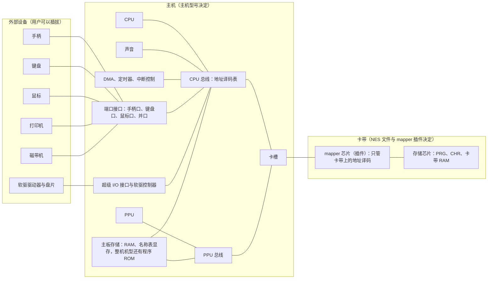

# 硬件模块

模拟器的硬件结构：主机、卡槽、卡带的关系，总线与时钟，芯片与功能模块，主机型号，存储区的归属，电源与复位。整体架构见 [01-软件架构设计.md](01-软件架构设计.md)，mapper 插件见 [03-mapper插件规范.md](03-mapper插件规范.md)。

状态说明同 01。

## 1. 决策

| 决策项 | 结论 | 状态 |
| --- | --- | --- |
| 结构 | 按真机分为主机、卡槽、卡带三部分；卡带插入卡槽，卡槽接入主机总线；宿主的总线只认识卡槽；学习机整机的程序 ROM 是主机自带的，不经卡槽 | 已定 |
| 模块粒度 | 一个型号一个模块；CPU、PPU、声音、每个功能模块、每种外部设备各自独立 | 已定 |
| 模块之间 | 互不依赖，只经宿主定义的总线、中断线、时钟等契约通信；实例只在组装根创建并连线 | 已定 |
| 主机型号 | 固定硬件的组合（芯片组、功能模块与存储、端口；`fc` 有卡槽，整机机型有程序 ROM）；一个机型一个主机型号；学习机整机的地址译码表与胶合逻辑都在主机型号里；卡带 mapper 的清单只能按名字选择主机型号 | 已定 |
| 模块复用与译码表 | 软驱控制器与驱动器、打印机、声音（PSG、DAC 等）、磁带机等功能模块各机型共用一份实现；模块本身与总线地址无关，只提供寄存器读写与事件；每个机型在主机装配里用自己的地址译码表把模块挂到 CPU 总线（例如软驱控制器在 `sb2000` 的 `$4100-$42FF`，在步步高机型的 `$FF80-$FFB8`）；机型各自的是键盘键位与协议、鼠标协议、手柄接法、主机私有的整机寄存器逻辑（如步步高 `$FF00` 起的视频控制与语音）、软驱中断等胶合逻辑，见第 6.3 节 | 已定 |
| 芯片内部 | 芯片内的寄存器与存储写死在芯片模块里，任何 mapper 都不能修改 | 已定 |
| 存储归属 | 芯片内、主板上的（含学习机整机的存储）由芯片模块与主机型号写死；卡带上的由 mapper 清单声明，见第 5 节 | 已定 |
| ROM | 学习机的 ROM 不当卡带：不走 mapper 匹配，不经卡槽；有的机型是一个文件装下全部程序（`sb97`、`bbg1`、`bbg98`、`pec9588`、`pec586`、`yuxing`），有的是 BIOS 与系统 ROM 合成的一个文件（`sb2000`），`cec1` 的 ROM 是 U7 与 U35 两块 32KB 芯片依次拼成的 64KB 文件（后面可以再接 256KB 的汉字字库），步步高的操作系统还要从软盘加载，所以统称 ROM；每个整机机型只有一个 ROM 文件（`pec586` 接受 PEC-586 与 PEC-686F 两个文件中的任意一个，`yuxing` 接受 V8.0-C、V8.2-D、V8.3-D、V9.0-98 四个学习卡中的任意一个），用户在“设置→机型与 ROM”里选机型后添加文件，文件复制进软件的 ROM 目录（用户数据目录下 `roms/`，一个机型一个文件）；开机处先选机型：`fc` 再选 NES 文件，整机机型直接用已设置的 ROM 开机，没有 ROM 时提示去设置添加，见 01、05 | 已定 |
| 学习机机型清单 | 内置的整机机型有八个：`sb97`（小霸王 97）、`sb2000`（小霸王 2000）、`bbg1`（步步高 软驱一号）、`bbg98`（步步高 98）、`pec9588`（金字塔 PEC-9588）、`pec586`（金字塔 PEC-586(686)）、`yuxing`（裕兴）、`cec1`（中华学习机 CEC-I，苹果 II 类机器，第 6.13 节）；`bbg1` 与 `bbg98` 是同一块主板的两个容量变体，用同一个主机型号 `bbg`（译码表与整机寄存器相同，只有 ROM、DRAM 与字符页的容量不同）；`pec9588` 与 `pec586` 是金字塔主板的两个型号，用同一个主机类 `PyramidMachine`（寄存器与外设相同，只有程序窗口的规则与磁带口的位不同）；`sb97`、`sb2000` 的映射结构各不相同，各是独立的主机型号，`cec1` 是苹果 II 类机器，没有 PPU 与 APU；八个都已做 | 已定 |
| 插卡学习机 | 没有这一类：学习机（包括金字塔这种“学习卡插在主机上”的机器）一律做成内置的整机机型，学习卡的内容就是该机型的 ROM 文件，不走 mapper 匹配、不经卡槽；金字塔 PEC-9588 的卡带与 FC 卡带不兼容、卡槽也更小，所以不是 FC 卡带；裕兴等其他学习机以后同样做成整机机型 | 已定 |
| 功能模块的时间参数 | 软驱控制器等功能模块的时钟频率、数据速率、转速等数值不写死在模块里，由主机型号装配时传入；模块的时间由调度器按主时钟推进（向调度器登记事件），mapper 脚本不需要也不能手动推进；各机型的数值待核对后在装配里填 | 已定 |
| 时钟模型 | 调度器按主时钟推进；CPU 每次总线访问推进时钟，PPU 等芯片在被访问前或事件到期时追赶到当前时间；PPU 按点时钟（dot）精度 | 拟定 |
| 首批主机型号 | `fc`（经典 FC）先做，再做 `sb2000`、`bbg`（含 `bbg1`、`bbg98` 两个变体）；`sb97` 已做；PAL、Dendy 的经典机以后加 | 拟定 |
| 芯片命名 | `sb2000` 的学习机芯片统一叫 6576，模块名带 `um6576`；仓库的 SH6578 资料是同系列芯片的手册，两者有差异，以真机实测为准；步步高机型用标准的 2A03、2C02（Dendy 制式）加主板上的整机寄存器，不用 6576 的模块；`sb97` 也用标准的 2A03、2C02（Dendy 制式，制式待核对）加主板上的整机寄存器 | 拟定 |
| 打印机 | 虚拟针式打印机，按 ESC/P 命令打印，插在并口上，每页输出一张 PNG，不弹窗，见第 6.5 节 | 拟定 |

## 2. 结构

学习机的整机程序 ROM 是主机自带的，不经卡槽；`fc` 机型用卡槽。

| 术语 | 含义 |
| --- | --- |
| 主机型号 | 固定硬件的组合：芯片组、功能模块与存储、端口、卡槽（`fc`）或程序 ROM（整机机型），以及时钟与制式；一个机型一个主机型号 |
| 芯片 | 一个硬件模块：如 CPU、PPU、PSG；芯片内部的寄存器和存储属于它自己 |
| 功能模块 | 主机里的一个独立硬件模块，如 DMA、定时器、软驱控制器、并口、PSG、DAC；只提供寄存器读写与事件，与总线地址无关；各机型共用一份实现，契约里叫 `Device` |
| 地址译码表 | 主机型号在装配时登记的“地址范围对应哪个功能模块、存储或卡槽”；同一个功能模块在不同机型上可以挂在不同地址 |
| 外部设备 | 插在主机端口上、用户可以插拔的东西：手柄、键盘、鼠标、打印机、软驱盘片、磁带 |
| 卡槽 | 主机上的卡带插座，规定引脚；总线上属于卡带的地址都转交给卡槽 |
| 卡带 | 存储芯片和 mapper 芯片的组合 |
| mapper 芯片 | 卡带上的地址译码与寄存器逻辑，只管卡带上的地址，由 mapper 插件提供，见 03 |
| ROM | 整机机型自带的程序 ROM，不是卡带，不走 mapper 匹配；一个整机机型一个文件，由用户在“设置→机型与 ROM”里添加，复制进软件的 ROM 目录，见 01 第 9 节 |
| 存储区 | 一块 ROM 或 RAM，有唯一的所有者 |
| 端口 | 主机上接外部设备的插座，如手柄口 |

划分规则只看两点：一是这段地址由谁译码，是主机的地址译码表，还是卡带上的 mapper；二是外设能否由用户插拔，即端口上的外部设备（手柄、键盘、鼠标、打印机、软驱盘片、磁带）。物理上在不在同一颗芯片里不是规则。

学习机整机：旧的 NES 文件格式把“BIOS 卡带”和“学习机主板上的译码电路”合成了一个 mapper（171），文件里无法拆开。本项目不沿用：整机的地址译码表与软驱中断等胶合逻辑属于主机型号，ROM 只是主机自带的，由用户添加文件；NES 文件只走卡带路线（主机按卡带清单的 `host` 自动装配），mapper 171 的文件没有匹配的插件时按“没有匹配的插件”报错，不自动识别成学习机，也不允许改 mapper 号强行运行。学习卡（mapper 241、178 等）的 NES 文件是学习机的 ROM 内容，按机型做成内置的整机机型（金字塔已做，见第 6.11 节），不是卡带，也不是 mapper 插件。

## 3. 总线与时钟

### 3.1 总线

| 总线 | 宽度 | 内容 |
| --- | --- | --- |
| CPU 总线 | 16 位地址、8 位数据 | 由主机型号的地址译码表规定：功能模块的寄存器、主板 RAM、整机机型的 ROM 与扩展存储由主机处理；其余地址转给卡槽 |
| PPU 总线 | 14 位地址、8 位数据 | 图案表地址（`$0000-$1FFF`）转给卡槽；名称表地址（`$2000-$3EFF`）按卡槽的显存控制线选择主板显存或卡带；调色板在 PPU 内 |

- 开放总线：没有任何芯片驱动的数据位，读到总线上最近一次的值（读或写留下的），行为与真机一致；这个值由总线模块保存，不由各芯片猜。设备的读结果带“驱动掩码”：`$FF` 表示八位都由设备驱动，`$00` 表示都不驱动，只驱动低 5 位的手柄口为 `$1F`；没有设备的地址等同于掩码 `$00`，写到没有设备的地址会被丢弃，但数据仍留在总线上。
- 地址宽度：CPU 总线 16 位，PPU 总线 14 位；超出宽度的高位被忽略（PPU 访问 `$4000` 以上等同于访问 `$0000` 以上）。
- 6576 的程序存储器分页（`$4040-$4047`）由 6576 芯片组的分页模块提供，输出更宽的物理地址；卡槽的地址线宽度由主机型号声明。

### 3.2 契约

硬件契约放在 `core/src/contracts/hardware/`，均为纯虚类：

| 契约 | 内容 |
| --- | --- |
| `Clock`、`Scheduler` | 主时钟，各芯片的分频，按时间点调度事件 |
| `CpuBus`、`PpuBus` | 总线的读写入口，以及“把地址范围挂给某个 `BusDevice`”的登记；两者共用基类 `Bus`，只有地址宽度不同 |
| `BusDevice` | 响应一个地址范围的读写，地址为总线上的绝对地址；读的结果带“驱动了哪些数据位”的掩码 |
| `IrqLine` | 中断线：IRQ 与 NMI 各创建一根，多个来源是线或关系；RESET 不是线，复位直接调用 `Cpu::reset` |
| `RdyLine` | CPU 的暂停线，DMA 用它暂停 CPU；与 `IrqLine` 是不同的类型，同样是线或关系 |
| `Cpu` | 复位、按周期数运行、读取寄存器状态；总线、时钟与三根线在构造时接入 |
| `Ppu` | 复位、按时间追赶、输出帧缓冲（每像素 4 字节，内存顺序为 R、G、B、A，A 恒为 255，可直接上传为 RGBA8 纹理）；寄存器读写经 `BusDevice` 挂在 CPU 总线上 |
| `Device` | 总线设备加复位与事件到期；中断输出经构造时接入的 `IrqLine` 发出 |
| `StorageRegion` | 存储区：容量、种类、字节读写、批量读取；ROM 拒绝写 |
| `MapperCircuit` | mapper 电路（如 MMC3、MMC2）：复位、寄存器读写、观察 PPU 地址线、显存访问引起页号变化的通知（`takeBankChange`）、按地址给出页大小与页号（程序页或图案页）、名称表镜像、IRQ 的复位与关闭、内部状态的调试读取，以及可选的“改写图案表读取地址”（`remapsVideoRead`、`remapVideoRead`：电路返回 true 时，板子对图案表地址的每次读取先问电路读哪个地址，金字塔学习机的汉字显示电路用它）；IRQ 线与存储由使用它的一方提供，电路只给寄存器逻辑和页号，见第 3.4 节 |
| `CircuitCatalog` | 电路目录：按类型名创建 mapper 电路（插件清单的 `circuits` 引用），由组装根实现，见第 3.4 节 |
| `ControllerPort`、`ControllerDevice`、`ButtonInput`、`PadSink` | 手柄口（锁存线、时钟线、数据线）、插在口上的设备、设置标准手柄按键的输入接口（8 位掩码，位 0 为 A，位 7 为右），以及主机上全部手柄口的集合 `PadSink`（输入钩子按手柄绑定、卡带的脚本经它设置各口的按键） |
| `ExpansionKeyboard` | 扩展口上的键盘：写 `$4016` 的整个字节、读 `$4017`（键盘驱动的位由 `dataMask()` 给出，读本身可以推进键盘的内部计数）、按物理键位名按下与松开、全部松开、复位；Family BASIC 键盘与金字塔学习机的键盘都实现它，由 `FcExpansionPort` 接到 `$4016-$4017`，见第 6.4 节 |
| `ParallelPort` | 并口：8 位数据线，选通、自动换行、选择、复位线，忙、应答、缺纸、联机、出错线；打印机阶段再加 |
| `CartridgeSlot`、`Cartridge`、`InputEvent` | 卡槽的引脚与卡带的对外接口，卡槽的复位转给插着的卡带，见第 4 节；用户输入（键盘 `KeyInput`、鼠标 `MouseInput`、游戏手柄 `GamepadInput`（带设备标识 `id`）的原始事件）先交给运行服务的输入钩子，钩子按手柄绑定截下游戏手柄的事件与当手柄用的键盘按键，经 `PadSink` 设置手柄口；没有被截下的键盘、鼠标事件经主机与卡槽的 `input` 转给插着的卡带，由卡带的 mapper 脚本决定怎么用，游戏手柄事件不再交给主机 |
| `IrqOutput` | 中断输出引脚：卡带经它向 CPU 的 IRQ 线发出中断（拉低、释放）；引脚由主机型号在卡槽上提供，在 IRQ 线上占一个固定来源，所以换卡带不会增加线的来源数量 |
| `Machine` | 一台装配好的主机：电源、复位、按时间运行、运行到 PPU 完成一帧、取帧缓冲、取走声音采样与采样率（单声道浮点，-1 到 1）、设置手柄按键、读 CPU 寄存器（测试与调试用）、取卡槽与卡槽的 IRQ 引脚；`keyboardIsMachineInput()`（默认 `false`）告诉输入钩子键盘现在是不是机器自己的输入：整机机型在键盘由机器处理时返回 `true`（`sb2000` 在 FC 兼容模式下返回 `false`），此时键盘按键全部交给机器，不当手柄用；`hasMouse()`（默认 `false`）告诉运行服务主机自己现在带不带鼠标：`sb2000` 在 6576 模式下返回 `true`（串口鼠标），进入 FC 兼容模式后返回 `false`，经典 FC 总是 `false`（卡带的 mapper 插件声明了 `mouse` 外设时，由运行服务合并后写入 `runtime.status` 的 `mouse`） |

- 契约只写当前里程碑用得上的方法；状态快照（见第 9 节）在调试服务阶段加到 `Device`、`Machine` 上。
- 契约头文件只能包含标准库、`contracts/hardware` 与 `shared`，不引用 `logic` 与第三方库，由 `npm run boundaries` 检查。

### 3.3 时钟与调度

- 主机型号声明主时钟与各芯片的分频（如 CPU 与 PPU 的比例），并声明制式（每帧行数、帧率）。
- 调度器按主时钟推进。CPU 每完成一次总线访问就推进时钟；PPU、PSG 等不逐周期运行，在 CPU 访问它们之前、以及自己的事件到期时，追赶到当前时间。
- 需要定时的功能模块（定时器、软驱控制器、DAC）向调度器登记事件：“某个时间点回调我”，不要求每周期被调用。
- mapper 脚本只能登记“若干 CPU 周期后回调”的事件，不能每周期回调，见 03。
- 声音按时钟生成采样（`Machine::takeAudio`），由运行服务每帧交给声音输出的环形缓冲，不依赖界面的帧率，见 01 第 7 节；运行服务按主机的 `framesPerSecond()` 限速，声音的产出速度才与播放速度一致，限速与主机的真实帧率不符时缓冲会持续写满或抽空，听起来是爆音。

实现细则（`ClockDomain`、`Scheduler` 的契约与实现）：

| 项 | 内容 |
| --- | --- |
| 时间 | 主时钟计数 `MasterTime`（有符号 64 位），从上电起计；`ClockDomain` 给出芯片周期与主时钟周期的换算（NTSC：CPU 12，PPU 4） |
| 推进 | `Clock::advance` 向前推进；推进过程中到期的事件按（时间点，登记先后）顺序先于时钟到达终点被触发；事件回调里 `now()` 等于事件的时间点，回调中可以登记、取消事件，但不能推进时钟；时间点已过的事件在下一次推进时立即触发 |
| 总线访问时刻 | CPU 的每个总线周期先推进半个周期，再访问总线，再推进剩余的半个周期；PPU 等被访问时追赶到访问时刻 |
| 暂停 | `RdyLine` 有效时，CPU 在读周期暂停：每个暂停周期只推进时钟，不访问总线，暂停方靠调度器事件推进传输并释放；写周期不暂停；连续暂停超过 100 万个周期按错误处理 |

### 3.4 硬件基础模块

硬件基础模块在 `core/src/logic/hardware/<模块>/`，命名空间 `ember::logic::hardware`，互不引用，只经 `contracts/hardware`：

| 模块 | 内容 |
| --- | --- |
| `scheduler` | `MasterScheduler`：主时钟与事件队列 |
| `bus` | `BusMap`（地址范围登记、分发、开放总线）、`CpuAddressBus`（16 位）、`PpuAddressBus`（14 位）；挂载范围起点大于终点、超出地址宽度、与已挂载的重叠，都明确报错（`hardware.busRangeInvalid`、`hardware.busRangeConflict`），报错后已有的挂载不变 |
| `lines` | `WiredOrIrqLine`、`WiredOrRdyLine`：线或信号线，每根线最多 32 个来源；`LineIrqOutput`：占用 IRQ 线上一个来源的中断输出引脚（卡槽的 IRQ 引脚） |
| `cpu-6502` | 经典 FC 的 CPU 核，见第 6.1 节 |
| `ppu-2c02` | 经典 FC 的 PPU，见第 6.1 节 |
| `dma-2a03`、`pad-2a03` | 经典 FC 的 2A03 里的功能模块：精灵 DMA 与手柄口，见第 6.3 节 |
| `apu-2a03` | 经典 FC 的 APU：两个方波、三角波、噪声、DMC，帧计数器与混音，见第 6.2 节 |
| `joypad` | 标准手柄，见第 6.4 节 |
| `ram` | `RamBlock`（可读写的存储区）与 `MirroredRam`（按容量镜像挂到总线上的设备） |
| `cartridge-slot` | `StandardCartridgeSlot`：卡槽，把 CPU 总线与 PPU 总线上属于卡带的访问转给卡带，空槽时开放总线 |
| `nametable-ram` | `NametableRam`：主板上 2K 的名称表显存，按卡槽的显存控制线选择哪一页响应，或交给卡带自带的显存 |
| `null-device` | `NullDevice`：空设备，读不驱动数据线，写被忽略，给还没实现的芯片占位（目前没有主机型号使用） |

硬件的错误码在 `contracts/hardware/hardware-error.hpp`，以 `hardware.` 开头，经 `shared::CoreError` 抛出；这些错误都是装配或调用方的错误，不是运行中的正常情况。

**mapper 电路**（MMC 类，可装在卡带上，也可在学习机主板上）也是硬件模块，放在 `core/src/logic/hardware/mapper-chips/<芯片>/`（命名空间 `ember::logic::hardware::mapper_chips`），一个芯片一个目录，测试在 `core/test/hardware/mapper-chips/`；每个芯片实现契约 `MapperCircuit`，规则和其他硬件模块一样（芯片之间互不引用，只经 `contracts/hardware`，由 `npm run boundaries` 检查）。芯片只给寄存器逻辑和页号，页号落到哪块存储、接了几根页号线由使用它的板子（主机型号或卡带）决定，板子只经 `MapperCircuit` 使用芯片，芯片由创建主机的一方（组装根）创建后注入：

| 芯片 | 内容 |
| --- | --- |
| `mmc3` | `Mmc3`：$8000-$FFFF 的 8 个寄存器、程序页号（6 位，固定页是 $3E、$3F）与图案页号（8 位，1K 一页）、名称表镜像位、PRG RAM 保护位（`ramProtect`），以及按 A12 上升沿计数的扫描线 IRQ 计数器（规则见第 6.8 节；构造参数 `revA` 选 A 版的 IRQ 行为）；由 `sb2000` 的 FC 兼容模式使用，卡带 mapper 插件也经清单的 `circuits` 引用它（见 03 第 4.10 节） |
| `mmc2` | `Mmc2`（`Model::Mmc2`、`Model::Mmc4`）：$A000-$F000 的 6 个寄存器（程序页、左右两个 4K 图案区各两个页号、镜像）与两个锁存器：PPU 取到 $0FD8、$0FE8、$1FD8-$1FDF、$1FE8-$1FEF（MMC4 的左半区为 8 个地址一组）时改锁存器，下一次显存访问才生效并置“页号已变”标志（`takeBankChange`），由板子重新设置窗口；MMC2 的程序页 8K（后三页固定）、MMC4 的 16K（后一页固定）；目前只有卡带 mapper 插件（`mmc2`、`mmc4`）使用 |

电路的创建经**电路目录**（契约 `CircuitCatalog` 在 `contracts/hardware/mapper-circuit-catalog.hpp`）：插件清单按类型名（`mmc3`、`mmc2`、`mmc4`）选择电路，目录的实现 `StandardCircuitCatalog` 在组装根 `bootstrap/machines/common/mapper-circuit-catalog.*`，加新电路时在那里登记。

## 4. 卡槽与卡带

卡槽与卡带只用于 `fc` 机型；学习机整机的程序 ROM 不是卡带，不经卡槽，见第 2 节。

### 4.1 卡槽引脚（拟定）

| 侧 | 引脚 | 说明 |
| --- | --- | --- |
| CPU 侧 | 地址线、数据线、读写线、PRG 片选（A15 与时钟的组合）、时钟 | 卡槽把 CPU 总线上属于卡带的访问交给卡带 |
| PPU 侧 | 地址线、数据线、读写线 | 图案表访问 |
| 显存控制 | CIRAM 的 A10 与片选 | 决定名称表用主板显存的哪一页，或由卡带自带显存接管 |
| 中断 | IRQ 输出 | 卡带向 CPU 的 IRQ 线输出 |
| 声音 | 扩展音频输入 | 卡带带音源时混入 |

- 卡槽引脚细节在实现时对照真机资料逐项定；地址线的宽度由主机型号声明。

### 4.2 卡带的组成与加载

卡带由两部分组成，加载 NES 文件时由卡带模块创建：

1. 存储芯片：PRG-ROM、CHR（ROM 或 RAM）、卡带 RAM，数据来自 NES 文件，大小与种类由 mapper 清单声明。
2. mapper 芯片：由匹配到的插件创建，只决定卡槽上的访问由哪个存储芯片的哪个位置响应，并处理寄存器、计时与中断；不连接、不控制主机上的任何功能模块。

卡带上没有功能模块：软驱控制器、DAC 等都在主机上，见第 6 节。

加载流程见 03 第 5 节。实现（已完成）：`logic/cartridges` 解析 iNES 文件得到卡带映像（PRG、CHR 与规范化的描述），`infra/mappers` 的 `PluginRegistry` 按描述匹配插件并创建卡带（`MapperChip`，实现 `Cartridge`）。卡带的行为：卡槽上的 CPU 侧与 PPU 侧访问先查译码表，落在窗口上就直接访问存储区（ROM 拒绝写入），落在寄存器范围内才回调脚本，都不落在的地址不驱动数据线（开放总线）；名称表连法经 `ciramControl` 给主板显存，四屏时由卡带自带 4K 显存响应，`custom` 时逐个 1K 槽指向主板显存的某一页或卡带自己的存储区；卡带的 IRQ 输出经主机提供的 `IrqOutput` 引脚；卡带需要观察 PPU 的取指地址时（带电路或脚本导出 `onA12`）`watchesVideoAddress()` 为真，卡槽（`StandardCartridgeSlot`）与主板的名称表显存（`NametableRam`）才把每次显存访问的地址经 `videoAddress` 交给卡带的 `onVideoAddress`；需要 CPU 周期计时的卡带从手柄口集合 `PadSink` 取主机的调度器与 CPU 时钟域（`cartridgeScheduler()`、`cartridgeCpuClock()`，经典 FC 主机提供）。上电复位时不带电池的 RAM 清零、窗口与状态回到初始值，软复位只调用脚本的 `reset`，RAM 保持；细节见 03 第 4、6 节。

## 5. 存储区的归属

| 位置 | 例子 | 谁定 | mapper 能否改 |
| --- | --- | --- | --- |
| 芯片内 | PPU 的 OAM、调色板；6576 的片内 2K RAM | 芯片模块写死 | 否 |
| 主板上 | 经典 FC 的 2K RAM、2K 名称表显存；学习机整机的 RAM、显存、扩展内存与程序 ROM | 主机型号写死 | 否 |
| 卡带上 | PRG-ROM、CHR、卡带 RAM | mapper 清单声明 | 是 |

- 一块存储区只有一个所有者，只经所有者访问；调试读取内存也经所有者的接口，不绕过。
- 6576 的片内 RAM：真机实测只有 2K，`$0800-$1FFF` 是 `$0000-$07FF` 的镜像；`$4400-$5FFF` 读出 `$68`，写入无效，所以 `$5000-$57FF` 不是 RAM；这些是芯片行为，写死在芯片模块里。
- 学习机的存储（RAM、显存、扩展内存、BIOS）属于主机型号（学习机整机）；每块的容量与位置要对照 `machines/sb2000` 的资料和实测逐项核对后写进主机型号；原则是真机属于哪一边就放哪一边，不为方便挪动。

## 6. 芯片与功能模块

首批模块清单（拟定）。寄存器与位定义以 `machines/` 资料、sh6578-chipset 手册与真机实测为准，两者不一致时以实测为准。

### 6.1 CPU 与 PPU

| 模块 | 内容 | 状态 |
| --- | --- | --- |
| `cpu-6502` | 6502 的 CPU 核：全部官方指令与 nestest 用到的非官方指令，另有 `$AB` 的 LAX 立即数（A 与 X 都取立即数，中华学习机的引导程序用它）；十进制模式默认关闭（经典 FC 的 2A03 没有），`setDecimalMode(true)` 后 ADC、SBC 在 D 标志为 1 时按 BCD 运算（`cec1` 用，N、V、Z 的取法同 NMOS 6502） | 拟定 |
| `cpu-um6576` | 6576 的 CPU 核：核对后与 `cpu-6502` 相同（标准 6502，无十进制模式），`sb2000` 直接用 `cpu-6502`，不单独做这个模块 | 已定 |
| `ppu-2c02` | 经典 FC 的 PPU（默认 NTSC；选项可设每帧行数、奇数帧跳点、vblank 起始行与背景图案表的附加选择，`sb2000` 的 FC 兼容模式、`bbg` 与 `sb97` 用它，见第 6.8、6.9、6.10 节） | 已完成 |
| `ppu-um6576` | 6576 的 PPU：增强的颜色位、不同的调色板与精灵规则、`$2008` 等寄存器 | 已完成 |

`cpu-6502` 的实现（已完成，nestest 通过）：

| 项 | 内容 |
| --- | --- |
| 指令 | 全部官方指令；非官方指令只做 nestest 用到的：LAX、SAX、DCP、ISB、SLO、RLA、SRE、RRA、各种 NOP 变体与 `$EB` 的 SBC；其余操作码按 2 周期的单字节 NOP 处理；无十进制模式，D 标志可以设置与清除，但不影响运算 |
| 周期 | 每个总线周期（含空读、读改写的假写、跨页修正前的空读、分支的空读）都经 `CpuBus` 完成并推进主时钟；写与读改写的带索引寻址一定有修正前的空读，读只在跨页时有 |
| 复位 | 7 个周期：两次空读、三次只读不写的“压栈”（栈指针下移 3）、读 `$FFFC/$FFFD`；上电复位寄存器清零、状态为 `$24`、周期重新计数，软复位保留寄存器与累计周期 |
| 中断 | 每个周期结束时采样 IRQ（受 I 标志屏蔽）与 NMI（有效边沿），用倒数第二个周期的结果决定指令结束后是否响应，所以 CLI 之后的 IRQ 要等下一条指令执行完才响应；序列共 7 个周期，硬件中断压入的状态不带 B，BRK 带 B；选向量发生在压栈之后，此时到来的 NMI 会劫持 IRQ 与 BRK 的向量；成功的分支会忽略刚出现的 IRQ，把中断推迟到下一条指令之后 |
| 接口 | `reset(power)`、`run(cycles)`（至少运行指定的周期，指令不被打断）、`registers()`（状态位 5 恒为 1，位 4 恒为 0） |

`ppu-2c02` 的实现（已完成，PPU 测试 ROM 通过，见第 10 节）：

| 项 | 内容 |
| --- | --- |
| 寄存器 | `$2000-$2007`，每 8 字节镜像一次直到 `$3FFF`；读只写寄存器读到数据总线上最近一次的值（不模拟衰减）；读 `$2002` 清 vblank 与写锁存，低 5 位取总线旧值；`$2007` 读经缓冲，调色板直接读出并把调色板下面的名称表装入缓冲，渲染期间访问 `$2007` 同时递增粗 X 与 Y；读 `$2004` 时属性字节屏蔽位 2-4，渲染期间返回评估正在用的值（第 1-64 点为 `$FF`），渲染期间写 `$2004` 不改 OAM，只让地址加 4 |
| 内部状态 | v、t、精细 X、w（loopy 滚动模型）；OAM 256 字节、次级 OAM 32 字节；调色板 32 字节（`$3F10/14/18/1C` 镜像 `$3F00/04/08/0C`，`$3F20` 起每 32 字节镜像）。上电时 OAM 全为 `$FF`，调色板取 blargg 的 `power_up_palette` 测试表（其作者的 NES 上的实测值，真机每次上电不同） |
| 时间 | 每行 341 点、每帧 262 行（NTSC）；点 k 在主时钟 `相位 + 4k` 执行，CPU 在同一时刻或更晚访问寄存器就能看到它的结果；PPU 不逐周期运行：CPU 访问寄存器前、自己的调度事件到期时才追赶到当前时间；调度事件登记在会改变 NMI 线的点上：241 行第 1 点、预渲染行第 1 点、预渲染行第 339 点（奇数帧在这里决定是否跳点，此后下一帧 vblank 的位置才确定），所以 CPU 逐周期采样 NMI 线时不会漏掉变化 |
| 帧 | 奇数帧在背景开启时跳过预渲染行的最后一点，判断用前一个点结束时的背景开关（背景开关写入有 1 个点的延迟）；第 240 行第 0 点发布一帧：双缓冲，`frame()` 返回最近完成的一帧，`frameCount()` 加 1，没有完成过帧时宽高为 0 |
| vblank 与 NMI | 241 行第 1 点置位，预渲染行第 1 点清除（同时清精灵 0 命中与精灵溢出）；NMI 线 = vblank 标志且 `$2000` 位 7；读 `$2002` 发生在置位前一个点：读到 0，本帧不置位也不产生 NMI；读发生在置位同一点或后一个点（此时 CPU 还没有采样到 NMI 线）：读到置位的标志并清除，NMI 线在 CPU 采样前回落，所以没有 NMI；更晚的读正常；在 vblank 期间使能 NMI，线立即有效，CPU 在下一条指令之后响应 |
| 背景 | 每 8 点取一个图块（名称表、属性表、图案低位、图案高位），16 位移位寄存器，精细 X 选位；第 256 点递增 Y，第 257 点复制横向位，预渲染行第 280-304 点复制纵向位；`$2001` 位 1 控制左 8 列遮罩 |
| 精灵 | 可见行第 1-64 点清次级 OAM，第 65-256 点评估（奇数点读主 OAM、偶数点写次级 OAM），含精灵溢出标志与“n、m 同时递增”的硬件缺陷；第 257-320 点取精灵图案（8x8 与 8x16、水平与垂直翻转），每行最多 8 个；预渲染行不评估精灵，所以第 0 行没有精灵；`$2001` 位 2 控制左 8 列遮罩 |
| 精灵 0 命中 | 精灵 0 与背景的不透明像素重合时置位，第 255 列除外，被遮罩的像素不参与；在预渲染行第 1 点清除 |
| 输出 | 256x240，每像素 4 字节，内存顺序 R、G、B、A（A 恒为 255；小端机器上整数值为 0xAABBGGRR）；颜色取自 64 项固定的 RGB 表（`ppu-palette`），颜色强调位的 8 种组合各对 R、G、B 乘一个衰减系数，灰度位把颜色号与 `$30` 相与；整个渲染关闭且 v 指向调色板时，输出 v 指向的那一项 |
| 选项 | 构造时可传 `Options`：每帧行数（默认 262，大于 vblank 起始行；预渲染行为最后一行）、奇数帧是否跳点（默认是）、vblank 起始行（默认 241，不小于 241；Dendy 制式为 291，之间的行不渲染也不置 vblank）；PAL 的 312 行没有跳点；背景图案表的附加选择 `backgroundTableOverride`（默认空，不启用）：参数是取这块背景图块时 v 的名称表序号（0 到 3，镜像之前的逻辑序号），返回 true 时这块背景图块用图案表 1，不影响精灵，`sb97` 的主板用它；精灵取色后移 `spritePaletteShifted`（默认空，不启用）：返回 true 时精灵像素（颜色号 1 到 3）改取“所选精灵调色板第 2 + 颜色号项”（颜色号 2 落在下一个调色板的第 0 项，取背景色；超出 16 项回绕），不影响背景，`yuxing` 的汉字单色模式用它；渲染期间写显存的丢弃 `dropVramWriteWhileRendering`（默认 false）：为 true 时，渲染中（背景或精灵开启，且在可见行或预渲染行）经 `$2007` 写图案表与名称表的数据一律丢弃（调色板区的写入照常，`v` 仍照常推进），`yuxing` 用它；`renderingEnabled()` 给出背景或精灵是否开启（主板据此决定是否计扫描线）；`halt()` 取消自己的事件并撤销 NMI，供机型切换芯片时使用 |
| 接口 | 构造时注入调度器、PPU 总线、NMI 线、时钟域与相位；`reset(power)`、`catchUp(now)`、`frame()`、`frameCount()`；另有只读的内部状态访问，供测试与调试 |

`ppu-um6576` 的实现（已完成，测试在 `core/test/hardware/ppu-um6576-test.cpp`；寄存器的位规则以真机 `hwtest` 实测为准，见 `vscode/docs/sb2000/03-硬件说明.md`）：

| 项 | 内容 |
| --- | --- |
| 寄存器 | 图形端口 `$2000-$2008` 与调色板 `$2040-$207F`；`$2000`：位 7 NMI、位 5 精灵 8×16、位 2 地址增量、位 1-0 背景页；`$2001`：位 0 黑白、位 1 与位 2 为 1 时显示最左 8 个像素（极性同 NES，芯片手册写反）、位 3 背景、位 4 精灵、位 5 增强绿、位 6 增强红、位 7 增强蓝；`$2002` 读：位 7 垂直消隐、位 6 精灵 0 碰撞、位 5 一行超过 8 个精灵，低 5 位是最后一次写 PPU 端口的值，读后清位 7 与写锁存；`$2004` 读出的属性字节位 4-2 恒为 1；`$2008`：位 7 为 1 是 16 色、位 3-2 精灵图案表、位 0 为 1 时名称表从显存 `$2000` 起且只有一页；调色板 64 项只保存低 6 位，读出时位 6 为 1 |
| 画面 | 按扫描行渲染：每行开始时用当时的寄存器画完整一行（不逐点），行与行之间由调度器事件推进；4 色或 16 色背景，名称表项 2 字节（高 4 位调色板组、低 12 位图案号）；精灵每行不限个数，超过 8 个时只置位 `$2002` 位 5；精灵 Y 字节为 `$FF` 时不可见；8×16 精灵的图案号最低位被忽略；16 色图块号的最低位忽略 |
| 时间 | PAL：每行 341 点、每帧 312 行（50 Hz）；第 0-239 行可见，第 240 行开始时发布一帧，第 241 行开始置垂直消隐标志并按 `$2000` 位 7 发 NMI，第 311 行（预渲染）开始时清 `$2002` 的位 7、6、5 |
| 没有做 | 不模拟 OAM 的刷新缺陷与精灵 0 命中的像素级时序；颜色的亮度与饱和度与真机电视的差别没有对齐 |
| 接口 | 构造时注入调度器、显存总线、NMI 线、时钟域与相位；`status()`、`frameCount()`、`vramAddress()`、`nextLine()`、`pokePalette()`、`pokeOam()` 等只读或调试访问供测试与调试 |

### 6.2 声音

| 模块 | 内容 | 状态 |
| --- | --- | --- |
| `apu-2a03` | 经典 FC 的 APU：两个方波、三角波、噪声、DMC | 已完成 |
| `psg-um6576` | 6576 的 4 通道 PSG（`$4000-$4015`） | 已完成 |

`apu-2a03` 的实现（已完成，APU 测试 ROM 通过，见第 10 节）：

| 项 | 内容 |
| --- | --- |
| 寄存器 | `$4000-$4013`（读不驱动数据线）；`$4015`：写是各通道的使能位（禁用时长度计数器清零，禁用期间载入无效），读是位 0-3 各通道长度计数器是否大于 0、位 4 DMC 是否有剩余字节、位 6 帧 IRQ、位 7 DMC IRQ，位 5 保持总线上的值，读清除帧 IRQ、写清除 DMC IRQ；`$4017` 的帧计数器部分 |
| 通道 | 两个方波：4 种占空比、包络、扫频（方波 1 的负向扫频用反码，多减 1）、长度计数器，周期小于 8 或扫频的目标周期超出 `$7FF` 时静音（扫频未使能也一样）；三角波：线性计数器、长度计数器，周期小于 2 的超声波不推进序列；噪声：15 位 LFSR 的长短两种模式、16 项周期表；DMC：16 项速率表（NTSC）、`$4011` 直接加载、采样读取、循环、IRQ、单字节采样缓冲，地址在 `$FFFF` 之后回到 `$8000` |
| 帧计数器 | 4 步（第 7457、14913、22371、29828、29829、29830 个周期，最后三个周期置位帧 IRQ，29829 同时时钟半帧）与 5 步（第 7457、14913、22371、29829、37281、37282 个周期，没有 IRQ）；写 `$4017` 在 3 个周期后生效（写在奇数 APU 周期时是 4 个），生效时计数从头开始，5 步模式生效时立即时钟一次半帧；IRQ 禁止位立即清除标志；上电如同在复位序列开始后的第 2 个 APU 周期写入了 `$00`（按 blargg 的 `apu_reset` 与 `09.reset_timing` 调定），软复位相当于写 `$4015` 为 0、按上次写入的 `$4017` 重新开始（三角波的暂停位保持） |
| 长度计数器 | 载入与暂停位的写入都延迟到下一个周期末生效；载入与长度时钟落在同一个周期且计数非零时，载入作废（blargg 的 `11.len_reload_timing`、`10.len_halt_timing`） |
| 时间与调度 | APU 周期 T（从 1 起）发生在 CPU 周期 T-1 的中点，CPU 在周期 c 访问寄存器时 APU 已推进到周期 c+1；APU 不被逐周期调用：被访问前、自己的事件到期时追赶到当前时间（内部逐周期推进）；会改变外部可见状态的时刻（帧 IRQ 置位、写 `$4017` 生效、DMC 取样请求）都预测出来登记成调度器事件，所以 CPU 逐周期采样 IRQ 线时不会漏掉变化；每次写入这些相关寄存器后重新预测 |
| 中断线 | 在 IRQ 线上占两个来源（帧 IRQ、DMC IRQ，线或） |
| DMC 的 DMA | 取样请求后在 RDY 线上暂停 CPU 4 个周期，在第 4 个周期的中点经 CPU 总线读采样，周期结束时释放 RDY；`$4015` 启用 DMC 且没有剩余字节时，按写入周期的奇偶过 2 或 3 个周期再请求取样；输出单元每 8 个输出时钟取走缓冲并在缓冲变空时请求下一个字节；近似与差异见第 12 节 |
| 混音 | 非线性公式：方波 `95.88 / (8128 / n + 100)`（n 为两个方波的音量之和），三角波、噪声、DMC 共用 `159.79 / (1 / (三角波 / 8227 + 噪声 / 12241 + DMC / 22638) + 100)`；每个周期若电平变化就把变化量交给降采样器；上电的初始电平不产生阶跃（三角波停在序列起点 15，所以混音电平不是 0，但没有任何输入时输出恒为 0） |
| 降采样 | 带限阶跃合成（与 blip_buf 同类，实现在 `shared/audio/band-limited-sampler.*`，与 6576 的 PSG 共用）：电平每变化一次，就把变化量乘以 32 点 Blackman 加窗 sinc 脉冲响应累加到输出样本缓冲，输出时逐样本积分得到阶跃，截止频率为奈奎斯特的 85%（约 20 kHz），位置精度 1/256 个样本，固定延迟 16 个样本（约 0.33 毫秒），每次电平变化 32 次乘加；取舍：比“累积平均”（箱式滤波）的混叠少得多（方波边沿不产生混叠嘶声），比更长的脉冲响应省，延迟低；代价是阶跃响应有约 10% 的过冲（振铃在 20 kHz 附近，听不到）；积分后接一阶高通（约 20 Hz）阻断直流，输出限幅到 -1 到 1 |
| 输出 | 采样率 `Apu2a03::SAMPLE_RATE`（48000 Hz，常量）；`Machine::takeAudio` 取走自上次以来的采样；没有人取走时主机只保留最近 1 秒 |
| PAL | 构造参数 `pal` 为 true 时：噪声周期表取 PAL 的 16 项（4、8、14、30、60、88、118、148、188、236、354、472、708、944、1890、3778），DMC 速率表取 PAL 的 16 项（398、354、316、298、276、236、210、198、176、148、132、118、98、78、66、50），帧计数器 4 步为第 8313、16627、24939、33252、33253、33254 个周期，5 步为第 8313、16627、24939、33253、41565、41566 个周期；默认 NTSC。`reset(true)` 从当前的调度器时刻起计周期（机型在运行中途切换到它时不为 0）；CPU 周期含奇数个主时钟周期时事件时刻与追赶的取整保持一致；`halt()` 取消事件并撤销 IRQ 与 RDY |
| 接口 | 构造时注入 CPU 总线（DMC 读采样）、调度器、IRQ 线、RDY 线、CPU 时钟域、CPU 频率与 `pal`；`reset(power)`、`catchUp(now)`、`takeAudio`；另有只读的状态访问，供测试 |

`psg-um6576` 的实现（已完成，测试在 `core/test/hardware/psg-um6576-test.cpp` 与 `core/test/hardware/dac-retimer-test.cpp`）：

| 项 | 内容 |
| --- | --- |
| 寄存器 | 同 NES 的 APU（芯片手册）：`$4000-$400F`、`$4015`；没有 DMC 与 `$4010-$4013`；方波不做扫频，`$4001`、`$4005` 写入无效；没有 `$4017`，内部固定走 4 步帧序列（四分之一帧时钟包络与三角波线性计数器，第 2、4 步再时钟长度计数器，不产生 IRQ）；`$4015` 写低 4 位使能通道（禁用时长度清零），读返回低 4 位各通道长度计数器是否大于 0 |
| 时间 | PAL：噪声周期取 PAL 表，帧序列间隔约 8314 个 CPU 周期（50 Hz 的 4 步）；不逐周期被调用，寄存器读写与取走声音前追赶到当前时间 |
| 混音 | NES 的非线性公式（方波、三角波与噪声）一路，芯片组 DAC（`$4027`，经 `setDacLevel`）与语音合成器（经 `setVoiceLevel`）各自一路，三路各有独立的带限采样器（与 `apu-2a03` 共用 `shared/audio` 里的实现，降采样与直流阻断见上表“降采样”，固定延迟 16 个样本），电平每变化一次就把变化量交给它，上电的初始电平不产生阶跃；取走声音时三路相加 |
| 重建滤波 | DAC 与语音是阶梯电平，阶梯在采样率一半以上留下镜像成分（沙沙的杂音），所以各自再经 48 kHz 下的线性相位低通（`reconstruction-filter.*`，255 点 Blackman 窗 FIR，过渡带约 1 kHz，固定延迟 127 个采样）：语音（10 kHz）截止 4.7 kHz，DAC（开机语音按约 21.4 kHz 逐个写入）截止 9.5 kHz；实测开机语音 10 kHz 以上的能量占比从最高约 2% 降到 0 |
| DAC 重新定时 | 程序逐个写入 PCM 采样时，写入时刻会被中断延迟打乱（实测开机语音每帧垂直消隐的中断处理占去约 240 微秒，之后连着补写几个），直接按写入时刻输出会每帧停顿一次，听起来是 50 Hz 的杂音（与理想等间隔渲染相比信噪比仅 18 dB）；`dac-retimer.*` 在连续 64 个写入的间隔接近估计值（估计值是平均到达间隔）后认作采样流，攒够 12 个采样就按估计间隔等间隔输出（水位在 ±5% 内微调输出间隔），停顿被缓冲吸收；零星写入（间隔大于约 600 微秒）与还没认出采样流时直接输出，采样流断开时回到直接输出；实测开机语音的输出间隔与等间隔的均方根偏差从 15.1 微秒降到 1.1 微秒，每帧的停顿消失；代价是采样流的输出延迟约 0.6 毫秒 |
| 已知差异 | 真机 `$4015` 位 4 的读数取决于读取时刻、不固定，这里读 0 |

### 6.3 功能模块与复用

复用原则：

- 功能模块只提供寄存器读写与事件，与总线地址无关；它挂在哪段地址、镜像几次，由主机型号的地址译码表决定。
- 同一个模块只有一份实现，各机型共用；同一个模块在不同机型上行为有差别时，差别写在该机型主机装配的胶合逻辑里，不复制模块。
- 划分规则只看两点（见第 2 节）：这段地址由谁译码，能否由用户插拔。物理上在不在同一颗芯片里不是规则，所以 6576 里的 DMA、定时器、键盘口与主板上的软驱控制器、并口一样，都是功能模块。

“机型相关”与“通用”对照：

| 部分 | 通用（各机型共用一份） | 机型相关（每个机型自己的） |
| --- | --- | --- |
| 软驱 | `fdc-upd765`、`floppy-drive` | 控制器挂在总线上的地址（`sb2000` 在 `$4100-$42FF`，步步高机型在 `$FF80-$FFB8`）、软驱中断等胶合逻辑、驱动器数量 |
| 打印机 | `printer-escp`、并口契约 `ParallelPort` | 并口寄存器的地址与各位的接法 |
| 声音 | PSG、DAC 等声音模块 | 寄存器的地址 |
| 磁带机 | `tape-deck` | 接在哪个端口、用哪几根信号线（经典 FC 接在 `$4016` 的位 0、1、2，金字塔学习机接在 `$5100` 的位 0 与 `$5500` 的位 2，见第 6.4 节） |
| 手柄 | `joypad` | 手柄口的接法（步步高只有手柄口 1，`$4017` 读键盘与鼠标，见第 6.9 节） |
| 键盘 | 无 | 键位与协议（`keyboard-sb2000`、`keyboard-bbg`、`keyboard-sb97`；经典 FC 的 `keyboard-fc` 是接在扩展口上的外设，只挂 `fc` 主机） |
| 鼠标 | 无 | 协议（`mouse-sb2000`、`mouse-bbg`） |
| 整机寄存器 | 无 | 主机私有的整机寄存器逻辑，如步步高 `$FF00` 起的视频控制与语音 |
| 地址译码表 | 无 | 每个机型一张，把上面的模块与存储挂到 CPU 总线 |

6576 芯片组的功能模块（`sb2000` 用到的，地址是 `sb2000` 的译码表）：

| 模块 | 地址 | 内容 |
| --- | --- | --- |
| `sysinit-um6576` | `$4031` | 初始设置 |
| `irq-um6576` | `$4032`、`$4033` | 中断屏蔽与状态 |
| `timer-um6576` | `$4034-$4036` | 定时器 |
| `rtc-um6576` | `$4080`、`$4081` | 实时时钟 |
| `paging-um6576` | `$4040-$4047` | 程序存储器分页 |
| `dma-um6576` | `$4014`、`$4048-$404F` | 精灵 DMA 与通用 DMA |
| `keyboard-um6576` | `$4020-$4022` | 键盘接口 |
| `mouse-um6576` | `$4023`、`$4024`、`$4026` 位 1 | 串口式鼠标接口：`$4023` 选择，`$4024` 读串行数据，RTS 经 `$4026` 位 1，中断经 `$4033` 位 6 |
| `pad-um6576` | `$4016`、`$4017` | 手柄口 |
| `printer-um6576` | `$4025` | 并口（`ParallelPort`）：数据线经 `$4025`，控制线经扩展 I/O，具体位对照手册与实测核对 |
| `expio-um6576` | `$4026` | 扩展 I/O |
| `dac-um6576` | `$4027` | DAC |
| `speech-lpc` | `$4302`（经超级 I/O 转入） | 语音芯片：15 字节接收缓冲加 LPC-10 合成器，位 6 的复位来自 `expio-um6576` |

- 上表的每个模块独立，由 `sb2000` 的主机装配（`bootstrap/machines/sb2000/sb2000.cpp`；没有单独的芯片组预设类）组合并挂到它的地址译码表上；模块之间的联动（DMA 暂停 CPU、定时器触发中断）经契约中的 `RdyLine`、`IrqLine`、`InterruptSink` 完成。
- 上表的 13 个模块都已完成（寄存器与行为测试在 `core/test/hardware/um6576-registers-test.cpp` 与 `um6576-peripherals-test.cpp`）：`irq-um6576` 实现 `InterruptSink`，各来源占一位（定时器 `$80`、鼠标 `$40`、键盘 `$20`、软驱 `$08`），经 `$4032` 屏蔽、`$4033` 读待处理；`timer-um6576` 的下溢由调度器事件触发；`paging-um6576` 把 `$8000` 起的 4 个窗口分页到 BIOS ROM（页号 `$00-$7F`）或扩展 RAM（`$80-$FF`）；`dma-um6576` 要求 `$404B` 位 7 为 1、长度按“长度 + 1”、目的在程序窗口时写不进去；`expio-um6576` 用回调把鼠标复位与语音复位交给主机装配；`dac-um6576` 的电平用回调交给 PSG 混音。
- 语音芯片 `speech-lpc`（`$4302`，实现在 `logic/hardware/speech-lpc/`，测试在 `core/test/hardware/speech-lpc-test.cpp`）：读 `$4302`，位 7 为 1 表示缓冲未满（缓冲 16 项环形、满的判据留一项，实际 15 字节），低 4 位为 `$F` 表示播放结束；写 `$4302` 送入一个码流字节，缓冲满时再写的字节被丢弃；扩展 I/O 位 6 的上升沿复位。码流第 1 个字节是命令（`$0A` 选 LPC-10 D6 码表，`$0B` 选 PE 码表，其他字节丢弃），之后每帧先读 4 位能量（0 静音帧，15 结束帧），其余各项取决于码表，字节按位反序使用（先取最低位）；每帧 200 个采样（10 kHz，20 毫秒），帧间按浊音、清音的关系插值，浊音用 160 点的激励波形、清音用伪随机激励，经 10 阶格型滤波器合成；开头读两帧，每合成完一帧再读下一帧，读到结束帧后“播放结束”置位，此后只有收到 `$0F` 才清空缓冲并重新等待命令字节，其他字节丢弃；一帧所需的字节不够时输出静音并等待。合成按主时钟推进，每个采样一个调度器事件，只在播放时登记，空闲时不占调度；输出电平经回调交给 `psg-um6576` 混进同一路声音（满幅乘 0.5，没有真机数据，按与 PSG 的相对响度估定；10 kHz 的采样按零阶保持进入 PSG 的 48 kHz 降采样）。开头两帧里就读到结束帧时按“播放结束”处理；缓冲写满时丢弃字节；复位或上电后“播放结束”为未置位。FC 兼容模式（`$4301` 写 `$55`）属于主机装配，见第 6.8 节。构造时可选接线变体 `SpeechLpc::Variant`：默认的 `Subor` 就是上面说的行为；`Bbg`（步步高）的命令字节是 `$D6`（只有 D6 码表，其他字节在等命令时丢弃），读状态时低 4 位恒为 `$F`，读到结束帧后停止并丢弃全部后续字节，只有复位才重新开始（没有 `$0F` 确认字节）；`Yuxing`（裕兴）没有命令字节，只有 PE 码表，上电与复位后直接按 PE 码表读帧，读到结束帧后丢掉当前字节的剩余位、紧接着开始读下一段（没有确认字节），读状态时缓冲里不到 8 个字节读 `$00`（可以写）、否则读 `$80`（忙），语音输出的电平算法与其他变体相同。
- `$41XX-$43XX` 的超级 I/O 译码属于 6576 芯片组与主机型号：`sb2000` 的译码表把软驱控制器等功能模块挂在这里（如软驱控制器在 `$4100-$42FF`），与卡带无关。

经典 FC 的 2A03 里的功能模块：

| 模块 | 地址 | 内容 | 状态 |
| --- | --- | --- | --- |
| `dma-2a03` | `$4014` | 精灵 DMA | 已完成 |
| `pad-2a03` | `$4016`、`$4017` | 手柄口 | 已完成 |

| 项 | 内容 |
| --- | --- |
| `dma-2a03` 时序 | 写 `$4014`（值为源页的高 8 位）后 CPU 在下一个读周期暂停（RDY）；写发生在周期 c 的中点，周期 c+1 是等待周期，第一次读必须落在偶数周期上，所以 c 为奇数时再加 1 个对齐周期；之后 256 组“读源地址、写 `$2004`”各占 2 个周期，总共暂停 513 或 514 个周期 |
| `dma-2a03` 实现 | 传输靠调度器事件推进：每个写周期的中点经 CPU 总线读源地址、写 `$2004`（PPU 的 OAM 地址随之递增），最后一个写周期结束时释放 RDY；传输进行中再写 `$4014` 被忽略；复位取消传输；读 `$4014` 不驱动数据线；与 DMC 的 DMA 互不知道对方，相互影响见第 12 节 |
| `pad-2a03` | 两个手柄口（`ControllerPort`，设备插在上面，没有设备时数据线读 0）；读 `$4016`、`$4017` 分别取口 1、口 2 的数据线，只驱动低 5 位（高 3 位保持总线上的值）；写 `$4016` 的位 0 是锁存线，同时送给两个口；写 `$4017` 同时属于 APU 的帧计数器，本模块只处理手柄口，主机装配里的转接设备 `PadApuPort`（`bootstrap/machines/common/pad-apu-port.hpp`，挂在 `$4016-$4017`）把写 `$4017` 同时转给本模块与 `apu-2a03`，两个模块互不引用；读 `$4016`、`$4017` 只来自手柄口，帧 IRQ 标志不在这两个地址上，经 `$4015` 读取 |

### 6.4 外设模块

| 模块 | 内容 | 状态 |
| --- | --- | --- |
| `fdc-upd765` | 软驱控制器：命令阶段、结果阶段、寻道、就绪、写保护、DMA 与中断；格式化磁道命令要程序为每个扇区送 4 个扇区编号字节，设定命令选了 DMA 方式时（步步高固件的格式化用它）经数据请求位交给 CPU，选了程序查询方式时经主状态的就绪位；格式化结束时清除程序在最后一个编号字节上给出的终止计数，不留给下一条命令 | 已完成 |
| `floppy-drive` | 软驱驱动器：持有盘片镜像、磁头位置、索引脉冲、写保护；故障注入（取盘、写保护、无索引、卡磁头、控制器无响应、指定扇区校验错）；驱动器是独立于主机的设备，只创建一个（软驱 A，由主机型号目录创建、介质服务用同一个），学习机创建时接入（`attach`：马达停转、磁头回到 0 道）、销毁时解除（`detach`，新主机已接入时不受旧主机销毁的影响），盘片留在里面，没有主机、没有通电也可以插入与取出 | 已完成 |
| `disk2` | 5.25 英寸软驱控制器（金字塔 PEC-9588 与中华学习机 CEC-I 的软驱接口，16 个软开关，布局与苹果 Disk II 的接口相同）：四相步进电机（读头按半个磁道为单位移动，0 到 40 道，相邻磁铁吸引读头、两边都吸时不动）、马达（马达关指令之后再转约 1 秒，其间再开马达不必等待）、驱动器选择（只有驱动器 1）、数据寄存器的读与写、写保护检测；盘片按位转动（每位 4 微秒、一圈 50000 位，转速 300 转每分钟），磁道的位序列由镜像按需编出，读模式下从第一个 1 位起每 8 位组成一个半字节，写模式下数据寄存器的 8 位依次写到读头下、每个位都改写读头下的位（程序写得比盘片转得慢时半字节之间多出 0 位），离开写模式时把这个磁道上完好的扇区解码写回镜像；没有盘片或镜像认不出格式时（格式由主机型号给出的认盘函数按镜像的大小与内容定：`pec9588` 认 143360 字节的金字塔格式（按扇区存放）与 266240 字节（40 道）的 `.nib`，`cec1` 认苹果 DOS 顺序或 ProDOS 顺序的 143360 与 163840 字节、232960 与 266240 字节的 `.nib`（每道 6656 个半字节，展开成 8 位一个的位序列，写回时从磁道里读出半字节；同步字节 FF 展开时后面补两个 0 位，读头靠这两个 0 位对准半字节的边界，写回时从这次开始写的位置起转成半字节，写入内容里半字节之间的空位使转出的半字节变少时，用 FF 补在写入内容之后；展开后的位序列按一圈的位数截齐（金字塔 50000、苹果 51200）：多出的只是间隙填充，截掉，不足一圈时按同步字节的样子补齐，这样固定时长的格式化写入能像真机一样覆盖整圈、不会留下旧扇区）与 5.25 英寸的 `.woz`（WOZ1、WOZ2：按四分之一磁道表查磁道位序列，读头在半磁道位置 n 时查第 2n 项，表里没有数据的位置是杂波，写回时把磁道位填回镜像，弱位与磁通型磁道不模拟）），读头读到的是杂波（每个磁道一圈固定的随机位，写入被忽略），程序的读盘超时计数能走完、报出读盘错误，不会一直等下去；驱动器用同一个 `floppy-drive`（只用它的盘片、马达、磁头位置与写保护）；`disk2-codec` 是磁道的编码与解码（6 加 2 编码，盘片格式 `Format` 给出每道扇区数、磁道数、扇区交错表、卷号与各段同步字节，见第 6.11、6.13 节）；模块与总线地址无关，由主机型号把 16 个寄存器挂到自己的地址上；挂 `pec9588` 与 `cec1` | 已完成 |
| `tape-deck` | 磁带机：播放时把磁带（声音文件）的采样流按主时钟换成数据线上的 1 位信号与声音，录音时把主机送来的 1 位信号按时间记成采样；单声道磁带整路是数据线（Family BASIC 的 SAVE 与 LOAD），立体声磁带左声道是声音、右声道是数据线（声像磁带，`qls.nes` 等 mapper 172 的卡带）；数据磁带与声像磁带是同一个磁带机、同一组信号线，不分开（学习机的音频接口也是一个输入一个输出） | 已完成 |
| `keyboard-fc` | Family BASIC 键盘（HVC-007）：72 键矩阵，接在经典 FC 的扩展口上，只挂 `fc` 主机；键位按 JIS 键盘的物理位置对应 PC 的键位名，不随卡带的 mapper 变化，学习机用自己内置的键盘 | 已完成 |
| `keyboard-sb2000` | 小霸王键盘：物理键位到键盘扫描码的映射 | 已完成 |
| `keyboard-bbg` | 步步高键盘：13 个扫描位置、每个位置两个半边、每个半边 4 个键的矩阵，接在 `$4016`、`$4017` 上，键位按 PC 键盘的物理位置对应键位名，见第 6.9 节 | 已完成 |
| `keyboard-sb97` | 小霸王 97 键盘：矩阵与扫描协议同步步高，键位表是自己的（Tab、左 Alt、Pause、空格的位置与步步高不同，空格接两处），见第 6.10 节 | 已完成 |
| `keyboard-pyramid` | 金字塔学习机键盘：13 行、每行 8 列的矩阵，接在 `$4016-$4017` 上，键位按 PC 键盘的物理位置对应键位名，只挂 `pec9588`、`pec586` 主机，见本节末的说明 | 已完成 |
| `keyboard-yuxing` | 裕兴学习机键盘：14 行、每行 8 列的矩阵，行选择由两个寄存器给出（低 8 位选第 0 到 7 行，高 6 位选第 8 到 13 行，位 n 为 1 选中第 n 行），读数据口得到被选中各行按列取或的键状态（按下为 1，没有选中行时为 0）；键位按 PC 键盘的物理位置对应键位名（`KeyboardEvent.code`），左右 Shift、Ctrl、Alt 各占同一个矩阵位置，两个键都按下时松开一个，位置仍是按下的；只挂 `yuxing` 主机，见第 6.12 节 | 已完成 |
| `mouse-yuxing` | 裕兴鼠标：经 `$4016`、`$4017` 的数据位 0 串行输出 3 个字节的数据包，写 `$4016` 的位 2 为 0、位 0 由 0 变 1（上升沿）时，移位寄存器空则装入新数据包（这一次不移出）、否则移出一位；每个字节 9 位（起始位 0、7 个数据位高位在前、停止位 1），读出的位是取反的，只在上次写入的位 0 为 1 且寄存器不空时给出，否则为 0；数据包第 1 个字节 = `$40` \| 左键 `$20` \| 右键 `$10` \| 横向位移的位 7、6（放在位 3、2）\| 纵向位移的位 7、6（放在位 1、0），第 2 个字节是纵向位移的低 6 位，第 3 个字节是横向位移的低 6 位；位移与按键在每帧开始时锁存（`syncFrame`，限在 -128 到 127），同一帧里装的每个数据包都带这一帧的值、不因装包清零（程序每帧读好几个包，只在一个包里带位移会被漏掉）；只挂 `yuxing` 主机，见第 6.12 节 | 已完成 |
| `pyramid-text` | 金字塔学习机的汉字显示电路，没有页号与存储；主板寄存器 0 的位 7 是汉字模式开关；PPU 取指的顺序是名称表字节、属性字节、图案低位平面、图案高位平面，电路据此认出“紧跟在属性字节之后的两次图案表读取”是背景的（精灵的图案读取之前是两次名称表字节，不改写）；汉字模式下背景的这两次读取改读同一个字节：图案地址的位 12 取名称表地址的位 9（屏幕上半 16 行用图案表 0，下半用图案表 1），位 3 取名称表地址的位 0（偶数列取每格的前 8 字节，奇数列取后 8 字节），其余位照旧，所以两个位平面得到同一个字节，每个像素只有颜色 0 与 3；改写只影响取指，不改变图案存储区的内容；由金字塔主板在 PPU 侧每次读之前先 `observe`、再 `remap`，只挂 `pec9588`、`pec586`；汉字模式下精灵的取色整体后移 2 项（`ppu-2c02` 的 `spritePaletteShifted`，由主板的 `textMode()` 决定）| 已完成 |
| `yuxing-text` | 裕兴学习机的汉字显示电路：规则与 `pyramid-text` 相同，两个品牌各自的电路各写一份，不共用代码；汉字模式开关由主板的寄存器给出，另提供最近一次名称表字节的地址 `tileAddress()`，主板的 4 分屏按它选字符页；由裕兴主板在 PPU 侧每次读之前先 `observe`、再 `remap`，只挂 `yuxing` | 已完成 |
| `video-apple2` | 苹果 II 类视频生成器：40 列文本、低分辨率（40×48）、高分辨率（280×192）、混合模式、第 2 页；按扫描线结算（每过一条扫描线的时间按此刻的显示开关与主存画出这一行，帧中间切换文本、图形、页面与混合模式都能显示，不区分一行内的水平位置），画成 560×384 的帧缓冲（每个苹果点 2×2 像素）；高分辨率按半个点的精度生成信号（位 7 为 1 的字节延后半个点），颜色按理想方式取（连续亮三个半点以上为白，单独的点按起点相位为紫、蓝、绿、橙，同色的单独点之间补成同色，得到实心色块，不模拟电视机造成的色边）；字符发生器没有原版资料，用自带的 5×7 点阵字库（`apple2-font`，字形取自苹果 IIe 增强版的视频 ROM，由 `tools/dev/gen-apple2-font.mjs` 转成源码）代替，字符的大小写与反相、闪烁规则见头文件；显示开关里的“允许彩色”为假时低分辨率按亮度显示成灰度、高分辨率只有黑白（文本不受影响）；主存与显示开关经 `Apple2VideoSource` 取得，模块不读总线；只挂 `cec1` | 已完成 |
| `keyboard-apple2` | 苹果 II 类的 ASCII 键盘：按键锁存 7 位 ASCII 码，读 `$C000` 取走（位 7 为“还没读过”），访问 `$C010` 清标志；大小写锁定上电为开，Ctrl 加字母产生控制码，Ctrl 加 6、`[ \ ]` 和 Shift 的减号产生 `$1E`、`$1B-$1D`、`$1F`（其余数字与符号不变，按手册的键码表），方向键与 Backspace 的码按苹果的约定，功能键码固定（F1 到 F5 是 `$01`、`$0C`、`$17`、`$14`、`$06`，F6 中文 `$1F`、F7 西文 `$11`、F8 自检 `$16`、Pause 退出 `$03`），左右 Alt 是按键输入 0、1（开苹果、关苹果）；键位按 PC 键盘的物理位置对应键位名；只挂 `cec1` | 已完成 |
| `printer-text` | 文本转位图的打印适配：虚拟针式打印机（`printer-escp`）只认位图，本模块把收到的 ASCII 文本（$20-$7E）排成行，每个字符 8 列（7 列字形加 1 列间隔，字模取自公有领域的 font8x8），一行最多 80 个字符，用 ESC * 1（120×72 点/英寸）位图命令发给并口；回车发出已排好的行，换行发一个换行，换页发换页；只挂 `cec1`（打印接口卡的文本口 `$C091`） | 已完成 |
| `speaker-1bit` | 一位扬声器：每次访问 `$C030` 翻转一次电平，记下翻转的主时钟时间，取声音时按采样间隔求平均电平（按时间加权，翻转得很快时声音自然变弱而不混叠成噪声；低电平输出 0，高电平输出固定幅度）；只挂 `cec1` | 已完成 |
| `joypad` | 标准手柄：锁存线为高时不断采样按键并输出 A 键；变为低后保持，每个时钟脉冲移出下一位（A、B、选择、开始、上、下、左、右），移空后读到 1；按键经 `ButtonInput` 以 8 位掩码设置 | 已完成 |
| `mouse-sb2000` | 小霸王串口鼠标：产生 3 字节数据包 | 已完成 |
| `mouse-bbg` | 步步高鼠标：经键盘控制芯片的串行协议接在 `$4016`、`$4017` 上（不占手柄口），读 `$4016` 连续 9 次后接通，主机发命令、鼠标回 32 位的帧，见第 6.9 节 | 已完成 |
| `printer-escp` | 针式打印机：ESC/P 命令，9 针与 24 针；插在并口上，打印到 PNG，见第 6.5 节 | 已完成 |

- 外部设备（手柄、键盘、鼠标、打印机、软驱盘片、磁带）由用户经端口插拔；软驱控制器、并口等功能模块在主机上，由主机型号用地址译码表挂到 CPU 总线。卡带上没有功能模块与设备。
- 软驱控制器与驱动器分开：控制器是芯片，驱动器是机械部件；主机型号提供控制器和驱动器，盘片由用户经界面或调试服务插入。
- 小霸王与步步高的键盘和鼠标协议差别很大，每种单独成模块；步步高的键盘与鼠标共用 `$4016`、`$4017`，协议见第 6.9 节。
- 已完成的外设：`fdc-upd765` 每 4 个 CPU 周期的时间（64 个主时钟周期）走一步，空闲时不登记事件，中断在出现上升沿时向中断汇集器请求一次；`floppy-drive` 按镜像大小推断格式（160、180、320、360、720、1200、1440、2880 KB，其他按 1.44MB），“取盘”保留镜像、与真正取出不同；`keyboard-sb2000` 的扫描码取 IBM 码集 1 的按下码（与 DirectInput 的 DIK 一致），命令先回 `$FA`；`mouse-sb2000` 是 1200bps 的微软串口鼠标，RTS 上升沿后约 15 毫秒回 PnP 标识；`printer-escp` 见第 6.5 节。测试在 `core/test/hardware/` 的 `fdc-upd765-test.cpp`、`printer-escp-test.cpp`、`um6576-peripherals-test.cpp`。
- 磁带机 `tape-deck`（契约 `contracts/hardware/tape-deck.hpp`，实现 `logic/hardware/tape-deck/`，测试 `core/test/hardware/tape-deck-test.cpp`）：磁带是一个声音文件，来源对磁带机只表现为 96 kHz、16 位、左右交错的采样流（`TapeSource`），解码由基础设施负责（`infra/media/disk-tape-store`：用静态链接进核心的 FFmpeg 库解码，打开时只读时长与声道数，读取时才解码，长磁带不占内存；`seek(帧)` 用容器的跳转定位到目标之前最近的可解码位置，再丢掉多出的帧，不支持跳转的文件从头解码并丢弃，其他来源默认倒带后读掉前面的帧），录音写成 32 kHz 单声道的 WAV 文件（`TapeSink`）。磁带机的信号线 `TapeLine`：`level()` 是磁带送给主机的 1 位信号，`drive()` 是主机送给磁带的 1 位信号，`setComparator()` 设置比较器，`setEdgeListener()` 设置边沿通知。播放的时间都是模拟时间：位置 = 播放起点的帧号加上经过的主时钟周期按 96 kHz 换算出的帧数，读数据线、读位置、取声音时才把磁带处理到现在，所以没有人读时不占调度；暂停、断电时磁带不走。数据线取立体声磁带的右声道（单声道磁带的唯一声道），经施密特比较器转成 1 位（默认不低于 3072 为 1、不高于 -3072 为 0，之间保持，可取反；没有播放时数据线停在“静音”对应的状态）；左声道（立体声磁带）降采样后混进机器的声音（经 `FcMachine::takeAudio`，系数 0.8）。设置了边沿通知时，向前扫描（最多 1 秒）找到下一次翻转，在翻转的时刻登记调度器事件并回调，参数是翻转后的电平与距上一次翻转的采样数。录音记录 `drive()` 调用的时刻：每次翻转前，把上一个电平按经过的时间补成 32 kHz 的方波采样（±20000）。磁带放完后自动停止，再播放时回到开头；定位（`TapeControl::seek`，秒，限制在 0 到总时长）在停止与播放时都可以，不要求接上主机，录音时没有效果：清掉缓冲与待混的声音，来源定位到新位置，数据线回到“静音”对应的状态，播放时以当前时刻重新锚定位置并重新扫描边沿（定位处第一个采样若已超过门限，会在定位的时刻通知一次边沿）。磁带机是独立于主机的设备，不属于主机：磁带机只创建一台（由主机型号目录创建并交给有磁带接口的主机，运行模块把它作为 `TapeControl` 服务提供，介质服务用同一台），磁带随时可以载入与取出，没有主机、没有通电、换卡带、取出卡带、断电都不会丢；主机通电时把自己的调度器绑定给它（`bind`，先在原来的调度器上停止），断电与主机被替换时解绑（`unbind`：先停止，录音在这里写完），没绑定时不能播放与录音（`connected()` 为假），位置保持不变；只有 `fc`、`pec9588`、`pec586`、`yuxing` 有磁带接口（`sb97`、`sb2000`、`bbg1`、`bbg98` 的磁带接口以后做，见待办备忘）。
- 经典 FC 的磁带接线与键盘接线由主机装配里的 `FcExpansionPort`（`bootstrap/machines/fc/fc-expansion-port.hpp`，挂在 `$4016-$4017`，在 `PadApuPort` 之上叠加）完成：写 `$4016` 的位 0 是送给磁带的 1 位信号，位 2 是读回使能（为 0 时读回恒为 0，与键盘的使能位是同一位），读 `$4016` 的位 1 是磁带送回的 1 位信号。接线已用真实的 Family BASIC v3.0 验证：`SAVE"A"` 把程序录进磁带机，`NEW` 之后 `LOAD"A"` 读回，`LIST` 列出原来的程序（`core/test/runtime/family-basic-test.cpp`）。
- 金字塔学习机的磁带接线在主板 `PyramidBoard`（`bootstrap/machines/pyramid/pyramid-board.*`）里：输出线是写 `$5100` 的一位（`pec9588` 取位 0，`pec586` 取位 2，按两个型号 ROM 里 SAVE 例程的写法定），输入线是读出值的位 2（`pec9588` 在 `$5500`，读出 `$10` 再叠加位 2；`pec586` 在 `$5300`，只驱动位 2，`$5500` 读出 `$10`）；`peek` 不读磁带信号。键盘的扫描信号在 `$4016`，所以磁带不接 `$4016`；每次上电磁带机的比较器是默认的（不低于 3072 为 1、不高于 -3072 为 0、不取反）。打印机的接线见第 6.11 节。接线已用真实 ROM 验证（`core/test/runtime/pyramid-tape-test.cpp`，缺真实磁带时跳过）：“声像电视教学”放真实的声像磁带（立体声，左声道是声音、右声道是数据）时，约一到一分半钟后画面从标志换成课文；立体声磁带的左声道经主机的声音输出送到扬声器。
- Family BASIC 键盘 `keyboard-fc`（`logic/hardware/keyboard-fc/`，测试 `core/test/hardware/keyboard-fc-test.cpp`）：9 行、每行 2 列、每列 4 个键，第 10 行没有键；写 `$4016` 的位 0 把行计数器复位到第 0 行，位 1 选列（由高变低时行加 1，第 10 行之后回到第 0 行），位 2 使能矩阵（为 0 时读出恒为 0）；读 `$4017` 的位 1-4 是当前行与列的 4 个键的状态，按下为 0，没有键的第 10 行使能时读出 `$1E`（游戏用它检测键盘是否存在）；真机每次选列后要等约 50 个周期才读，这里不模拟电容延迟，写入后立即有效。键位按 JIS 键盘的位置对应 PC 的键位名（`KeyboardEvent.code`）：`BracketLeft` 是 `@`，`BracketRight` 是 `[`，`Backslash` 是 `]`，`Quote` 是 `:`，`IntlYen` 是 `¥`，`Enter` 与 `NumpadEnter` 是 RETURN，`Backspace` 与 `Delete` 是 DEL，`Home` 是 CLR/HOME，`Pause` 是 STOP，F1-F8 对应 F1-F8；一个键位名只对应一个位置，不认识的键位忽略。接入由机器菜单的“接入 Family BASIC 键盘”勾选项控制（经 `input.setFamilyKeyboard` 设置，只保存在本次运行里，每次启动都是未接入），`RuntimeService::setFamilyKeyboard` 对当前主机立即生效，之后装配的每台主机也按它设置；接入后键盘的按键只给键盘（`Machine::keyboardIsMachineInput` 为真，手柄绑定不再把键盘当手柄），鼠标事件仍交给卡带的脚本；没有扩展口的主机（学习机）不受影响。
- 金字塔学习机键盘 `keyboard-pyramid`（`logic/hardware/keyboard-pyramid/`，测试 `core/test/hardware/keyboard-pyramid-test.cpp`）：13 行、每行 8 列的矩阵。写 `$4016`：0 或 1 回到第 0 行，2 回到第 0 列，6 或 7 使行加 1（超过第 12 行回到第 0 行），其他值不起作用；读 `$4017` 的位 1 是当前行与列的键（按下为 1，其余位不驱动），每读一次列加 1，列超过 7 时没有键，读出 0；学习机的程序每行先写 2 回到第 0 列，再连读 8 次得到这一行的 8 列，写 7 换到下一行。键位按 PC 键盘的物理位置对应键位名（`KeyboardEvent.code`），键位表在 `keyboard-pyramid.cpp`：第 0 行是修饰键与空格（列 0 左右 Shift、列 1 Tab、列 2 `` ` ``、列 3 左右 Ctrl、列 4 CapsLock、列 5 左右 Alt、列 6 空格、列 7 Esc），第 1 行是 F1-F8，第 2 至 9 行是字母、数字、标点与小键盘，第 10 行是 F9-F12 与小键盘减号，第 11 行是 Delete、End、Insert、四个光标键与 PageDown，第 12 行是 Print Screen、Scroll Lock、Page Up、Home 与 Pause；一个键位名可以对应一个位置，左右两个修饰键共用一个位置。键盘是 `pec9588`、`pec586` 主机的一部分，不能拔下，所以 `connectFamilyKeyboard` 对它不起作用，键盘事件始终只给键盘；协议与键位按这台学习机的程序扫描键盘的方式定，没有经过真机核对（见第 11 节）。

### 6.5 针式打印机

打印机是并口上的一台虚拟针式打印机，把打印内容画成图片保存，不连接真实打印机。

| 项 | 内容 |
| --- | --- |
| 模块 | `printer-escp`，插在并口上；主机型号默认接一台 |
| 并口信号 | 主机到打印机：8 位数据、选通、自动换行、选择、复位；打印机到主机：忙、应答、缺纸、联机、出错；虚拟打印机始终联机、不忙、不缺纸、不出错 |
| 命令 | `ESC @` 复位并回到页首；`ESC *` 选择点密度并打印位图；`ESC K` 60 点密度位图；`ESC L` 120 点密度位图；`ESC 3`、`ESC A` 设置行距；`ESC J` 进纸；`ESC C`、`ESC N` 读入页长与下边距；`ESC <` 打印头回左端；`CR`、`LF`、`FF`；其余字节忽略 |
| 点阵 | 9 针（位图每列 8 点，纵向 72 点/英寸）与 24 针（纵向 180 点/英寸），横向 60 到 360 点/英寸；24 针的一列是 3 个字节 |
| 页面 | A4，按 200 点/英寸画成 1660×2340 像素的黑白图；左边距 60 像素，上边距 96 像素；两种针数都按 200 点/英寸近似 |
| 输出时机 | 收到 `FF`；复位线有效；断电或硬复位；6 秒（模拟时间）没有收到数据；写满一页；调用 `media.printerFlush` |
| 空白页 | 页上没有任何点时不生成文件 |
| 文件名 | `printer-YYYYMMDD-HHMMSS.png`，按输出时的本机日期时间生成；同一秒输出多页时在后面加 `-2`、`-3` |
| 保存位置 | 首选项“打印机”里的“图片保存位置”；目录不存在时创建；留空时保存到用户数据目录下的 `printer-output`（这个默认位置待用户确认） |
| 弹窗 | 不弹出保存或打印对话框，调试服务的操作同样不弹出 |
| 失败 | 目录无法写入时用通知和运行消息说明原因，该页丢弃 |
| 编码 | 黑白两色的 PNG，用 miniz 编码 |

- 命令与点阵参数以 `machines/sb2000` 打印机服务（功能 `$76-$7A`）的实测核对：打印机收到的字节序列、行距、进纸、图形命令都与真机一致才算完成。
- 本模块没有任何对话框，写满一页会先输出再开新页。
- 收到数据时没有页就开一页，不要求先有 `ESC @`；`ESC K` 的位图每点横纵各占 3 个像素（把 60 点/英寸近似成 200 点/英寸的 3 倍），写满一页的判断按最近一次位图命令的纵向像素数算。

### 6.6 主机型号

主机型号把芯片组、功能模块、存储和端口固定地组合起来，并用自己的地址译码表把它们挂到总线上，在 `core/src/bootstrap/machines/<主机型号>/<主机型号>.cpp` 里装配（机型自己的板级文件也在这个目录，多个机型共用的转接设备在 `bootstrap/machines/common/`，目前有 `PadApuPort`（手柄口与 APU 的 `$4016-$4017`）、`FdcPortBridge`（软驱端口转接：寄存器号表与 PC 式端口表，`sb2000`、`bbg`、`sb97`、`yuxing` 共用）、`VoiceMixer`（语音芯片的电平混进声音，`bbg`、`sb97`、`yuxing` 共用）等，规则见 01 第 5 节）；整机机型还带 ROM 与整机胶合逻辑。芯片组预设只是模块的组合，机型相关的译码与胶合逻辑不放在里面。

| 主机型号 | 芯片组 | 功能模块 | 端口 | ROM | 状态 |
| --- | --- | --- | --- | --- | --- |
| `fc` | `cpu-6502`、`ppu-2c02`、`apu-2a03` | `dma-2a03`、`pad-2a03` | 手柄口 1、2 | 无，用卡槽插卡带 | 已完成 |
| `sb97` | `cpu-6502`、`ppu-2c02`（Dendy 制式，背景图案表由主板选）、`apu-2a03` | 第 6.10 节：`dma-2a03`、`pad-2a03`（只用手柄口 1）、`fdc-upd765` 与 `floppy-drive`（1 个软驱 A）、`speech-lpc`（小霸王变体）、`keyboard-sb97`、主板的整机寄存器 | 手柄口 1，键盘口 | 1 个，1024KB（纯 ROM 文件，不带文件头） | 已完成（没有鼠标与打印机） |
| `sb2000` | 6576 芯片组（`cpu-6502`、`ppu-um6576`、`psg-um6576`；FC 兼容模式下 PPU 与声音换成 `ppu-2c02`、`apu-2a03`，第 6.8 节） | 第 6.3 节 6576 的功能模块、`fdc-upd765` 与 `floppy-drive`（1 个软驱 A）、并口（接 `printer-escp`）、`keyboard-sb2000`、`mouse-sb2000` | 手柄口 1、2，串口鼠标口，键盘口，并口 | 1 个，512KB（纯 ROM 文件） | 已完成 |
| `bbg1` | `cpu-6502`、`ppu-2c02`（Dendy 制式）、`apu-2a03`、`mapper-chips/mmc3`（MMC3 模式） | 第 6.9 节：`dma-2a03`、`pad-2a03`（只用手柄口 1）、`fdc-upd765` 与 `floppy-drive`（1 个软驱 A）、并口（接 `printer-escp`）、`speech-lpc`（步步高变体）、`keyboard-bbg`、`mouse-bbg`、主板的整机寄存器 | 手柄口 1，键盘与鼠标口，并口 | 1 个，128KB（纯 ROM 文件） | 已完成（步步高 软驱一号） |
| `bbg98` | 同 `bbg1`，只有容量不同 | 同 `bbg1` | 同 `bbg1` | 1 个，2048KB（纯 ROM 文件） | 已完成（步步高 98） |
| `pec9588` | 同 `fc`（`cpu-6502`、`ppu-2c02`、`apu-2a03`，NTSC） | 第 6.11 节：`dma-2a03`、`pad-2a03`、磁带机 `tape-deck`、并口打印机 `printer-escp`、`keyboard-pyramid`、`pyramid-text`、`disk2` 与 `floppy-drive`（1 个 5.25 英寸软驱 A）、主板的整机寄存器 | 手柄口 1、2，键盘（自带，不能拔下），磁带，打印机，软驱 | 1 个，512KB（纯 ROM 文件） | 已完成 |
| `pec586` | 同 `pec9588` | 同 `pec9588` | 同 `pec9588` | 1 个，512KB（PEC-586 与 PEC-686F 两个 ROM 都可以） | 已完成（没有软驱） |
| `yuxing` | 同 `bbg`（`cpu-6502`、`ppu-2c02`（Dendy 制式）、`apu-2a03`、`mapper-chips/mmc3`（MMC3 模式）） | 第 6.12 节：`dma-2a03`、`pad-2a03`（手柄口 1、2）、`fdc-upd765` 与 `floppy-drive`（1 个软驱 A）、`speech-lpc`（裕兴变体）、`keyboard-yuxing`、`mouse-yuxing`、磁带机 `tape-deck`、并口打印机 `printer-escp`、`yuxing-text`、主板的整机寄存器 | 手柄口 1、2，键盘（自带，不能拔下），鼠标，磁带，打印机 | 1 个，1024KB（纯 ROM 文件；V8.0-C、V8.2-D、V8.3-D、V9.0-98 四个学习卡的 ROM 任选一个） | 已完成（VCD 还没有做） |
| `cec1` | `cpu-6502`（打开十进制模式），没有 PPU、APU 与中断源 | 第 6.13 节：`video-apple2`、`keyboard-apple2`、`speaker-1bit`、`disk2` 与 `floppy-drive`（1 个 5.25 英寸软驱 A）、磁带机 `tape-deck`、主板（存储、ROM 与软开关的译码） | 手柄口 1（按键 0 到 2 与两个模拟手柄），键盘（自带，不能拔下），磁带，软驱 | 1 个，64KB（U7 与 U35 依次拼成的纯 ROM 文件），后面可以再接 256KB 的汉字字库（U33、U34 各 128KB） | 已完成（没有真机核对；汉字字库用内置的替代字库，打印接口卡的驱动程序是重写的） |

- `sb97`、`sb2000` 的映射结构各不相同，各是一个独立的主机型号，不共用译码表；`bbg1` 与 `bbg98` 同一块主板，共用主机型号 `bbg`，容量差别放在变体里；各机型共用的是第 6.3 节的功能模块。
- 学习机一律是内置的整机机型，没有“卡带主机”这一类；裕兴（`yuxing`）把学习卡的内容当作该机型的 ROM，其他裕兴学习卡（mapper 241、178 等）以后同样做成整机机型，先核对它们的软驱、声卡、键盘与鼠标口的组成和时钟。
- 金字塔学习机（`pec9588`、`pec586`）是内置的整机机型，主板与外设见第 6.11 节：主机类 `PyramidMachine` 是自己的类，不与 `fc` 共用代码；两个型号的键盘、汉字显示电路、磁带口与名称表镜像相同，只有程序窗口的规则与磁带口的位不同，放在同一块主板 `PyramidBoard` 的型号参数里。
- 整机机型只有一个 ROM 文件，由用户经 `machines` 模块添加，开机时由主机型号读入；没有 ROM 不能开机，见 01、04、05。整机机型的装配已在学习机阶段实现：`sb97`、`sb2000`、`bbg1`、`bbg98`、`pec9588`、`pec586`、`yuxing`、`cec1` 都已做。
- 各机型有哪些功能模块、驱动器数量、存储的容量与位置，对照 `machines/` 的资料与实测逐项核对后写定。

`fc` 的装配（`core/src/bootstrap/machines/fc/fc.hpp`、`fc.cpp`，类 `FcMachine`）：

| 项 | 内容 |
| --- | --- |
| 时钟 | 主时钟 21.477272 MHz；CPU 12 分频，PPU 4 分频；每帧 262 行、每行 341 点 |
| CPU 总线 | `$0000-$1FFF` 内部 RAM（2K，每 2K 镜像）；`$2000-$3FFF` PPU（每 8 字节镜像）；`$4000-$4013` 与 `$4015` APU；`$4014` 精灵 DMA；`$4016-$4017` 手柄口、磁带机、Family BASIC 键盘与 APU 帧计数器（经转接设备 `FcExpansionPort` 叠在 `PadApuPort` 之上；写 `$4017` 同时转给两边，手柄口的数据线只来自手柄口，`$4016` 的位 1 是磁带信号，键盘接上时 `$4017` 的位 1-4 是键盘，见第 6.4 节）；`$4018-$401F` 没有设备（开放总线）；`$4020-$FFFF` 卡槽 |
| PPU 总线 | `$0000-$1FFF` 图案表，由卡槽转给卡带；`$2000-$3EFF` 名称表，按卡槽的显存控制线选择主板 2K 显存的哪一页，或交给卡带自带的显存；调色板在 PPU 内，不经总线 |
| 线 | NMI 线只有 PPU 一个来源；IRQ 线的来源是卡槽的 IRQ 引脚（`cartridgeIrq()`，卡带经它发出中断）与 APU 的帧 IRQ、DMC IRQ 两个来源；RDY 线的来源是精灵 DMA 与 APU 的 DMC 取样 |
| 相位 | 上电后 PPU 第 0 点在主时钟 `PPU_PHASE_TICKS`（1）处；CPU 的 7 个复位周期之后第一条指令开始于 PPU 第 0 行第 21 点；这个相位按 blargg 的 vblank/NMI 时序测试调定（真机每次上电在四种相位里随机取一种，见第 12 节） |
| 电源 | `powerOn()`：时钟归零、丢弃旧事件，内部 RAM 与名称表显存清零（以后按选项取全零或随机），APU、DMA、PPU 复位，释放卡槽的 IRQ 引脚，卡带复位，最后 CPU 复位；`softReset()`：只复位 APU、DMA、PPU、卡带与 CPU，内部 RAM 保持；`powerOff()`：停止运行 |
| 运行 | `run(ticks)` 按主时钟周期数运行并让 PPU 与 APU 追赶；`runFrame()` 逐条指令运行，直到 PPU 完成下一帧（第 240 行第 0 点），再让 APU 追赶到当前时间；手柄口的集合（`PadSink`：`padPortCount()` 与 `setButtons(port, 掩码)`，端口号只有 0 与 1）由主机提供，输入钩子与卡带的脚本（经 `ctx.pad`）设置；用户输入中没有被输入钩子截下的键盘、鼠标原始事件经 `input(事件)` 转给卡带（接上 Family BASIC 键盘时键盘事件只给键盘），主机型号自己没有手柄键位；磁带接口与键盘是主机上的外设接口（`tape()`、`tapeLine()` 指向共享的那台磁带机，`connectFamilyKeyboard()`），`powerOn()` 时磁带机接上本机，`powerOff()` 时断开；声音经 `takeAudio(采样)` 取走自上次以来生成的采样，采样率 `audioSampleRate()` 为 48000，帧率 `framesPerSecond()` 由主时钟与每帧的点数算出（约 60.0988） |
| 测试用 | `ppu()`、`apu()`、`internalRam()`、`nametableRam()`、`peekPpuBus(地址)`（直接读 PPU 总线的图案表与名称表） |

`sb2000` 的装配（`core/src/bootstrap/machines/sb2000/sb2000.hpp`、`sb2000.cpp`、`sb2000-board.hpp`、`sb2000-fc-board.hpp`，类 `Sb2000Machine`）：

| 项 | 内容 |
| --- | --- |
| 时钟 | 主时钟 26,601,712 Hz；CPU 15 分频（约 1.7734 MHz），PPU 5 分频（每个 CPU 周期 3 个点）；每行 341 点、每帧 312 行（50 Hz）。CPU 分频按真机 `hwtest` 实测定：定时器选 CPU 时钟、预分频 16、预置 `$FF` 时 120 帧下溢约 1040 次（15 分频算得 1040，16 分频只有 975） |
| CPU 总线 | `$0000-$1FFF` 内部 RAM（2K 镜像）；`$2000-$3FFF` 图形端口（`$2000-$2008`、调色板 `$2040-$207F`）；`$4000-$4013` 与 `$4015` PSG；`$4014` 精灵 DMA；`$4016-$4017` 手柄口；`$4020-$4022` 键盘；`$4023-$4024` 鼠标；`$4025` 并口数据；`$4026` 扩展 I/O；`$4027` DAC；`$4031` 初始设置；`$4032-$4033` 中断；`$4034-$4036` 定时器；`$4040-$4047` 程序分页；`$4048-$404F` 通用 DMA；`$4080-$4081` 实时时钟；`$4100-$4101`、`$4200-$4207` 软驱控制器；`$4300` 显存页等超级 I/O；`$4400-$5FFF` 工作窗口（初始设置打开后读 `$68`）；`$6000-$7FFF` 外部 RAM（8K）；`$8000-$FFFF` 程序窗口（分页到 BIOS ROM 或扩展 RAM）；没有器件的地址读到总线上最近的值；FC 兼容模式下 `$2000-$3FFF` 转给标准 PPU、`$4000-$4015` 转给 `apu-2a03`、`$5000-$5FFF` 是 2K 工作 RAM、程序窗口改成 MMC3 映射（第 6.8 节） |
| 存储 | BIOS ROM 512KB（页号 `$00-$7F`，每页 4K）、扩展 RAM 512KB（页号 `$80-$FF`）、外部 RAM 8K、内部 RAM 2K、字符 RAM 32K（显存总线 `$0000-$7FFF`）、扩展显存 512KB（显存总线 `$8000-$FFFF`，32K 窗口，`$4300` 低 4 位选 bank，更大的 bank 号回绕） |
| BIOS | 512KB 的纯 ROM 文件（不带文件头），`machines` 模块校验大小后原样交给主机；没有卡带，Machine 契约要求的卡槽是一个空的、不挂载的卡槽 |
| 外设 | 软驱 A 一个（1.44MB，每道 18 扇区、2 面、80 道）；并口接一台虚拟针式打印机（有输出方时）；串口鼠标；键盘；手柄口 1、2 |
| 输入 | `input(事件)`：键盘事件按物理键位换成学习机扫描码（不认识的键丢弃）；鼠标事件的位移累加到够 1 个单位再交给串口鼠标，离开画面时松开按键；手柄事件交给手柄口；不经 mapper 脚本 |
| 读数 | 按真机 `hwtest` 实测对齐：`$4022` 读出时位 6（键盘数据线，空闲为高）为 1，开机值 `$C0`；`$4016` 读出时位 2 恒为 1（读 `$44`）；`$3FFF` 读 `$68`；`$4015` 位 4 与 `$4037` 的真机读数取决于读取时刻，没有对齐 |
| 没有做 | 学习机的磁带接口；见待办备忘（软盘里的文件管理已在媒体库模块里做，见第 6.7 节） |
| 验收 | 真实 BIOS 开机到“小霸王”画面；从软盘镜像启动 SB-DOS 与 SB-Win98 演示盘；在 SB-DOS 下运行 `apps/sb2000/memtest`（扩展 RAM、ROM、显存、内部 RAM、ERAM 与 DMA 的结果与真机实测相同）与 `apps/sb2000/hwtest`（图形端口、外设寄存器、定时器、DMA、`$2002` 的结果与文档记录的真机值一致，仍有差异的项见 `vscode/docs/sb2000/03-硬件说明.md` 的“真机与模拟器仍有差异的行为”）；设置环境变量 `EMBER_SB2000_DUMP` 后 `sb2000-machine-test.cpp` 里的 `RealMemtestDiskRunsUnderSbDos`、`RealHwtestDiskRunsUnderSbDos` 把画面与 `HWTEST.TXT` 导出供人工核对；FC 兼容模式的验收见第 6.8 节（真实 BIOS 加“游戏集锦 001”软盘进入游戏） |

### 6.7 磁盘镜像里文件的管理与同步

界面的“媒体库”对话框（05 第 4.8 节）由核心的 `filemanager` 模块支撑（请求与事件见 04 第 4.10 节）：它能列出、重命名、删除、移动、复制、新建文件夹、导入、导出、撤销磁盘镜像里的文件，并新建空白镜像；目录里的全部文件与文件夹本身也能重命名、移动、复制、删除（移进回收站）、新建文件夹，镜像正插在软驱里（或所在文件夹里有镜像插在软驱里）时不允许重命名、移动、删除，免得介质同步写回旧路径。本节写它与硬件模块的关系。

| 项 | 内容 |
| --- | --- |
| 数据来源 | 镜像插在软驱里时，唯一的数据是软驱（`floppy-drive`）持有的盘片镜像，学习机经软驱控制器读写它，管理操作经 `FloppyDrive::writeFromHost` 改它，两者看到的始终是同一份；没有插入时直接改镜像文件 |
| 文件系统 | 解析与修改放在 `logic/filemanager`（不放进硬件模块）：FAT12/16（`fat-file-system`）、Apple DOS 3.3（`apple-dos-file-system`）、ProDOS（`prodos-file-system`）、Apple Pascal（`pascal-file-system`，只读：列目录、导出，块排列与 ProDOS 相同，卷目录在块 2 到 5，文件占连续的一段块），都对字节数组工作；苹果盘真实的道数按卷目录里的记载（DOS 3.3 的 VTOC 磁道数、ProDOS 与 Pascal 的总块数换算），可以小于镜像容器的道数（35 道的盘存放在 40 道容器里也能认出）；`.nib`、`.woz` 经位流解码器（`bootstrap` 里的适配器调用 `disk2-codec`）解成扇区后只能查看；金字塔 DOS（`pyramid-file-system`，只读：列目录、导出，写入见待办备忘）：40 道、每道 14 个扇区，目录结构与 DOS 3.3 相同（共用工具在 `dos-catalog.hpp`），但 T/S 引用是逻辑扇区号、经交错表换算物理扇区，卷目录表的“每道扇区数”字节仍是 16，不按它校验，空闲位图只看每道前 14 位；143360 字节的 `.dsk` 扇区已按逻辑扇区号排列，直接只读打开，`.nib`、`.woz` 先认金字塔的盘（磁道上全是 0 至 13 号扇区，要先于苹果格式判断，否则它的卷目录表会让苹果识别误认成空目录的苹果盘），经解码器按金字塔格式解成 143360 字节后打开；位流的金字塔盘认不出目录时标为“金字塔 DOS（认不出目录）”；认不出文件系统的镜像不凭大小猜格式（苹果 35 道盘与金字塔盘都是 143360 字节）：全是 0 的标为空白，其余标为“未识别”；能新建的空白镜像里金字塔的是 266240 字节全 0 的 `.nib`，要在机器里 `INIT`；苹果的扇区顺序表放在 `shared/disk/apple-sector-order.hpp`，`disk2-codec` 与文件系统共用 |
| 写回方式 | 读出镜像的副本，在副本上改，比较改动前后的字节，只把有差别的区间写回（相隔不超过 16 字节的合成一处）：机器在别处同时写的内容不会被覆盖；镜像在软驱里时由模拟线程执行 `writeFromHost`（写入盘片、置“已修改”、`hostChangeCount` 加一），随后介质服务照常把盘片写回镜像文件；读出镜像之后盘片被换了或取出时，改动不写进别的盘片 |
| 5.25 英寸盘 | `disk2` 缓存着编码后的磁道位流，原来只在镜像指针、大小或插入状态变化时丢缓存；管理操作改了盘片字节后，`hostChangeCount` 变化会让它在非写入状态时丢掉缓存，机器才读到新内容 |
| 外部修改 | 镜像文件被别的程序改了，由介质服务同步进软驱里的盘片（原有机制）；管理界面收到 `filemanager.imageChanged` 后重新读取 |
| 撤销 | 每个镜像在内存里各有一份撤销记录（改动区间与改前、改后的字节，最多 100 步或 32 MB）；撤销前核对这些位置仍是改出来的样子，被别人改过则拒绝，不覆盖那些改动 |
| 目录监视 | `FileWatchFactory::watchDirectory` 递归监视目录（Windows 用 `ReadDirectoryChangesW`，macOS 还没有实现），变化后在后台线程去抖动一下，核对打开过（`filemanager.list`）的镜像的大小与修改时间（变了发 `filemanager.imageChanged`），再发 `filemanager.treeChanged`；目录树由界面按文件夹读取（`filemanager.tree`），核心不缓存、不预先读镜像，镜像的格式在打开时才识别 |
| 没有核对 | 学习机的 SB-DOS 有自己的磁盘缓存，管理操作改了盘片后机器是否立即看到变化，取决于它的缓存行为，还没有对照真机核对 |
| 学习机的缓存 | SB-DOS 把引导扇区和 FAT 缓存在扩展 RAM 里；外部修改后必须让它重新读盘，否则它看到的还是旧目录，甚至会用旧 FAT 覆盖外部的修改；让缓存失效的办法见第 11 节“待核对” |
| 写保护 | 写保护的盘片拒绝外部修改 |
| 同步 | 双向都实时，都靠事件，没有定时检查。镜像到文件：学习机写盘与外部修改先改内存里的盘片镜像并记下“已修改”的字节区间，区间从空变为非空时驱动器通知 `media` 的介质服务，服务立即把这个区间直接写进镜像文件里对应的位置，写成功才清除，不需要手动保存；取出与换盘前、核心停止前也先写回，写回失败见 04 第 4.3 节。文件到镜像：盘片放入后监视镜像文件（系统的文件变化通知），文件被别的程序改动（包括“先写临时文件再改名覆盖”的保存方式）时，在模拟线程上读出文件与内存镜像逐字节比较，把不同的字节同步进镜像（用 `applyExternalChange`，不计入“已修改”），已修改区间里尚未写回的字节保留；自己写文件引起的通知比较后没有差别，不会循环；文件大小与盘片不同或读不出来（别的程序正在保存的中间状态）时忽略，等下一次变化。学习机的缓存见上面“学习机的缓存”一行 |

### 6.8 FC 兼容模式（sb2000）

6576 芯片组可以向 `$4301` 写 `$55` 切到 FC 兼容模式：“游戏集锦”软盘的启动程序与 DOS 里的 `play` 都用它运行 NES 游戏。已实现（`bootstrap/machines/sb2000/sb2000-fc-board.hpp`、`sb2000.hpp`、`sb2000.cpp`、`sb2000-board.hpp`）。

**说明**：sb2000 的 FC 兼容模式映射电路是主板上的，按 MMC3 的行为实现，是否就是 MMC3 芯片没有在真机上核实；MMC3 的行为实现在公共的 `logic/hardware/mapper-chips/mmc3`（见第 3.4 节，mapper 电路可以装在卡带上，也可以在主板上），不是 sb2000 独有的；sb2000 主板自己的逻辑只有 128K 窗口选择和把页号换算成扩展 RAM、扩展显存的偏移（程序页号线接 4 根、图案页号线接 7 根），放在 sb2000 的主板文件里；这部分目前只有 sb2000 使用，出现第二个使用者时改成公共的硬件模块（见待办备忘第 4 节）。相关研究见 [NES 兼容模式研究](../../machines/sb2000/docs/NES兼容模式研究.md)；真机没有实测过，与真机的差异只能靠以后测试发现。

**换的是芯片，不是整机**：CPU 仍是 `cpu-6502`（与 `fc` 通用，没有差异的证据）；图形端口由 `ppu-um6576` 换成 `ppu-2c02`，声音由 `psg-um6576` 换成 `apu-2a03`，手柄口、通用 DMA、软驱等其余设备不动。换下来的 PPU 静音（撤销它在线上的来源、取消自己的事件），不再产生帧与 NMI，PSG 不再被访问、也不再取走采样；两者都不复位，硬复位后照常工作。`$4017` 的写入在 FC 模式下同时转给手柄口与 `apu-2a03`（转接设备 `PadApuPort`）。

**模式**：上电后总是 6576 模式；`$4301` 写 `$55` 进入 FC 兼容模式（写别的值没有效果）；只有硬复位（断电再上电）回到 6576 模式。进入之后没有退出的写法，再向 `$4031` 写 `$65`、`$76` 不会切回去，`$4031` 的行为不变。软复位（`softReset`）在 FC 模式下只复位 CPU、手柄口、DMA、APU 与 PPU，模式、MMC3 寄存器与全部存储保持，所以游戏中软复位不会回到 DOS，而是经窗口末尾的 RESET 向量重新进入游戏（`play` 已把它改成启动桩）。

**写 `$4301`（值为 `$55`）的效果**，按顺序：

1. 6576 的外设寄存器复位：初始设置识别进度清零（`$4400-$5FFF` 变回没有 6576 模式时的样子），中断屏蔽与状态、定时器、键盘口、鼠标口、扩展 I/O、DAC 回到复位值；软驱、实时时钟、程序分页寄存器、通用 DMA、PSG 不复位。
2. 6576 的 PPU 静音，标准 PPU（`ppu-2c02`）从当前时刻起从第 0 行开始；`$2000-$3FFF` 每 8 字节镜像一次。
3. PSG 不再被访问，`apu-2a03` 复位（上电复位，采样从当前时刻起）。
4. 程序窗口 `$8000-$FFFF` 与显存总线改成下面的 MMC3 映射，不再看 `$4040-$4047` 与 `$4300`；MMC3 的 IRQ 计数器与 IRQ 允许清零。
5. CPU 复位。写 `$4301` 的指令结束之后才复位（在指令中途复位会让时钟在总线访问里推进），复位向量取自新的程序窗口末尾；这条指令之后的指令不会执行。

**`$5006`（任何模式下都有效）**：写入 `$55`、`$77`、`$DD`、`$FF` 选 128K 窗口 0、1、2、3（窗口号 = `((值 >> 2) & 2) | ((值 >> 1) & 1)`），同时关闭并撤销 MMC3 的 IRQ。窗口基址：程序为扩展 RAM 起点 + 窗口号 × 128K，图案为扩展显存起点 + 窗口号 × 128K。6576 模式下 `$5000-$5FFF` 不是 RAM，写入无效但 `$5006` 的窗口号照常记下；启动程序都是在 6576 模式下先写 `$5006`、再写 `$4301`。

**FC 模式的 CPU 映射**：

| 范围 | 内容 |
| --- | --- |
| `$0000-$1FFF` | 内部 RAM（2K 镜像） |
| `$2000-$3FFF` | 标准 PPU |
| `$4000-$4015`、`$4016-$4017` | `apu-2a03`、手柄口；`$4014` 精灵 DMA 与 `$4020` 起的 6576 外设仍然挂着 |
| `$5000-$5FFF` | 2K 工作 RAM（与内部 RAM 同一块，镜像两次；`$4400-$4FFF` 没有器件应答） |
| `$6000-$7FFF` | 外部 RAM（8K，不分窗口） |
| `$8000-$9FFF` | 选择位 6 为 0：窗口内第 R6 页（8K，R6 只取低 4 位，共 16 页）；为 1：窗口倒数第 2 页 |
| `$A000-$BFFF` | 窗口内第 R7 页（R7 只取低 4 位） |
| `$C000-$DFFF` | 选择位 6 为 0：窗口倒数第 2 页；为 1：窗口内第 R6 页 |
| `$E000-$FFFF` | 窗口末页 |
| `$8000-$FFFF` 的写入 | 全部当 MMC3 寄存器写：`$8000` 偶地址写选择寄存器（位 7 反转 CHR、位 6 PRG 模式、位 2-0 选 R0-R7），奇地址写所选寄存器；`$A000` 偶地址写镜像（位 0 为 1 水平，为 0 垂直），奇地址（PRG RAM 保护）忽略；`$C000` 偶地址写 IRQ 锁存值，奇地址使计数器在下一次计数时重载；`$E000` 偶地址关闭 IRQ 并撤销，奇地址允许 IRQ；不再写入扩展 RAM |
| 上电值 | R0-R7 都是 0，窗口 0，垂直镜像，所以 NROM 之类的游戏要先写寄存器才能运行 |

**FC 模式的显存总线**（标准 PPU 访问）：

| 范围 | 内容 |
| --- | --- |
| `$0000-$1FFF` | 窗口内的 1K 页，只读（PPU 写入被丢弃）：选择位 7 为 0 时 `$0000`、`$0800` 是 R0、R1（2K，取偶数页）、`$1000-$1FFF` 是 R2-R5；为 1 时两半对调；R0-R1 只取低 7 位并取偶数，R2-R5 只取低 7 位（128 页） |
| `$2000-$2FFF`（`$3000-$3EFF` 镜像） | 字符 RAM 的 `$2000-$27FF`（2K），按 `$A000` 的镜像连接；上电后是垂直镜像 |
| 调色板 | 在 PPU 内，不经总线 |

通用 DMA（`$4048-$404F`）在 FC 模式下照常工作，目的仍是字符 RAM 与扩展显存（按 `$4300` 选 32K 页），与 MMC3 窗口无关。

**标准 PPU 与 APU 的选项**（默认行为不变，现有的 ROM 测试照常通过）：

- `ppu-2c02` 的 `Options`：每帧行数、奇数帧是否跳点。FC 模式用 312 行（PAL，与 6576 模式的 50 Hz 一致）、没有跳点。调色板是标准方式（`$3F10`、`$3F14`、`$3F18`、`$3F1C` 镜像背景色），游戏写 `$3F10` 也要改到背景色（马里奥的天空色就是这样设的）。
- `apu-2a03` 的构造参数 `pal`：为 true 时噪声与 DMC 用 PAL 的周期表，帧计数器用 PAL 的步长。FC 模式用 PAL，采样率 48000 Hz 不变。CPU 周期是 15 个主时钟周期（奇数），APU 的事件时刻与追赶的取整要一致，否则唤醒事件推不动进度。
- `ppu-2c02`、`ppu-um6576`、`apu-2a03` 都新增 `halt()`（静音，供模式切换与上电时使用）。

**MMC3 的 IRQ**：数图案地址线 A12 的上升沿（PPU 经显存总线读取时由主板逻辑观察地址）。A12 先连续低过 4 次显存访问，下一次变高才算一次上升沿，用来滤掉每个图块取名称与属性时的短暂低电平（真 MMC3 用的是“低电平持续约 3 个 CPU 周期”的滤波，这里按显存访问次数近似）。每次上升沿：计数器为 0 或有重载请求时装入锁存值，否则减 1；减到 0 且允许 IRQ 时拉低 IRQ 线（线上新增一个来源）；`$E000` 写（偶地址）与 `$5006` 撤销。PPU 在每条指令之后追赶到当前时间，所以 CPU 最多晚一条指令才看到 IRQ。

**调试接口**：`cpu`、`ppu` 空间的地址解析与读写按当前模式取映射（FC 模式下程序窗口解析为 `board.extendedRam`、图案区解析为 `board.extendedVram`、名称表解析为 `board.characterRam`）；状态模块 `ppu` 在 FC 模式下取标准 PPU 的值，新增状态模块 `mmc3`（`window`、`selector`、`r0`-`r7`、`horizontalMirroring`、`irqLatch`、`irqCounter`、`irqEnabled`），`paging` 模块新增字段 `fcMode`。

**验证**：

- 单元测试 `core/test/hardware/mapper-chips/mmc3-test.cpp`：MMC3 芯片的程序与图案页号、镜像位、A12 滤波与 IRQ 计数、复位、经 `MapperCircuit` 契约使用与状态列表；`core/test/hardware/sb2000-fc-mode-test.cpp`：主板接线（窗口号、页号到偏移的换算、名称表偏移）；整机用合成的 BIOS 覆盖 `$4301` 的值、指令之后才复位、PPU 与 APU 的切换、PAL 的每帧周期数与声音、外设复位与工作 RAM、窗口选择、图案区只读与名称表镜像、调试接口、软复位与硬复位；用例 `AnNromGameRunsFromTheMmc3Windows` 按 `play` 的放法把超级马里奥兄弟（mapper 0）装入扩展 RAM 与扩展显存，标题画面按开始后进入第一关，有声音；`TheSpriteBackdropEntriesMirrorTheBackgroundOnes` 核对调色板的镜像。`ppu-2c02-test.cpp`、`apu-2a03-test.cpp` 覆盖选项。
- 真实 BIOS 加“游戏集锦 001”软盘镜像（`sb2000-machine-test.cpp` 的 `RealGameCollectionDiskStartsAGameInFcMode`）：开机后约第 1645 帧自动进入 FC 模式，显示游戏菜单，按开始进入“热血格斗”，厂商标志与剧情画面的图案取自扩展显存、画面正确。这张盘的 `GAME.EXE` 只是加载器，游戏代码在没有文件名的扇区里，`dir` 列不出来。
- 真实 BIOS 加 DOS 下的 `play`（`sb2000-machine-test.cpp` 的 `RealPlayRunsAnNesGameUnderSbDos`，需要先用 FC Dev 扩展构建生成 `PLAY.img`，没有时跳过）：把超级马里奥兄弟放进盘里，在 SB-DOS 里输入 `play mario.nes`，进入 FC 模式，标题画面按开始后进入 1-1。
- 没有验证：真机行为；双截龙 2（PRG 与 CHR 超过 128K，`play` 与 `game` 不支持）。

**已知限制与近似**：

- 硬件本身的限制：只有一个 128K 窗口，PRG 或 CHR 超过 128K、CHR-RAM 游戏、带 trainer 的文件、mapper 0 与 4 以外的游戏不支持，见研究文档第 6、7 节。
- MMC3 的 A12 滤波按显存访问次数近似，IRQ 最多晚一条指令；真机的精确时序没有实测。

### 6.9 步步高学习机（bbg1、bbg98）

`bbg1`（步步高 软驱一号）与 `bbg98`（步步高 98）是同一块主板的两个容量变体，用同一个主机型号 `bbg`（`core/src/bootstrap/machines/bbg/`：`bbg.hpp`、`bbg.cpp` 的 `BbgMachine`，`bbg-board.hpp`、`bbg-board.cpp` 的 `BbgBoard` 与变体 `BbgVariant::floppyOne()`、`BbgVariant::model98()`，`bbg-input-port.hpp` 的 `BbgInputPort`）。容量与整机寄存器的行为按固件的用法与它在本模拟器里启动的结果定，没有经过真机核对（见第 11 节）。

| 项 | 内容 |
| --- | --- |
| 变体 | `bbg1`：BIOS ROM 128KB、DRAM 512K、字符页号掩码 `$1F`（32K）；`bbg98`：BIOS ROM 2048KB、DRAM 2048K、字符页号掩码 `$FF`（256K）；字符 RAM 的物理容量都是 256K；BIOS 是纯 ROM 文件（大小就是各机型的 ROM 大小），`machines` 模块按机型校验大小，所以不需要从文件里识别是哪个机型 |
| 时钟 | Dendy 制式：主时钟 26,601,712 Hz，CPU 15 分频（约 1.7734 MHz），PPU 5 分频，每行 341 点、每帧 312 行（50 Hz）；`ppu-2c02` 用选项 312 行、不跳点、vblank 从第 291 行起（第 240 到 290 行不渲染）；`apu-2a03` 用 NTSC 的周期表 |
| CPU 总线 | `$0000-$1FFF` 内部 RAM（2K 镜像）；`$2000-$3FFF` PPU（经主板代理）；`$4000-$4013`、`$4015` APU；`$4014` 精灵 DMA；`$4016-$4017` 输入口；`$4020-$FFFF` 主板（见下）；`$4018-$401F` 没有设备（开放总线） |
| 主板译码（普通模式） | `$4020-$43FF` 没有器件；`$4400-$7FFF` 是 DRAM 顶部 32K 里的前 16K（系统工作区，整个 `$4000-$7FFF` 对应它）；`$8000-$BFFF` 两个 8K 窗口：`$FF04` 选 16K 页（位 7 为 1 选 DRAM，否则选 ROM），`$FF14`、`$FF1C` 分别选 8K 页并同时选 DRAM；`$C000-$FFFF`：`$FF01` 位 3 或 `$FF11` 位 7 为 1 时是 DRAM（8K 页由 `$FF24`、`$FF2C` 选），否则是 ROM 的最后 16K；页号按存储容量取低位；`$FF00-$FFFF` 的写入总是进整机寄存器，读时只有 8 的倍数的地址（且 `$C000` 起不是 DRAM 时）读寄存器，没有这个寄存器时读到 ROM；写 `$2000`、`$2001`、`$2005` 且 `$C000` 起是 DRAM 时，同时写系统工作区 `$6000` 起的对应地址（固件靠它读回这几个只写寄存器） |
| 整机寄存器 | `$FF01` 视频控制（位 1-0 名称表连接：垂直、水平、全接第 1 页、全接第 2 页；位 2 允许扫描线 IRQ；位 3 `$C000` 起用 DRAM；位 5 MMC3 模式；位 6 分屏）；`$FF02`、`$FF06` 扫描线计数器的低、高 4 位；`$FF03`、`$FF0B`、`$FF13`、`$FF1B` 各选一个 2K 字符页；`$FF23` 起每 8 个地址一个 1K 字符页寄存器；`$FF0A`、`$FF1A`、`$FF12`、`$FF22`、`$FF2A` 分屏队列；`$FF10` 语音复位（位 0 上升沿）、`$FF18` 语音数据；`$FF11`、`$FF19` 强制与取消强制 DRAM；`$FF3C` 游戏数据大小；`$FF40` 并口数据、`$FF48` 并口状态（位 3 无错、位 4 已选中、位 5 缺纸、位 6 应答反相、位 7 不忙）、`$FF50` 并口控制（位 0 选通、位 1 换行、位 2 非复位、位 3 选中）；`$FF80`、`$FF88` 软驱 DMA 数据（后者同时给终止计数）、`$FF90` 写 DOR 读数据请求（位 6）、`$FF98` 读中断位（位 6）写清 IRQ、`$FFA0` 写复位脚读主状态、`$FFA8` 数据、`$FFB8` 读盘片更换写数据率；`$FFB0` 读写都清 IRQ（读出 `$06`） |
| 扫描线 IRQ 与分屏 | 行时钟：每个 PPU 行的第 260 点触发一次（背景取图结束、下一行预取开始之前），行号与 PPU 一致。普通模式：计数器每行加 1（8 位），从 `$FF` 回到 0 且允许 IRQ、显示开启、在可见行（0-239）内时拉低 IRQ；分屏模式：第 240 行起每行把队列指针与计数器清零，之后每行加 1，计数器为 0 且队列没用完时，用队列当前一项（低半字节、高半字节各选一个 2K 字符页放在图案区 `$0000`、`$0800`）换字符页，并把计数器装成这一项的行数，第 239 行允许 IRQ 时拉低 IRQ；分屏模式下字符页只由队列改变，写字符页寄存器不影响生效的页 |
| MMC3 模式 | `$FF01` 位 5 为 1 时：`$8000-$FFFF` 的写入交给 `mapper-chips/mmc3`（`$FF11` 位 7 为 1 时不再进整机寄存器），`$FF00-$FFFF` 的写入仍进整机寄存器；`$4020-$7FFF` 都是 DRAM、`$8000-$FFFF` 读 DRAM；程序页：芯片页号取低位（位数由 `$FF3C` 的位 7-4 取反得出，最多 6 位）后加上 DRAM 页数减这个位数的偏移，落在 DRAM 高端，游戏的倒数第 4、第 3 页与系统工作区重合，改放到 DRAM 最前面的两页；图案页：芯片的 1K 页号取低 7 位（`$FF3C` 位 2 为 1 时取 8 位）；名称表连接取自芯片；IRQ 由芯片按图案地址 A12 计数，不用整机的扫描线计数器 |
| 软驱 | `fdc-upd765`（同 `sb2000`）与 `floppy-drive`（软驱 A，1.44MB 盘片）；控制器的中断不接 CPU，固件查询 `$FF98` 的位 6 |
| 并口 | `printer-escp`（有输出方时），没有输出方时是空口；状态读数见上 |
| 键盘 | `keyboard-bbg`：13 个扫描位置、每个位置两个半边、每个半边 4 个键，读 `$4017` 位 1-4（按下为 0）；写 `$4016`（位 2 为 1 时）`$05` 回到起点、`$04` 位置加 1 并翻转半边、`$06` 只翻转半边；固件每个位置先写 `$04` 读前半边、再写 `$06` 读后半边，位置 9 之后多发一对跳过位置 10；键位表按 PC 键盘的物理位置（`KeyboardEvent.code`），小键盘、F1-F12、方向键、编辑键都在矩阵里，左右 Shift、Alt、Ctrl 各对应同一个键 |
| 鼠标 | `mouse-bbg`：读 `$4016` 连续 9 次（中间没有读 `$4017`、写 `$4016`）后接通，读 `$4017` 位 0 为 1；写 `$05` 开始收命令，之后每次写入位 2 为 1 时取位 0 的反相为命令的一位，22 位后命令结束；应答 `$FA` 一帧，命令 `$EB`（读数据）再回 3 帧：按键与符号位（位 0 右键、位 1 中键、位 2 左键）、纵向位移、横向位移（取反）；帧 32 位，每读一次 `$4017` 位 0 给一位，帧间隔读 0；发完后回到未接通；位移在两次读数据之间累加，超出 -256 到 255 取 0 并置溢出位 |
| 输入口 | `BbgInputPort`：读 `$4016` 位 0 是手柄 1 的数据线（其余位 0），同时让鼠标记一次读；读 `$4017`：位 5-7 为 1、位 1-4 是键盘、位 0 是鼠标串行线（步步高不接手柄 2）；写 `$4016`：位 0 是手柄的锁存线，整个字节给键盘与鼠标；写 `$4017` 转给 APU 的帧计数器 |
| 声音 | APU（`$4000-$4015`）加语音芯片 `speech-lpc`（步步高变体，`$FF10`、`$FF18`）；语音输出的电平按主时钟时间记下，取声音时混进 APU 的采样 |
| 输入 | `input(事件)`：键盘事件按键位表送给键盘（不认识的键丢弃）；鼠标事件的位移累加到够 1 个单位再交给鼠标，离开画面时松开按键，左、右、中键换成鼠标的按键位；键盘与鼠标属于机器（`keyboardIsMachineInput()`、`hasMouse()` 为真）；手柄口只有 1 个（`padPortCount()` 为 1） |
| 验收 | 真实 BIOS（`ember/roms/bbg1_bios.rom`、`bbg98_bios.rom`）开机到系统检测画面（软驱一号报内存 512K、显存 32K，98 报内存 2048K、显存 256K），从 `dos启动盘.IMG` 读入 BBGDOS，回车跳过日期与时间后在 `A:\>` 输入 `dir` 看到文件列表；测试在 `core/test/hardware/bbg-machine-test.cpp`（存储译码、寄存器、影子写、字符页、名称表、Dendy 的 vblank、扫描线 IRQ、分屏、MMC3 模式、语音、并口、输入、真实 BIOS）与 `bbg-peripherals-test.cpp`（键盘、鼠标、输入口）；设置环境变量 `EMBER_BBG_DUMP` 后真实 BIOS 的用例把画面导出为 PPM 供人工查看 |
| 没有做 | 磁带接口（见待办备忘）；调试用的游戏数据转储；MMC3 模式没有用真实的游戏验证（只有单元测试） |

### 6.10 小霸王 97（sb97）

`sb97`（小霸王 97 学习机）是独立的主机型号（`core/src/bootstrap/machines/sb97/`：`sb97.hpp`、`sb97.cpp` 的 `Sb97Machine`，`sb97-board.hpp`、`sb97-board.cpp` 的 `Sb97Board` 与 `Sb97FdcInterrupt`；键盘是自己的硬件模块 `logic/hardware/keyboard-sb97/` 的 `KeyboardSb97`），系统在一个 1024KB 的 BIOS 文件里（原机是插卡形式的学习卡，文件头里的 mapper 号不对，机型不看它），按整机机型处理：用户在“机型与 ROM”里管理 ROM，经“开机”启动，不走 mapper 匹配。地址译码与寄存器由资料与 BIOS 的反汇编得出（分析工程在仓库的 `machines/sb97/`，结论在它的 `docs/README.md`），再用真实 BIOS 在模拟器里开机验证，没有经过真机核对（见第 11 节）。

| 项 | 内容 |
| --- | --- |
| 时钟 | Dendy 制式（同 `bbg`）：主时钟 26,601,712 Hz，CPU 15 分频，PPU 5 分频，每行 341 点、每帧 312 行、vblank 从第 291 行起（50 Hz）；APU 用 NTSC 的周期表；制式没有经过真机核对 |
| 存储 | BIOS ROM 1024KB（64 个 16K 页）；内部 RAM 2K；程序 RAM 128K；工作 RAM 8K（`$6000-$7FFF`）；字符 RAM 8K（图案区）；名称表显存 2K |
| CPU 总线 | `$0000-$1FFF` 内部 RAM（2K 镜像）；`$2000-$3FFF` PPU（直接接 `ppu-2c02`，没有影子写）；`$4000-$4013`、`$4015` APU；`$4014` 精灵 DMA；`$4016-$4017` 输入口；`$4020-$FFFF` 主板；`$4018-$401F` 没有设备（开放总线） |
| 主板译码 | `$4020-$40FF` 读出 0、写入忽略；`$4100-$5FFF` 除下面的寄存器外是开放总线（写入忽略）；`$6000-$7FFF` 是 8K 工作 RAM；`$8000-$FFFF` 是程序窗口（见下） |
| 整机寄存器 | `$5000` 写：程序页，位 7 为 0 选 ROM、为 1 选程序 RAM；`$5200` 写：整机控制，位 0 名称表镜像（1 水平、0 垂直），位 2 为 1 是 32K 模式，位 0、1 等于 2 时背景图案表按名称表序号选（见下），位 3 起的作用没有查明（固件的影子在 `$0117`），只存；`$5300` 读写：语音芯片，读状态（`$80` 就绪、`$8F` 播放结束）、写码流字节；`$5500-$5507` 写：软驱控制器，`$5501` 对应寄存器 2（DOR），`$5500` 对应寄存器 7（数据率），其余取地址低 3 位；`$5600-$5607` 读：软驱控制器，`$5604` 是主状态、`$5605` 是数据；`$480D`、`$480F` 固件有写入，作用没有查明，忽略。`$5000`、`$5200` 与软驱的写端口读不出东西（不驱动数据线）；复位时 `$5000`、`$5200` 回到 0 |
| 程序窗口 | 16K 模式（`$5200` 位 2 为 0）：`$8000-$BFFF` 是第 `$5000` 页（按 64 页取模，所以 `$5000` 为 `$40` 时还是第 0 页），`$C000-$FFFF` 固定是 ROM 的第 0 页（复位向量 `$FF00`、系统调用的跳转表 `$FFE0` 与功能分派器都在这一页）；32K 模式（位 2 为 1）：`$5000` 是 32K 页号（按 32 个取模），`$8000-$FFFF` 是第 2n、2n+1 两页；程序 RAM 模式（`$5000` 位 7 为 1）：16K 模式下 `$8000-$BFFF` 是程序 RAM 的第 `$5000&7` 个 16K（可写，`$C000` 起仍是 ROM 的第 0 页，写入忽略），32K 模式下整个 `$8000-$FFFF` 是程序 RAM 的第 `$5000&3` 个 32K（可写）；写 ROM 的地址忽略 |
| 背景图案表 | 画背景时，取名称表序号为 2 的图块一定用图案表 1，序号为 1、3 的图块在 `$5200` 的位 0、1 等于 2 时也用图案表 1，其余按 `$2000` 位 4；序号是取图块时 v 的名称表位（镜像之前的逻辑序号）；精灵不受影响。实现：主机装配时把 `Sb97Board::backgroundUsesTableOne` 交给 `ppu-2c02` 的选项 `backgroundTableOverride`（默认不设，经典 FC 与其他机型不受影响）。开机菜单的上半屏在名称表 0、下半屏在名称表 2，靠它才有图形 |
| 名称表 | 2K 显存按 `$5200` 位 0 水平或垂直镜像，`$3000-$3EFF` 镜像 `$2000-$2EFF`；文件头里的镜像位无效 |
| 软驱 | `fdc-upd765`（同 `sb2000`、`bbg`）与 `floppy-drive`（软驱 A，1.44MB 盘片）；不用 DMA，固件查询主状态后逐字节读写；控制器的 INT 脚接 CPU 的 IRQ 线（`Sb97FdcInterrupt`）：控制器请求中断时与每次软驱寄存器读写之后，IRQ 线都跟着控制器的中断标志 |
| 中断 | 固件从不写 `$4017`，却靠 IRQ 线接收软驱的中断，所以上电与复位时 APU 的帧 IRQ 被禁止（写 `$4017` 为 `$C0`）；APU 其余照常 |
| 键盘与输入口 | `keyboard-sb97`：13 个扫描位置、每个位置两个半边、每个半边 4 个键，读 `$4017` 位 1-4（按下为 0），写 `$4016`（位 2 为 1 时）`$05` 回到起点、`$04` 位置加 1 并翻转半边、`$06` 只翻转半边，位置 10 的后半边第 1 个键恒为按下；键位表是这台机器自己的，与 `keyboard-bbg`、`keyboard-sb2000` 各自独立：位置 6 前半边第 4 个键是 Tab，位置 11 前半边第 1 个键是左 Alt，位置 13 前半边第 3、4 个键是 Pause 与空格（空格键在位置 9 与位置 13 各接一份），Ctrl、Alt 只接左边的，左右 Shift 是同一个键。输入口 `Sb97Machine::InputPort`（在 `sb97.cpp` 里）：读 `$4016` 只驱动位 0（手柄 1 的数据线），其余位是开放总线；读 `$4017`：位 1-4 是键盘，位 0 与位 5-7 为 1（不接手柄 2）；写 `$4016`：位 0 是手柄的锁存线，整个字节给键盘；写 `$4017` 转给 APU 的帧计数器。键盘属于机器（`keyboardIsMachineInput()` 为真），鼠标事件丢弃（`hasMouse()` 为假），手柄口只有 1 个；菜单用方向键与回车选择 |
| 声音 | APU 加语音芯片 `speech-lpc`（小霸王变体，`$5300`）；语音输出的电平按主时钟时间记下，取声音时混进 APU 的采样 |
| 功能分派器 | 第 0 页 `$FFE0` 是 `JMP $C0C2`，功能号放在 `$0100`，分派器按功能号切换窗口页后跳转，返回后恢复原来的页：`$00-$0F` 查 RAM 里 `$013D` 起的三字节表（页、入口，运行时填）；`$10-$6F` 查第 0 页 `$C000` 起的功能表；`$70-$7E` 切到第 63 页跳 `$8000`；`$7F` 切到第 47 页跳 `$E0BE`；`$80-$9F` 切到第 64 页（就是第 0 页）；`$A0-$BF` 切到程序 RAM 模式的第 0 个 16K；`$C0-$EF` 切到第 1 页；`$F0-$FF` 切到第 5 页。应用页（第 2-8 页等）经它调用系统功能；F-BASIC 在第 8、9 页（32K 页 4） |
| 没有做 | sb97 没有做：并口与打印机（BIOS 里找不到对应的寄存器访问）、`$5200` 位 3 起的作用、磁带接口、盘片里的文件管理已在媒体库模块里做，见第 6.7 节 |
| 验收 | 真实 BIOS（`ember/roms/sb97.rom`）开机约 100 帧（2 秒）出现小霸王画面，之后停在“小霸王、中英文电脑学习机”的画面上循环变色，按任意键先是“正在检测，请稍等”，约 3 秒后进入菜单（指法训练、打字游戏、五笔字型、认知码、WPS、音乐之窗、计算器、F-BASIC、DOS 共 9 项，上下半屏都有图形）；不按键约 3000 帧（60 秒）后自己进入菜单；菜单初始高亮“指法训练”，右键顺时针走一圈（指法训练、打字游戏、五笔字型、认知码、WPS、音乐之窗、计算器、F-BASIC），左键一次到 DOS；F-BASIC 进入 `]` 提示符并能输入字符；插入 `1.IMA`，选 DOS 回车进入，在 DOS 提示符下输入 `dir`，软驱马达转起来并看到文件列表；测试在 `core/test/hardware/sb97-machine-test.cpp`（页寄存器、三种窗口模式、RAM、整机寄存器、软驱寄存器、名称表镜像、字符 RAM、背景图案表、复位向量、Dendy 帧率、键盘、真实 BIOS）、`keyboard-sb97-test.cpp`（扫描协议与键位表）与 `ppu-2c02-test.cpp` 的 `Ppu2c02Variants.BackgroundTableOverrideSendsTheChosenNametablesToPatternTableOne` |

### 6.11 金字塔学习机（pec9588、pec586）

`pec9588`（金字塔 PEC-9588）与 `pec586`（金字塔 PEC-586(686)）是内置的整机机型（`core/src/bootstrap/machines/pyramid/`：`pyramid.hpp`、`pyramid.cpp` 的 `PyramidMachine`，`pyramid-board.hpp`、`pyramid-board.cpp` 的 `PyramidBoard`；键盘是硬件模块 `logic/hardware/keyboard-pyramid/` 的 `KeyboardPyramid`，汉字显示电路是 `logic/hardware/pyramid-text/` 的 `PyramidText`）。ROM 是 512KB 的纯程序文件（不带文件头）；`pec586` 同时接受 PEC-586 与 PEC-686F 两个 ROM（两个文件只差 804 字节）。金字塔的卡带与 FC 卡带不兼容、卡槽更小，所以这两个机型不是 FC 卡带，不走 mapper 匹配。寄存器与窗口规则从修改版模拟器 `VirtuaNESex-9588.exe`、`VirtuaNESex-586-686.exe` 里的 mapper 还原，不是从 ROM 反汇编得出的，再用真实 ROM 在模拟器里开机验证，没有经过真机核对（见第 11 节）。

| 项 | 内容 |
| --- | --- |
| 时钟 | 同经典 FC（NTSC）：主时钟 21.477272 MHz，CPU 12 分频，PPU 4 分频，每帧 262 行 |
| 存储 | ROM 512KB；内部 RAM 2K；工作 RAM 8K（`$6000-$7FFF`）；字符 RAM 8K（图案区）；名称表显存 2K；`pec586` 还有只读的 32K 启动映像（见下） |
| CPU 总线 | `$0000-$1FFF` 内部 RAM（2K 镜像）；`$2000-$3FFF` PPU；`$4000-$4013`、`$4015` APU；`$4014` 精灵 DMA；`$4016-$4017` 输入口；`$4020-$FFFF` 主板；`$4018-$401F` 没有设备。输入口 `PyramidMachine::InputPort`：在手柄口与 APU 帧计数器（`PadApuPort`）之上叠加键盘，读 `$4017` 的位 1 是键盘，写 `$4016` 的整个字节给键盘 |
| 寄存器 | `$4100-$5FFF` 写：存入 `reg[(地址>>8)&7]`，随后每次都按 `reg0` 重新计算镜像、汉字模式与程序窗口；`reg0` 位 7 是汉字模式，位 3 与位 4 同为 1 时名称表水平镜像、否则垂直镜像；其余地址读到开放总线（`$5500`、`pec586` 的 `$5300` 除外，见磁带） |
| 磁带 | 输出：写 `$5100`，`pec9588` 取位 0，`pec586` 取位 2；输入：`pec9588` 读 `$5500`（读出 `$10`，位 2 叠加磁带信号），`pec586` 读 `$5300` 的位 2（只驱动这一位；`$5500` 读出 `$10`）；调试读不碰磁带机；见第 6.4 节 |
| `pec9588` 的程序窗口 | 16K 块（ROM 共 32 块）：`reg0&$70` 为 `$00`：`$8000` 是块 `reg0&$F`、`$C000` 是块 31；`$20`：`$8000` 是块 `(reg0&$F)|$10`、`$C000` 是块 31；`$40`：`$8000` 是块 `reg0&$F`、`$C000` 是块 30；`$60`：`$8000` 是块 `(reg0&$F)|$10`、`$C000` 是块 30（`reg0` 不小于 `$6C` 时是块 28）；位 4 为 1 的值不改变窗口；复位后 `$8000` 块 0、`$C000` 块 31；写程序窗口忽略 |
| `pec586` 的程序窗口 | 上电与复位后整个 `$8000-$FFFF` 是一块 32K 的只读“启动映像”，由 ROM 后 256K 的 16 个 16K 块各取末尾的两段 1K 拼成（块 `16+k` 偏移 `$1C00` 的 1K 放在映像 `$800k`，偏移 `$3C00` 的 1K 放在 `$800k+$400`），复位向量在 `$A030` 一带；写 `reg0` 后：位 4 为 1 时整个窗口换成 ROM 的第 `reg0&7` 个 32K；位 4 为 0 时 `reg0&$70` 为 `$40` 或 `$60` 就把 `$8000-$9FFF` 换成 ROM 的第 `(reg0&$F)|$20` 或 `(reg0&$F)|$30` 个 8K，其余部分仍是启动映像，其他值整块回到启动映像；写程序窗口忽略 |
| 名称表 | 2K 显存按 `reg0` 的镜像位水平或垂直镜像，`$3000-$3EFF` 镜像 `$2000-$2EFF` |
| 汉字显示 | `reg0` 位 7 打开后，背景图块按单色字模读取，见第 6.4 节的 `pyramid-text`；PPU 侧由主板在每次读之前先 `observe`、再 `remap`，调试读（`peek`）不改写 |
| 键盘与输入口 | 键盘 `keyboard-pyramid`（见第 6.4 节）属于机器（`keyboardIsMachineInput()` 为真），不能拔下；没有鼠标（`hasMouse()` 为假）；手柄口 1、2 |
| 打印机 | 并口上的虚拟针式打印机 `printer-escp`（见第 6.5 节），接线由两个型号 ROM 里的打印例程定：程序先等就绪线为 1（`pec9588` 读 `$4017` 的位 2，在 `PyramidMachine::InputPort` 里叠加；`pec586` 读 `$5300` 的位 0；接着打印机且不忙时为 1），把字节写 `$5200`，再依次写 `$5100` 为 `$01`、`$03`，位 1 从低变高时打印机取走 `$5200` 里的字节；没有接打印机时数据丢弃、就绪线读 0 |
| 软驱 | 只有 `pec9588`：5.25 英寸软驱 A（`floppy-drive`）经控制器 `disk2`（见第 6.4 节）接在 `$5600-$56FF`，地址的低 4 位是寄存器号（每 16 字节镜像一次，磁盘操作系统用的是 `$5610-$561F`），写入同时也存进 `reg6`；调试读不碰控制器（返回开放总线）；软驱与磁带机一样是独立于主机的设备，创建主机时接入、销毁时解除，盘片留在里面；`pec586` 没有软驱，`$5600-$56FF` 仍是普通寄存器。盘片镜像 143360 字节（40 道、每道 14 个扇区、每扇区 256 字节，偏移 = (磁道 × 14 + 逻辑扇区) × 256，文件扩展名 `.dsk`），格式由磁盘操作系统的读写程序定：地址场 `D5 AA 96`、卷号（254）、磁道、扇区、校验（各按 4 加 4 编码）、`DE AA EB`，数据场 `D5 AA AD`、343 个半字节（86 个辅助、256 个主体、1 个校验，6 加 2 编码）、`DE AA EB`，同步字节是 FF 后跟两个 0 位；磁盘上的扇区号是物理扇区号，逻辑扇区号换物理扇区号的交错表是 `00 0B 09 07 05 03 01 0C 0A 08 06 04 02 0D`（程序里 `$BEB8` 的表），6 加 2 的编码表在程序里 `$BF29`；文件系统是苹果 DOS 3.3 的样子（磁道 17 扇区 0 是卷目录表，下面是目录扇区链），不是 PC 的 FAT，所以 SB-DOS 与步步高的镜像、苹果 II 与中华学习机的镜像都不能直接用 |
| 磁盘操作系统 | 主菜单 6 进入的“磁盘操作系统”是程序 ROM 块 0（CPU `$8000-$BFFF`）里的 PEC LM-DOS 3.31，不从软盘加载：苹果 DOS 3.3 风格的命令行，提示符 `]`，BASIC 语句也能直接用（`PRINT`、编号语句、`RUN`）；命令名表在 ROM 偏移 `$277A`：`INIT`、`LOAD`、`SAVE`、`RUN`、`CHAIN`、`DELETE`、`LOCK`、`UNLOCK`、`CLOSE`、`READ`、`EXEC`、`WRITE`、`POSITION`、`OPEN`、`APPEND`、`RENAME`、`CATALOG`、`MON`、`NOMON`、`PR#`、`BSAVE`、`BLOAD`、`BRUN`、`VERIFY`，以及自己的 `LMTYPE`、`LMDIR`、`LMRUN`、`VERSION`、`LMDELDISK`、`LMREAD`、`LMWRITE`、`LMDUMP`、`LMUNDIR`、`LMHEX`、`LMDEC`、`LMUNDEL`、`LMDISKMAP`；`INIT` 不带文件名，问“Are you sure?(Y/N)”，答 Y 后格式化整张盘（卷号 254）；读写盘程序（RWTS）从 `$BC16` 起，读 `$5610-$561F` 的软开关。主菜单 5 的“中西文 BASIC”是另一个程序，没有磁盘命令（`CATALOG` 报 `?SYNTAX ERROR`）。没有盘片时 `CATALOG` 报 `I/O ERROR` |
| 没有做 | `pec586` 的软驱与其他外设；软盘的写入管理（添加、删除；列出与导出已做，见第 6.7 节）；与真机的核对 |
| 验收 | 真实 ROM 开机：`pec9588` 开机画面里程序在 RAM 里等按键，按回车进入汉字模式的主菜单（8 个菜单项），各菜单项能启动不同的程序；`pec586`、`pec686f` 开机出现彩色开机画面，按空格进入汉字模式的主菜单（中西文与函数 BASIC、绘图、LOGO、汇编、声像电视教学、坦克大战等）；声像电视教学放真实的声像磁带能出现课文画面；5.25 英寸软驱用真实 ROM 手工验证过：在全零的 `.dsk` 镜像与全零的 `.nib` 镜像（266240 字节，`reference/floppy-images/pec9588/blank.nib`）上各试过，主菜单 6 里 `INIT`（答 `Y`）格式化、`10 PRINT 7` 加 `SAVE T` 保存、`CATALOG` 列出文件、`NEW` 后 `LOAD T` 读回、`RUN` 打印 7，都与预期一致，没有盘片时 `CATALOG` 报 `I/O ERROR`。测试在 `core/test/hardware/pyramid-board-test.cpp`、`core/test/hardware/pyramid-machine-test.cpp`（汉字模式下精灵取色后移）、`core/test/runtime/pyramid-test.cpp`、`core/test/runtime/pyramid-tape-test.cpp`，设置环境变量 `EMBER_REAL_ROM_DUMP` 后把关键时刻的画面存成 PPM 供人工查看 |

### 6.12 裕兴学习机（yuxing）

`yuxing`（裕兴）是内置的整机机型（`core/src/bootstrap/machines/yuxing/`：`yuxing.hpp`、`yuxing.cpp` 的 `YuxingMachine`，`yuxing-board.hpp`、`yuxing-board.cpp` 的 `YuxingBoard`；键盘与鼠标是硬件模块 `logic/hardware/keyboard-yuxing/`、`logic/hardware/mouse-yuxing/`）。ROM 是 1MB 的纯程序文件（不带文件头），学习卡的各个版本（V7.0、V8.0-C、V8.2-D、V8.3-D、V9.0-98、V9.2-98、V9.2-F）用同一个机型，用户在“设置→机型与 ROM”里任选一个添加、想换时替换；主板按 ROM 的 CRC-32 认出学习卡的型号并定存储容量（V8.0-C、V8.2-D、V8.3-D：程序 RAM 128K、字符 RAM 32K；V9.0-98 与不认识的 ROM：程序 RAM 1MB、字符 RAM 128K），都能开机、用键盘与鼠标、读软盘、用磁带。寄存器与窗口规则用真实 ROM 在模拟器里验证过，没有经过真机核对（见第 11 节）。

| 项 | 内容 |
| --- | --- |
| 时钟 | 同 `bbg`（Dendy 制式）：主时钟 26,601,712 Hz，CPU 15 分频，PPU 5 分频，每行 341 点、每帧 312 行、vblank 从第 291 行起（50 Hz） |
| 存储 | ROM 1024KB（32 个 32K 页）；内部 RAM 2K；程序 RAM 1024K（V8.x 型号只有 128K，页号按“程序 RAM 掩码”折回，见下）；MMC3 工作 RAM 8K（只在 MMC3 模式下接到 `$6000` 窗口）；静态 RAM 32K（只在 V8.x 型号的 `$6000` 窗口页选择 1 到 3 时用）；字符 RAM 128K（V8.x 型号只有 32K，页号按“字符页掩码”折回）；名称表显存 2K |
| CPU 总线 | `$0000-$1FFF` 内部 RAM（2K 镜像）；`$2000-$3FFF` PPU；`$4000-$4013`、`$4015` APU；`$4014` 精灵 DMA；`$4016-$4017` 输入口；`$4020-$FFFF` 主板；`$4018-$401F` 没有设备（开放总线）。输入口 `YuxingMachine::InputPort`（在 `yuxing.cpp` 里）在手柄口与 APU 帧计数器（`PadApuPort`）之上叠加：读 `$4016`、`$4017` 的位 0 同时是手柄 1 或 2 的数据线与鼠标的数据位（两者取或），读 `$4016` 的位 1 是磁带送回的信号（总是驱动，没有读回使能位），打印机就绪时也置位（见下）；写 `$4016` 的位 0 同时是手柄的锁存线、鼠标的时钟线与送给磁带的信号，位 0 到 2 还是打印机的数据、时钟与锁存线，写 `$4017` 同时转给 APU 的帧计数器 |
| 主板译码 | `$4020-$40FF` 读出 0、写入忽略；`$4100-$5FFF` 只有下面的寄存器，其余是开放总线；`$6000-$7FFF` 与 `$8000-$FFFF` 按下面的窗口 |
| 软驱 | `fdc-upd765`（同 `sb97`、`bbg`）与 `floppy-drive`（软驱 A）；不用 DMA，程序查询主状态后逐字节读写；控制器的中断不接 CPU；`$4200` 写寄存器 7（数据率）、`$4201` 写寄存器 2（DOR）、`$4205` 写寄存器 5（数据），`$4304` 读寄存器 4（主状态）、`$4305` 读寄存器 5（数据）；另有一组别名地址：地址满足 `(地址 & $FE4F) == $4244` 时（如 `$4254` DOR、`$4364` 主状态、`$42E4` 与 `$43E4` 数据、`$42F4` 数据率），寄存器号由地址位拼出（位 0 取地址位 7，位 1 取地址位 4，位 2 取地址位 5），读写与上面一样 |
| 键盘 | `keyboard-yuxing`：`$4202`、`$4302`、`$5004` 写行选择的低 8 位，`$4203`、`$4303`、`$5005` 写高 6 位，`$4207` 读被选中各行按列取或的键状态；键盘属于机器（`keyboardIsMachineInput()` 为真） |
| 鼠标 | `mouse-yuxing`（经输入口的位 0，见上）；鼠标事件的位移累加到够 1 个单位再交给鼠标，离开画面时松开按键，界面的左键与右键对应鼠标的左右键（中键没有）；每帧开始（`runFrame`）时锁存位移与按键；`hasMouse()` 为真 |
| 手柄 | 手柄口 1、2，标准手柄；`padPortCount()` 为 2 |
| 磁带 | 磁带机 `tape-deck`（独立于主机，通电时绑定）：写 `$4016` 的位 0 送给磁带，读 `$4016` 的位 1 是磁带送回的信号；游戏 BASIC 的 `SAVE"A"` 与 `LOAD"A"`、声像学习放立体声的声像磁带（左声道是声音、右声道是数据）都经这根线；左声道降采样后混进机器的声音 |
| 打印机 | 并口上的虚拟针式打印机 `printer-escp`（见第 6.5 节），接在 `$4016` 的扩展线上，由 `YuxingPrinterPort`（`yuxing-printer-port.*`）转接：程序逐位送出一个字节——位 0 是数据，位 1 每次上升沿把位 0 移入（高位在先），位 2 平时为高、下降沿时把已移入的字节交给打印机；程序送每个字节前先写 `$06` 再读 `$4016`，位 1 为 1 表示打印机就绪（只在最近一次写入恰好是 `$06` 时叠加，就绪即接着打印机且不忙，与磁带送回的信号取或）；没有接打印机时字节丢弃、就绪读 0 |
| 语音 | `speech-lpc`（裕兴变体）：`$4700` 写：`$00` 复位语音芯片并清除接收状态，`$FF` 开始接收，开始接收之后高 4 位为 `$C` 的写入各带半个字节（先低半后高半），合成一个字节后与 `$41` 异或再送入语音芯片，其他值忽略；`$4701` 读：缓冲里不到 8 个字节读 `$00`、否则读 `$80`；输出的电平按主时钟时间混进 APU 的声音（`VoiceMixer`，在 `bootstrap/machines/common/voice-mixer.*`，`bbg`、`sb97`、`yuxing` 共用） |
| 整机寄存器 | `$4800` 写 `reg4800`：位 0-4 选 32K 的 ROM 页，位 5 为 1 时（程序 RAM 模式里）`$8000` 起的写入是程序 RAM 的页寄存器，位 7 打开分屏；`$5500` 写 `reg5500`（`$5500-$55FF` 的偶数地址都是它）：位 0-1 选 `$6000` 窗口，位 2 为 1 时程序窗口用程序 RAM，位 3 名称表水平镜像（为 0 垂直），位 6 为 1 时程序 RAM 按 32K 取页，位 7 在分屏时选 4 分屏（为 0 是汉字单色模式）；`$5501` 写字符页：位 0-3 选 8K 字符页，位 7 为 1 进入 MMC3 模式；`$5002` 读 `$02`；上电与复位后这些寄存器为 0、窗口是 ROM 的第 0 个 32K |
| `$6000` 窗口 | 位 0-1 为 0 时是程序 RAM 的 8K 页 `$3C & 程序 RAM 掩码`；位 0-1 为 1 到 3 时：V9.x 型号是程序 RAM 的 8K 页 `$3C \| 位 0-1`（`$3D-$3F`，系统检测先经 `$8000` 窗口把图案写进程序 RAM，再经这个窗口读回，所以它与程序窗口是同一块程序 RAM），V8.x 型号（程序 RAM 只有 128K）是独立的 32K 静态 RAM（8K 一页，不占程序 RAM；若也按程序 RAM 的页取，页 5 到 7 会盖掉程序自己的数据，WPS 运行就花屏死机）；`reg5500` 位 2 为 1 且在 MMC3 模式时，这个窗口是 MMC3 自己的 8K 工作 RAM（与程序 RAM 无关），名称表镜像由 MMC3 的 `$A000` 决定，不随 `reg5500` 更新 |
| 程序窗口 | ROM 模式（`reg5500` 位 2 为 0）：整个 `$8000-$FFFF` 是 ROM 的第 `reg4800&$1F` 个 32K，写入忽略；程序 RAM 模式：位 6 为 1 时整个窗口是程序 RAM 的第 `页寄存器>>1` 个 32K，否则 `$8000-$BFFF` 是第“页寄存器”个 16K、`$C000-$FFFF` 固定是第“程序 RAM 掩码”个 16K（V9.0-98 上是第 63 个，V8.x 上是第 7 个）；`reg4800` 位 5 为 0 时写入窗口就是写程序 RAM，为 1 时写入值与程序 RAM 掩码相与后是页寄存器（V9.0-98 取低 6 位，V8.x 取低 3 位）；MMC3 模式：窗口由 `mapper-chips/mmc3` 给页（4 个 8K 窗口的页号由电路给出，取低 6 位后接到程序 RAM），`$8000-$FFFF` 的写入全部交给 MMC3 电路，`$A000` 偶地址写入同时决定名称表镜像（位 0 为 1 水平），每次写入后重排 4 个窗口 |
| 字符页 | 非 MMC3 模式：`$0000-$1FFF` 是 `reg5501 & 字符页掩码` 选的 8K（V9.0-98 的掩码是 `$0F`，V8.x 是 `$03`）；MMC3 模式：电路给出的 1K 页号 `p`，令 `f=(p>>3) & 字符页掩码`，字符 RAM 的 1K 页号 = `(((f<<2)&$0C)\|((f>>2)&3))<<3 \| (p&7)`（`f` 的位 3-2 与位 1-0 互换） |
| 名称表 | 2K 显存按 `reg5500` 位 3（MMC3 模式下按 `$A000` 的写入）水平或垂直镜像，`$3000-$3EFF` 镜像 `$2000-$2EFF` |
| 汉字单色模式 | 不在 MMC3 模式、`reg4800` 位 7 为 1 且 `reg5500` 位 7 为 0：交给 `yuxing-text` 改写背景取字模的地址（图案地址的位 12 取名称表地址的位 9，位 3 取位 0，两个位平面得到同一个字节）；精灵的图案读取不改，但取色整体后移 2 项（`ppu-2c02` 的 `spritePaletteShifted`，主板 `YuxingBoard::spritePaletteShifted` 在这个模式下为真）：程序在左上角放的 16 个“图块 `$F0`、在背景之后”的精灵，颜色号 2 落到背景色上，所以不显示 |
| 渲染期间写显存 | 机型给 `ppu-2c02` 开 `dropVramWriteWhileRendering`：画面渲染期间（背景或精灵开启，且在可见行或预渲染行）经 `$2007` 写图案表与名称表的数据一律丢弃，`v` 照常推进，调色板区的写入照常；系统检测等程序在渲染中途用 `$2006`、`$2007` 写调色板，此时 `v` 已被渲染推到别处（如 `$3F02` 变成 `$3B02`），不丢弃就会把调色板值写进名称表，在画面左下角留下一个多余的字模 |
| 4 分屏 | `reg4800` 位 7 为 1 且 `reg5500` 位 7 为 1，且不在 MMC3 模式：PPU 取指读 `$1000-$1FFF` 时，字符页是字符 RAM 里 4K 页号 `区号<<3 \| (reg5501&3)<<1 \| 1` 的那一页（区号是 `yuxing-text` 记下的最近一次名称表字节读取地址的位 9、8）；`$0000-$0FFF` 与 CPU 经 `$2007` 的访问照常取 `reg5501` 所选页 |
| 调试 | 存储空间 `board.rom`、`board.programRam`、`board.mmc3WorkRam`、`board.staticRam`、`board.characterRam`、`board.nametable`，状态模块 `board`（`reg4800`、`reg5500`、`reg5501`、`pageRegister`、`keyboardRows`、`mmc3Mode`、`horizontalMirroring`、`textMode`、`fourWaySplit`） |
| 声像卡 | 裕兴说的“声像卡”是主菜单里的“声像学习”（V8.0-C 有这一项）：放立体声的声像磁带后课文画面与声音跟着磁带出现，用的就是上面的磁带线，没有另外的寄存器 |
| 没有做 | V9.2 学习卡的 VCD 模式、V5.0 的 XT 键盘、MMC3 模式下按扫描线计数的中断（现在用 `mapper-chips/mmc3` 电路按图案地址位 12 计数）；与真机的核对 |
| 验收 | 真实 ROM（`ember/roms/yuxing_v8.0-c.rom`、`yuxing_v8.2-d.rom`、`yuxing_v8.3-d.rom`、`yuxing_v9.0-98.rom`）开机到主菜单；V9.0-98 里方向键移动选择、鼠标移动光标；用 `磁盘处理(98-F).IMG` 在“磁盘管理”里列出目录；V8.0-C 的“声像学习”放真实的声像磁带，画面出现课文；测试在 `core/test/hardware/yuxing-machine-test.cpp`（存储译码、`$6000` 窗口与程序窗口读回、型号容量、`$55xx` 别名、MMC3 工作 RAM、软驱别名地址、寄存器、窗口、字符页、MMC3 模式、汉字模式与 4 分屏在 MMC3 模式下关闭、键盘、语音数据口、手柄、鼠标、复位、调试）、`keyboard-yuxing-test.cpp`、`yuxing-text-test.cpp`、`mouse-yuxing-test.cpp`、`speech-lpc-test.cpp` 的 `SpeechLpcYuxing` 与 `core/test/runtime/yuxing-test.cpp`（真实 ROM；V9.0-98 的系统检测菜单里名称表没有多余的字模、V8.3-D 的页寄存器只取低 3 位），设置环境变量 `EMBER_REAL_ROM_DUMP` 后把关键时刻的画面存成 PPM 供人工查看 |

### 6.13 中华学习机 CEC-I（cec1）

`cec1` 是内置的整机机型（`core/src/bootstrap/machines/cec1/`：`cec1.hpp`、`cec1.cpp` 的 `Cec1Machine`，`cec1-board.hpp`、`cec1-board.cpp` 的 `Cec1Board`；视频、键盘、扬声器是硬件模块 `logic/hardware/video-apple2/`、`keyboard-apple2/`、`speaker-1bit/`）。它是兼容苹果 II+ 的 6502 机器，不是 FC 体系：没有 PPU 与 APU，不插卡带，苹果 DOS 3.3 与 ProDOS 的软盘程序在它上面运行；机器自带内置软驱接口（槽 6）与汉字系统，ROM 由两块 32KB 芯片 U7、U35 组成。ROM 文件是 U7 在前、U35 在后的 64KB 纯程序文件（不带文件头），后面可以再接 256KB 的汉字字库（芯片 U33、U34 各 128KB，U33 在前，见下），没有接时用内置的汉字字库；程序按 CRC-32 认出版本（1.1a、1.21），两个版本结构相同。结构由 ROM 的反汇编、开机自检程序与《中华学习机 CEC-Ⅰ 技术参考手册》（硬件、软件两册与 1.21 版使用介绍）得出，没有经过真机核对（见第 11 节）。

| 项 | 内容 |
| --- | --- |
| 时钟 | 主时钟 14,318,180 Hz，CPU 14 分频（约 1.0227 MHz），每行 65 个 CPU 周期、每帧 262 行（约 60 Hz，不模拟每行第 65 个周期的延长）；制式没有资料，按苹果 II 的 NTSC 取 |
| ROM 的内容 | U7 低 16K 是 LOGO 语言；U7 高 16K 对应 `$C000-$FFFF`：`$C100-$CFFF` 是内部 ROM（开机自检、BASIC 的附加表、从软盘引导的程序），`$D000-$FFFF` 是苹果 II+ 监控与 CEC-BASIC（复位向量 `$FA62`）；U35 低 16K 是汉字表（含拼音表）；U35 高 16K 对应 `$C000-$FFFF`：`$C300` 是槽 3 的汉字卡驱动、`$C600` 是标准的 Disk II 引导 ROM，`$D000-$FFFF` 是汉字程序；开机自检用异或校验认出这四块：LOGO `$43`、CEC-BASIC `$AF`、汉字表 `$FE`、汉字程序 `$98`（1.21） |
| 存储 | 主存 64K（`$0000-$FFFF` 的 RAM 部分）；语言卡存储 16K（`$D000-$DFFF` 的两个 4K bank 与 `$E000-$FFFF` 的 8K）；上电时全部清零 |
| 读译码 | `$0000-$3FFF` 主存；`$4000-$BFFF` 主存，辅存读开关（`$C002`、`$C003`）为 1 时读 ROM（辅存的 `$0000-$3FFF` 与主存是同一块 RAM）：`$4000-$7FFF` 读汉字字库（`$C0B0` 低 4 位选 16KB 的页，芯片地址是页号乘 8192 加页内偏移除 2，偶偏移读 U33、奇偏移读 U34，CPU 读到的字节与芯片里的位序相反，没有接字库时读 0），`$8000-$BFFF`：`$C0B0` 位 5 为 1 读 U7 低 16K（LOGO），为 0 读 U35 低 16K（汉字表）；`$C000-$C0FF` 软开关与 I/O；`$C100-$CFFF`：内部 ROM 开关（`$C006`、`$C007`）为 1 时读 U7 高 16K，否则读 U35 高 16K（槽 ROM），其中 `$C3xx` 在槽 3 开关（`$C00A`、`$C00B`）为 0 时也读 U7；`$C1C0-$C1C7` 在内部 ROM 开关为 0 时是打印机接口卡的状态寄存器；`$D000-$FFFF`：语言卡读 RAM 时，辅助零页开关（`$C008`、`$C009`）为 1 读 U35 高 16K（汉字程序），为 0 读语言卡存储；语言卡读 ROM 时辅助零页开关不起作用，读 U7 高 16K |
| 写译码 | `$0000-$3FFF` 写主存；`$4000-$BFFF` 写主存，但辅存写开关（`$C004`、`$C005`）为 1 时写进了辅存里的 ROM，丢弃；`$D000-$FFFF` 语言卡写允许且辅助零页开关为 0 时写语言卡存储，否则忽略；ROM 区的写入忽略 |
| 语言卡 | `$C080-$C08F`，读与写都算一次访问：地址位 3 为 0 选 bank 2、为 1 选 bank 1；位 1、0 为 00 与 11 读 RAM，01 与 10 读 ROM；写允许就是地址位 0（奇数地址允许写 RAM、偶数地址禁止，按硬件手册，不需要连续两次访问）；上电与复位后读 ROM、写保护、bank 2 |
| 软开关 | `$C000-$C00F` 写：偶数地址关、奇数地址开，依次是 80 列存储、辅存读、辅存写、内部 ROM、辅助零页、槽 3 ROM、80 列显示、备用字符集（80 列与备用字符集只记状态，没有用）；`$C000` 读键盘；`$C010` 读写清键盘标志；`$C011-$C01F` 读状态（位 7；`$C019` 是垂直消隐，每帧 262 行里第 192 行起为消隐、位 7 为 0，显示期间为 1）；`$C020` 磁带输出翻转；`$C030` 扬声器翻转；`$C050-$C057` 图形/文本、混合、页 1/页 2、低分辨率/高分辨率，`$C058-$C05F` 四个信号输出；`$C060` 磁带输入（位 7）、`$C061-$C063` 游戏接口的三个按键 0 到 2（按下读到位 7 为 1）、`$C064-$C067` 模拟手柄 0 到 3 的计时（位 7 为 1 表示还在计时）、`$C070` 触发计时；上电与复位后文本模式、页 1，其余开关关闭 |
| `$C0B0` | 槽 3 设备选择区里的一个锁存器，整个字节保存，复位值 `$10`：位 0 到 3 是汉字字库的页号（辅存读开关为 1 时选 `$4000-$7FFF`），位 4 为 1 允许彩色、为 0 显示单色（视频生成器把图形画成灰度或黑白，文本不受影响），位 5 选 `$8000-$BFFF` 读 LOGO 还是汉字表；读不驱动数据线 |
| 软驱 | 槽 6 的 `$C0E0-$C0EF`，16 个寄存器由 `disk2` 处理（相位、马达、驱动器选择、读写状态），从软盘引导时 ROM 里的引导程序读第 0 道第 0 扇区到 `$0800` 再跳过去；盘片是 143360 字节（35 道）或 163840 字节（40 道）的 `.dsk`、`.do`、`.po` 镜像，也可以是 `.nib` 与 `.woz`（见 `disk2`），镜像里的扇区顺序按内容认出（DOS 3.3 的卷目录表在第 17 道第 0 扇区就是 DOS 顺序，块 2 是 ProDOS 的卷目录头就是 ProDOS 顺序，两者都不是时按 DOS 顺序），盘片格式是标准的苹果 6 加 2 编码（每道 16 个扇区、卷号 254），写入的扇区解码后写回镜像；读头能走到第 40 道；盘片上一个位 4 个 CPU 周期；ROM 里的 `p6.bin`（Disk II 的 P6 状态机 ROM）不需要，`disk2` 直接按位模拟 |
| 键盘 | `keyboard-apple2`，属于机器（`keyboardIsMachineInput()` 为真），经 `$C000`、`$C010`；字母键在大小写锁定为开（上电默认）时总是大写，Caps Lock 键切换；键码按手册第 3.25 表（字母、数字与符号、Ctrl 组合、F1 到 F5、中文、西文、TEST、Quit 的固定码），PC 键位：F1 到 F5 对应 F1 到 F5，F6 中文，F7 西文，F8 TEST，Pause Quit；左右 Alt 是按键 0、1（开苹果、关苹果），机器没有单独的 Shift 输入 |
| 手柄 | 手柄口 1：A 与 B 是按键 0、1（`$C061`、`$C062`），选择与开始是按键 2（`$C063`，“西文”键 F7 按着时 `$C063` 的位 7 也为 1：1.21 的复位程序读它决定冷启动），方向键是两个模拟手柄的两端值（左右是手柄 0 的 0 与 255，上下是手柄 1 的 0 与 255，不按时 128）；`padPortCount()` 为 1 |
| 声音 | `speaker-1bit`，没有别的声源；磁带机的声音混进来 |
| 磁带 | 磁带机 `tape-deck`（独立于主机，通电时绑定）：`$C020` 的每次访问翻转送给磁带的信号，`$C060` 的位 7 是磁带送回的信号 |
| 内置串口与打印接口卡 | `$C0AE`、`$C0AF` 是汉字系统用的串口（槽 2）：读 `$C0AE` 位 1 恒为发送就绪，位 0 恒为没有数据；槽 1 的打印机接口卡（手册里唯一的扩展卡）：写 `$C090` 把字节原样交给并口打印机（位图与控制码）、写 `$C091`（Ember 的扩展，文本口）把字节交给 `printer-text` 排成位图行（`PrinterEscp`，与其他学习机相同，没有打印机输出时接空并口），内部 ROM 开关为 0 时读 `$C1C0` 的位 7 是 Ack（反相），`$C1C4` 的位 7 是忙，其余地址读 0；接口卡自带的驱动程序 ROM 没有收集到，主板在 `$C100` 起放一段按接口卡行为重写的 26 字节驱动（`PR#1` 用：去掉高位、等 `$C1C4` 不忙、写文本口 `$C091`，回车后追加一个换行，返回时 A 不变），汉字系统自带的打印例程直接写 `$C090`；`printer()` 在有打印机输出时返回打印机 |
| 画面 | 560×384（见 `video-apple2`）；汉字系统在高分辨率图形里自己画字，字模在 U33、U34 里，没有接这两块芯片时读内置汉字字库（`cec1-font`，由 GNU Unifont（SIL OFL 1.1）的 16×16 点阵按 GB2312 区位重新排列，由 `tools/dev/gen-cec1-font.mjs` 生成，登记在 `core/third_party/unifont`，字形与真机不同；布局由汉字程序的寻址反推：字模序号 = 256 + 94 × 区序号 + 位 - 1，区 1 到 9 的区序号是 0 到 8、16 到 87 的是 9 到 80，ASCII 的序号就是它的码，每个字模 32 字节、每行左右各一个字节、位 0 在最左）；开机封面用区位 2-1 填充空白，所以这个字模留空；已验证：`F6` 进入汉字方式显示封面“中华学习机 CEC-I”，`F2` 拼音输入 `ni` 得到“妮霓倪泥尼拟”，选 1 后写入当前行） |
| 调试 | 存储空间 `cpu`、`board.ram`、`board.languageCard`、`board.rom`、`board.font`（内置汉字字库），状态模块 `cpu`、`board`（显示开关、辅存读写开关、内部 ROM、辅助零页、槽 3 ROM、语言卡状态、`$C0B0`）、`disk`（马达、磁道、读写状态） |
| 没有做 | 原卡的打印机接口卡驱动程序 ROM（现在是重写的）、80 列与备用字符集（手册里没有 80 列卡）、双倍高分辨率、每行第 65 个周期的延长、真机的字符发生器与汉字字库的字形（现在是替代字库）、杂散总线（读到未连接的 I/O 地址得到的是总线上最近的值，不是视频数据）、`.woz` 的弱位与磁通型磁道、与真机的核对 |
| 验收 | 真实 ROM（`ember/roms/cec1_v1.21.rom`，另有 `cec1_v1.1a.rom`）开机显示“ZHONG HUA XUE XI JI VERSION1.21”并进入 `]` 提示符；开机时按住 Ctrl 与 V 进入内存自检，RAM、BNK1、BNK2 通过，ROM1、ROM2、AUX1、AUX2 认出 LOGO、CEC-BASIC、HZTABLE、HZPROGRAM，说明存储与 ROM 的译码与 ROM 一致；Apple DOS 3.3 系统盘（143360 字节）与 DOS 3.3 的 160K 盘（163840 字节）从软驱引导，`CATALOG` 列出目录，`SAVE` 写盘后 `CATALOG` 能看到新文件；`loderunner.dsk` 的高分辨率游戏运行；`CEC-I/CJHZWZBJ.dsk`（汉字编辑系统）引导并显示封面（它的引导程序用到 `$AB` 的 LAX 立即数）。这些都是在模拟器里手工验证的，没有自动测试；按手册修正译码、加入 `.nib`、`.woz` 与打印机接口卡后又验证：`DOS 3.3 System Master.woz` 引导到 `]` 提示符，`CPM60K.nib` 引导并显示“CAN'T FIND Z80 SOFTCARD”，`PR#3` 进入汉字方式后程序运行且显示开关为高分辨率第 2 页，合成的 320KB ROM 经 `$C0B0` 选页读出的字节与交织、位序相反的预期一致，辅存写开关为 1 时对 `$4000-$BFFF` 的写被丢弃；后续验证：开机时按住 Ctrl 与 F8（自检键）进入内存自检，RAM、BNK1、BNK2、ROM1、ROM2、AUX1、AUX2 都通过（AUX3 是汉字字库，内置字库的校验值与真机不同，显示 UNKNOWN）；复位时按住 F7，复位程序读到 `$C063` 为 1，清除热启动标志后冷启动，不按则热启动保留内存；`.nib` 与 `.woz` 的 DOS 3.3 盘 `SAVE` 后重新载入 `CATALOG` 能看到新文件，文件已写回；`PR#1` 后输出的文字经文本口排成位图，冲出后得到 A4 的 PNG（“]HELLO”与“?Syntax error”）；没有 DOS 时输入 `LG` 进入 LOGO，显示版本横幅与提示符，`FD 50` 画出海龟与线段；汉字方式下 `POKE 1659,1` 后输入汉字，汉字程序经 `$C090` 送出 ESC L 位图，得到 PNG |

## 7. 端口与输入设备

- 端口是主机上的插座，契约为 `ControllerPort`；设备插在端口上，端口不知道设备的种类。
- 经典 FC：手柄口 1、2，各接一个标准手柄。
- `sb2000`：手柄口 1、2；6576 的串口式鼠标接口；键盘口；并口（`ParallelPort`），接虚拟针式打印机。
- 步步高：只有手柄口 1（`$4016` 读它的数据线）；键盘的矩阵与鼠标的串行线共用 `$4016`、`$4017`，鼠标不占手柄口，见第 6.9 节。
- `sb97`：只有手柄口 1，键盘是自己的（`keyboard-sb97`，键位表与步步高、`sb2000` 都不同），没有鼠标，见第 6.10 节。
- 金字塔（`pec9588`、`pec586`）：手柄口 1、2，键盘是自己的（`keyboard-pyramid`，接在 `$4016-$4017` 上），没有鼠标，见第 6.11 节。
- 裕兴（`yuxing`）：手柄口 1、2，键盘是自己的（`keyboard-yuxing`，经 `$4202`、`$4207` 扫描），鼠标（`mouse-yuxing`，经 `$4016`、`$4017` 的位 0 串行输出，不占手柄口），磁带（`$4016` 的位 0 与位 1），见第 6.12 节。
- 中华学习机（`cec1`）：只有一个手柄口（按键 0 到 2 与两个模拟手柄，经 `$C061-$C067`），键盘是自己的（`keyboard-apple2`，经 `$C000`、`$C010`），没有鼠标，磁带（`$C020` 与 `$C060`），见第 6.13 节。
- 界面把键盘、手柄、鼠标采集成原始事件，`input` 模块的输入钩子按“手柄绑定”（全局一份，见 04 第 4.4 节）把游戏手柄与不属于机器的键盘按键换成手柄口的按键；其余键盘、鼠标事件交给主机，设备如何响应由设备模块决定。

## 8. 电源与复位

| 操作 | 行为 |
| --- | --- |
| 上电 | 创建或重置全部芯片与设备到上电状态；存储区的上电内容按选项取全零或随机；卡带的存储区重新从 NES 文件载入（带电池的 RAM 先载入存档文件） |
| 断电 | 停止运行，芯片状态丢弃；插在驱动器里的盘片和磁带机里的磁带保持不变，磁带机停止并与主机断开 |
| 硬复位 | 断电后再上电 |
| 软复位 | 只发 RESET 线；各芯片按自己的复位行为处理，存储区内容、mapper 芯片的状态按真机保持或清除，由各模块实现 |
| 介质 | 软盘与磁带的插拔与电源无关，随时可以操作（没有主机也可以载入盘片与磁带）；磁带的播放与录音要主机通电 |

实现（阶段 2b-2，`logic/runtime`，经 `Machine` 契约操作主机）：上电即 `Machine::powerOn`（卡带的不带电池 RAM 清零、ROM 不变）；断电即 `powerOff`，卡槽里的卡带保持；硬复位是断电后再上电，运行模式保持；整机机型（没有卡带）的硬复位与断电后再上电，先经 `RuntimeService::setMachineRomSource` 登记的来源（`machines` 模块登记，读机型当前设置的 ROM）取最新的 ROM，与开机时的不同就按新 ROM 重新装配主机，读不到时沿用原主机；软复位即 `softReset`，内部 RAM 与卡带 RAM 保持（用“在 $0000 留标记，冷启动与热启动画不同背景色”的小程序测试）。主机型号由插件的 `host` 决定，`bootstrap/machines/machine-catalog.*` 的 `MachineCatalog` 按型号名创建主机（目前只有 `fc`），不认识的型号返回 `runtime.hostUnsupported`。整机机型由 `machines.boot` 按机型标识指定（学习机阶段实现，见 04 第 4.7 节）。

## 9. 状态快照

- 每个硬件模块和 mapper 插件都要能导出当前状态（寄存器、内部计数、存储区摘要），格式为 JSON，字段名固定、有说明。
- 调试服务据此提供“完整获得运行中所有数据与状态”的能力，见 04；状态也是以后做存档的基础。
- 调试接口：`Machine::debugger()` 返回 `MachineDebugger`（`contracts/hardware/machine-debugger.hpp`，主机型号不支持时为空），`fc` 已实现：内存空间的无副作用读与写、总线地址解析、`cpu` 与 `ppu` 状态的读写、按指令或周期或扫描线或帧单步、执行、读写与中断、复位断点（`addBreakpoint` 等；`BreakpointTable` 记录断点，总线的 `AccessProbe` 钩子在每次 CPU 总线读写时报告，没有读写断点时钩子为空、零开销；IRQ、NMI、BRK 断点由 `CpuDebugKit` 在收到中断通知时判断，复位断点在复位完成后的第一次执行断点查询时判断；命中后 `FcMachine::runFrame` 在指令边界返回，`takeBreakpointHit` 取出命中，调试写内存与单步经 `ProbeSuspend` 暂停钩子）、指令/I/O/中断跟踪与调用记录（`startRecorder`、`stopRecorder`；`RecorderTable` 把内容记在内存里，主机在每条指令之前通知它，总线探针经 `ProbeHub` 分发给断点表与记录表，CPU 经 `InterruptObserver` 通知中断；反汇编 `disassemble` 写成 nestest 日志风格，指令跟踪与 nestest 日志逐行一致，见 `recorder-table-test.cpp`）、反汇编（`disassemble`，同一个反汇编也给出控制流与数据地址）、代码与数据标记（`startCdl`、`stopCdl`、`cdlFlags`；`CodeDataLog` 在每条指令之前按指令的操作数打标记，地址到 PRG 偏移的换算由调用方给，因为分页归卡带管），另有断点的启用开关与条件表达式（`updateBreakpoint`；`Expression` 解析并在命中时求值，读寄存器、无副作用读内存与 PPU 位置）、调用栈（`callStack`；CPU 经 `CallObserver` 在 JSR、RTS、RTI 与复位开始、复位完成时通知，`CallTracker` 按栈指针维护）与子程序周期统计（`startProfiler`、`stopProfiler`、`profile`，同样由 `CallTracker` 完成）、事件记录（`startEventLog`、`stopEventLog`、`eventLog`；`EventLog` 记寄存器读写与中断，位置来自 `Ppu2c02::positionAt` 或 `PpuUm6576::position`，各机型经 `CpuDebugKit::setVideoPosition` 提供）、调色板颜色（`colorTable`，各 PPU 的 `colorTable()` 按 `$2001` 的强调与灰度位换算）、记录的实时读取（`readRecorder`，记录可以选环形）；这些都在 6502 机型共用的 `CpuDebugKit` 里，规则见 04 第 4.5 节。只在模拟线程使用；无副作用读靠 `BusDevice::peek`（默认不驱动数据线，寄存器类设备读不到内容；RAM、名称表显存、卡槽与卡带的窗口覆盖它，卡带脚本的寄存器不回调脚本）；`Cpu::setRegisters` 改 CPU 寄存器；卡带侧 `MapperCartridge` 提供 `describeAddress`（总线地址按窗口映射解析）、`stateNames`、`pokeStorage`。完整的状态快照（`inspector.snapshot`）在阶段 5c 补充。
- mapper 脚本的内部寄存器必须放在宿主管理的状态对象里，见 03。

## 10. 验收依据

- 与真机的一致性以真机实测为准：`apps/sb2000/memtest`、`apps/sb2000/hwtest` 等实测程序的结果作为芯片与主板模块的验收用例。
- 经典 FC 部分以公开的测试 ROM 为验收用例，具体清单在实现时登记；已登记：`nestest`（CPU，数据与来源在 `core/test/data/nestest/`，自动模式逐行比对日志的 PC、A、X、Y、P、SP 与周期数，8991 行全部一致）。
- PPU 的验收用例（来自 christopherpow/nes-test-roms，数据、来源与用途见 `core/test/data/` 各子目录的 `README.md`，由 `core/test/hardware/ppu-rom-test.cpp` 运行）：`blargg-ppu-tests`（5 个）、`sprite-hit-tests`（11 个）、`sprite-overflow-tests`（5 个）、`vbl-nmi-timing`（7 个）、`ppu-vbl-nmi`（10 个）、`oam-read`、`oam-stress`、`ppu-read-buffer`，共 41 个全部通过；`ppu-open-bus` 失败在第 3 项，见第 12 节。ROM 的卡带用 iNES 解析加真实的 nrom 插件装配（`ppu-read-buffer` 是 mapper 3，用测试插件 `test-cnrom`），核心程序和测试代码里都没有 mapper 的替身实现。
- PPU 的单元测试在 `ppu-2c02-test.cpp`（寄存器与镜像、滚动、vblank 与 NMI、帧长度、精灵评估与命中、帧缓冲格式），精灵 DMA、手柄、主机装配分别在 `dma-2a03-test.cpp`、`joypad-test.cpp`、`fc-machine-test.cpp`。
- APU 的验收用例（同样来自 christopherpow/nes-test-roms，由 `core/test/hardware/apu-rom-test.cpp` 运行，结果读法与复位处理在 `rom-test-support.hpp`，测试要求复位时等待约 8 帧后软复位）：`blargg-apu-tests`（11 个）、`apu-test`（8 个）、`apu-reset`（6 个，含复位）、`cpu-interrupts` 的第 1、4、5 项、`dmc-dma-during-read4` 的 `dma_2007_write` 与 `read_write_2007`，共 30 个全部通过；其余失败项登记在第 12 节，对应测试（`ApuRomKnownDifferences`）断言当前的失败结果。`dmc_tests`（`buffer_retained`、`latency`、`status`、`status_irq`）只用蜂鸣声报告结果，无法自动判读，没有纳入；`apu_mixer` 要听声音判断，也没有纳入（混音由单元测试按公式核对）。
- APU 的单元测试在 `apu-2a03-test.cpp`（各通道的寄存器行为、帧计数器与帧 IRQ 的时序、`$4015` 状态、DMC 取样 DMA 与速率、混音公式、无输入时输出为 0、输出范围），带限采样器的测试在 `core/test/shared/band-limited-sampler-test.cpp`（采样数、阶跃响应、对超奈奎斯特频率的抑制），声音输出在 `core/test/platform/audio-test.cpp`，运行服务的声音接入在 `core/test/runtime/simulation-runtime-test.cpp`。
- `sb2000` 的 FC 兼容模式：单元与整机测试在 `core/test/hardware/sb2000-fc-mode-test.cpp`，真实 BIOS 加游戏集锦软盘的测试在 `sb2000-machine-test.cpp`，见第 6.8 节。
- `sb97`：真实 BIOS 开机到菜单、F-BASIC、DOS 读盘的测试在 `core/test/hardware/sb97-machine-test.cpp`，键盘在 `keyboard-sb97-test.cpp`，BIOS 的静态分析工程在 `machines/sb97/`，见第 6.10 节。
- `pec9588`、`pec586`：主板的窗口规则、镜像、汉字模式与磁带口在 `core/test/hardware/pyramid-board-test.cpp`，汉字模式下精灵取色后移在 `core/test/hardware/pyramid-machine-test.cpp`，真实 ROM（`ember/roms/pec9588.rom`、`pec586.rom`、`pec686f.rom`）开机、按键进入主菜单、各菜单项在 `core/test/runtime/pyramid-test.cpp`，声像磁带在 `core/test/runtime/pyramid-tape-test.cpp`，键盘在 `core/test/hardware/keyboard-pyramid-test.cpp`，汉字显示电路在 `core/test/hardware/pyramid-text-test.cpp`；ROM 的反汇编工程在 `machines/pyramid/disassembly/`（只是研究资料，程序不引用）。

## 11. 待核对

| 项 | 核对内容 | 依据 |
| --- | --- | --- |
| 6576 CPU 核 | 与 6502 的差异（指令、时序、十进制模式、DMA 暂停的细节） | 手册与实测 |
| 学习机的存储 | `sb2000` 的 RAM、显存、扩展内存、BIOS 的容量与位置；`sb97` 的 RAM、字符 RAM、名称表显存、BIOS 的容量与位置按 BIOS 的用法定（第 6.10 节），没有经过真机核对；`bbg1`、`bbg98` 的容量按固件的用法定（第 6.9 节），没有经过真机核对 | `machines/` 的资料与实测 |
| 学习机的映射结构与 BIOS | `sb97` 的译码表与整机寄存器按 BIOS 的反汇编与开机结果定（第 6.10 节），没有经过真机核对；BIOS 文件的格式已定：只含程序的纯 ROM 文件（大小等于机型的 ROM 容量），不接受带 iNES 文件头的文件；添加时的检查 | `machines/` 与实测 |
| 裕兴其他学习卡的机型 | 裕兴的其他学习卡（mapper 241、178、168、170、177、560 等，数量很多；`yuxing` 只做了 mapper 169 的四个学习卡）怎么划分机型、各带哪些功能模块；按内置整机机型的方式做 | `machines/`、实机资料与实测 |
| 裕兴的真机核对 | `$4200-$4305` 的软驱寄存器、`$4202-$4207` 的键盘行选择、`$4700-$4701` 的语音数据口、`$4800`、`$5500`、`$5501` 的窗口规则与 MMC3 模式的字符页重排、4 分屏按名称表地址位 9、8 选字符页、汉字单色模式与精灵的调色板偏移、鼠标数据包的编码（横向位移的位 7、6 放在第 1 个字节的位 3、2）、鼠标位移每帧锁存、磁带读回没有使能位；四个学习卡的程序 RAM 与字符 RAM 容量；程序 RAM 的 8K 页 `$3C` 作为 `$6000` 窗口的默认页；V8.x 型号的 `$6000` 窗口页选择 1 到 3 是独立的静态 RAM（用 WPS97 系统盘在 V8.2-D、V8.3-D 上对照）；渲染期间写显存的数据丢弃 | 实测 |
| 金字塔学习机的真机核对 | 汉字模式下背景图案的上下半屏按名称表第 16 行分界（不按扫描线），精灵的图案读取不改写；`$4100-$5FFF` 的写入按 A8-A10 进 8 个寄存器，窗口规则只用寄存器 0；`$5500` 读出 `$10`；`pec9588` 的块 28（寄存器 0 不小于 `$6C`）规则；`pec586` 的启动映像、`$5300` 的磁带输入与 `$5100` 位 2 的磁带输出；键盘的协议与键位；`$5300` 在 9588 上与 `$5500` 位 4 的含义；磁带信号的极性（现在用默认的，真实的声像磁带与自己的 SAVE、LOAD 都能工作，没有与真机对照）；5.25 英寸软驱的盘片格式、读写时序与没有盘片时的行为（按磁盘操作系统的读写程序定，没有与真机对照）；打印机的接线（由 ROM 里的打印例程定，没有与真机对照） | 实测 |
| 卡槽引脚 | 6576 整机机型的卡槽（有无、地址线宽度与分页输出） | 手册与实测 |
| 中华学习机的真机核对 | 存储与 ROM 的译码（辅存读开关与 `$C0B0` 选 ROM 的规则、内部 ROM 与槽 ROM 的切换、辅助零页开关选汉字程序）、软开关的复位值、汉字字库的字模（现在是替代字库）、串口 `$C0AE` 与 `$C0AF`、字符发生器、打印机接口卡的状态位极性；这些由 ROM 的反汇编、开机自检与技术参考手册得出，见第 6.13 节与 `machines/cec1/docs/ROM分析.md` | 实测 |
| 制式 | 6576 机型与 `sb97` 的时钟、每帧行数、帧率（`sb97` 暂按 Dendy） | 实测 |
| 步步高的真机核对 | `bbg1`、`bbg98` 的整机寄存器、DRAM 与字符页容量、键盘与鼠标的协议都按固件的用法定，没有真机数据；有真机时核对 | 实测 |
| 小霸王 97 的真机核对 | `$5200` 位 3 起的作用；`$480D`、`$480F` 的作用；并口与打印机的寄存器；软驱 INT 接 CPU IRQ、APU 帧 IRQ 被禁止是否与真机一致；开机画面不按键时约 60 秒自己进入菜单是否与真机一致；制式；是否有鼠标 | 实测 |
| 软盘文件的同步 | 外部修改后怎样让 SB-DOS 的 FAT 缓存（引导扇区加 9 个 FAT 扇区，缓存有效标志 `FS_FAT_CACHE_VALID`）失效：软驱是否有盘片更换信号、SB-DOS 是否检查，若不检查再改用什么办法；学习机正在读写该盘时外部修改的处理；SB-DOS 允许的文件名字符 | `machines/sb2000` 的反汇编与实测 |

## 12. 已知差异

经典 FC 的实现与真机、测试 ROM 的已知差异。“预期”是真机或测试 ROM 的要求，“实际”是当前实现的行为；修复后删除对应行并同步测试。

| 项 | 预期 | 实际 | 影响与登记 |
| --- | --- | --- | --- |
| 开放总线衰减 | PPU 数据总线上的每一位若约 600 毫秒没有被刷新为 1，就衰减为 0（`ppu_open_bus` 第 3 项 `Decay value should become zero by one second`） | 读只写寄存器、`$2002` 低 5 位与调色板高 2 位读到最近一次写入或读出的值，不衰减 | `ppu_open_bus.nes` 失败在第 3 项；测试 `PpuRomKnownDifferences.OpenBusDecayIsNotSimulated` 断言这个结果，实现衰减后改为普通的通过测试 |
| 上电预热 | PPU 上电或复位后约 29658 个 CPU 周期内忽略对 `$2000`、`$2001`、`$2005`、`$2006` 的写入 | 写入立即生效 | 游戏会自己等两次 vblank，不影响运行；没有测试 ROM 依赖 |
| CPU 与 PPU 的相位 | 真机每次上电在四种相位里随机取一种，部分测试（如 `oam_stress`、vbl/NMI 时序）只在其中一种通过 | 固定一种（`PPU_PHASE_TICKS` 为 1，由 vbl/NMI 时序测试调定），软复位后 PPU 从第 0 行第 0 点重新开始 | 相位不可选；需要时再加到电源选项 |
| 上电内容 | OAM 与调色板随机，内部 RAM 随机 | OAM 全为 `$FF`，调色板取 `power_up_palette` 测试表，RAM 与名称表显存全零 | 第 8 节“按选项取全零或随机”的选项以后随 `runtime` 模块加 |
| 寄存器写入的延迟 | `$2001` 等寄存器的写入对渲染的生效有若干点的延迟 | 只有奇偶帧跳点的判断有 1 个点的延迟，其余寄存器写入立即生效 | 精灵命中与溢出测试全部通过；更细的写入时序没有测试 ROM 覆盖 |
| OAM 的硬件缺陷 | 渲染中途关闭会损坏 OAM；2C02G/H 在 OAM 地址非 0 时评估开始会触发刷新缺陷 | 不模拟 | 没有测试 ROM 依赖 |
| 调色板 | 与真机和电视的颜色有差别 | 用 64 项固定的 RGB 表，颜色强调只按通道乘固定系数，不含微分相位失真与色彩伪影 | 只影响颜色观感；以后可加调色板选项 |
| DMC 取样 DMA 的暂停周期 | CPU 暂停 3 或 4 个周期（暂停、空周期、需要时对齐、取样）；请求发生时 CPU 正在连续写（读改写指令），暂停从下一个读周期才开始 | 请求之后从下一个 CPU 周期起固定暂停 4 个周期，在第 4 个周期读采样，不区分当前是读还是写，也没有对齐周期的判断 | 单次取样的暂停平均多约 0.5 个周期；没有可自动判读的测试 ROM 检查精确值（`dmc_tests` 只有蜂鸣声） |
| DMC 取样的启动延迟 | `$4015` 启用 DMC 之后到取样请求的延迟随 CPU 与 APU 的相位在 3 到 4 个周期之间变化 | 按写入时 APU 周期的奇偶取 2 或 3 个周期 | `apu_test` 的 DMC 各项通过；精确值没有测试 ROM 覆盖 |
| DMC DMA 重复读 CPU 的地址 | 被 DMC DMA 暂停的 CPU 在暂停的前几个周期里重复读它正要读的地址，读 `$2007`、`$4016` 因此被多读几次 | 暂停时 CPU 不访问总线 | `dmc_dma_during_read4` 的 `dma_2007_read`、`double_2007_read`、`dma_4016_read` 失败；测试 `ApuRomKnownDifferences.DmcDmaDoesNotRepeatTheCpuRead` 断言这个结果，实现后改为普通的通过测试 |
| DMC DMA 与精灵 DMA 的相互影响 | 精灵 DMA 进行中发生 DMC 取样时，精灵 DMA 被延后 2 个周期 | 两个 DMA 互不知道对方，精灵 DMA 的时间不变 | `sprdma_and_dmc_dma`、`sprdma_and_dmc_dma_512` 失败；测试 `ApuRomKnownDifferences.DmcDmaDoesNotDelaySpriteDma` 断言这个结果；要做需要在契约里加“总线周期被占用”的接口 |
| NMI 劫持 BRK 与 IRQ | NMI 在 `BRK` 或 IRQ 的序列进行到特定周期前到达时，改用 NMI 的向量，且标志位与压栈的内容按真机的规则 | CPU 核在 `cpu_interrupts_v2` 的第 2、3 项上结果与真机不同（第 1、4、5 项通过） | 与 APU 无关；测试 `ApuRomKnownDifferences.NmiHijackingOfBrkAndIrq` 断言这个结果，修复 CPU 后改为普通的通过测试 |
| APU 与 CPU 的相位 | 真机每次上电，APU 与 CPU 的奇偶周期随机取一种，上电后帧计数器的起点在第一条指令前 9 到 12 个周期之间 | 固定一种：上电后第 2 个 APU 周期写入生效，落在 `apu_reset` 的 `4017_timing` 允许的范围内 | 相位不可选；需要时再加到电源选项 |
| 模拟滤波 | 真机的音频输出经过约 37 Hz 与 14 Hz 的高通和约 14 kHz 的低通，卡带的扩展音源会混入 | 只有 20 Hz 的一阶高通与 20 kHz 附近的带限滤波，没有扩展音源 | 只影响音色；扩展音源随卡带的声音输入以后加 |
| 三角波的超声波 | 周期为 0 或 1 的三角波输出超声波，平均电平偏离序列起点 | 周期小于 2 时序列停在原处，输出保持 | 听觉上一致（静音），混音电平略有不同 |
