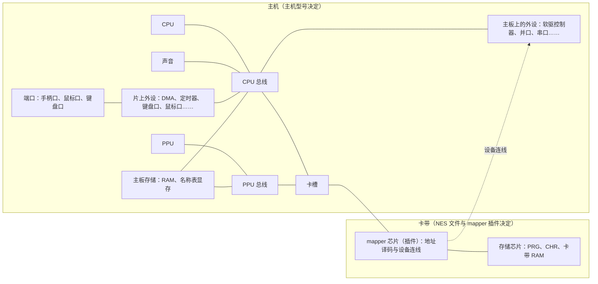

# 硬件模块

模拟器的硬件结构：主机、卡槽、卡带的关系，总线与时钟，芯片与设备模块，主机型号，存储区的归属，电源与复位。整体架构见 [01-软件架构设计.md](01-软件架构设计.md)，mapper 插件见 [03-mapper插件规范.md](03-mapper插件规范.md)。

状态说明同 01。

## 1. 决策

| 决策项 | 结论 | 状态 |
| --- | --- | --- |
| 结构 | 按真机分为主机、卡槽、卡带三部分；卡带插入卡槽，卡槽接入主机总线；宿主的总线只认识卡槽 | 已定 |
| 模块粒度 | 一个型号一个模块；CPU、PPU、声音、每个片上外设、每种设备各自独立 | 已定 |
| 模块之间 | 互不依赖，只经宿主定义的总线、中断线、时钟等契约通信；实例只在组装根创建并连线 | 已定 |
| 主机型号 | 固定硬件的组合（芯片组、主板上的外设与存储、端口、卡槽）；一个机型一个主机型号；mapper 清单只能按名字选择 | 已定 |
| 外设归属 | 软驱控制器、驱动器、并口、串口、键盘接口等外设都在主机上，由主机型号提供；mapper 只能把地址译码连到这些设备的寄存器，不能创建或修改设备 | 已定 |
| 芯片内部 | 芯片内的寄存器与存储写死在芯片模块里，任何 mapper 都不能修改 | 已定 |
| 存储归属 | 芯片内、主板上的由芯片模块与主机型号写死；卡带上的由 mapper 清单声明，见第 5 节 | 已定 |
| 时钟模型 | 调度器按主时钟推进；CPU 每次总线访问推进时钟，PPU 等芯片在被访问前或事件到期时追赶到当前时间；PPU 按点时钟（dot）精度 | 拟定 |
| 首批主机型号 | `fc`（经典 FC）与 `sb2000`（小霸王 SB2000）；步步高软驱一号、步步高 98 等以后各加一个；学习机的主机型号共用芯片组预设 `chipset-um6576`；PAL、Dendy 的经典机以后加 | 拟定 |
| 芯片命名 | 学习机芯片统一叫 6576，模块名带 `um6576`；仓库的 SH6578 资料是同系列芯片的手册，两者有差异，以真机实测为准 | 拟定 |
| 打印机 | 虚拟针式打印机，按 ESC/P 命令打印，插在并口上，每页输出一张 PNG，不弹窗，见第 6.5 节 | 拟定 |

## 2. 结构

| 术语 | 含义 |
| --- | --- |
| 主机型号 | 固定硬件的组合：芯片组、主板上的外设与存储、端口、卡槽，以及时钟与制式；一个机型一个主机型号 |
| 芯片 | 一个硬件模块：如 CPU、PPU、PSG；芯片内部的寄存器和存储属于它自己 |
| 片上外设 | 集成在芯片组里的外设，如 6576 的 DMA、定时器、键盘口、鼠标口 |
| 主板外设 | 主板上的独立芯片，如软驱控制器、并口、串口；由主机型号提供 |
| 设备 | 挂接在总线上的独立硬件模块，如软驱控制器、磁带机；都属于主机，不属于卡带 |
| 卡槽 | 主机上的卡带插座，规定引脚；总线上属于卡带的地址都转交给卡槽 |
| 卡带 | 存储芯片和 mapper 芯片的组合 |
| mapper 芯片 | 卡带上的地址译码与寄存器逻辑，由 mapper 插件提供，见 03 |
| 设备连线 | mapper 把卡槽上的某段地址译码到主机上某个设备的寄存器，见 03 |
| 存储区 | 一块 ROM 或 RAM，有唯一的所有者 |
| 端口 | 主机上接外部设备的插座，如手柄口 |

学习机的特殊处理：NES 格式的 mapper 171 把“BIOS 卡带”和“学习机主板上的译码电路”合成了一个 mapper，文件里无法拆开。所以地址译码（哪一段地址落在软驱控制器的哪个寄存器）由 mapper 的清单与脚本提供；软驱控制器、驱动器、并口等外设本身仍属于主机，由主机型号提供，mapper 不能创建或修改它们。

## 3. 总线与时钟

### 3.1 总线

| 总线 | 宽度 | 内容 |
| --- | --- | --- |
| CPU 总线 | 16 位地址、8 位数据 | 主机型号规定固定的译码：片上寄存器、主板 RAM 在主机内处理；其余地址转给卡槽 |
| PPU 总线 | 14 位地址、8 位数据 | 图案表地址（`$0000-$1FFF`）转给卡槽；名称表地址（`$2000-$3EFF`）按卡槽的显存控制线选择主板显存或卡带；调色板在 PPU 内 |

- 开放总线：没有任何芯片驱动的数据位，读到总线上最近一次的值（读或写留下的），行为与真机一致；这个值由总线模块保存，不由各芯片猜。设备的读结果带“驱动掩码”：`$FF` 表示八位都由设备驱动，`$00` 表示都不驱动，只驱动低 5 位的手柄口为 `$1F`；没有设备的地址等同于掩码 `$00`，写到没有设备的地址会被丢弃，但数据仍留在总线上。
- 地址宽度：CPU 总线 16 位，PPU 总线 14 位；超出宽度的高位被忽略（PPU 访问 `$4000` 以上等同于访问 `$0000` 以上）。
- 6576 的程序存储器分页（`$4040-$4047`）在芯片内，输出更宽的物理地址给卡槽；卡槽的地址线宽度由主机型号声明。

### 3.2 契约

硬件契约放在 `core/src/contracts/hardware/`，均为纯虚类：

| 契约 | 内容 |
| --- | --- |
| `Clock`、`Scheduler` | 主时钟，各芯片的分频，按时间点调度事件 |
| `CpuBus`、`PpuBus` | 总线的读写入口，以及“把地址范围挂给某个 `BusDevice`”的登记；两者共用基类 `Bus`，只有地址宽度不同 |
| `BusDevice` | 响应一个地址范围的读写，地址为总线上的绝对地址；读的结果带“驱动了哪些数据位”的掩码 |
| `IrqLine` | 中断线：IRQ 与 NMI 各创建一根，多个来源是线或关系；RESET 不是线，复位直接调用 `Cpu::reset` |
| `RdyLine` | CPU 的暂停线，DMA 用它暂停 CPU；与 `IrqLine` 是不同的类型，同样是线或关系 |
| `Cpu` | 复位、按周期数运行、读取寄存器状态；总线、时钟与三根线在构造时接入 |
| `Ppu` | 复位、按时间追赶、输出帧缓冲（每像素 4 字节，内存顺序为 R、G、B、A，A 恒为 255，可直接上传为 RGBA8 纹理）；寄存器读写经 `BusDevice` 挂在 CPU 总线上 |
| `Device` | 总线设备加复位与事件到期；中断输出经构造时接入的 `IrqLine` 发出 |
| `StorageRegion` | 存储区：容量、种类、字节读写、批量读取；ROM 拒绝写 |
| `ControllerPort`、`ControllerDevice`、`ButtonInput` | 手柄口（锁存线、时钟线、数据线）、插在口上的设备，以及设置标准手柄按键的输入接口（8 位掩码，位 0 为 A，位 7 为右） |
| `ParallelPort` | 并口：8 位数据线，选通、自动换行、选择、复位线，忙、应答、缺纸、联机、出错线；打印机阶段再加 |
| `CartridgeSlot`、`Cartridge` | 卡槽的引脚与卡带的对外接口，卡槽的复位转给插着的卡带，见第 4 节 |
| `Machine` | 一台装配好的主机：电源、复位、按时间运行、运行到 PPU 完成一帧、取帧缓冲、设置手柄按键、读 CPU 寄存器（测试与调试用） |

- 契约只写当前里程碑用得上的方法；状态快照（见第 9 节）在调试服务阶段加到 `Device`、`Machine` 上。
- 契约头文件只能包含标准库、`contracts/hardware` 与 `shared`，不引用 `logic` 与第三方库，由 `npm run boundaries` 检查。

### 3.3 时钟与调度

- 主机型号声明主时钟与各芯片的分频（如 CPU 与 PPU 的比例），并声明制式（每帧行数、帧率）。
- 调度器按主时钟推进。CPU 每完成一次总线访问就推进时钟；PPU、PSG 等不逐周期运行，在 CPU 访问它们之前、以及自己的事件到期时，追赶到当前时间。
- 需要定时的设备（定时器、软驱、DAC）向调度器登记事件：“某个时间点回调我”，不要求每周期被调用。
- mapper 脚本只能登记“若干 CPU 周期后回调”的事件，不能每周期回调，见 03。
- 声音按时钟生成采样，交给音频输出的环形缓冲，不依赖界面的帧率。

实现细则（`ClockDomain`、`Scheduler` 的契约与实现）：

| 项 | 内容 |
| --- | --- |
| 时间 | 主时钟计数 `MasterTime`（有符号 64 位），从上电起计；`ClockDomain` 给出芯片周期与主时钟周期的换算（NTSC：CPU 12，PPU 4） |
| 推进 | `Clock::advance` 向前推进；推进过程中到期的事件按（时间点，登记先后）顺序先于时钟到达终点被触发；事件回调里 `now()` 等于事件的时间点，回调中可以登记、取消事件，但不能推进时钟；时间点已过的事件在下一次推进时立即触发 |
| 总线访问时刻 | CPU 的每个总线周期先推进半个周期，再访问总线，再推进剩余的半个周期；PPU 等被访问时追赶到访问时刻 |
| 暂停 | `RdyLine` 有效时，CPU 在读周期暂停：每个暂停周期只推进时钟，不访问总线，暂停方靠调度器事件推进传输并释放；写周期不暂停；连续暂停超过 100 万个周期按错误处理 |

### 3.4 硬件基础模块

硬件基础模块在 `core/src/logic/hardware/<模块>/`，命名空间 `ember::logic::hardware`，互不引用，只经 `contracts/hardware`：

| 模块 | 内容 |
| --- | --- |
| `scheduler` | `MasterScheduler`：主时钟与事件队列 |
| `bus` | `BusMap`（地址范围登记、分发、开放总线）、`CpuAddressBus`（16 位）、`PpuAddressBus`（14 位）；挂载范围起点大于终点、超出地址宽度、与已挂载的重叠，都明确报错（`hardware.busRangeInvalid`、`hardware.busRangeConflict`），报错后已有的挂载不变 |
| `lines` | `WiredOrIrqLine`、`WiredOrRdyLine`：线或信号线，每根线最多 32 个来源 |
| `cpu-6502` | 经典 FC 的 CPU 核，见第 6.1 节 |
| `ppu-2c02` | 经典 FC 的 PPU，见第 6.1 节 |
| `dma-2a03`、`pad-2a03` | 经典 FC 的 2A03 片上外设：精灵 DMA 与手柄口，见第 6.3 节 |
| `joypad` | 标准手柄，见第 6.4 节 |
| `ram` | `RamBlock`（可读写的存储区）与 `MirroredRam`（按容量镜像挂到总线上的设备） |
| `cartridge-slot` | `StandardCartridgeSlot`：卡槽，把 CPU 总线与 PPU 总线上属于卡带的访问转给卡带，空槽时开放总线 |
| `nametable-ram` | `NametableRam`：主板上 2K 的名称表显存，按卡槽的显存控制线选择哪一页响应，或交给卡带自带的显存 |
| `null-device` | `NullDevice`：空设备，读不驱动数据线，写被忽略，给还没实现的芯片占位 |

硬件的错误码在 `contracts/hardware/hardware-error.hpp`，以 `hardware.` 开头，经 `shared::CoreError` 抛出；这些错误都是装配或调用方的错误，不是运行中的正常情况。

## 4. 卡槽与卡带

### 4.1 卡槽引脚（拟定）

| 侧 | 引脚 | 说明 |
| --- | --- | --- |
| CPU 侧 | 地址线、数据线、读写线、PRG 片选（A15 与时钟的组合）、时钟 | 卡槽把 CPU 总线上属于卡带的访问交给卡带 |
| PPU 侧 | 地址线、数据线、读写线 | 图案表访问 |
| 显存控制 | CIRAM 的 A10 与片选 | 决定名称表用主板显存的哪一页，或由卡带自带显存接管 |
| 中断 | IRQ 输出 | 卡带向 CPU 的 IRQ 线输出 |
| 声音 | 扩展音频输入 | 卡带带音源时混入 |

- 卡槽引脚细节在实现时对照真机资料逐项定；地址线的宽度由主机型号声明。

### 4.2 卡带的组成与加载

卡带由两部分组成，加载 NES 文件时由卡带模块创建：

1. 存储芯片：PRG-ROM、CHR（ROM 或 RAM）、卡带 RAM，数据来自 NES 文件，大小与种类由 mapper 清单声明。
2. mapper 芯片：由匹配到的插件创建，决定卡槽上的访问由哪个存储芯片的哪个位置响应，并按清单把需要的地址译码连到主机上的设备。

卡带上没有设备：软驱控制器、DAC 等外设都在主机上，见第 6 节。

加载流程见 03 第 5 节。

## 5. 存储区的归属

| 位置 | 例子 | 谁定 | mapper 能否改 |
| --- | --- | --- | --- |
| 芯片内 | PPU 的 OAM、调色板；6576 的片内 2K RAM | 芯片模块写死 | 否 |
| 主板上 | 经典 FC 的 2K RAM、2K 名称表显存；学习机主板上的存储 | 主机型号写死 | 否 |
| 卡带上 | PRG-ROM、CHR、卡带 RAM；学习机的扩展内存与显存 | mapper 清单声明 | 是 |

- 一块存储区只有一个所有者，只经所有者访问；调试读取内存也经所有者的接口，不绕过。
- 6576 的片内 RAM：真机实测只有 2K，`$0800-$1FFF` 是 `$0000-$07FF` 的镜像；`$4400-$5FFF` 读出 `$68`，写入无效，所以 `$5000-$57FF` 不是 RAM；这些是芯片行为，写死在芯片模块里。
- 学习机的每块存储究竟属于主板还是卡带，要对照 `machines/sb2000` 的资料和实测逐项核对后写进主机型号文档和 mapper 清单；原则是真机属于哪一边就放哪一边，不为方便挪动。

## 6. 芯片与设备模块

首批模块清单（拟定）。寄存器与位定义以 `machines/` 资料、sh6578-chipset 手册与真机实测为准，两者不一致时以实测为准。

### 6.1 CPU 与 PPU

| 模块 | 内容 | 状态 |
| --- | --- | --- |
| `cpu-6502` | 经典 FC 的 CPU 核：6502 指令集，无十进制模式 | 拟定 |
| `cpu-um6576` | 6576 的 CPU 核：6502 兼容；与 `cpu-6502` 的差异待逐项核对 | 待定 |
| `ppu-2c02` | 经典 FC 的 PPU（NTSC）；PAL 与 Dendy 的 PPU 以后加 | 已完成 |
| `ppu-um6576` | 6576 的 PPU：增强的颜色位、不同的调色板与精灵规则、`$2008` 等寄存器 | 拟定 |

`cpu-6502` 的实现（已完成，nestest 通过）：

| 项 | 内容 |
| --- | --- |
| 指令 | 全部官方指令；非官方指令只做 nestest 用到的：LAX、SAX、DCP、ISB、SLO、RLA、SRE、RRA、各种 NOP 变体与 `$EB` 的 SBC；其余操作码按 2 周期的单字节 NOP 处理；无十进制模式，D 标志可以设置与清除，但不影响运算 |
| 周期 | 每个总线周期（含空读、读改写的假写、跨页修正前的空读、分支的空读）都经 `CpuBus` 完成并推进主时钟；写与读改写的带索引寻址一定有修正前的空读，读只在跨页时有 |
| 复位 | 7 个周期：两次空读、三次只读不写的“压栈”（栈指针下移 3）、读 `$FFFC/$FFFD`；上电复位寄存器清零、状态为 `$24`、周期重新计数，软复位保留寄存器与累计周期 |
| 中断 | 每个周期结束时采样 IRQ（受 I 标志屏蔽）与 NMI（有效边沿），用倒数第二个周期的结果决定指令结束后是否响应，所以 CLI 之后的 IRQ 要等下一条指令执行完才响应；序列共 7 个周期，硬件中断压入的状态不带 B，BRK 带 B；选向量发生在压栈之后，此时到来的 NMI 会劫持 IRQ 与 BRK 的向量；成功的分支会忽略刚出现的 IRQ，把中断推迟到下一条指令之后 |
| 接口 | `reset(power)`、`run(cycles)`（至少运行指定的周期，指令不被打断）、`registers()`（状态位 5 恒为 1，位 4 恒为 0） |

`ppu-2c02` 的实现（已完成，PPU 测试 ROM 通过，见第 10 节）：

| 项 | 内容 |
| --- | --- |
| 寄存器 | `$2000-$2007`，每 8 字节镜像一次直到 `$3FFF`；读只写寄存器读到数据总线上最近一次的值（不模拟衰减）；读 `$2002` 清 vblank 与写锁存，低 5 位取总线旧值；`$2007` 读经缓冲，调色板直接读出并把调色板下面的名称表装入缓冲，渲染期间访问 `$2007` 同时递增粗 X 与 Y；读 `$2004` 时属性字节屏蔽位 2-4，渲染期间返回评估正在用的值（第 1-64 点为 `$FF`），渲染期间写 `$2004` 不改 OAM，只让地址加 4 |
| 内部状态 | v、t、精细 X、w（loopy 滚动模型）；OAM 256 字节、次级 OAM 32 字节；调色板 32 字节（`$3F10/14/18/1C` 镜像 `$3F00/04/08/0C`，`$3F20` 起每 32 字节镜像）。上电时 OAM 全为 `$FF`，调色板取 blargg 的 `power_up_palette` 测试表（其作者的 NES 上的实测值，真机每次上电不同） |
| 时间 | 每行 341 点、每帧 262 行（NTSC）；点 k 在主时钟 `相位 + 4k` 执行，CPU 在同一时刻或更晚访问寄存器就能看到它的结果；PPU 不逐周期运行：CPU 访问寄存器前、自己的调度事件到期时才追赶到当前时间；调度事件登记在会改变 NMI 线的点上：241 行第 1 点、预渲染行第 1 点、预渲染行第 339 点（奇数帧在这里决定是否跳点，此后下一帧 vblank 的位置才确定），所以 CPU 逐周期采样 NMI 线时不会漏掉变化 |
| 帧 | 奇数帧在背景开启时跳过预渲染行的最后一点，判断用前一个点结束时的背景开关（背景开关写入有 1 个点的延迟）；第 240 行第 0 点发布一帧：双缓冲，`frame()` 返回最近完成的一帧，`frameCount()` 加 1，没有完成过帧时宽高为 0 |
| vblank 与 NMI | 241 行第 1 点置位，预渲染行第 1 点清除（同时清精灵 0 命中与精灵溢出）；NMI 线 = vblank 标志且 `$2000` 位 7；读 `$2002` 发生在置位前一个点：读到 0，本帧不置位也不产生 NMI；读发生在置位同一点或后一个点（此时 CPU 还没有采样到 NMI 线）：读到置位的标志并清除，NMI 线在 CPU 采样前回落，所以没有 NMI；更晚的读正常；在 vblank 期间使能 NMI，线立即有效，CPU 在下一条指令之后响应 |
| 背景 | 每 8 点取一个图块（名称表、属性表、图案低位、图案高位），16 位移位寄存器，精细 X 选位；第 256 点递增 Y，第 257 点复制横向位，预渲染行第 280-304 点复制纵向位；`$2001` 位 1 控制左 8 列遮罩 |
| 精灵 | 可见行第 1-64 点清次级 OAM，第 65-256 点评估（奇数点读主 OAM、偶数点写次级 OAM），含精灵溢出标志与“n、m 同时递增”的硬件缺陷；第 257-320 点取精灵图案（8x8 与 8x16、水平与垂直翻转），每行最多 8 个；预渲染行不评估精灵，所以第 0 行没有精灵；`$2001` 位 2 控制左 8 列遮罩 |
| 精灵 0 命中 | 精灵 0 与背景的不透明像素重合时置位，第 255 列除外，被遮罩的像素不参与；在预渲染行第 1 点清除 |
| 输出 | 256x240，每像素 4 字节，内存顺序 R、G、B、A（A 恒为 255；小端机器上整数值为 0xAABBGGRR）；颜色取自按 NTSC 复合视频信号电平与解码算法生成的 RGB 表（含 8 种颜色强调组合，来源见 `ntsc-palette.cpp` 的文件头），灰度位把颜色号与 `$30` 相与；整个渲染关闭且 v 指向调色板时，输出 v 指向的那一项 |
| 接口 | 构造时注入调度器、PPU 总线、NMI 线、时钟域与相位；`reset(power)`、`catchUp(now)`、`frame()`、`frameCount()`；另有只读的内部状态访问，供测试与调试 |

### 6.2 声音

| 模块 | 内容 | 状态 |
| --- | --- | --- |
| `apu-2a03` | 经典 FC 的 APU：两个方波、三角波、噪声、DMC | 拟定 |
| `psg-um6576` | 6576 的 4 通道 PSG（`$4000-$4015`） | 拟定 |

### 6.3 6576 的片上外设

| 模块 | 地址 | 内容 |
| --- | --- | --- |
| `sysinit-um6576` | `$4031` | 初始设置 |
| `irq-um6576` | `$4032`、`$4033` | 中断屏蔽与状态 |
| `timer-um6576` | `$4034-$4036` | 定时器 |
| `rtc-um6576` | `$4080`、`$4081` | 实时时钟 |
| `paging-um6576` | `$4040-$4047` | 程序存储器分页 |
| `dma-um6576` | `$4014`、`$4048-$404F` | 精灵 DMA 与通用 DMA |
| `keyboard-um6576` | `$4020-$4022` | 键盘接口 |
| `mouse-um6576` | `$4023`、`$4024`、`$4026` 位 1 | 串口式鼠标接口：`$4023` 选择，`$4024` 读串行数据，RTS 经 `$4026` 位 1，中断经 `$4033` 位 6 |
| `pad-um6576` | `$4016`、`$4017` | 手柄口 |
| `printer-um6576` | `$4025` | 并口（`ParallelPort`）：数据线经 `$4025`，控制线经扩展 I/O，具体位对照手册与实测核对 |
| `expio-um6576` | `$4026` | 扩展 I/O |
| `dac-um6576` | `$4027` | DAC |

- 上表按片上功能划分，每个模块独立，由芯片组预设 `chipset-um6576` 在组装根组合；模块之间的联动（DMA 暂停 CPU、定时器触发中断）经契约中的 `RdyLine`、`IrqLine` 完成。
- `$41XX-$43XX` 的超级 I/O 不属于芯片，是主板上的电路：设备由主机型号提供，地址译码由 mapper 清单连线。

经典 FC 的 2A03 片上外设：

| 模块 | 地址 | 内容 | 状态 |
| --- | --- | --- | --- |
| `dma-2a03` | `$4014` | 精灵 DMA | 已完成 |
| `pad-2a03` | `$4016`、`$4017` | 手柄口 | 已完成 |

| 项 | 内容 |
| --- | --- |
| `dma-2a03` 时序 | 写 `$4014`（值为源页的高 8 位）后 CPU 在下一个读周期暂停（RDY）；写发生在周期 c 的中点，周期 c+1 是等待周期，第一次读必须落在偶数周期上，所以 c 为奇数时再加 1 个对齐周期；之后 256 组“读源地址、写 `$2004`”各占 2 个周期，总共暂停 513 或 514 个周期 |
| `dma-2a03` 实现 | 传输靠调度器事件推进：每个写周期的中点经 CPU 总线读源地址、写 `$2004`（PPU 的 OAM 地址随之递增），最后一个写周期结束时释放 RDY；传输进行中再写 `$4014` 被忽略；复位取消传输；读 `$4014` 不驱动数据线；DMC 的 DMA 与它的相互影响在实现 APU 时再做 |
| `pad-2a03` | 两个手柄口（`ControllerPort`，设备插在上面，没有设备时数据线读 0）；读 `$4016`、`$4017` 分别取口 1、口 2 的数据线，只驱动低 5 位（高 3 位保持总线上的值）；写 `$4016` 的位 0 是锁存线，同时送给两个口；写 `$4017` 属于 APU 的帧计数器，本模块忽略，实现 `apu-2a03` 时由主机型号在 `$4017` 上接转接设备 |

### 6.4 设备

| 模块 | 内容 | 状态 |
| --- | --- | --- |
| `fdc-upd765` | 软驱控制器：命令阶段、结果阶段、寻道、就绪、写保护、DMA 与中断 | 拟定 |
| `floppy-drive` | 软驱驱动器：持有盘片镜像、磁头位置、索引脉冲、写保护；故障注入（取盘、写保护、无索引、卡磁头、控制器无响应、指定扇区校验错） | 拟定 |
| `tape-deck-data` | 数据磁带机：1 位信号的录放，用于 FBASIC 的 SAVE 与 LOAD；磁带文件是声音文件，具体格式在实现时定 | 拟定 |
| `tape-deck-av` | 声像磁带机：立体声，一路声音、一路画面数据；用于 `qls.nes` 等 mapper 172 的卡带 | 拟定 |
| `keyboard-sb2000` | 小霸王键盘：物理键位到键盘扫描码的映射 | 待定 |
| `keyboard-bbk` | 步步高键盘 | 待定 |
| `joypad` | 标准手柄：锁存线为高时不断采样按键并输出 A 键；变为低后保持，每个时钟脉冲移出下一位（A、B、选择、开始、上、下、左、右），移空后读到 1；按键经 `ButtonInput` 以 8 位掩码设置 | 已完成 |
| `mouse-sb2000` | 小霸王串口鼠标：产生 3 字节数据包 | 待定 |
| `mouse-bbk` | 步步高鼠标：接在手柄口上 | 待定 |
| `printer-escp` | 针式打印机：ESC/P 命令，9 针与 24 针；插在并口上，打印到 PNG，见第 6.5 节 | 拟定 |

- 设备分三类：片上外设（芯片组自带）、主板上的外设（主机型号提供，如软驱控制器、并口）、用户可插拔的设备（介质与外设，如软盘、磁带、鼠标）。设备都属于主机，卡带上没有设备。
- 软驱控制器与驱动器分开：控制器是芯片，驱动器是机械部件；主机型号提供控制器和驱动器，盘片由用户经界面或调试服务插入。
- 小霸王与步步高的键盘和鼠标协议差别很大，每种单独成模块，协议细节在实现时对照 `machines/` 的资料核对。

### 6.5 针式打印机

打印机是并口上的一台虚拟针式打印机，把打印内容画成图片保存，不连接真实打印机。

| 项 | 内容 |
| --- | --- |
| 模块 | `printer-escp`，插在并口上；主机型号默认接一台 |
| 并口信号 | 主机到打印机：8 位数据、选通、自动换行、选择、复位；打印机到主机：忙、应答、缺纸、联机、出错；虚拟打印机始终联机、不忙、不缺纸、不出错 |
| 命令 | `ESC @` 复位并回到页首；`ESC *` 选择点密度并打印位图；`ESC L` 120 点密度位图；`ESC 3` 设置行距；`ESC J` 进纸；`ESC C`、`ESC N` 读入页长与下边距；`ESC <` 打印头回左端；`CR`、`LF`、`FF`；其余字节忽略 |
| 点阵 | 9 针（位图每列 8 点，纵向 72 点/英寸）与 24 针（纵向 180 点/英寸），横向 60 到 360 点/英寸；24 针的一列是 3 个字节 |
| 页面 | A4，按 200 点/英寸画成 1660×2340 像素的黑白图；左边距 60 像素，上边距 96 像素；两种针数都按 200 点/英寸近似 |
| 输出时机 | 收到 `FF`；复位线有效；断电或硬复位；6 秒（模拟时间）没有收到数据；写满一页；调用 `media.printerFlush` |
| 空白页 | 页上没有任何点时不生成文件 |
| 文件名 | `printer-YYYYMMDD-HHMMSS.png`，按输出时的本机日期时间生成；同一秒输出多页时在后面加 `-2`、`-3` |
| 保存位置 | 首选项“打印机”里的“图片保存位置”；目录不存在时创建；默认值待定 |
| 弹窗 | 不弹出保存或打印对话框，调试服务的操作同样不弹出 |
| 失败 | 目录无法写入时用通知和运行消息说明原因，该页丢弃 |
| 编码 | 黑白两色的 PNG，用 miniz 编码 |

- 命令与点阵参数来自旧版的实现，以 `machines/sb2000` 打印机服务（功能 `$76-$7A`）的实测核对：打印机收到的字节序列、行距、进纸、图形命令都与真机一致才算完成。
- 与旧版不同：旧版收到 `ESC @` 时先弹出“打印目标”对话框，输出 PNG 时再弹出保存对话框，写满一页后丢弃超出的点；本模块没有任何对话框，写满一页会先输出再开新页。

### 6.6 主机型号

主机型号把芯片组、主板上的外设、存储和端口固定地组合起来，在 `core/src/bootstrap/machines/<主机型号>.cpp` 里装配。芯片组预设只是模块的组合，机型相关的外设不放在里面。

| 主机型号 | 芯片组 | 主板上的外设 | 端口 | 状态 |
| --- | --- | --- | --- | --- |
| `fc` | `cpu-6502`、`ppu-2c02`、`apu-2a03` | 无 | 手柄口 1、2 | 已完成（`apu-2a03` 以空设备占位） |
| `sb2000` | `chipset-um6576` | 软驱控制器与驱动器、并口（接 `printer-escp`）、小霸王键盘 | 手柄口 1、2，片上串口鼠标口 | 待核对 |
| `bbk-fd1`、`bbk-98` | `chipset-um6576`（待核对） | 软驱控制器与驱动器、并口、步步高键盘 | 手柄口 1、2，鼠标接在手柄口上 | 以后加 |

- 各机型主板上有哪些外设、驱动器数量、存储归属，对照 `machines/` 的资料与实测逐项核对后写定。

`fc` 的装配（`core/src/bootstrap/machines/fc.hpp`、`fc.cpp`，类 `FcMachine`）：

| 项 | 内容 |
| --- | --- |
| 时钟 | 主时钟 21.477272 MHz；CPU 12 分频，PPU 4 分频；每帧 262 行、每行 341 点 |
| CPU 总线 | `$0000-$1FFF` 内部 RAM（2K，每 2K 镜像）；`$2000-$3FFF` PPU（每 8 字节镜像）；`$4000-$4013` 与 `$4015` APU（本阶段是空设备，装配处留着替换成 `apu-2a03` 的位置）；`$4014` 精灵 DMA；`$4016-$4017` 手柄口；`$4018-$401F` 没有设备（开放总线）；`$4020-$FFFF` 卡槽 |
| PPU 总线 | `$0000-$1FFF` 图案表，由卡槽转给卡带；`$2000-$3EFF` 名称表，按卡槽的显存控制线选择主板 2K 显存的哪一页，或交给卡带自带的显存；调色板在 PPU 内，不经总线 |
| 线 | NMI 线只有 PPU 一个来源；IRQ 线暂时没有来源（卡带与 APU 以后接入）；RDY 线只有 DMA 一个来源 |
| 相位 | 上电后 PPU 第 0 点在主时钟 `PPU_PHASE_TICKS`（1）处；CPU 的 7 个复位周期之后第一条指令开始于 PPU 第 0 行第 21 点；这个相位按 blargg 的 vblank/NMI 时序测试调定（真机每次上电在四种相位里随机取一种，见第 12 节） |
| 电源 | `powerOn()`：时钟归零、丢弃旧事件，内部 RAM 与名称表显存清零（以后按选项取全零或随机），APU、DMA、PPU、卡带复位，最后 CPU 复位；`softReset()`：只复位 APU、DMA、PPU、卡带与 CPU，内部 RAM 保持；`powerOff()`：停止运行 |
| 运行 | `run(ticks)` 按主时钟周期数运行并让 PPU 追赶；`runFrame()` 逐条指令运行，直到 PPU 完成下一帧（第 240 行第 0 点）；输入经 `setButtons(port, 掩码)`，端口号只有 0 与 1 |
| 测试用 | `ppu()`、`internalRam()`、`nametableRam()`、`peekPpuBus(地址)`（直接读 PPU 总线的图案表与名称表） |

### 6.7 软盘文件的同步

界面的右边栏可以在学习机运行时增删改盘片里的文件，学习机立即看到变化，见 05 第 4.6 节。

| 项 | 内容 |
| --- | --- |
| 数据来源 | 盘片镜像由 `floppy-drive` 持有，是唯一的数据；学习机经软驱控制器读写它，界面经请求读写它，两者看到的始终是同一份 |
| 文件系统 | 盘片镜像按 FAT12 解析，解析与修改放在 `media` 模块的逻辑层，不放进硬件模块；先支持根目录，子目录待定 |
| 外部修改 | 界面或调试服务的修改经命令队列投递到模拟线程，在指令边界原子执行；一次修改完成后，学习机才能进行下一次磁盘访问 |
| 学习机写盘 | 学习机写盘后镜像变化，发事件 `media.floppyFilesChanged`，右边栏刷新 |
| 学习机的缓存 | SB-DOS 把引导扇区和 FAT 缓存在扩展 RAM 里；外部修改后必须让它重新读盘，否则它看到的还是旧目录，甚至会用旧 FAT 覆盖外部的修改；让缓存失效的办法见第 11 节“待核对” |
| 写保护 | 写保护的盘片拒绝外部修改 |
| 保存 | 外部修改与学习机写盘都只改内存里的盘片镜像，“保存镜像”才写回文件，不自动落盘 |

## 7. 端口与输入设备

- 端口是主机上的插座，契约为 `ControllerPort`；设备插在端口上，端口不知道设备的种类。
- 经典 FC：手柄口 1、2，各接一个标准手柄。
- 小霸王 SB2000：手柄口 1、2；片上的串口式鼠标接口；键盘口；并口（`ParallelPort`），接虚拟针式打印机。
- 步步高的鼠标接在手柄口上，作为一种插在手柄口的设备，与手柄互斥。
- 界面把键盘、手柄、鼠标采集成设备事件，由 `input` 模块按用户的映射送给插在端口上的设备；设备如何响应由设备模块决定。

## 8. 电源与复位

| 操作 | 行为 |
| --- | --- |
| 上电 | 创建或重置全部芯片与设备到上电状态；存储区的上电内容按选项取全零或随机；卡带的存储区重新从 NES 文件载入（带电池的 RAM 先载入存档文件） |
| 断电 | 停止运行，芯片状态丢弃；插在驱动器里的盘片和磁带保持不变 |
| 硬复位 | 断电后再上电 |
| 软复位 | 只发 RESET 线；各芯片按自己的复位行为处理，存储区内容、mapper 芯片的状态按真机保持或清除，由各模块实现 |
| 介质 | 软盘与磁带的插拔、录放与电源无关，随时可以操作 |

## 9. 状态快照

- 每个硬件模块和 mapper 插件都要能导出当前状态（寄存器、内部计数、存储区摘要），格式为 JSON，字段名固定、有说明。
- 调试服务据此提供“完整获得运行中所有数据与状态”的能力，见 04；状态也是以后做存档的基础。
- 快照方法在做调试服务时加到硬件契约上；`cpu-6502` 目前只有 `registers()`。
- mapper 脚本的内部寄存器必须放在宿主管理的状态对象里，见 03。

## 10. 验收依据

- 与真机的一致性以真机实测为准：`apps/sb2000/memtest`、`apps/sb2000/hwtest` 等实测程序的结果作为芯片与主板模块的验收用例；新模拟器要重现旧版已经对齐的实测行为。
- 经典 FC 部分以公开的测试 ROM 为验收用例，具体清单在实现时登记；已登记：`nestest`（CPU，数据与来源在 `core/test/data/nestest/`，自动模式逐行比对日志的 PC、A、X、Y、P、SP 与周期数，8991 行全部一致）。
- PPU 的验收用例（来自 christopherpow/nes-test-roms，数据、来源与用途见 `core/test/data/` 各子目录的 `README.md`，由 `core/test/hardware/ppu-rom-test.cpp` 运行）：`blargg-ppu-tests`（5 个）、`sprite-hit-tests`（11 个）、`sprite-overflow-tests`（5 个）、`vbl-nmi-timing`（7 个）、`ppu-vbl-nmi`（10 个）、`oam-read`、`oam-stress`、`ppu-read-buffer`，共 41 个全部通过；`ppu-open-bus` 失败在第 3 项，见第 12 节。测试用的 NROM 卡带只在测试代码里，核心程序里没有 mapper 的实现。
- PPU 的单元测试在 `ppu-2c02-test.cpp`（寄存器与镜像、滚动、vblank 与 NMI、帧长度、精灵评估与命中、帧缓冲格式），精灵 DMA、手柄、主机装配分别在 `dma-2a03-test.cpp`、`joypad-test.cpp`、`fc-machine-test.cpp`。

## 11. 待核对

| 项 | 核对内容 | 依据 |
| --- | --- | --- |
| 6576 CPU 核 | 与 6502 的差异（指令、时序、十进制模式、DMA 暂停的细节） | 手册与实测 |
| 学习机的存储归属 | RAM、显存、BIOS 的位置：属主板还是卡带 | `machines/sb2000` 与实测 |
| 卡槽引脚 | 6576 机型卡槽的地址线宽度与分页输出 | 手册与旧版 `resolve` 行为 |
| 制式 | 6576 机型的时钟、每帧行数、帧率 | 实测 |
| 步步高键盘与鼠标 | 协议与接口位置 | `machines/bbk` |
| 软盘文件的同步 | 外部修改后怎样让 SB-DOS 的 FAT 缓存（引导扇区加 9 个 FAT 扇区，缓存有效标志 `FS_FAT_CACHE_VALID`）失效：软驱是否有盘片更换信号、SB-DOS 是否检查，若不检查再改用什么办法；学习机正在读写该盘时外部修改的处理；SB-DOS 允许的文件名字符 | `machines/sb2000` 的反汇编与实测 |

## 12. 已知差异

经典 FC 的实现与真机、测试 ROM 的已知差异。“预期”是真机或测试 ROM 的要求，“实际”是当前实现的行为；修复后删除对应行并同步测试。

| 项 | 预期 | 实际 | 影响与登记 |
| --- | --- | --- | --- |
| 开放总线衰减 | PPU 数据总线上的每一位若约 600 毫秒没有被刷新为 1，就衰减为 0（`ppu_open_bus` 第 3 项 `Decay value should become zero by one second`） | 读只写寄存器、`$2002` 低 5 位与调色板高 2 位读到最近一次写入或读出的值，不衰减 | `ppu_open_bus.nes` 失败在第 3 项；测试 `PpuRomKnownDifferences.OpenBusDecayIsNotSimulated` 断言这个结果，实现衰减后改为普通的通过测试 |
| 上电预热 | PPU 上电或复位后约 29658 个 CPU 周期内忽略对 `$2000`、`$2001`、`$2005`、`$2006` 的写入 | 写入立即生效 | 游戏会自己等两次 vblank，不影响运行；没有测试 ROM 依赖 |
| CPU 与 PPU 的相位 | 真机每次上电在四种相位里随机取一种，部分测试（如 `oam_stress`、vbl/NMI 时序）只在其中一种通过 | 固定一种（`PPU_PHASE_TICKS` 为 1，由 vbl/NMI 时序测试调定），软复位后 PPU 从第 0 行第 0 点重新开始 | 相位不可选；需要时再加到电源选项 |
| 上电内容 | OAM 与调色板随机，内部 RAM 随机 | OAM 全为 `$FF`，调色板取 `power_up_palette` 测试表，RAM 与名称表显存全零 | 第 8 节“按选项取全零或随机”的选项以后随 `runtime` 模块加 |
| 寄存器写入的延迟 | `$2001` 等寄存器的写入对渲染的生效有若干点的延迟 | 只有奇偶帧跳点的判断有 1 个点的延迟，其余寄存器写入立即生效 | 精灵命中与溢出测试全部通过；更细的写入时序没有测试 ROM 覆盖 |
| OAM 的硬件缺陷 | 渲染中途关闭会损坏 OAM；2C02G/H 在 OAM 地址非 0 时评估开始会触发刷新缺陷 | 不模拟 | 没有测试 ROM 依赖 |
| 调色板 | 与真机和电视的颜色有差别 | 由 NTSC 复合视频信号电平解码生成，不含微分相位失真与色彩伪影 | 只影响颜色观感；以后可加调色板选项 |
| `$4017` 的写 | 写 `$4017` 设置 APU 帧计数器 | 本阶段被手柄口忽略 | 实现 `apu-2a03` 时由主机型号在 `$4017` 上接转接设备 |
| DMC 的 DMA | DMC 取样的 DMA 会与精灵 DMA 相互影响，改变暂停的周期数 | 没有 DMC | 实现 `apu-2a03` 时一并做 |
