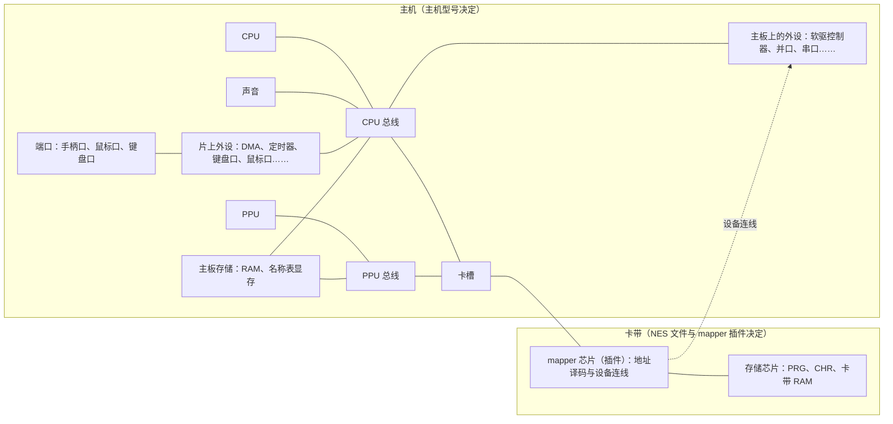

# 硬件模块

模拟器的硬件结构：主机、卡槽、卡带的关系，总线与时钟，芯片与设备模块，主机型号，存储区的归属，电源与复位。整体架构见 [01-软件架构设计.md](01-软件架构设计.md)，mapper 插件见 [03-mapper插件规范.md](03-mapper插件规范.md)。

状态说明同 01。

## 1. 决策

| 决策项 | 结论 | 状态 |
| --- | --- | --- |
| 结构 | 按真机分为主机、卡槽、卡带三部分；卡带插入卡槽，卡槽接入主机总线；宿主的总线只认识卡槽 | 已定 |
| 模块粒度 | 一个型号一个模块；CPU、PPU、声音、每个片上外设、每种设备各自独立 | 已定 |
| 模块之间 | 互不依赖，只经宿主定义的总线、中断线、时钟等契约通信；实例只在组装根创建并连线 | 已定 |
| 主机型号 | 固定硬件的组合（芯片组、主板上的外设与存储、端口、卡槽）；一个机型一个主机型号；mapper 清单只能按名字选择 | 已定 |
| 外设归属 | 软驱控制器、驱动器、并口、串口、键盘接口等外设都在主机上，由主机型号提供；mapper 只能把地址译码连到这些设备的寄存器，不能创建或修改设备 | 已定 |
| 芯片内部 | 芯片内的寄存器与存储写死在芯片模块里，任何 mapper 都不能修改 | 已定 |
| 存储归属 | 芯片内、主板上的由芯片模块与主机型号写死；卡带上的由 mapper 清单声明，见第 5 节 | 已定 |
| 时钟模型 | 调度器按主时钟推进；CPU 每次总线访问推进时钟，PPU 等芯片在被访问前或事件到期时追赶到当前时间；PPU 按点时钟（dot）精度 | 拟定 |
| 首批主机型号 | `fc`（经典 FC）与 `sb2000`（小霸王 SB2000）；步步高软驱一号、步步高 98 等以后各加一个；学习机的主机型号共用芯片组预设 `chipset-um6576`；PAL、Dendy 的经典机以后加 | 拟定 |
| 芯片命名 | 学习机芯片统一叫 6576，模块名带 `um6576`；仓库的 SH6578 资料是同系列芯片的手册，两者有差异，以真机实测为准 | 拟定 |
| 打印机 | 虚拟针式打印机，按 ESC/P 命令打印，插在并口上，每页输出一张 PNG，不弹窗，见第 6.5 节 | 拟定 |

## 2. 结构

| 术语 | 含义 |
| --- | --- |
| 主机型号 | 固定硬件的组合：芯片组、主板上的外设与存储、端口、卡槽，以及时钟与制式；一个机型一个主机型号 |
| 芯片 | 一个硬件模块：如 CPU、PPU、PSG；芯片内部的寄存器和存储属于它自己 |
| 片上外设 | 集成在芯片组里的外设，如 6576 的 DMA、定时器、键盘口、鼠标口 |
| 主板外设 | 主板上的独立芯片，如软驱控制器、并口、串口；由主机型号提供 |
| 设备 | 挂接在总线上的独立硬件模块，如软驱控制器、磁带机；都属于主机，不属于卡带 |
| 卡槽 | 主机上的卡带插座，规定引脚；总线上属于卡带的地址都转交给卡槽 |
| 卡带 | 存储芯片和 mapper 芯片的组合 |
| mapper 芯片 | 卡带上的地址译码与寄存器逻辑，由 mapper 插件提供，见 03 |
| 设备连线 | mapper 把卡槽上的某段地址译码到主机上某个设备的寄存器，见 03 |
| 存储区 | 一块 ROM 或 RAM，有唯一的所有者 |
| 端口 | 主机上接外部设备的插座，如手柄口 |

学习机的特殊处理：NES 格式的 mapper 171 把“BIOS 卡带”和“学习机主板上的译码电路”合成了一个 mapper，文件里无法拆开。所以地址译码（哪一段地址落在软驱控制器的哪个寄存器）由 mapper 的清单与脚本提供；软驱控制器、驱动器、并口等外设本身仍属于主机，由主机型号提供，mapper 不能创建或修改它们。

## 3. 总线与时钟

### 3.1 总线

| 总线 | 宽度 | 内容 |
| --- | --- | --- |
| CPU 总线 | 16 位地址、8 位数据 | 主机型号规定固定的译码：片上寄存器、主板 RAM 在主机内处理；其余地址转给卡槽 |
| PPU 总线 | 14 位地址、8 位数据 | 图案表地址（`$0000-$1FFF`）转给卡槽；名称表地址（`$2000-$3EFF`）按卡槽的显存控制线选择主板显存或卡带；调色板在 PPU 内 |

- 开放总线：没有任何芯片驱动的读，返回总线上最近一次的值，行为与真机一致；返回值由总线模块保存，不由各芯片猜。
- 6576 的程序存储器分页（`$4040-$4047`）在芯片内，输出更宽的物理地址给卡槽；卡槽的地址线宽度由主机型号声明。

### 3.2 契约

硬件契约放在 `core/src/contracts/hardware/`，均为纯虚类：

| 契约 | 内容 |
| --- | --- |
| `Clock`、`Scheduler` | 主时钟，各芯片的分频，按时间点调度事件 |
| `CpuBus`、`PpuBus` | 总线的读写入口，以及“把地址范围挂给某个 `BusDevice`”的登记 |
| `BusDevice` | 响应一个地址范围的读写；读写的结果带“是否驱动总线” |
| `IrqLine` | 中断线：IRQ、NMI、RESET；多个来源是线或关系 |
| `RdyLine` | CPU 的暂停线，DMA 用它暂停 CPU |
| `Cpu` | 复位、按时间运行、接受中断线 |
| `Ppu` | 复位、按时间追赶、寄存器读写、输出帧缓冲 |
| `Device` | 复位、寄存器读写、事件到期、状态快照；可选的中断输出线 |
| `StorageRegion` | 存储区：容量、种类、字节读写、批量读取；ROM 拒绝写 |
| `ControllerPort` | 手柄口：锁存线、时钟线、数据线 |
| `ParallelPort` | 并口：8 位数据线，选通、自动换行、选择、复位线，忙、应答、缺纸、联机、出错线 |
| `CartridgeSlot`、`Cartridge` | 卡槽的引脚与卡带的对外接口，见第 4 节 |
| `Machine` | 一台装配好的主机：电源、复位、运行、取各模块的快照 |

### 3.3 时钟与调度

- 主机型号声明主时钟与各芯片的分频（如 CPU 与 PPU 的比例），并声明制式（每帧行数、帧率）。
- 调度器按主时钟推进。CPU 每完成一次总线访问就推进时钟；PPU、PSG 等不逐周期运行，在 CPU 访问它们之前、以及自己的事件到期时，追赶到当前时间。
- 需要定时的设备（定时器、软驱、DAC）向调度器登记事件：“某个时间点回调我”，不要求每周期被调用。
- mapper 脚本只能登记“若干 CPU 周期后回调”的事件，不能每周期回调，见 03。
- 声音按时钟生成采样，交给音频输出的环形缓冲，不依赖界面的帧率。

## 4. 卡槽与卡带

### 4.1 卡槽引脚（拟定）

| 侧 | 引脚 | 说明 |
| --- | --- | --- |
| CPU 侧 | 地址线、数据线、读写线、PRG 片选（A15 与时钟的组合）、时钟 | 卡槽把 CPU 总线上属于卡带的访问交给卡带 |
| PPU 侧 | 地址线、数据线、读写线 | 图案表访问 |
| 显存控制 | CIRAM 的 A10 与片选 | 决定名称表用主板显存的哪一页，或由卡带自带显存接管 |
| 中断 | IRQ 输出 | 卡带向 CPU 的 IRQ 线输出 |
| 声音 | 扩展音频输入 | 卡带带音源时混入 |

- 卡槽引脚细节在实现时对照真机资料逐项定；地址线的宽度由主机型号声明。

### 4.2 卡带的组成与加载

卡带由两部分组成，加载 NES 文件时由卡带模块创建：

1. 存储芯片：PRG-ROM、CHR（ROM 或 RAM）、卡带 RAM，数据来自 NES 文件，大小与种类由 mapper 清单声明。
2. mapper 芯片：由匹配到的插件创建，决定卡槽上的访问由哪个存储芯片的哪个位置响应，并按清单把需要的地址译码连到主机上的设备。

卡带上没有设备：软驱控制器、DAC 等外设都在主机上，见第 6 节。

加载流程见 03 第 5 节。

## 5. 存储区的归属

| 位置 | 例子 | 谁定 | mapper 能否改 |
| --- | --- | --- | --- |
| 芯片内 | PPU 的 OAM、调色板；6576 的片内 2K RAM | 芯片模块写死 | 否 |
| 主板上 | 经典 FC 的 2K RAM、2K 名称表显存；学习机主板上的存储 | 主机型号写死 | 否 |
| 卡带上 | PRG-ROM、CHR、卡带 RAM；学习机的扩展内存与显存 | mapper 清单声明 | 是 |

- 一块存储区只有一个所有者，只经所有者访问；调试读取内存也经所有者的接口，不绕过。
- 6576 的片内 RAM：真机实测只有 2K，`$0800-$1FFF` 是 `$0000-$07FF` 的镜像；`$4400-$5FFF` 读出 `$68`，写入无效，所以 `$5000-$57FF` 不是 RAM；这些是芯片行为，写死在芯片模块里。
- 学习机的每块存储究竟属于主板还是卡带，要对照 `machines/sb2000` 的资料和实测逐项核对后写进主机型号文档和 mapper 清单；原则是真机属于哪一边就放哪一边，不为方便挪动。

## 6. 芯片与设备模块

首批模块清单（拟定）。寄存器与位定义以 `machines/` 资料、sh6578-chipset 手册与真机实测为准，两者不一致时以实测为准。

### 6.1 CPU 与 PPU

| 模块 | 内容 | 状态 |
| --- | --- | --- |
| `cpu-6502` | 经典 FC 的 CPU 核：6502 指令集，无十进制模式 | 拟定 |
| `cpu-um6576` | 6576 的 CPU 核：6502 兼容；与 `cpu-6502` 的差异待逐项核对 | 待定 |
| `ppu-2c02` | 经典 FC 的 PPU（NTSC）；PAL 与 Dendy 的 PPU 以后加 | 拟定 |
| `ppu-um6576` | 6576 的 PPU：增强的颜色位、不同的调色板与精灵规则、`$2008` 等寄存器 | 拟定 |

### 6.2 声音

| 模块 | 内容 | 状态 |
| --- | --- | --- |
| `apu-2a03` | 经典 FC 的 APU：两个方波、三角波、噪声、DMC | 拟定 |
| `psg-um6576` | 6576 的 4 通道 PSG（`$4000-$4015`） | 拟定 |

### 6.3 6576 的片上外设

| 模块 | 地址 | 内容 |
| --- | --- | --- |
| `sysinit-um6576` | `$4031` | 初始设置 |
| `irq-um6576` | `$4032`、`$4033` | 中断屏蔽与状态 |
| `timer-um6576` | `$4034-$4036` | 定时器 |
| `rtc-um6576` | `$4080`、`$4081` | 实时时钟 |
| `paging-um6576` | `$4040-$4047` | 程序存储器分页 |
| `dma-um6576` | `$4014`、`$4048-$404F` | 精灵 DMA 与通用 DMA |
| `keyboard-um6576` | `$4020-$4022` | 键盘接口 |
| `mouse-um6576` | `$4023`、`$4024`、`$4026` 位 1 | 串口式鼠标接口：`$4023` 选择，`$4024` 读串行数据，RTS 经 `$4026` 位 1，中断经 `$4033` 位 6 |
| `pad-um6576` | `$4016`、`$4017` | 手柄口 |
| `printer-um6576` | `$4025` | 并口（`ParallelPort`）：数据线经 `$4025`，控制线经扩展 I/O，具体位对照手册与实测核对 |
| `expio-um6576` | `$4026` | 扩展 I/O |
| `dac-um6576` | `$4027` | DAC |

- 上表按片上功能划分，每个模块独立，由芯片组预设 `chipset-um6576` 在组装根组合；模块之间的联动（DMA 暂停 CPU、定时器触发中断）经契约中的 `RdyLine`、`IrqLine` 完成。
- `$41XX-$43XX` 的超级 I/O 不属于芯片，是主板上的电路：设备由主机型号提供，地址译码由 mapper 清单连线。

### 6.4 设备

| 模块 | 内容 | 状态 |
| --- | --- | --- |
| `fdc-upd765` | 软驱控制器：命令阶段、结果阶段、寻道、就绪、写保护、DMA 与中断 | 拟定 |
| `floppy-drive` | 软驱驱动器：持有盘片镜像、磁头位置、索引脉冲、写保护；故障注入（取盘、写保护、无索引、卡磁头、控制器无响应、指定扇区校验错） | 拟定 |
| `tape-deck-data` | 数据磁带机：1 位信号的录放，用于 FBASIC 的 SAVE 与 LOAD；磁带文件是声音文件，具体格式在实现时定 | 拟定 |
| `tape-deck-av` | 声像磁带机：立体声，一路声音、一路画面数据；用于 `qls.nes` 等 mapper 172 的卡带 | 拟定 |
| `keyboard-sb2000` | 小霸王键盘：物理键位到键盘扫描码的映射 | 待定 |
| `keyboard-bbk` | 步步高键盘 | 待定 |
| `joypad` | 标准手柄 | 拟定 |
| `mouse-sb2000` | 小霸王串口鼠标：产生 3 字节数据包 | 待定 |
| `mouse-bbk` | 步步高鼠标：接在手柄口上 | 待定 |
| `printer-escp` | 针式打印机：ESC/P 命令，9 针与 24 针；插在并口上，打印到 PNG，见第 6.5 节 | 拟定 |

- 设备分三类：片上外设（芯片组自带）、主板上的外设（主机型号提供，如软驱控制器、并口）、用户可插拔的设备（介质与外设，如软盘、磁带、鼠标）。设备都属于主机，卡带上没有设备。
- 软驱控制器与驱动器分开：控制器是芯片，驱动器是机械部件；主机型号提供控制器和驱动器，盘片由用户经界面或调试服务插入。
- 小霸王与步步高的键盘和鼠标协议差别很大，每种单独成模块，协议细节在实现时对照 `machines/` 的资料核对。

### 6.5 针式打印机

打印机是并口上的一台虚拟针式打印机，把打印内容画成图片保存，不连接真实打印机。

| 项 | 内容 |
| --- | --- |
| 模块 | `printer-escp`，插在并口上；主机型号默认接一台 |
| 并口信号 | 主机到打印机：8 位数据、选通、自动换行、选择、复位；打印机到主机：忙、应答、缺纸、联机、出错；虚拟打印机始终联机、不忙、不缺纸、不出错 |
| 命令 | `ESC @` 复位并回到页首；`ESC *` 选择点密度并打印位图；`ESC L` 120 点密度位图；`ESC 3` 设置行距；`ESC J` 进纸；`ESC C`、`ESC N` 读入页长与下边距；`ESC <` 打印头回左端；`CR`、`LF`、`FF`；其余字节忽略 |
| 点阵 | 9 针（位图每列 8 点，纵向 72 点/英寸）与 24 针（纵向 180 点/英寸），横向 60 到 360 点/英寸；24 针的一列是 3 个字节 |
| 页面 | A4，按 200 点/英寸画成 1660×2340 像素的黑白图；左边距 60 像素，上边距 96 像素；两种针数都按 200 点/英寸近似 |
| 输出时机 | 收到 `FF`；复位线有效；断电或硬复位；6 秒（模拟时间）没有收到数据；写满一页；调用 `media.printerFlush` |
| 空白页 | 页上没有任何点时不生成文件 |
| 文件名 | `printer-YYYYMMDD-HHMMSS.png`，按输出时的本机日期时间生成；同一秒输出多页时在后面加 `-2`、`-3` |
| 保存位置 | 首选项“打印机”里的“图片保存位置”；目录不存在时创建；默认值待定 |
| 弹窗 | 不弹出保存或打印对话框，调试服务的操作同样不弹出 |
| 失败 | 目录无法写入时用通知和运行消息说明原因，该页丢弃 |
| 编码 | 黑白两色的 PNG，用 miniz 编码 |

- 命令与点阵参数来自旧版的实现，以 `machines/sb2000` 打印机服务（功能 `$76-$7A`）的实测核对：打印机收到的字节序列、行距、进纸、图形命令都与真机一致才算完成。
- 与旧版不同：旧版收到 `ESC @` 时先弹出“打印目标”对话框，输出 PNG 时再弹出保存对话框，写满一页后丢弃超出的点；本模块没有任何对话框，写满一页会先输出再开新页。

### 6.6 主机型号

主机型号把芯片组、主板上的外设、存储和端口固定地组合起来，在 `core/src/bootstrap/machines/<主机型号>.cpp` 里装配。芯片组预设只是模块的组合，机型相关的外设不放在里面。

| 主机型号 | 芯片组 | 主板上的外设 | 端口 | 状态 |
| --- | --- | --- | --- | --- |
| `fc` | `cpu-6502`、`ppu-2c02`、`apu-2a03` | 无 | 手柄口 1、2 | 拟定 |
| `sb2000` | `chipset-um6576` | 软驱控制器与驱动器、并口（接 `printer-escp`）、小霸王键盘 | 手柄口 1、2，片上串口鼠标口 | 待核对 |
| `bbk-fd1`、`bbk-98` | `chipset-um6576`（待核对） | 软驱控制器与驱动器、并口、步步高键盘 | 手柄口 1、2，鼠标接在手柄口上 | 以后加 |

- 各机型主板上有哪些外设、驱动器数量、存储归属，对照 `machines/` 的资料与实测逐项核对后写定。

## 7. 端口与输入设备

- 端口是主机上的插座，契约为 `ControllerPort`；设备插在端口上，端口不知道设备的种类。
- 经典 FC：手柄口 1、2，各接一个标准手柄。
- 小霸王 SB2000：手柄口 1、2；片上的串口式鼠标接口；键盘口；并口（`ParallelPort`），接虚拟针式打印机。
- 步步高的鼠标接在手柄口上，作为一种插在手柄口的设备，与手柄互斥。
- 界面把键盘、手柄、鼠标采集成设备事件，由 `input` 模块按用户的映射送给插在端口上的设备；设备如何响应由设备模块决定。

## 8. 电源与复位

| 操作 | 行为 |
| --- | --- |
| 上电 | 创建或重置全部芯片与设备到上电状态；存储区的上电内容按选项取全零或随机；卡带的存储区重新从 NES 文件载入（带电池的 RAM 先载入存档文件） |
| 断电 | 停止运行，芯片状态丢弃；插在驱动器里的盘片和磁带保持不变 |
| 硬复位 | 断电后再上电 |
| 软复位 | 只发 RESET 线；各芯片按自己的复位行为处理，存储区内容、mapper 芯片的状态按真机保持或清除，由各模块实现 |
| 介质 | 软盘与磁带的插拔、录放与电源无关，随时可以操作 |

## 9. 状态快照

- 每个硬件模块和 mapper 插件都要能导出当前状态（寄存器、内部计数、存储区摘要），格式为 JSON，字段名固定、有说明。
- 调试服务据此提供“完整获得运行中所有数据与状态”的能力，见 04；状态也是以后做存档的基础。
- mapper 脚本的内部寄存器必须放在宿主管理的状态对象里，见 03。

## 10. 验收依据

- 与真机的一致性以真机实测为准：`apps/sb2000/memtest`、`apps/sb2000/hwtest` 等实测程序的结果作为芯片与主板模块的验收用例；新模拟器要重现旧版已经对齐的实测行为。
- 经典 FC 部分以公开的测试 ROM 为验收用例，具体清单在实现时登记。

## 11. 待核对

| 项 | 核对内容 | 依据 |
| --- | --- | --- |
| 6576 CPU 核 | 与 6502 的差异（指令、时序、十进制模式、DMA 暂停的细节） | 手册与实测 |
| 学习机的存储归属 | RAM、显存、BIOS 的位置：属主板还是卡带 | `machines/sb2000` 与实测 |
| 卡槽引脚 | 6576 机型卡槽的地址线宽度与分页输出 | 手册与旧版 `resolve` 行为 |
| 制式 | 6576 机型的时钟、每帧行数、帧率 | 实测 |
| 步步高键盘与鼠标 | 协议与接口位置 | `machines/bbk` |
