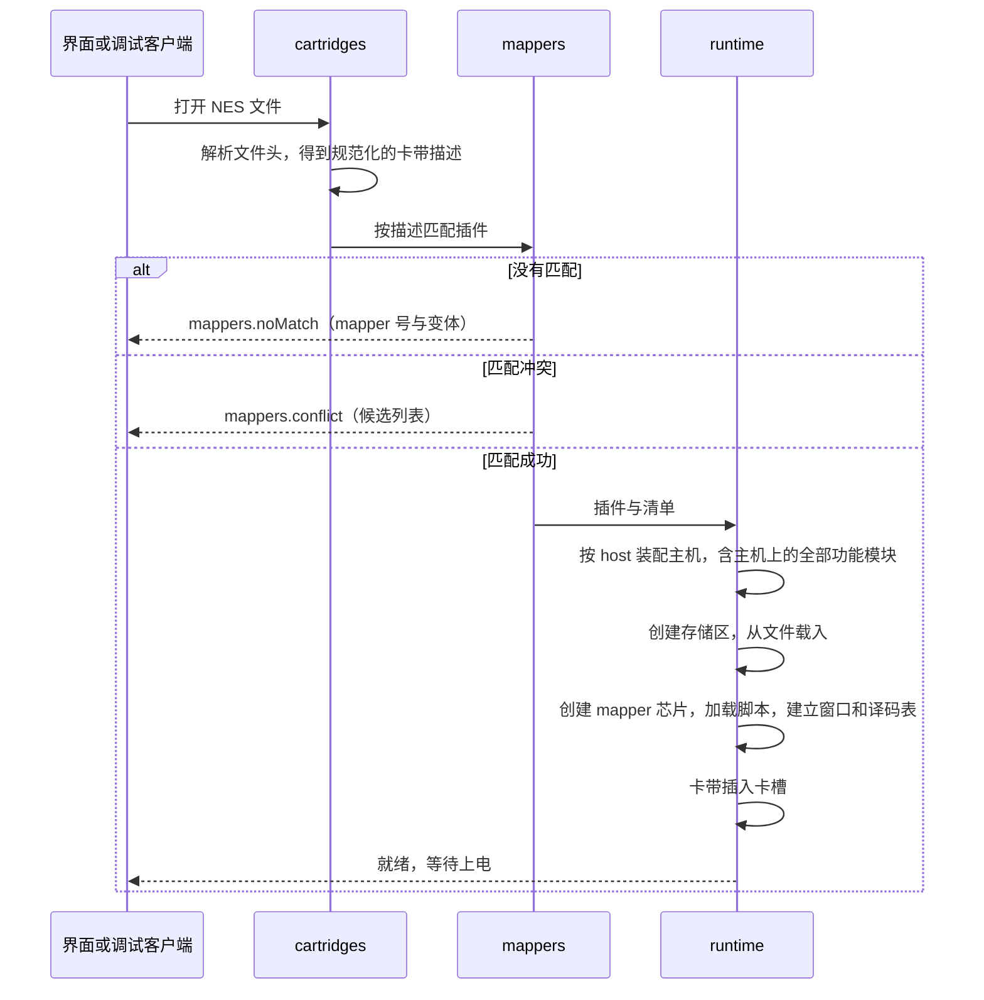

# mapper 插件规范

mapper 插件提供 FC 卡带（含学习卡）上的 mapper 芯片：声明卡带有哪些存储元件、地址如何译码、要哪种主机，寄存器与磁带的接线用清单里的声明表达（宿主原生执行），声明写不出的逻辑用脚本实现；插卡学习机（如裕兴）的卡带还要译码并读写主机上的软驱、声卡等功能模块（后续阶段）。整机机型（自带 BIOS）的译码与胶合逻辑在主机型号里，整机的 BIOS 不是卡带，都不属于本规范，见 [02-硬件模块.md](02-硬件模块.md)。模拟器程序不内置任何 mapper，更新或增加卡带适配只需安装或更新插件。本文写给插件作者，也是核心实现插件宿主的依据。硬件结构见 02。

状态说明同 [01-软件架构设计.md](01-软件架构设计.md)。

## 1. 决策

| 决策项 | 结论 | 状态 |
| --- | --- | --- |
| 插件的含义 | 插件就是卡带上的 mapper 芯片：清单描述卡带的存储区、窗口与寄存器，脚本实现芯片行为 | 已定 |
| 范围 | 只描述卡带（含学习卡）；整机机型的译码与胶合逻辑在主机型号里，插件不访问整机机型的功能模块；插卡学习机的卡带 mapper 译码并经 `ctx.device` 读写主机上的功能模块（后续阶段，见 02 第 1 节“插卡学习机”） | 已定 |
| 不内置 | 程序里没有任何内置 mapper，包括 NROM；官方 mapper 以插件形式随安装包预装 | 已定 |
| 主机的选择 | 清单只能按名字选择主机型号（`host` 字段，目前只有 `fc`，以后有别的卡带主机时再用），不能修改芯片内部、主板上的功能模块与存储 | 已定 |
| 匹配 | 按 NES 文件头的 mapper 号和变体匹配，规则写在清单里；程序只做通用查询，不认识任何具体卡带；mapper 171（BBK、SB2K 的 BIOS 文件）没有匹配的插件时按 `mappers.noMatch` 报错，不自动识别成学习机，学习机 BIOS 只能走“机型与 BIOS”开机 | 已定 |
| 脚本语言 | JavaScript（ES2023 模块），推荐用 TypeScript 编写后打包为单个文件 | 拟定 |
| 运行环境 | C++ 核心中的 QuickJS-ng，每个插件一个独立的运行时；不能访问文件、网络与进程，一切外部访问只经宿主对象 `ctx` | 拟定 |
| 调用方式 | 寄存器读写、查表与磁带边沿计时优先写成清单里的声明，由宿主直接执行，不进脚本；脚本只在声明不够用的地方被调用（回调脚本的寄存器、查表表项的首次计算、定时事件、复位、输入）；脚本不逐周期回调，译码结果（bank 窗口）由宿主保存并直接使用 | 拟定 |
| 状态可见 | 脚本的内部寄存器必须声明并放在宿主管理的状态对象里，调试服务可随时读写 | 拟定 |
| 接口版本 | 插件接口版本为整数，当前为 `1`；只在破坏性变更时加一 | 拟定 |
| 包格式 | 扩展名 `.emap` 的 zip 文件 | 拟定 |

## 2. 概念

- NES 文件是卡带的内容：PRG、CHR、文件头。加载时宿主把它解析成规范化的卡带描述，再按它匹配插件。
- 插件按清单创建卡带：存储芯片和 mapper 芯片；然后把卡带插入主机的卡槽。
- mapper 芯片的职责与真机一致：响应 CPU 与 PPU 的访问，决定卡槽上的每个地址落在哪个存储芯片的哪个位置，必要时处理寄存器、计时和中断。
- 译码表：宿主按“窗口”保存译码结果。寄存器写入时修改窗口（如把 `$8000-$9FFF` 指向 PRG 的第 5 个 8K；可以写成声明，也可以由脚本做），之后的读写由宿主直接按窗口访问存储区，不再调用脚本。这与真机一致：译码输出只在寄存器写入时变化。

## 3. 插件包

插件包是扩展名为 `.emap` 的 zip 文件，根目录包含：

| 文件 | 内容 | 是否必需 |
| --- | --- | --- |
| `manifest.json` | 清单，见第 4 节 | 必需 |
| `main.js` | 脚本，单个 ES 模块，默认导出一个对象；不能再引用其他文件；清单里没有回调脚本的寄存器、没有查表、也不处理键盘、鼠标、磁带边沿的 mapper 可以没有（如 `nrom`、`qls`，寄存器与磁带都写成声明；`plq` 因为有查表，保留了 `main.js`） | 有脚本逻辑时必需 |
| `icon.png` | 图标，正方形，不小于 64 像素 | 可选 |

- 包内不允许出现其他文件、目录与符号链接；`main.js` 不超过 1 MB，`manifest.json` 不超过 256 KB，整个包不超过 2 MB。
- 文件名必须严格等于上表的名字（区分大小写）；绝对路径、盘符、反斜杠、含 `..` 的名字按路径穿越拒绝；加密或使用不支持的压缩方式的条目、重复的条目、解压后超过上限的条目都拒绝（按压缩包目录里声明的大小判断，不会先解压再检查）。
- `icon.png` 必须是 PNG，宽高相等且不小于 64 像素。
- 包末尾可以有 zip 注释，读取时忽略；官方插件包由打包脚本附一段 256 字节的可压缩注释，原因见 06 第 7 节。
- 开发时可以直接加载未打包的插件目录（含 `manifest.json` 与 `main.js`），修改后用 `mappers.reload` 重新加载，不用反复打包，见第 7 节（**后续阶段**；目前只能安装 `.emap` 包）。

## 4. 清单

### 4.1 基本字段

| 字段 | 类型 | 说明 |
| --- | --- | --- |
| `id` | 字符串 | 插件标识，小写字母、数字与 `-`，3 到 40 个字符；安装后不能修改 |
| `name` | 字符串 | 显示名称，不超过 40 个字符 |
| `version` | 字符串 | 插件版本，`主.次.修订` |
| `apiVersion` | 整数 | 插件接口版本，当前为 `1` |
| `publisher` | 字符串 | 发布者名称 |
| `description` | 字符串 | 一两句话的说明，可选 |
| `host` | 字符串数组 | 要求的主机型号，目前只有 `fc`（`["fc"]`）；宿主按第一个存在的型号装配；插卡学习机的卡带写自己的主机型号（如裕兴系列），打开卡带时按它自动装配，用户不选机型（后续阶段） |
| `devices` | 字符串数组 | 可选；卡带用到的外设，目前只有 `mouse`（鼠标），最多 1 项、不重复；不写等于没有外设，见下面的说明 |
| `busConflict` | 布尔 | 可选，默认 `false`；写寄存器时是否发生总线冲突：CPU 写入的数据与该地址当前读到的 ROM 字节相与，再交给寄存器的处理；该地址没有映射 ROM 时不相与；每次复位回到这个值，脚本可以用 `ctx.busConflict.set(true 或 false)` 按变体改 |
| `match` | 数组 | 匹配条件，见第 4.2 节 |

- 清单里不认识的字段一律拒绝（`mappers.invalidPackage`），包括已取消的 `wires`、`uses`、`irq`：清单不声明连线，也不声明用了哪些功能模块，脚本在读写回调里译码并直接用 `ctx.device(名称)` 访问，主机没有该功能模块时运行时报错并暂停；卡带要向 CPU 发中断只能经 `ctx.irq`；这些字段以后也不恢复。
- `devices` 声明卡带用到的外设，界面据此决定要不要把鼠标交给这张卡带：整机机型（学习机）自带串口鼠标，不看这个字段；经典 FC 只有声明了 `mouse` 的卡带，点击画面才会捕获鼠标，没有声明的卡带点不进去。不认识的外设名、重复的外设、不是数组的写法一律拒绝（`mappers.invalidPackage`）；`mappers.list`、`mappers.info` 的插件摘要与 `runtime.status`、`cartridges.info` 的卡带信息里都带 `devices`。声明了 `mouse` 的卡带用 `onMouse` 接收鼠标事件（见第 6.5 节）。

### 4.2 匹配

宿主解析 NES 文件头，得到规范化的卡带描述：

| 字段 | 含义 |
| --- | --- |
| `mapper` | mapper 号 |
| `variant` | 变体：NES 2.0 头取 submapper；旧 iNES 头取头部第 9 字节（从 0 数起）右移 1 位，已用仓库里的 `SB2K_BIOS.NES` 核对：第 9 字节为 `02`，变体为 1 |
| `prgSize`、`chrSize` | PRG、CHR 的字节数 |
| `mirroring`、`battery`、`trainer` | 头里的镜像方式、电池标志、训练器标志 |
| `nes20` | 是否是 NES 2.0 头 |
| `prgRamSize`、`prgNvramSize`、`chrRamSize`、`chrNvramSize` | 头里写明的 PRG RAM、PRG NVRAM（带电池）、CHR RAM、CHR NVRAM 字节数；只有 NES 2.0 头写明（字节 10、11 的每个半字节，0 表示没有，否则是 `64 << n`），旧 iNES 头没有写明，在 `ctx.header` 里为 `null` |
| `crc32Prg`、`crc32All` | PRG 的校验值、PRG 加 CHR 的校验值 |

`match` 的每一项是一组条件，必须写 `mapper`，其余可选：`variant`、`prgSize`、`chrSize`、`chr`（`"present"` 表示文件里有 CHR ROM，`"none"` 表示没有）、`crc32Prg`、`crc32All`；写出的条件必须全部满足，任一项满足即匹配。`crc32Prg`、`crc32All` 在清单里写成 8 位十六进制字符串（如 `"A1B2C3D4"`，大小写均可）。

文件头的解析规则（`core/src/logic/cartridges/ines-parser.cpp`）：

- 魔数为 `NES` 加 `1A`；开头是 `UNIF`、`FDS` 加 `1A` 的文件报“不支持的格式”，魔数不对或不足 16 字节报“不是 NES 文件”。
- 第 7 字节的位 2-3 为 2，并且按 NES 2.0 算出的 PRG、CHR 大小加上文件头与训练器不超过文件长度时，按 NES 2.0 解析（mapper 为 12 位、变体取 submapper、大小高位与指数写法都支持）；否则按 iNES 1.0。
- 训练器（512 字节）跳过，只记录标志；文件比头里声明的内容长时，多出的部分忽略；文件比声明的短报“文件被截断”，PRG 大小为 0 报“文件头不合法”。
- 镜像：第 6 字节的位 3 为四屏，否则位 0 为垂直、清零为水平。
- 错误码：`cartridges.notInes`、`cartridges.truncated`、`cartridges.unsupportedFormat`、`cartridges.invalidHeader`。

- 同一个 mapper 号可以对应多种卡带，用变体或校验值区分；可以写成一个插件的多项匹配，也可以每种卡带一个插件。
- 多个插件同时匹配时，写出条件更多的优先（一个插件有多项匹配时取它满足的各项里条件最多的）；条件数相同时报冲突，`mappers.conflict` 的说明列出同样匹配的插件，用户停用其中不需要的即可。“用户在 mapper 插件对话框选择并记住”**后续阶段**再做（需要首选项存储与对应的请求）。
- 没有任何已启用的插件匹配时不运行，`mappers.noMatch` 的说明写明“缺少 mapper 号 N、变体 V 的插件”（匹配的插件都被停用时改为提示去启用），界面据此给出打开“mapper 插件”页的入口。
- 宿主只比较这些规范化字段，不理解它们对应哪张卡带。
- mapper 171（BBK、SB2K 的 BIOS 文件）是学习机的 BIOS，不是卡带：没有匹配的插件时同样按 `mappers.noMatch` 报错，程序不会把它识别成学习机，也不允许改 mapper 号强行运行；学习机 BIOS 只能走“机型与 BIOS”开机，见 02、05。

### 4.3 存储区

`storage` 声明卡带上的存储芯片，每项：

| 字段 | 说明 |
| --- | --- |
| `id` | 存储区标识，同一插件内不重复 |
| `kind` | `rom` 或 `ram` |
| `from` | `rom` 的数据来源：`file.prg` 或 `file.chr`（NES 文件里的数据） |
| `size` | `ram` 的字节数，整数；或 `{ "header": 头里的哪一项, "default": 默认字节数 }`，大小取自文件头，见下面的说明 |
| `battery` | `ram` 是否带电池；带电池时存档文件按卡带保存 |
| `fallback` | 仅 `rom` 可写：来源为空时改用的存储区，写成内联的存储区声明，目前只支持 `{ "kind": "ram", "size": 字节数或 { header, default }, "battery": 可选 }`（如文件没有 CHR 时用 8K 的 CHR RAM）；来源为空又没有 `fallback` 时存储区容量为 0，窗口读到开放总线 |

- 只声明卡带上的存储区；芯片内与主板上的存储不能在这里声明或修改，见 02 第 5 节。
- `id` 用小写字母、数字与 `-`，不超过 32 个字符；最多 16 个存储区；`ram` 的整数 `size` 为 1 到 16 MiB。
- 大小取自文件头：`header` 是 `prgRam`、`prgNvram`、`prgAny`、`chrRam`、`chrNvram` 之一，`default` 为 0 到 16 MiB。头里写明了（NES 2.0）就用头里的，写明为 0 的存储区容量为 0；没写明（旧 iNES 头）时：`prgRam` 在文件带电池时为 0、否则取 `default`，`prgNvram` 在文件带电池时取 `default`、否则为 0，`chrRam` 取 `default`，`chrNvram` 为 0。`prgAny` 是卡带默认挂在 `$6000` 的那块 RAM：`prgNvram` 的结果不为 0 时用它（并带电池），否则用 `prgRam` 的结果（不带电池），所以这种存储区是否带电池由文件头决定，不写 `battery`。容量为 0 的窗口读到开放总线、写入被丢弃。
- ROM 拒绝写入（经窗口写入被丢弃，经 `ctx.storage(id).write` 写入返回 `false`）。上电复位时不带电池的 RAM 清零，带电池的保持；软复位时所有 RAM 保持。存档文件的载入与保存是**后续阶段**（目前带电池的 RAM 只在内存里保持）。
- 训练器的内容目前不载入存储区（**后续阶段**按需要加入），只在 `ctx.header.trainer` 里给出标志。

### 4.4 窗口与初始译码

`windows` 声明可切换的窗口，每项：

| 字段 | 说明 |
| --- | --- |
| `id` | 窗口标识 |
| `bus` | `cpu` 或 `ppu` |
| `range` | 窗口覆盖的地址范围，如 `$8000-$9FFF` |
| `storage` | 窗口访问的存储区；可以写成存储区标识的数组（最多 4 个），第一个是复位后绑定的，脚本用 `select` 在其中切换（如同一地址范围在 ROM 与 RAM 之间切换） |
| `size` | 一个 bank 的字节数，必须等于窗口大小 |
| `initial` | 复位后指向的 bank，可以是整数，或 `last`、`first`；负整数从末尾数（`-1` 是最后一个，`-2` 是倒数第二个，不用取模，所以 bank 数不是 2 的幂也成立） |
| `access` | `r` 或 `rw`；指向 ROM 时只能是 `r` |

- 窗口之间的地址范围不能重叠；没有被窗口或寄存器覆盖的卡槽地址按开放总线处理。
- CPU 侧的窗口只能在卡带的地址 `$4020-$FFFF`；PPU 侧的窗口只能在图案表地址 `$0000-$1FFF`（名称表地址的连法见下面的 `nametable`）；`initial` 不写时为 `first`。
- bank 号按存储区的 bank 数取模（bank 数为存储区容量除以 `size` 向下取整，至少为 1，真机的地址线只连低位）；`setOffset` 的字节偏移按存储区容量取模；窗口访问越过存储区末尾时从头回绕（镜像），所以 16K 的 PRG 放进两个 16K 的窗口就是镜像。`unmap()` 之后读按开放总线、写被丢弃，再调用 `setBank`、`setOffset` 重新映射。
- `access` 为 `rw` 的窗口必须指向 `ram`，或指向带 `fallback` 的 `rom`（文件没有这部分数据时它是 RAM，有数据时是 ROM，写入被 ROM 拒绝）；`storage` 是数组时，其中有一项满足即可，窗口当前绑定的是 ROM 时写入被拒绝，`access` 只是上限，脚本可以用 `setAccess('r')` 临时写保护。
- `nametable` 声明名称表的初始连法：`header`（按文件头）、`horizontal`、`vertical`、`single0`、`single1`、`four`；脚本可以在运行中改。上电复位回到初始连法。`four` 由卡带自带 4K 的名称表显存响应（`$3000-$3EFF` 是 `$2000-$2EFF` 的镜像），其他连法经显存控制线用主板的 2K 显存，见 02 第 4 节。

### 4.5 寄存器与处理方式

`registers` 声明卡带上的寄存器地址范围，每项：

| 字段 | 说明 |
| --- | --- |
| `bus` | `cpu` 或 `ppu` |
| `range` | 地址范围，如 `$4100-$4107` |
| `read`、`write` | 这个范围怎么处理读、写：`true` 回调脚本；对象由宿主直接执行（声明式，见下）；不写或 `false` 表示不处理（读写落到窗口或开放总线） |

**读的声明**（`read` 是对象时，`value`、`open`、`state` 必须且只能写一个）：

| 字段 | 说明 |
| --- | --- |
| `value` | 驱动固定值（0 到 255） |
| `open` | 写 `true`：不驱动数据线，读到总线上最近的值 |
| `state` | 驱动这个状态的低 8 位 |
| `releaseIrq` | 可选，`true` 时每次读完撤销卡带的 IRQ |

**写的声明**（`write` 是对象时，`state`、`bank`、`update` 至少写一个；同一次写入依次做 `state`、`bank`、`update`）：

| 字段 | 说明 |
| --- | --- |
| `state` | 把写入的数据（8 位）存进这个状态，按位宽截断 |
| `bank` | 数组（1 到 8 项），每项 `{ "window", "shift", "mask" }`：把窗口切到 bank `(数据 >> shift) & mask`；`shift` 为 0 到 7（默认 0），`mask` 为 1 到 255（默认 255）；bank 号再按窗口的规则取模 |
| `update` | `{ "table": 表标识, "into": 状态名 }`：按表的索引查表（第 4.8 节），结果存进这个状态 |

- 只有落在声明范围内的读写才被寄存器处理，其余访问由窗口直接处理；声明式寄存器由宿主原生执行，不进脚本，所以读写特别频繁的寄存器应当写成声明（脚本回调一次约几微秒到十几微秒，真实游戏会拖慢运行）。
- 寄存器范围可以与窗口的地址范围重叠：只读窗口（`access` 为 `r`）上的写入转给寄存器，读取仍由窗口直接处理。寄存器按读、写分别优先于窗口：声明了 `read` 的地址读由寄存器回答，声明了 `write` 的地址写只给寄存器（即使窗口是 `rw`，窗口也不再处理）。
- 寄存器范围之间不能重叠（同一总线上）；`read`、`write` 至少要有一个有处理；同样受窗口的地址限制（CPU 侧 `$4020-$FFFF`，PPU 侧 `$0000-$1FFF`）。
- 声明里引用的状态、窗口、表必须存在，否则拒绝（`mappers.invalidPackage`）。
- 调试读取（`peek`）不会触发回调：声明的固定值与状态可以直接读到，回调脚本的寄存器与 `open` 读不到值。

### 4.6 状态声明

`state` 声明卡带的内部寄存器，每项：`name`（字母开头的 camelCase，不超过 32 个字符）、`bits`（位宽，1 到 32）、`description`，可选 `initial`（不超过位宽）。脚本只能读写已声明的状态（`ctx.state` 不能增加属性，写未声明的状态抛出 TypeError），写入时按位宽截断；上电复位时清零。写了 `initial` 的状态在每次复位（上电与软复位）时回到这个值（如真机的寄存器在复位时置位），没写的只在上电时清零、软复位保持。调试服务可以读写它们，见 04（读写请求属于后续阶段，目前经 `MapperCartridge::state` 只读）。声明式寄存器、查表与磁带计时（第 4.5、4.8、4.9 节）都经状态存取，所以不用脚本也能看到卡带的内部寄存器。

### 4.7 设置项

`settings` 声明用户可调的选项（可选），写法同如见的模型插件设置项：`key`、`label`、`kind`（`text`、`choice`、`switch`）、`default`、`description`；`choice` 还要写 `options`（每项 `{ "value", "label" }`，`default` 必须是其中一个取值），`switch` 的 `default` 是布尔值。脚本经 `ctx.settings.get(key)` 读取。**后续阶段**：目前只解析与检查，设置页与 `ctx.settings` 一起实现。

### 4.8 查表

`tables` 声明查表（可选，最多 16 张）：寄存器写入时按一组输入拼成索引，查出一个值存进状态。表项的内容由脚本算出来，宿主只在第一次遇到某个索引时调用一次脚本并缓存，之后同样的索引直接取缓存，所以逻辑方程可以写成可读的脚本，运行时仍是原生速度。每项：

| 字段 | 说明 |
| --- | --- |
| `id` | 表标识，同一插件内不重复；脚本里的计算函数是 `tables.<id>` |
| `index` | 索引的来源，数组（1 到 8 项），按顺序拼成索引，第一项在高位 |
| `bits` | 表项的位宽（1 到 32），脚本返回的值按它截断 |

索引的来源，每项 `{ "from": ... }`：

| `from` | 其他字段 | 位数 | 取值 |
| --- | --- | --- | --- |
| `state` | `name`：状态名 | 状态的位宽 | 状态现在的值 |
| `address` | `shift`（0 到 15）、`bits`（1 到 16），`shift + bits` 不超过 16 | `bits` | 这次访问的地址的 `[shift, shift + bits)` 位 |
| `data` | `shift`（0 到 7）、`bits`（1 到 8），`shift + bits` 不超过 8 | `bits` | 这次写入的数据的 `[shift, shift + bits)` 位 |
| `tape` | 无 | 1 | 磁带数据线现在的电平（主机没有磁带机时为 0） |

- 索引的总位数不超过 16（表最多 65536 项）。
- 脚本的计算函数：`export default { tables: { 表标识(ctx, ...各来源的值) { return 整数; } } }`，参数按 `index` 的顺序给出各来源取出的值；返回 0 到 4294967295 的整数，不是整数或越界按脚本错误处理（`mappers.scriptError`）。**必须是纯函数**：同样的参数得到同样的结果，不读取 `ctx.state` 之外会变的东西，不改变卡带状态，因为宿主会缓存结果；声明了表而脚本没有导出对应的函数时，安装与创建卡带都拒绝。
- 缓存按卡带保存，复位不清除；第一次遇到某个索引的那次写入会多花一次脚本回调的时间（仍受第 6.3 节的 50 毫秒限制）。

### 4.9 磁带

`tape`（可选）声明卡带与磁带机的接线，由宿主原生执行；主机没有磁带机时（如经典 FC 以外的主机）什么也不做。

| 字段 | 说明 |
| --- | --- |
| `comparator` | 数据线的比较器 `{ "low", "high", "invert" }`：采样不低于 `high` 为 1、不高于 `low` 为 0，之间保持原值；`invert` 为 `true` 时输出取反；`low`、`high` 是 -32768 到 32767 的整数且 `low` 小于 `high`；每次复位（上电与软复位）设置一次，等同脚本在 `reset` 里调用 `setComparator`（第 6.6 节） |
| `timer` | 边沿计时 `{ "samples", "ticks", "scale", "irq" }`：数据线每次翻转，把距上一次翻转的采样数累加进状态 `samples`；下降沿（翻转后为 0）时，把 `samples` 乘 `scale[0]` 除以 `scale[1]`（整数除法）加进状态 `ticks`，再把 `samples` 清零，`irq` 为 `true` 时拉低卡带的 IRQ |

- `comparator`、`timer` 至少写一个；`samples`、`ticks` 是已声明的两个不同的状态（`ticks` 的位宽决定计时的回绕）；`scale` 是两个 1 到 65535 的整数；`timer` 的 `irq` 为 `true` 时，每次复位也撤销 IRQ。
- 脚本也可以同时导出 `onTapeEdge`（第 6.6 节）：每次翻转先做 `timer`，再通知脚本。

## 5. 加载流程



- 经典 FC 的游戏同样要有匹配的插件，所以必须预装 NROM 等常用插件。
- 学习机整机不走本流程：它的 BIOS 由主机型号读入，经“机型与 BIOS”开机（见 02、04 第 4.7 节），不匹配插件。学习卡是卡带，走本流程：用卡带 mapper 插件，主机按插件的 `host` 装配（插卡学习机的主机型号后续阶段做，现在只有 `fc`）。
- 插件的 `host` 决定装配哪个主机型号，没有第二条路径。
- 实现：解析与匹配合为 `CartridgeLoader::plan`（得到卡带映像、匹配到的插件与要装配的主机型号 `host`：插件 `host` 里第一个程序里已有的型号）；调用方据 `host` 装配主机，再用 `assemble` 把主机卡槽上的 IRQ 引脚（`Machine::cartridgeIrq`）与主机的手柄口（`Machine` 本身，`PadSink`）交给插件创建卡带。创建时按清单建存储区、窗口与译码表并加载脚本；阶段 2b-2 起由运行模块（`runtime`）把这几步串起来：`cartridges.load` 读文件、`plan`、再把映像与匹配结果交给运行服务，运行服务在模拟线程里创建主机（按 `host`）、经 `MapperFactory::create` 创建卡带并插入卡槽，三步里任何一步失败都不改动正在运行的主机。

## 6. 脚本接口

### 6.1 导出

```ts
import { definePlugin } from '@rujianjs/ember-mapper-sdk';

export default definePlugin({
  reset(ctx, kind) { /* kind 为 'power' 或 'soft'：初始化状态与窗口 */ },
  read(ctx, bus, addr) { /* 返回 0-255；返回 undefined 表示不驱动总线 */ },
  write(ctx, bus, addr, value) { /* 处理寄存器写入 */ },
  timer(ctx, name) { /* 定时事件到期 */ },
  onKey(ctx, event) { /* 键盘：event.code、event.down */ },
  onMouse(ctx, event) { /* 鼠标：event.kind、x、y、dx、dy、buttons、wheel */ },
  onTapeEdge(ctx, level, samples) { /* 磁带数据线翻转：level 为 0 或 1，samples 是距上一次翻转的采样数（96 kHz） */ },
  tables: { 表标识(ctx, ...各来源的值) { /* 查表的一个表项：纯函数，返回整数，见第 4.8 节 */ } },
});
```

- 每个导出都可选；寄存器声明为 `true`（回调脚本）的读或写，就必须实现对应的 `read`、`write`；声明了查表，就必须在 `tables` 上实现对应表标识的函数（安装与创建卡带时检查，缺少报 `mappers.invalidPackage`）；寄存器与磁带都写成声明、也不处理输入的 mapper 不需要脚本。
- **本阶段没有 SDK**：脚本直接 `export default { reset, read, write }`，不写 `import`（沙箱里没有模块加载器，`import` 会报 `mappers.invalidPackage`）；上面示意代码里的 `definePlugin` 只是给类型检查用的恒等函数，等 SDK 做好后再用。`timer(ctx, name)` 目前不会被调用（后续阶段）。
- `reset` 的 `kind` 是 `'power'` 或 `'soft'`；上电复位时宿主先把窗口回到 `initial`、状态清零、名称表回到初始连法、释放 IRQ，再调用脚本的 `reset`；软复位只调用 `reset`（寄存器与窗口的状态按真机保持或清除，由脚本自己决定）。
- 函数是同步的，宿主在模拟线程中直接调用；没有 Promise、没有定时器。
- 返回值与参数由宿主校验：读返回值必须是 0 到 255 的整数或 `undefined`，窗口与状态的写入必须合法，否则按插件错误处理。

### 6.2 宿主对象 `ctx`

| 成员 | 说明 |
| --- | --- |
| `ctx.header` | 只读的规范化卡带描述，见第 4.2 节 |
| `ctx.window(id)` | 窗口：`setBank(n)` 切换 bank，`setOffset(bytes)` 按字节偏移，`unmap()` 取消映射（读按开放总线），`bankCount`（只读）当前绑定的存储区里有几个窗口大小的 bank（至少 1，用来写“倒数第 n 个 bank”），`select(存储区标识, bank)` 切到清单里该窗口列出的另一个存储区并选 bank（`bank` 默认 0，不在列表里抛 `RangeError`），`setAccess('r' 或 'rw')` 写保护或允许写入（上电复位回到清单的 `access`） |
| `ctx.busConflict.set(enabled)` | 设置寄存器写入是否发生总线冲突，见第 4.1 节的 `busConflict` |
| `ctx.peek(address)` | 按卡带自己的 CPU 侧译码读一个字节（窗口、声明的固定值与状态），没有副作用，不回调脚本的 `read`；卡带不驱动数据线时返回 `undefined`；地址不在 0 到 65535 之间抛 `RangeError` |
| `ctx.nametable.set(mode)` | 设置名称表连法：`horizontal`、`vertical`、`single0`、`single1`、`four` |
| `ctx.irq` | 卡带的 IRQ 引脚：`assert()` 拉低，`release()` 释放 |
| `ctx.device(name)` | 主机上的功能模块；目前只有 `'tape'`（磁带机，见第 6.6 节）：`level()`、`setComparator(low, high, invert)`；主机没有该功能模块时抛出 `RangeError`（“当前主机没有磁带机”），按插件错误处理；**后续阶段（插卡学习机）**：其他功能模块（如 `fdc`），`read(寄存器)`、`write(寄存器, 值)` 在脚本的读写回调里转发，寄存器编号由脚本从地址取，运行页提示“当前机型没有 xx”并暂停 |
| `ctx.storage(id)` | 存储区：`size`、`read(offset)`、`write(offset, value)`（ROM 拒绝写） |
| `ctx.timer` | `after(cpuCycles, name)` 登记事件，`cancel(name)` 取消；时间单位是 CPU 周期 |
| `ctx.state` | 已声明状态的读写，如 `ctx.state.prgBank = 5` |
| `ctx.settings.get(key)` | 读取设置项 |
| `ctx.random(max)` | 返回 0 到 `max - 1` 的整数；种子由宿主决定，同一次运行内可重现 |
| `ctx.log.warn(message)` | 写入运行消息日志，一条最长 2000 字节 |
| `ctx.keys` | `isDown(code)`：这个物理键（`KeyboardEvent.code`）现在是否按着，用来写组合键；见第 6.5 节 |
| `ctx.pad(port)` | 手柄口 `port`（经典 FC 为 0 与 1）：`set(button, down)` 按下或松开一个键，`button` 是 `a`、`b`、`select`、`start`、`up`、`down`、`left`、`right`；`release()` 松开这个口的全部按键；见第 6.5 节 |

- 脚本不能访问文件、网络、进程、系统时间和 `Math.random`；需要随机数时用 `ctx.random`。
- **实现范围**：已实现 `ctx.header`、`ctx.window`、`ctx.nametable`、`ctx.irq`（`assert`、`release`）、`ctx.storage`、`ctx.state`、`ctx.log.warn`、`ctx.keys`、`ctx.pad`、`ctx.device('tape')`；`ctx.timer`、`ctx.random`、`ctx.settings` **后续阶段实现**，目前在脚本里是 `undefined`。目前脚本能访问的主机功能模块只有磁带机，卡带与主机之间另有卡槽引脚；其他 `ctx.device` 在插卡学习机阶段实现。
- 沙箱里只加载确定性的内置对象：没有 `Date`、`console`、`performance`、`setTimeout`、`fetch`、`process`、`require` 与 quickjs-libc，`Math.random` 被删除，访问它们报 `ReferenceError` 或 `TypeError`（即 `mappers.scriptError`）。`Promise` 仅作为语言内置保留，宿主不执行异步任务，顶层 `await` 报 `mappers.invalidPackage`。
- `ctx` 与其中的窗口、存储区对象都是冻结的，`ctx.state` 不能增加属性；参数不合法（bank 为负、不是整数、标识不存在、存储区偏移越界、写入值不在 0 到 255、名称表连法不认识）抛出 `RangeError` 或 `TypeError`，按插件错误处理。`ctx.log.warn` 只接受字符串，超过 2000 字节在 UTF-8 字符边界截断，卡带保留最近 200 条（`MapperCartridge::scriptLog`，运行消息日志模块做好后经它写入）。
- 宿主对象是脚本与硬件之间的全部接口，所以插件的行为是确定的，同样的输入得到同样的结果，方便测试与调试。

### 6.3 执行限制

| 项 | 限制 |
| --- | --- |
| 运行时内存 | 32 MB |
| 栈 | 256 KB |
| 一次回调的时长 | 超过 50 毫秒即终止，插件报错，模拟器暂停 |
| 定时事件 | 同时最多 16 个 |

- 超出限制或脚本抛出异常时，模拟器暂停并报告：超时、内存或栈超限为 `mappers.limitExceeded`，其他异常与不合法的返回值为 `mappers.scriptError`，说明里带插件标识与脚本位置；写入运行消息日志，调试服务推送 `runtime.error` 事件。
- 实现：卡带在总线访问里不抛异常（异常会穿过 CPU 的指令执行），而是记下错误并停止调用脚本，之后对寄存器的读按开放总线、写被丢弃；`MapperCartridge::failure()` 返回这个错误，运行模块在每一帧与每条命令执行之后检查它，发现错误就暂停模拟器、写入系统错误日志并发事件 `runtime.error`（模块为 `mappers`）与 `runtime.stateChanged`（原因 `error`），同一个错误只报告一次；复位后清除错误。
- 时长限制按真实时间判断（中断处理函数每执行一批字节码检查一次），超时的中止脚本捕获不了；脚本的加载（顶层代码）同样受时长与内存限制。“定时事件同时最多 16 个”随 `ctx.timer` 在后续阶段实现。
- 回调只发生在回调脚本的寄存器访问、查表表项的首次计算、复位、定时事件、用户输入和磁带数据线翻转（第 6.6 节）上，所以脚本不会拖慢普通的程序执行；寄存器访问特别频繁的 mapper 要写成声明（第 4.5、4.8 节），每个周期都要观察总线的电路见第 6.4 节。

### 6.4 宿主电路构件（声明式寄存器是第一批）

由宿主原生执行、不进脚本的构件，在清单里声明，脚本只在需要的地方补充。已有的是声明式寄存器（第 4.5 节）、查表（第 4.8 节）与磁带的比较器和边沿计时（第 4.9 节）。需要逐周期或监视 PPU 地址线的电路（如按 PPU 地址线 A12 计数的中断计数器、移位寄存器、扩展声音）不让脚本逐周期回调，而由宿主的“电路构件”提供，按需要逐个加入；宿主里已有的 mapper 电路（如 MMC3，实现契约 `MapperCircuit`，见 02 第 3.4 节）以后可以经清单声明引用。加入新构件只添加清单字段，不改变已有字段的含义。

### 6.5 输入回调（键盘、鼠标）

手柄的按键不由脚本产生：游戏手柄的事件与（主机的键盘不用作机器输入时的）键盘按键，由 `input` 模块的手柄绑定统一换算成手柄口的按键（见 04 第 4.4 节），所以没有 `onGamepad`，卡带脚本也不需要写通用的键位。界面只上报原始事件，核心先交给手柄绑定，没有被截下的键盘事件（没有绑定的键，或键盘属于机器时）与鼠标事件再交给当前卡带的脚本；脚本用这两个回调实现这张卡带自己的键盘、鼠标功能（如外设、热键）。没有导出对应回调的卡带忽略这类事件。

| 回调 | 事件 | 说明 |
| --- | --- | --- |
| `onKey(ctx, event)` | `{ code, down }` | 键盘：`code` 是物理键位（`KeyboardEvent.code`，如 `KeyW`、`Space`、`Numpad1`），`down` 为按下或松开；按住不放的重复按下不上报；已被手柄绑定截下的按下事件不会到这里，松开事件总是同时交给脚本 |
| `onMouse(ctx, event)` | `{ kind, x, y, dx, dy, buttons, wheel }` | 鼠标：`kind` 是 `move`、`down`、`up`、`wheel`、`leave`；`x`、`y` 是指针在标准帧（256x240）上的坐标，指针在画面之外时可以超出范围；`dx`、`dy` 是相对上一次事件的位移；`buttons` 是事件之后按住的按键位（1 左键、2 右键、4 中键）；`wheel` 向下为正，约一格为 1，只有 `wheel` 事件不为 0 |

- `ctx.keys.isDown(code)` 读到的是这次事件之后的状态，所以组合键这样写：`if (event.code === 'KeyZ' && ctx.keys.isDown('ShiftLeft')) { ... }`。
- `ctx.pad(port).set(button, down)` 由卡带记着每个口当前按下的键，宿主把整个口的按键交给主机的手柄口；`button` 不认识、`port` 不存在、`down` 不是布尔值，都按脚本错误处理（`RangeError`）。
- 事件按到达的顺序在模拟线程里执行，最迟在下一帧开始之前生效；脚本出错的处理同第 6.3 节。
- Windows 上画面区获得焦点期间界面独占键盘，所有物理按键（包括 Esc、Tab、F 键与 Ctrl、Alt 组合）都上报，见 05 第 7 节；没有键盘独占时（其他平台）界面不上报 F1 到 F24、Tab、Escape 与带 Ctrl、Alt、Meta 的组合键（留给应用的快捷键与焦点移动），Ctrl、Alt、Meta、Shift 这些修饰键本身照常上报。
- 示意（只针对这张卡带的热键：按住右 Shift 时 F 键当手柄 2 的开始键）：

```js
export default {
  onKey(ctx, event) {
    if (event.code === 'KeyF' && ctx.keys.isDown('ShiftRight')) ctx.pad(1).set('start', event.down);
  }
};
```

### 6.6 磁带机

声像磁带的卡带（如 mapper 172）把磁带机的数据线接在卡上，脚本经 `ctx.device('tape')` 读数据线，并用 `onTapeEdge` 在数据线翻转的时刻得到通知。磁带机是独立于主机的设备（只有 `fc` 有磁带接口，见 02 第 6.4 节），主机通电时才能播放，播放时按模拟时间推进，与真实时间无关。

| 接口 | 说明 |
| --- | --- |
| `ctx.device('tape').level()` | 数据线现在的电平，0 或 1；没有播放时是“静音”对应的电平（取反的比较器静音时为 0） |
| `ctx.device('tape').setComparator(low, high, invert)` | 设置比较器：数据线取磁带右声道（单声道磁带的唯一声道），采样不低于 `high` 为 1、不高于 `low` 为 0，之间保持原值；`invert` 为 `true` 时输出取反；`low`、`high` 是 -32768 到 32767 的整数且 `low` 小于 `high`，`invert` 必须是布尔值，否则抛出 `RangeError`；默认是 -3072、3072、不取反；通常在 `reset` 里设置 |
| `onTapeEdge(ctx, level, samples)` | 数据线翻转时在翻转的时刻调用：`level` 是翻转后的电平（0 或 1），`samples` 是距上一次翻转的采样数（96 kHz；播放刚开始时是距开始播放的采样数）；只在播放时发生，脚本没有导出它时宿主不登记通知；脚本出错的处理同第 6.3 节 |

- 数据线的比较器是整个磁带机共用的一份：卡带创建时磁带机保持默认，清单的 `tape.comparator`（第 4.9 节）或脚本在 `reset` 里设置；卡带被换掉时磁带机与磁带都保留。
- 磁带的接线用清单的 `tape` 就能写出来（比较器、边沿计时与 IRQ，由宿主原生执行）；`ctx.device('tape')` 与 `onTapeEdge` 用于清单写不出的磁带逻辑。
- 比较器与采样的约定：磁带送来的是 96 kHz、16 位、左右交错的采样（见 02 第 6.4 节），所以 `samples` 的单位是 1/96000 秒；需要换成别的时间单位时由脚本自己算（如 `qls` 把它按 1764/960 折成计时）。
- 数据线读不到“某一时刻之前的电平”：`level()` 只给当前值；需要精确的边沿时刻用 `onTapeEdge`。

## 7. 安装与管理

- 预装的官方插件随安装包放在应用的资源目录，只读；用户安装的插件放在用户数据目录的插件文件夹。实现：预装目录由启动核心时的可选参数 `bundledPluginsPath` 给出（开发版是仓库根目录下的 `build/ember/plugins`，由 `npm run plugins:pack` 从 `plugins/` 打包；正式包里是应用资源目录下的 `plugins/`，打包配置把 `build/ember/plugins` 作为额外资源复制过去；主进程在启动核心时传入这个路径，核心启动即自动加载其中的 `nrom` 等预装插件），用户插件目录是 `<用户数据目录>/plugins/`，安装后的文件名是 `<id>.emap`（id 只含小写字母、数字与 `-`，不会写到目录之外）。
- 同一个 `id` 同时存在时，版本高的生效（按三段数字比较，`10.0.0` 高于 `9.0.0`）；版本相同时用户安装的优先。`mappers.list` 只列生效的那一个。安装的插件与用户目录里已有的同标识插件直接替换，不比较版本。
- 用户可以停用任何插件，卸载自己安装的插件；预装的插件只能停用，不能删除（`mappers.bundledReadonly`）。停用状态保存在用户插件目录的 `state.json`，重启后保持；插件被完全卸载后对应的停用记录一并清除。
- 安装时检查：包结构与大小、清单符合规范、`apiVersion` 受支持、`host` 中至少有一个存在的主机型号（`mappers.hostUnknown`）、`main.js` 能加载并导出声明的函数（有 `main.js` 时用空卡带试创建一次，脚本的顶层代码会真的执行，受第 6.3 节的限制）；不通过则拒绝并说明原因。用户目录与预装目录里不合格的包在重新读取时被跳过，写入系统错误日志。
- 开发目录：首选项里可以指定“开发中的插件目录”，目录下每个子目录是一个未打包的插件；这些插件优先于同 `id` 的已安装插件，用 `mappers.reload` 重新加载，调试服务也提供同名请求。**后续阶段**实现；目前 `mappers.reload` 只重新读取预装目录与用户目录。
- `mappers` 模块的请求：`list`、`info`、`install`、`uninstall`、`setEnabled`、`reload` 已实现（字段见 `schema/mappers.schema.json`，`install` 只能由主进程或调试服务发起；界面经主进程自己处理的 `mappers.openPackage` 安装），插件变化时发事件 `mappers.changed`；`match`（按文件头预览匹配结果）随 `cartridges.parseHeader` 在**后续阶段**实现。

错误码：`mappers.noMatch`、`mappers.conflict`、`mappers.invalidPackage`、`mappers.hostUnknown`、`mappers.scriptError`、`mappers.limitExceeded`，以及插件管理增加的 `mappers.notFound`（没有这个标识的插件）、`mappers.bundledReadonly`（预装插件不能卸载）。

## 8. SDK 与测试

- **后续阶段**：本节的 SDK、假宿主与命令行工具目前都没有做。现在的插件脚本是自包含的单文件（沙箱里没有 `import`），官方插件的源码在 `plugins/<插件>/`，用 `npm run plugins:pack` 打包（见 06 第 7 节）；自动测试目前直接在核心的 C++ 测试里用真实的脚本运行时跑（沙箱限制、ctx、卡带的窗口与寄存器、插件登记）。
- SDK 放在 `sdk/`，发布为 npm 包（包名 `@rujianjs/ember-mapper-sdk`，作用域沿用 `@rujianjs`），内容：声明文件（`definePlugin`、`ctx` 与清单的类型，每个类型与字段有中文文档注释）、清单检查、假宿主、命令行工具（`build`、`pack`）。
- 假宿主可以不启动模拟器就测试插件：预设卡带文件头和存储区，模拟寄存器读写，检查窗口、名称表、中断与状态；规则与核心一致，修改任一侧时同步另一侧。
- 官方插件在 `plugins/<插件>/`，只经 SDK 的入口引用 SDK，插件之间不互相引用。
- 自动测试只用假宿主，不访问真实设备；整机行为用 `machines/` 的实测程序在核心里验证。

## 9. 首批官方插件

| 插件 | 匹配 | 主机 | 说明 | 状态 |
| --- | --- | --- | --- | --- |
| `nrom` | mapper 0 | `fc` | 没有寄存器，固定映射；第一个要做的插件，用来验证经典 FC 的路径与插件机制，先让超级玛丽运行 | 已完成（见下） |
| `qls` | mapper 172，PRG 32K | `fc` | 声像教学卡（“动画普里奇声像系统”）：磁带机的数据线接在卡上，每个下降沿向 CPU 发一次中断 | 已完成（见下） |
| `plq` | mapper 172，PRG 16K | `fc` | 声像教学卡“普里奇”版：卡上有 PAL 逻辑寄存器与 8K RAM，磁带的电平在写入的那一刻进入逻辑 | 已完成（见下） |

- 后续是学习卡等各种 mapper 插件：mapper 241、178、168、169、170、177、560 等，数量很多，都是卡带；声像磁带的 mapper 172 同样是插件（PRG 32K 的 `qls` 与 PRG 16K 的 `plq` 都已完成）。它们要用的主机与外设（插卡学习机主机、其他 `ctx.device`）放在经典 FC 之后做，见 02 第 1 节“插卡学习机”与第 11 节待核对。学习机整机的 BIOS（mapper 171）不是插件，见 02。

- `nrom`（`plugins/nrom/manifest.json`，没有脚本）：没有寄存器，不设键位（手柄的按键由手柄绑定统一产生，见第 6.5 节）；存储区 `prg`（文件 PRG）、`chr`（文件 CHR，没有时用 8K CHR RAM）、`prg-ram`（8K RAM）；窗口：`$8000-$BFFF` 与 `$C000-$FFFF` 各 16K，分别初始指向第一与最后一个 bank（NROM-128 两个窗口都是唯一的 16K，即镜像；NROM-256 各自一半），PPU `$0000-$1FFF` 映射 CHR，名称表连法按文件头。
- `nrom` 额外带 `$6000-$7FFF` 的 8K PRG RAM（`prg-ram`）：真机的 NROM 卡带没有（Family BASIC 等才有），这是和真机的一处出入；blargg 的 2010 年系列测试 ROM 把结果写在 `$6000`，没有它就无法用测试 ROM 验收经典机。
- 测试用的 `test-cnrom`（mapper 3，用声明式寄存器写 `$8000-$FFFF` 选择 CHR 的 8K 页，没有脚本）在 `core/test/data/test-plugins/cnrom/`，不属于官方插件，不随程序发布；回调脚本的寄存器、脚本改窗口与状态等用测试里的内联脚本覆盖。
- `qls`（`plugins/qls/manifest.json`，没有脚本）：匹配 mapper 172 且 PRG 为 32K（`reference/rom/qls.nes` 就是这一种）。存储区 `prg`、`chr`（文件没有 CHR，用 8K CHR RAM）、`ram`（1K）；窗口：`$8000-$8FFF` 是 1K RAM 的镜像，`$C000-$DFFF`、`$E000-$FFFF` 分别初始指向 PRG 的第 2、3 个 8K（文件前 16K 卡上不可见）；PPU `$0000-$1FFF` 映射 CHR，名称表水平连法。寄存器：读 `$9000-$9FFF` 得到累计的计时 `tickCount` 并撤销中断，读 `$A000-$B7FF` 得到 0，`$B800` 以上卡上没有器件（不驱动总线）。磁带机：`tape.comparator` 把比较器设为“采样不大于 -1000 为 1，否则为 0”（数据线取右声道，左声道经机器的扬声器播放）；`tape.timer` 累加“距上一次下降沿的采样数”（状态 `sampleCount`），下降沿时把它按 1764/960 折成计时加到 `tickCount`（8 位回绕）、清零并拉低中断；两个状态都写了 `initial: 0`，每次复位回到 0。已用真实的 `qls.nes` 与 `reference/tape` 里的声像磁带验证：卡带启动显示标题画面，磁带播放后画面随磁带推进到课文（`core/test/runtime/qls-test.cpp`）。
- `plq`（`plugins/plq/manifest.json`、`plugins/plq/main.js`）：匹配 mapper 172 且 PRG 为 16K（`reference/rom/plq.nes` 就是这一种）。存储区 `prg`、`chr`（文件没有 CHR，用 8K CHR RAM）、`ram`（8K）；窗口：`$C000-$DFFF` 是 8K RAM，`$E000-$FFFF` 是 PRG 的后 8K；PPU `$0000-$1FFF` 映射 CHR，名称表水平连法。寄存器：写 `$8000-$9FFF` 时按 `(原输出 pal、地址位 2 与 1、数据低 4 位、磁带电平)` 查 `pal` 表更新 `pal`，读 `$8000-$9FFF` 得到 0，读 `$A000-$BFFF` 得到 `pal`（复位时 `initial` 为 $FF）；表项的逻辑方程写在 `main.js` 的 `tables.pal` 里（纯函数，宿主按索引缓存），所以游戏每次访问都是原生速度；`tape.comparator` 同 `qls`。已用真实的 `plq.nes` 与声像磁带验证：启动后磁带播放驱动画面从标题换到课文（`core/test/runtime/plq-test.cpp`）。

## 10. 示意

下面是一个带 bank 寄存器的示意 mapper，只展示清单与脚本的写法，地址与取值是占位值：

```json
{
  "id": "demo-bank",
  "name": "示意 mapper",
  "version": "1.0.0",
  "apiVersion": 1,
  "publisher": "示例发布者",
  "host": ["fc"],
  "match": [{ "mapper": 999 }],
  "storage": [
    { "id": "prg", "kind": "rom", "from": "file.prg" },
    { "id": "chr", "kind": "rom", "from": "file.chr", "fallback": { "kind": "ram", "size": 8192 } }
  ],
  "windows": [
    { "id": "prg-low", "bus": "cpu", "range": "$8000-$BFFF", "storage": "prg", "size": 16384, "initial": 0, "access": "r" },
    { "id": "prg-high", "bus": "cpu", "range": "$C000-$FFFF", "storage": "prg", "size": 16384, "initial": "last", "access": "r" }
  ],
  "nametable": "header",
  "registers": [{ "bus": "cpu", "range": "$8000-$FFFF", "write": true }],
  "state": [{ "name": "prgBank", "bits": 8, "description": "低 16K 窗口的 bank 号" }]
}
```

```ts
export default definePlugin({
  reset(ctx) {
    ctx.state.prgBank = 0;
  },
  write(ctx, bus, addr, value) {
    ctx.state.prgBank = value;
    ctx.window('prg-low').setBank(value);
  },
});
```

同样的 mapper 也可以不用脚本，把寄存器写成声明（包里不需要 `main.js`，宿主原生执行，每次写入都不进脚本）：只需把上面清单的 `registers` 改成

```json
"registers": [{ "bus": "cpu", "range": "$8000-$FFFF", "write": { "state": "prgBank", "bank": [{ "window": "prg-low" }] } }]
```

上电复位时状态清零、窗口回到 `initial`，与脚本里的 `reset` 效果一致。需要逻辑计算的寄存器用查表（`update` 与 `tables`，见 `plugins/plq`），磁带的接线用 `tape`（见 `plugins/qls`）。

## 11. 实现状态与出入

阶段 2b-1 实现了插件宿主与 `nrom`；下表列出实现范围，以及实现与前文设计的出入（已改文档使之与实现一致）。

| 部分 | 状态 | 说明 |
| --- | --- | --- |
| 插件包（第 3 节） | 已实现 | `core/src/infra/mappers/emap-package.*`；用 miniz 读取，拒绝路径穿越、目录、符号链接、加密、重复与其他文件，限制大小，检查图标 |
| 清单（第 4 节） | 已实现 | `manifest.*`；全部字段解析与检查；`settings` 只解析与检查，运行时行为后续阶段 |
| 卡带（第 4.3-4.5 节） | 已实现 | `mapper-chip.*`；存储区、窗口译码表、寄存器（回调脚本或宿主执行的声明）、名称表连法、IRQ 引脚、状态位宽与初值 |
| 查表与磁带声明（第 4.8、4.9 节） | 已实现 | `manifest.*`、`mapper-chip.*`、`script-runtime.*`（`tables.<id>` 的计算）；表项按索引缓存，磁带的比较器与边沿计时在宿主里执行 |
| 沙箱（第 6 节） | 已实现 | `script-runtime.*`；每个卡带一个 QuickJS-ng 运行时；`ctx` 实现 `header`、`window`、`nametable`、`irq`、`storage`、`state`、`log`、`keys`、`pad`；输入回调 `onKey`、`onMouse` |
| 匹配与加载（第 5 节） | 已实现 | `plugin-registry.*` 与 `logic/cartridges`；条件数优先、冲突与无匹配的错误码 |
| 插件管理（第 7 节） | 已实现 | `list`、`info`、`install`、`uninstall`、`setEnabled`、`reload` 与事件 `mappers.changed` |
| `ctx.timer`、`ctx.random`、`ctx.settings` | 后续阶段 | 需要定时器与设置页 |
| SDK、假宿主、命令行工具、开发目录、冲突时用户选择并记住、`mappers.match`、训练器载入、存档文件 | 后续阶段 | 见各节标注 |

与前文设计的出入：

- 清单的 `crc32Prg`、`crc32All` 是 8 位十六进制字符串；`fallback` 是内联的存储区声明，目前只支持 `ram`；`choice` 设置项多一个 `options` 字段；这些是前文没有写清楚的格式，现已写进第 4 节。
- 窗口的 bank 号取模、越过存储区末尾回绕、`access` 为 `rw` 的窗口必须指向 RAM 或带 RAM 后备的 ROM、CPU 侧窗口只能在 `$4020-$FFFF`、PPU 侧只能在 `$0000-$1FFF`，同样是第 4.4 节补充的规则。
- 脚本出错时卡带不抛异常，由运行模块在每一帧与每条命令之后轮询 `MapperCartridge::failure()`，发现错误就暂停并报告（第 6.3 节，阶段 2b-2 已实现）。
- `MapperCartridge` 增加 `storageList()`（每块存储区的标识、种类、实际容量、是否带电池），运行模块在装入卡带时取它写进卡带描述里的存储区清单（`cartridges.info`、`runtime.status`）。
- `nrom` 额外带 8K PRG RAM（第 9 节）；包里没有 `main.js`。
- 查表的表项不在复位时一次填满，而是第一次遇到某个索引时调用脚本算一次并缓存：`plq` 的表有 15 位索引，一次填满 32768 项会超过单次回调 50 毫秒的限制，而真实游戏用到的索引很少（第 4.8 节）。
- `mappers.install` 在 Schema 里标 `mainOnly`：参数带磁盘路径，界面不能直接发起，由主进程根据用户选择的文件（`mappers.openPackage` 弹出文件选择窗口，只显示 `.emap`）或调试服务发起。
- 新增错误码 `mappers.notFound`、`mappers.bundledReadonly`；`cartridges` 模块新增 `cartridges.notInes`、`cartridges.truncated`、`cartridges.unsupportedFormat`、`cartridges.invalidHeader`。
