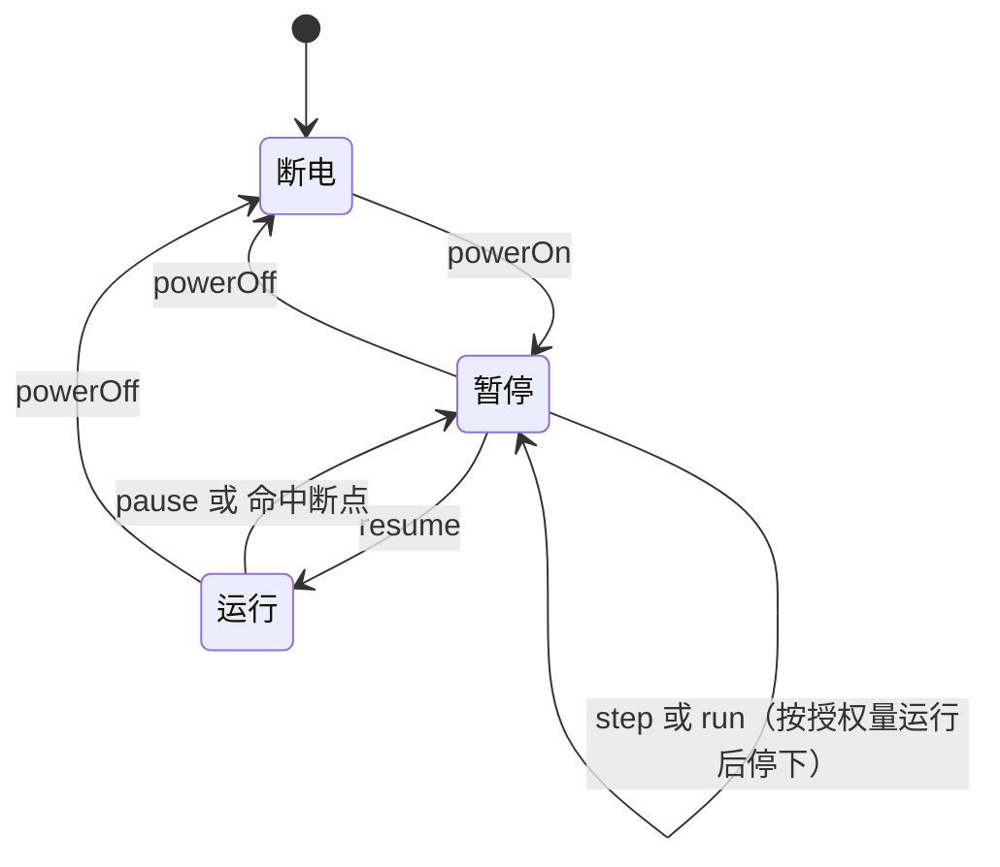

# 调试服务

调试服务让开发者和 Copilot 通过 WebSocket 实时控制模拟器、读取运行数据。模拟器只启动一次，之后的上电、复位、切换卡带、更换磁盘、录放磁带、更新 mapper 都通过请求完成，不用重启。界面不做调试窗口，调试能力只经本服务开放。整体架构见 [01-软件架构设计.md](01-软件架构设计.md)，硬件结构见 [02-硬件模块.md](02-硬件模块.md)。

状态说明同 01。

## 1. 决策

| 决策项 | 结论 | 状态 |
| --- | --- | --- |
| 形式 | 可开关的服务，由核心直接监听，不经主进程和界面；传输是 WebSocket（RFC 6455），报文是 JSON-RPC 2.0 | 已定 |
| 目标 | Copilot 调试方便；性能有保证（调试服务不阻塞模拟，事件有界队列，大块数据走二进制帧）；用户可以用任何工具连接（官方调试工具、终端客户端、脚本、网页）：接口完全开放，接口文档、类型与 SDK 都由 Schema 生成 | 已定 |
| 开放范围 | 模拟器的全部功能都有接口；调试服务与界面共用同一套请求，另有调试专用的请求 | 已定 |
| 运行数据 | 所有运行时的数据与状态都能实时获得：一次取得完整快照，或订阅变化 | 已定 |
| 界面 | 不做调试窗口；首选项里有开关、端口与令牌，系统栏右侧（通知按钮左边）在调试服务开启时显示绿色的“调试模式”（关闭时不显示，点击打开首选项），见 05 第 6 节 | 已定 |
| 默认状态 | 默认关闭；在首选项的“调试服务”分组里开启，或用启动参数 `--debug-port=<端口>`（也可以写成 `--debug-port <端口>`）强制开启，后者只在本次运行有效，不写入首选项；`--debug-token=<令牌>` 指定本次运行的令牌 | 已定 |
| 监听地址 | 只监听 `127.0.0.1` | 已定 |
| 传输 | WebSocket，路径 `/`，可选子协议 `ember-debug.v1`；文本帧放 JSON-RPC 报文，二进制帧放大块数据；浏览器和 Electron 页面可以直接连 | 已定 |
| 认证 | 令牌必须：第一次运行自动生成并保存在首选项里；每条连接的第一个请求必须是带令牌的 `debug.hello`，否则关闭连接；握手时还检查 `Host` 与 `Origin` | 已定 |
| 多连接 | 允许多个连接（最多 32 条）；事件订阅按连接；同一连接上的请求按到达顺序逐个处理，多条连接互不阻塞 | 已定 |
| 单实例 | 调试服务不改变单实例规则：要同时运行两个实例，给第二个实例指定另一个 `--user-data-dir` | 已定 |
| 发现 | `rpc.discover` 返回 OpenRPC 接口描述文档；启动后在用户数据目录写端点文件（地址与令牌），工具可以自动连接 | 已定 |
| 客户端工具 | 官方客户端在仓库的 `packages/ember-debug-sdk/`：SDK、终端客户端 `ember-debug`、MCP 服务 `ember-debug-mcp`，见第 8 节与 07 | 已定 |

## 2. 连接与报文

### 2.1 连接与握手

- 地址 `ws://127.0.0.1:<端口>/`。服务端先检查 HTTP 升级请求：方法必须是 GET、路径必须是 `/`、版本必须是 13（否则 426）、`Host` 必须是 `127.0.0.1`、`localhost` 或 `[::1]` 加服务的端口（防 DNS 重绑定）、`Origin` 没有（命令行与脚本）或指向本机（`http`、`https` 加 `127.0.0.1`、`localhost`、`[::1]`，任意端口）才允许，其余返回 403；请求头最大 16 KB。
- 升级成功后 5 秒内要发 `debug.hello` 且令牌正确，否则以关闭码 4001 关闭连接；没有先 `debug.hello` 就发别的请求、或令牌不对，先回 `debug.unauthorized` 的错误响应，再以 4001 关闭。令牌用恒定时间比较。
- 首选项里更换令牌后，已建立的连接以关闭码 4002 关闭，新的握手按新令牌检查。
- 关闭码：1000 正常、1001 服务停止、1002 协议错误、1003 客户端发了二进制消息、1007 文本不是 UTF-8、1008 空闲超时、1009 消息太大、4001 令牌不对或没有握手、4002 令牌已更换。

### 2.2 报文

JSON-RPC 2.0，每条消息一个文本帧（UTF-8），参数按名称传递（`params` 是对象，可以省略）。

| 报文 | 字段 |
| --- | --- |
| 请求 | `jsonrpc`（固定 `"2.0"`）、`id`（整数或字符串）、`method`（`<模块>.<操作>`）、`params` |
| 成功响应 | `jsonrpc`、`id`、`result` |
| 错误响应 | `jsonrpc`、`id`（请求无法解析时为 `null`）、`error`：`code`（整数）、`message`（说明）、`data.code`（模块里登记的错误码，如 `runtime.noCartridge`） |
| 事件（通知） | `jsonrpc`、`method`（`<模块>.<事件>`）、`params`（事件数据），没有 `id` |

```text
-> {"jsonrpc":"2.0","id":1,"method":"debug.hello","params":{"client":"copilot","token":"<令牌>"}}
<- {"jsonrpc":"2.0","id":1,"result":{"protocol":1,"coreVersion":"0.1.0","appVersion":"0.1.0","session":1}}
-> {"jsonrpc":"2.0","id":2,"method":"cartridges.load","params":{"path":"D:/roms/game.nes"}}
<- {"jsonrpc":"2.0","id":2,"result":{"cartridge":{"path":"D:/roms/game.nes","pluginId":"nrom","host":"fc","...":"卡带描述的其余字段"},"state":{"power":"on","mode":"running"}}}
-> {"jsonrpc":"2.0","id":3,"method":"runtime.run","params":{"frames":300,"wait":true}}
<- {"jsonrpc":"2.0","id":3,"result":{"frames":300,"stopped":"completed"}}
-> {"jsonrpc":"2.0","id":4,"method":"nobody.home"}
<- {"jsonrpc":"2.0","id":4,"error":{"code":-32601,"message":"没有登记：nobody.home","data":{"code":"core.unknownRequest"}}}
```

- 示例里的 `debug.hello`、`cartridges.load` 已实现（字段见第 4.2、4.6 节）；`runtime.run` 已实现（第 3.2 节），当前只支持按帧授权。
- 没有 `id` 的请求是通知：照常执行，不回响应；不支持批量请求（数组），发数组返回 -32600。
- 错误码：-32700 报文不是合法的 JSON；-32600 不是合法的 JSON-RPC 请求；-32601 方法不存在（`core.unknownRequest`）；-32602 参数不合格（`core.invalidParams`，参数与结果按各模块的 Schema 校验，与界面共用）；-32603 核心内部错误（`core.internal`，详情写进错误日志，不返回给客户端）；-32000 其余业务错误，具体看 `error.data.code`。
- `rpc.discover`：没有参数，返回描述全部请求与事件的 OpenRPC 文档（与调试 SDK 里的 `generated/openrpc.json` 相同），工具可据此生成客户端与界面。

### 2.3 二进制帧

结果或事件数据里顶层的 `data` 字段如果是二进制（如截图、内存内容、画面帧），整条消息改发一个二进制帧，不再发文本帧：

| 部分 | 内容 |
| --- | --- |
| 前 4 字节 | 大端的无符号整数 N，JSON 报文的字节数 |
| 接下来的 N 字节 | JSON-RPC 报文（UTF-8），其中没有 `data` 字段，其余字段照常 |
| 其后的全部字节 | `data` 的原始内容 |

客户端收到二进制帧，按 N 取出 JSON 报文，再把剩余字节当作 `result.data`（响应）或 `params.data`（事件）。客户端发给服务端的二进制帧不接受（关闭码 1003）。

Schema 里结果或事件数据的顶层 `data` 属性不写类型（任意 JSON，只写 `description`）就表示它是二进制：OpenRPC 文档里给它加 `x-binary: true`，SDK 的类型是 `Uint8Array`；核心里把它赋成 `nlohmann::json::binary` 即触发二进制帧。

### 2.4 限制、保活与背压

- 一条请求最大 4 MB，超过关闭连接（1009）。
- 同一连接上的请求按到达顺序逐个处理：一个请求（如 `runtime.run` 的 `wait`）没有返回之前，后面的请求排队；要并行就开多条连接。
- 服务端每 30 秒发一次 ping，90 秒没有收到该连接的任何数据就关闭（1008）；客户端发 ping 服务端立即回 pong。
- 事件默认不推送，要用 `debug.subscribe` 订阅。每条连接排队等待发送的事件最多 1024 条，超过后丢弃新事件，队列空下来后发一条 `debug.eventsDropped`（丢弃的条数）；响应不会被丢弃。事件在核心的线程里只做入队，所以读得慢的客户端只丢自己的事件，不拖慢模拟与其他连接。
- 连接断开时，该连接订阅的事件自动取消；正在处理的请求被取消（`core.cancelled`）；模拟器的运行状态不变。

### 2.5 端点文件

调试服务开始监听后，在用户数据目录写端点文件 `run/debug-endpoint.json`，令牌更换时更新，服务停止或核心退出时删除；命令行与 Copilot 的工具读它就能自动连接，不用手抄端口与令牌。

```json
{ "url": "ws://127.0.0.1:5688/", "port": 5688, "token": "<令牌>", "pid": 12345, "coreVersion": "0.1.0", "appVersion": "0.1.0", "startedAt": "2026-11-14T08:00:00Z" }
```

文件里有令牌，位置在当前用户的目录下；写入时先写临时文件再改名。

## 3. 运行控制

### 3.1 状态



| 状态 | 操作 |
| --- | --- |
| 电源（断电、通电） | `powerOn`、`powerOff`、`reset`（硬复位等于断电再上电） |
| 运行模式（暂停、运行） | `pause`、`resume`、`run`、`step`；只在通电时有效 |
| 卡带（空、已插） | `cartridges.load` 切换并重新装配主机，`cartridges.eject` 取出；整机机型不插卡带，经 `machines.boot` 装配主机；与介质无关 |
| 每个驱动器（无盘、有盘） | `floppyInsert`、`floppyEject`；驱动器之间互不影响，与电源无关 |
| 磁带机（停、播放、录音） | `tapePlay`、`tapeRecord`、`tapeStop`；播放与录音要主机通电（磁带机的 `connected` 为 `true`），载入与取出与主机无关 |

- 软复位只发 RESET 线，不改变电源、运行模式、卡带和介质。
- 上电后默认进入暂停，调用 `resume` 或 `run` 才运行；`runtime.powerOn` 可以带 `resume: true` 直接运行。`cartridges.load` 默认装入后上电并运行（`powerOn`、`resume` 都默认 `true`），可以分别设为 `false`。
- 状态与请求的实际行为（阶段 2b-2）：`powerOff` 后运行模式回到暂停；硬复位保持运行模式（运行中的机器硬复位后继续运行，暂停的仍暂停），帧号从头计；已通电时再上电等同硬复位；重复暂停、重复继续、重复断电、空槽取出都没有效果也不报错。
- 模拟器自由运行时，读写内存、读写状态等检查请求由模拟线程在下一个帧边界代为执行，结果是一致的快照，不需要先暂停；需要精确停在某一点时用 `runtime.step` 单步（暂停时检查请求立即执行），或设断点让运行自己停下（见第 4 节的断点）。

### 3.2 运行的授权量

`runtime.run` 的参数：`frames`（要运行的帧数，1 到 10000000）、`wait`（默认 `false`）。授权运行不限速，连续运行指定的帧数后暂停，运行中不输出声音，每帧之间照常处理输入等命令；`wait: true` 时等运行结束才返回响应，结果的 `stopped` 说明停止原因（`completed` 跑完、`interrupted` 被暂停、继续、硬复位、换卡带、新的授权运行或请求被取消打断、`powerOff` 断电、`breakpoint` 命中断点、`error` 运行出错），`frames` 与 `cycles` 是实际运行的帧数与 CPU 周期数；`wait` 为 `false` 时立即返回，结束时发事件 `runtime.runFinished`。已在授权运行中时旧的被打断，由新的替代；等待中的请求被取消（如连接断开）时运行被打断并暂停。`cycles`、`instructions`、`scanlines` 等其他授权量在后续阶段加入；断点命中时运行自动停止，不需要 `until`。

## 4. 请求

没有特别说明的请求，界面和调试服务都能用；`inspector` 与握手类（`debug.hello` 等）请求只在调试服务开放（`debugOnly`）。参数只列主要字段，完整定义以 Schema 为准。

### 4.1 runtime

| 请求 | 说明 |
| --- | --- |
| `runtime.status` | 已实现；结果：`power`（`off`、`on`）、`mode`（`paused`、`running`）、`machine`（主机型号，没有卡带时没有这一项）、`cartridge`（卡带描述，见 `cartridges.info`，没有时没有这一项）、`frame`（自上电起完成的帧数）、`cycles`（自上电起的 CPU 周期数）、`speed`（百分比，目前固定 100）、`mouse`（机器现在是否带鼠标：学习机在 6576 模式下带，进入 FC 兼容模式后没有，经典 FC 只有卡带的 mapper 插件声明了 `mouse` 外设才有，没有主机时为 `false`）；读的是模拟线程最近发布的快照，不经命令队列 |
| `runtime.powerOn`、`runtime.powerOff` | 已实现；`powerOn` 参数 `resume`（默认 `false`）；结果都是 `state`（`power`、`mode`）；没有卡带时上电返回 `runtime.noCartridge` |
| `runtime.reset` | 已实现；`kind` 为 `soft` 或 `hard`；没有卡带返回 `runtime.noCartridge`，软复位时断电返回 `runtime.notPowered` |
| `runtime.run` | 已实现；授权运行，见 3.2 节；错误码 `runtime.noCartridge`、`runtime.notPowered` |
| `runtime.setFrameEvents` | 已实现；参数 `frames`（0 到 3600）：`runtime.frame` 事件每 N 帧发一次，0 表示不发（默认）；全局设置，对订阅了 `runtime.frame` 的所有连接生效；结果 `frames` |
| `runtime.step` | 已实现，只经调试服务；参数 `unit`（`instruction` 一条指令含随后响应的中断序列、`cycle` 至少这么多 CPU 周期、`scanline` PPU 的扫描线推进这么多行、`frame` 完成这么多帧）与 `count`（1 到 100000，默认 1）；先暂停（正在进行的授权运行以 `interrupted` 结束），执行后保持暂停，经过的帧照常显示；结果 `state`、`instructions`、`cycles`、`frames`、`pc`（停下时的 PC）；发 `runtime.stateChanged`（原因 `step`）；错误码 `runtime.noCartridge`、`runtime.notPowered`、`runtime.debugUnsupported`；周期与扫描线单位在一条指令内越过目标时会多走几个周期，精灵 DMA 暂停 CPU 时扫描线可能一次推进多行 |
| `runtime.pause`、`runtime.resume` | 已实现；结果 `state`；断电时返回 `runtime.notPowered`（运行中的卡带脚本出错后会自动暂停，见 5 节的 `runtime.error`） |
| `runtime.setSpeed` | 后续阶段：速度百分比，或 `max` 最快 |

- runtime 的错误码：`runtime.noCartridge`（还没有装入卡带）、`runtime.notPowered`（主机没有通电）、`runtime.hostUnsupported`（插件要求的主机型号程序里没有实现，经 `cartridges.load` 返回）。
- 输入（键盘、鼠标、游戏手柄的原始事件）不走请求，经消息端口送达核心（见 01 第 7 节）；核心侧入口是运行服务的 `sendInput(事件)`，经命令队列在模拟线程里先交给输入钩子（`input` 模块的手柄输入路由器，按手柄绑定把游戏手柄与“不用作机器输入”的键盘按键变成手柄口的按键，见第 4.4 节），没有被截下的再交给主机，再转给卡带的 mapper 脚本（见 03 第 6.5 节）；`input.key`、`input.mouse`、`input.gamepad` 请求（第 4.4 节）映射到同一入口，`input.pad` 直接设置主机手柄口的按键掩码，不经手柄绑定和 mapper 脚本。

### 4.2 cartridges、mappers

| 请求 | 说明 |
| --- | --- |
| `cartridges.load` | 已实现，只用于 fc 卡带（mapper 171 的学习机 BIOS 文件没有匹配的插件时返回 `mappers.noMatch`，不会被识别成学习机；整机机型经 `machines.boot` 开机），`mainOnly`（参数带磁盘路径，界面不能直接发起，经下面的 `cartridges.open` 或调试服务）；参数 `path`（必填）、`powerOn`（默认 `true`）、`resume`（默认 `true`，`powerOn` 为 `false` 时无效）；读文件（上限 64 MB）、解析文件头、按 mapper 号与变体匹配插件、装配主机并插入卡槽，已有的卡带与主机被替换，任何一步失败都不改动原有的；结果 `cartridge`（卡带描述，见 `cartridges.info`）与 `state`（`power`、`mode`）；错误码：`cartridges.fileNotFound`、`cartridges.fileUnreadable`、`cartridges.notInes`、`cartridges.truncated`、`cartridges.unsupportedFormat`、`cartridges.invalidHeader`，以及 `mappers.noMatch`、`mappers.conflict`、`mappers.hostUnknown`、`mappers.notFound`、`mappers.invalidPackage`、`mappers.limitExceeded`、`runtime.hostUnsupported` |
| `cartridges.open` | 已实现，由主进程自己处理（Schema 的 `mainRequests`，不进入核心），只给界面：参数 `droppedId`（可选，拖入窗口的文件的编号，见 05 第 2 节“文件拖放”）；不给时弹出系统文件选择窗口（只显示 `.nes`），给出时不弹窗口、用这个编号对应的 `.nes` 文件，把路径交给 `cartridges.load`（`powerOn`、`resume` 都用默认值）；结果 `canceled`（用户取消选择时为 `true`，不是错误）、`loaded`（`cartridge` 与 `state`，取消时没有）；加载失败时原样返回 `cartridges.load` 的错误码，编号没有登记过、已失效或文件不是 `.nes` 时返回 `cartridges.droppedNotFound`；调试服务没有这个请求（没有窗口），直接用 `cartridges.load`；成功之前就已把路径记入“最近打开”，加载失败时移出 |
| `cartridges.recent` | 已实现，由主进程自己处理（`mainRequests`），只给界面：最近打开的卡带清单，最近的在前，最多 10 个；结果 `items`，每项 `id`（编号，本次运行内有效，从 1 开始）与 `name`（显示名，文件名），不含路径；清单由主进程保存在用户数据目录的 `config/recent-cartridges.json`（格式 `{ version, items: [{ path }] }`，文件不存在、损坏或某项不合格时用空清单或跳过那一项，不报错；防抖写盘，退出前立即写盘）；调试服务没有这个请求 |
| `cartridges.openRecent` | 已实现，由主进程自己处理（`mainRequests`），只给界面：参数 `id`（`cartridges.recent` 给出的编号，正整数）；按编号取出路径交给 `cartridges.load`（`powerOn`、`resume` 都用默认值）；结果 `loaded`（`cartridge` 与 `state`）；错误码：`cartridges.recentNotFound`（编号不在清单里）与 `cartridges.load` 的错误码；加载失败的卡带从清单里移出；渲染进程只能传编号，不接触路径；调试服务没有这个请求 |
| `cartridges.eject` | 已实现；取出卡带并拆除主机，电源变为断电，结果 `state`；空槽时没有效果 |
| `cartridges.info` | 已实现；结果 `cartridge`：`path`、`mapper`、`variant`、`prgSize`、`chrSize`、`mirroring`（`horizontal`、`vertical`、`four`）、`battery`、`crc32Prg`、`crc32All`（8 位大写十六进制）、匹配到的插件 `pluginId`、`pluginName`、`pluginVersion`、装配的主机型号 `host`、插件声明的外设 `devices`（目前只有 `mouse`）、存储区清单 `storage`（每项 `id`、`kind` 为 `rom` 或 `ram`、实际容量 `size`、`battery`）；没有卡带返回 `cartridges.empty` |
| `cartridges.parseHeader` | 后续阶段：只解析文件头并预览匹配结果，不装配 |
| `mappers.list` | 列出生效的插件摘要（标识、名称、版本、发布者、主机型号、匹配条件、来源 `bundled` 或 `user`、是否启用）；同一标识有多个来源时只列版本最高的 |
| `mappers.info` | `id`；返回摘要加清单详情（存储区、窗口、名称表、寄存器、状态、设置项）；没有这个插件返回 `mappers.notFound` |
| `mappers.install` | `path`（`.emap` 插件包的路径）；参数带磁盘路径，标 `mainOnly`，界面经主进程的文件选择发起，调试服务直接发起；检查不通过返回 `mappers.invalidPackage`、`mappers.hostUnknown`、`mappers.limitExceeded`；安装开发目录在后续阶段实现 |
| `mappers.openPackage` | 已实现，由主进程自己处理（Schema 的 `mainRequests`，不进入核心），只给界面：没有参数；弹出系统文件选择窗口（`.emap` 插件包，也可以选所有文件），把用户选定的路径交给 `mappers.install`；结果 `canceled`（用户取消时为 `true`，不是错误）、`plugin`（安装后的插件摘要，取消时没有）；安装失败时原样返回 `mappers.install` 的错误码；调试服务没有这个请求，直接用 `mappers.install` |
| `mappers.uninstall` | `id`；卸载用户安装的插件，预装的返回 `mappers.bundledReadonly`，没有返回 `mappers.notFound` |
| `mappers.setEnabled` | `id`、`enabled`；停用的插件不参与匹配，状态保存，重启后保持 |
| `mappers.reload` | 重新读取预装目录与用户目录里的插件包，下次装配或硬复位生效，不合格的包被跳过并写入错误日志；开发者改了 mapper 后用它，不用重启（开发目录的重新加载在后续阶段） |

### 4.3 media

| 请求 | 说明 |
| --- | --- |
| `media.floppyInsert` | 已实现，`mainOnly`（参数带磁盘路径，界面经下面的 `media.openFloppy`，调试服务直接发起）；参数 `drive`（0 到 3）、`path`、`writeProtected`（默认 `false`）；读取镜像文件（上限 16 MB）放进驱动器，替换已有的盘片（已有的盘片有尚未写回的修改时先写回它的文件，写回失败则不替换）；软驱是独立于主机的设备，没有主机、没有通电时也可以插入；镜像的格式由大小推断（160、180、320、360、720、1200、1440、2880 KB，其他大小按 1.44MB 处理）；结果 `status`（驱动器状态，见 `media.floppyStatus`）；成功后发 `media.changed`；错误码：`media.noDrive`（没有这个驱动器）、`media.fileNotFound`、`media.fileUnreadable`、`media.imageInvalid`（空文件或超过上限）、`media.saveFailed`（旧盘片的修改写回失败） |
| `media.openFloppy` | 已实现，由主进程自己处理（Schema 的 `mainRequests`，不进入核心），只给界面：参数 `drive`、`droppedId`（可选，拖入窗口的文件的编号）；不给 `droppedId` 时弹出系统文件选择窗口（软盘镜像 `.img`、`.ima`、`.vfd`、`.dsk`、`.flp`，也可以选所有文件），给出时不弹窗口、用这个编号对应的镜像文件（扩展名必须是上面五种），把路径交给 `media.floppyInsert`；结果 `canceled`（用户取消时为 `true`，不是错误）、`status`（取消时没有）；加载失败时原样返回 `media.floppyInsert` 的错误码，编号没有登记过、已失效或扩展名不符时返回 `media.droppedNotFound`；调试服务没有这个请求 |
| `media.floppyEject` | 已实现；参数 `drive`；取出盘片并丢弃镜像；有尚未写回的修改时先写回放入时的文件，写回失败则不取出；没有盘片时没有效果；结果 `status`；成功后发 `media.changed`；错误码：`media.noDrive`、`media.saveFailed` |
| `media.floppySave` | 已实现；参数 `drive`；立即把驱动器里的镜像写回放入时的文件并清除“已修改”标志；学习机写盘后核心会自动写回（见本表后面的说明），通常不必调用；结果 `status`；错误码：`media.noDrive`、`media.noDisk`（驱动器里没有盘片）、`media.saveFailed`（写回文件失败） |
| `media.floppyWriteProtect` | 已实现；参数 `drive`、`writeProtected`；设置或取消盘片的写保护，写保护的盘片拒绝学习机写入；结果 `status`；成功后发 `media.changed`；错误码：`media.noDrive` |
| `media.floppyStatus` | 已实现；没有参数；结果 `drives`：各驱动器的状态，按编号排列；软驱是独立于主机的设备，一直存在（目前只有软驱 A）；每项 `drive`、`inserted`（里面有没有盘片）、`fileName`（盘片来源的文件名，不含路径，没有盘片时没有这一项）、`writeProtected`、`modified`（镜像是否有尚未写回文件的修改）、`size`（镜像字节数，没有盘片时为 0）、`cylinder`（磁头所在的磁道）、`motor`（马达是否在转）、`faults`（当前注入的故障：`ejected`、`noIndex`、`seekFail`、`unresponsive`、`badSectors`） |
| `media.floppyFault` | 已实现，只经调试服务（`debugOnly`）；故障注入：参数 `drive`、`fault`（`ejected` 取盘，放回时内容不变；`writeProtected`；`noIndex` 无索引脉冲；`seekFail` 磁头卡住；`unresponsive` 控制器无响应；`badSector` 指定扇区校验错，必须给 `sector`；`clear` 关闭全部故障、放回盘片、取消写保护）与 `enabled`（默认 `true`）；结果 `status`；错误码：`media.noDrive`、`media.sectorRequired` |
| `media.floppyList` | 后续阶段（见待办备忘）：`drive`；列出盘片根目录的文件（名称、大小、修改时间 `modified`）与空间用量 |
| `media.floppyAddFile` | 后续阶段（见待办备忘）：`drive`、`path`、`replace`；把用户选定的文件添加到盘片，名称按 8.3 规则检查，同名且 `replace` 为 false 时返回错误；路径来自拖入或文件选择，只经主进程发起（`mainOnly`） |
| `media.floppyDeleteFile`、`media.floppyRenameFile` | 后续阶段（见待办备忘）：`drive`、`name`，改名再加 `newName`；写保护的盘片返回错误 |
| `media.tapeLoad` | 已实现，`mainOnly`（参数带磁盘路径，界面经下面的 `media.openTape`，调试服务直接发起）；参数 `path`；把声音文件放进磁带机当磁带，位置回到开头，替换已有的磁带；解码交给随应用附带的 ffmpeg（m4a、mp3、wav 等都可以）；单声道文件整路是数据线，立体声文件左声道出声、右声道是数据线；磁带机是独立于主机的设备，没有主机、没有通电时也可以载入；结果 `status`（磁带机状态，见 `media.tapeStatus`）；成功后发 `media.changed`；错误码：`media.tapeBusy`（磁带机正在播放或录音）、`media.fileNotFound`、`media.fileUnreadable`、`media.tapeUnsupported`（文件里没有可用的声音）、`media.decoderMissing`（没有找到 ffmpeg） |
| `media.openTape` | 已实现，由主进程自己处理（Schema 的 `mainRequests`），只给界面：参数 `droppedId`（可选，拖入窗口的文件的编号）；不给时弹出系统文件选择窗口（声音文件，也可以选所有文件），给出时不弹窗口、用这个编号对应的声音文件（扩展名 `m4a`、`mp3`、`wav`、`aac`、`flac`、`ogg`、`opus`、`mp4`、`mka`），把路径交给 `media.tapeLoad`；结果 `canceled`（取消时为 `true`，不是错误）与 `status`；编号没有登记过、已失效或扩展名不符时返回 `media.droppedNotFound`；调试服务没有这个请求 |
| `media.tapeEject` | 已实现；取出磁带，没有磁带时没有效果；播放或录音时先停止再取出（录音的文件先写完）；没有错误码；结果 `status`；成功后发 `media.changed` |
| `media.tapePlay` | 已实现；开始播放，磁带放完后再播放从头开始，已经在播放或录音时没有效果；没有磁带返回 `media.noTape`，磁带机没有接在通电的主机上返回 `media.tapeNotConnected`；结果 `status`；成功后发 `media.changed` |
| `media.tapeRecord` | 已实现，`mainOnly`（参数带磁盘路径，界面经 `media.openTapeRecording`）；参数 `path`；放入一盘空白磁带并开始录音：主机送给磁带的 1 位信号按时间记成 32 kHz、单声道、16 位的 WAV 文件（已有的文件被覆盖），原来的磁带被取出；停止后这个文件自动成为磁带机里的磁带，位置在开头，可以直接播放；磁带机播放或录音时不能开始录音（`media.tapeBusy`），没有接在通电的主机上返回 `media.tapeNotConnected`；结果 `status`；成功后发 `media.changed`；错误码还有 `media.saveFailed`（无法创建录音文件） |
| `media.openTapeRecording` | 已实现，由主进程自己处理，只给界面：弹出系统的保存文件窗口（只显示 WAV 文件），把用户选定的路径交给 `media.tapeRecord`；结果 `canceled` 与 `status`；调试服务没有这个请求 |
| `media.tapeStop` | 已实现；停止播放或录音，录音停止时把录到的内容写完，文件成为磁带机里的磁带（解码或打开失败时返回 `media.fileUnreadable`、`media.tapeUnsupported`、`media.decoderMissing`，磁带机回到空闲）；已经停止时没有效果；结果 `status`；成功后发 `media.changed` |
| `media.tapeStatus` | 已实现；没有参数；结果 `status`：`connected`（磁带机是否接在通电的主机上：主机通电且有磁带接口，现在只有开了机的经典 FC；没接上时可以载入与取出磁带，不能播放与录音）、`loaded`、`fileName`（不含路径，没有磁带时没有这一项）、`mode`（`stopped`、`playing`、`recording`）、`position`（当前位置，秒；录音时是已录的时长）、`duration`（总时长，秒；不知道或没有磁带时为 0）、`stereo`（是否立体声磁带：左声道是声音、右声道是数据，否则整路是数据） |
| `media.printerStatus` | 已实现；没有参数；结果 `status`：`state`（`idle` 空闲，机器没有运行或还没有内容；`printing` 打印中，当前页上有内容；`done` 打印完成，输出过一页且下一页还没有内容）、`hasContent`（当前页上是否已经有内容）、`pages`（本次运行以来已输出的页数）、`lastFile`（最近一页的文件名，不含路径，还没有输出过时没有这一项）；还没有主机或主机没有打印机时为空闲 |
| `media.printerFlush` | 已实现；立即输出当前页，等同打印机收到换页，页上的内容画成 PNG 保存到首选项“打印机”里设置的目录，成功后发 `media.printed`；结果 `status`；错误码：`media.noMachine`、`media.noPrinter`（这台主机没有打印机）、`media.printerEmpty`（当前页没有内容） |

- 软驱与磁带机都是独立于主机的设备，一直存在：盘片与磁带随时可以载入与取出，软驱在学习机通电时接到它的软驱控制器上，磁带机只有经典 `fc` 通电时才接到它的磁带接口上；打印机挂在整机机型（目前只有 `sb2000`）上，主机没有打印机时请求返回 `media.noPrinter`，还没有主机时返回 `media.noMachine`；驱动器编号超出个数时返回 `media.noDrive`。
- 打印机输出的 PNG 是 1 位灰度图，文件名按日期时间自动生成；保存目录取首选项 `printer.outputDirectory`（见第 4.8 节），为空时用用户数据目录下的 `printer-output`；某一页无法保存时这一页被丢弃并发 `media.printFailed`。
- 软盘镜像与镜像文件双向实时同步，都靠事件，没有定时检查。镜像到文件：学习机或调试服务改了盘片镜像，驱动器记下改动的字节区间并通知核心，核心的后台线程立即把这个区间直接写进镜像文件里对应的位置（文件其余部分与大小不变），写完清除 `modified` 并发 `media.changed`；写回期间又有新的改动时 `modified` 保持，随即再写。取出或换盘前、核心停止前也先写回。自动写回失败时发 `media.floppySaveFailed` 并写错误日志，修改仍在内存里，每 5 秒重试，成功前只通知这一次；取出与换盘时写回失败则请求失败（`media.saveFailed`），盘片不变。文件到镜像：盘片放入后核心监视镜像文件（Windows 的 `ReadDirectoryChangesW`、macOS 的 kqueue，取出或换盘时停止），文件被别的程序改动（含先写临时文件再改名覆盖的保存方式）时，核心读出文件、与内存里的镜像逐字节比较，把不同的字节同步进镜像并发 `media.changed`；学习机刚写、还没写进文件的字节（`modified` 区间内）保留，之后写回文件；自己写文件引起的通知比较后没有差别，不会循环；文件大小与盘片不同或读不出来（别的程序正在保存的中间状态、文件被删除）时忽略，等下一次变化；无法监视文件时写错误日志，外部修改就不会自动同步。学习机自己缓存在内存里的 FAT 与目录不会因此刷新，见 02 第 6.7 节。

### 4.4 input、output

| 请求 | 说明 |
| --- | --- |
| `input.getBindings` | 已实现，界面与调试服务都能用；读取手柄绑定；结果 `slots`：两个玩家槽位，第 1 项对应手柄口 1。每个槽位 `keys`（键盘的绑定：`button` 与物理键位 `code`）与可选的 `gamepad`（实体手柄：设备标识 `id`、同一标识里第几个 `occurrence`（从 0 开始）、按钮或轴的绑定 `bindings`：`button`、`kind`（`button` 或 `axis`）、`index`、轴的 `direction`）。`button` 取 `a`、`b`、`select`、`start`、`up`、`down`、`left`、`right`、`turboA`、`turboB`，没有写的键就是没有绑定 |
| `input.setBindings` | 已实现，界面与调试服务都能用；参数 `slots`（正好 2 项），核心校验后保存到用户数据目录的 `config/input-bindings.json`（`{ version, slots }`，原子写入；文件不存在用默认值，损坏或不合格时用默认值并写入系统错误日志），结果 `slots` 是保存之后的内容；内容有变化才发 `input.bindingsChanged`。校验：同一个手柄键在键盘上或在实体手柄上只能绑定一次；一个物理键在两个玩家之间只能绑定一次（字母与数字、不超过 32 个字符）；同一个实体手柄（`id` 加 `occurrence`）只能分给一个玩家；按钮编号 0 到 31，轴编号 0 到 15 且必须给方向；设备标识 1 到 256 个字符，`occurrence` 0 到 15；不合格返回 `input.invalidBindings`（说明里写明哪个玩家、哪一项） |
| `input.resetBindings` | 已实现，界面与调试服务都能用；恢复出厂默认（玩家 1 的键盘：方向键、Z 为 B、X 为 A、C 为连发 B、V 为连发 A、右 Shift 为选择、回车为开始；玩家 2 没有绑定；都没有实体手柄）；结果 `slots`；内容有变化才发 `input.bindingsChanged` |
| `input.key` | 已实现，只经调试服务（`debugOnly`）；`code`（物理键位，取 `KeyboardEvent.code`，如 `KeyW`、`Space`）、`down`（布尔）；与界面发的键盘事件同一入口：主机的键盘不用作机器输入时，绑定了的键按手柄绑定变成手柄口的按键，其余交给主机（卡带的 mapper 脚本或整机的键盘）；没有开机时被丢弃 |
| `input.pad` | 已实现，只经调试服务；`port`（手柄口，0 到 7）与 `buttons`（按键掩码，0 到 255：1 A、2 B、4 选择、8 开始、16 上、32 下、64 左、128 右）；直接设置主机的手柄口，不经手柄绑定和 mapper 脚本；手柄绑定只在手柄状态变化时才重新设置手柄口，所以这里设置的掩码会保持到手柄的状态下一次变化；口不存在（含没有开机时）返回 `input.invalidPort` |
| `input.mouse` | 已实现，只经调试服务；`kind`（`move`、`down`、`up`、`wheel`、`leave`）与 `x`、`y`、`dx`、`dy`、`buttons`、`wheel`，坐标单位是标准帧（256x240）的像素，省略的数值按 0 处理；与界面发的鼠标事件同一入口，交给卡带的 mapper 脚本 |
| `input.gamepad` | 已实现，只经调试服务；游戏手柄一个手柄的当前状态（`index`、`id`（设备标识，可省略、省略按空处理）、`connected`、`buttons`、`axes`），拔掉时 `connected` 为 `false`；与界面发的游戏手柄事件同一入口，全部由手柄绑定换算成手柄口的按键，不交给主机与卡带脚本 |
| `input.releaseAll` | 已实现，只经调试服务；松开经 `input.key` 按下的全部键，把经 `input.pad` 设置过的手柄口清零，并让经 `input.gamepad` 注入的手柄断开 |
| `output.screenshot` | 已实现，只经调试服务（`debugOnly`）；截取最近一次完成的画面（256x240，暂停与断电后也有上一帧）；参数 `format`（`png` 默认，或 `rgba`：未压缩的像素，每像素 4 字节，按行从上到下）、`file`（文件名，可省略）；不带 `file` 时图像以二进制帧返回（见 2.3 节，结果里的 `data`），带 `file` 时保存到调试输出目录（首选项 `debug.outputDirectory`，空则用用户数据目录下的 `debug-output`），结果的 `file` 是完整路径，不再返回 `data`；`file` 只能是不含目录的名字（字母、数字、点、下划线、短横线与空格，1 到 100 个字符，不以点或空格开头与结尾，不含 `..`，不用 Windows 设备名），`png` 没有扩展名时补 `.png`，先写临时文件再改名；结果 `format`、`width`、`height`、`byteLength`；错误码：`output.noPicture`（没有开过机或还没有完成过一帧）、`output.invalidFileName`、`output.fileFailed`（无法创建目录或写入） |
| `output.setAudioMode` | 后续阶段：`real` 按真实时间播放；`fast` 不等声卡，采样直接丢弃，模拟器内部时序不变 |
| `output.setVolume` | 已实现；参数 `volume`（0 到 100 的整数，音量百分比）与 `muted`（布尔，是否静音），都可以省略，省略的保持不变；结果 `volume`、`muted` 是设置之后的值；音量保存到首选项的 `sound.volume`（见 4.8，核心重启后保持，没有保存过时是 100），静音不保存，每次启动由 `sound.startMuted` 决定（默认未静音）；变化经 10 毫秒的淡入淡出，没有爆音；音量超出 0 到 100 或类型不对返回 `core.invalidParams`，不改变已有的设置；没有声音设备时核心降级为无声输出，请求照常成功 |

### 4.5 inspector（调试专用）

| 请求 | 说明 |
| --- | --- |
| `inspector.snapshot` | 已实现；参数 `module`（可省略，省略时包含全部模块）；结果 `cycles`（CPU 周期数）、`states`（各模块状态，同 `getState`）、`breakpoints`、`watches`（监视项与当前取值），都在同一个时刻读出；内存不在快照里，用 `readMemory` 读 |
| `inspector.getState` | 已实现；参数 `module`（可省略，省略时返回全部）；结果 `states`：每个模块一项 `module`、`writable`、`fields`（`name`、`value`、`description`）；模块 `cpu`（`pc`、`a`、`x`、`y`、`sp`、`status`、`cycles`）、`ppu`（`scanline`、`dot`、`frame`、`vramAddress`、`tempAddress`、`fineX`、`writeToggle`、`vblank`、`spriteZeroHit`、`spriteOverflow`，标志位为 0 或 1）、`mapper`（卡带脚本的内部状态，插着卡带时才有）；错误码 `inspector.invalidState`（没有这个模块） |
| `inspector.setState` | 已实现；参数 `module`、`fields`（`name`、`value`）；目前只有 `cpu` 可以改（`pc`、`a`、`x`、`y`、`sp`、`status`，`cycles` 只读），在指令之间生效；先全部检查，有任何一项不合格就一项也不改；结果 `state` 是修改之后的状态；错误码 `inspector.readOnly`（`mapper`）、`inspector.invalidState`（`ppu` 只读、状态项不存在、取值超出范围） |
| `inspector.listSpaces` | 已实现；结果 `spaces`：`id`、`description`、`size`、`writable`；主机的空间加上卡带上的每块存储区（`cart.<存储区标识>`） |
| `inspector.readMemory` | 已实现；参数 `space`、`address`、`length`（1 到 1048576）；数据以二进制帧返回（结果里的 `data`，见 2.3 节）；无副作用，不读寄存器、不回调卡带脚本；错误码 `inspector.unknownSpace`、`inspector.outOfRange` |
| `inspector.writeMemory` | 已实现；参数 `space`、`address`、`bytes`（整数数组，1 到 65536 项，每项 0 到 255）；结果 `written`；`cpu` 与 `ppu` 空间的写经真实的总线，与 CPU 写一样有副作用；错误码 `inspector.unknownSpace`、`inspector.outOfRange`、`inspector.readOnly`（卡带的 ROM 存储区） |
| `inspector.resolve` | 已实现；参数 `space`（`cpu` 或 `ppu`）、`address`；结果 `target`：`kind`（`ram`、`rom`、`register`、`none`）、`region`（所在的空间标识或寄存器所属的芯片，没有时省略）、`offset`、`description`；卡带的地址按当前的窗口映射（分页）解析，不回调脚本 |
| `inspector.addBreakpoint` | 已实现；参数 `kind`（`execute`、`read`、`write`）、`address`、可选 `endAddress`（地址范围，含两端；省略时只有一个地址）；结果 `breakpoint`：`id`、`kind`、`address`、`endAddress`、`hits`；地址是 CPU 总线上的地址；最多 256 个；错误码 `inspector.invalidBreakpoint`（起点大于终点）、`inspector.breakpointLimit` |
| `inspector.listBreakpoints` | 已实现；结果 `breakpoints`，按编号升序，`hits` 是累计命中次数 |
| `inspector.removeBreakpoint` | 已实现；参数 `id`；没有这个编号时错误码 `inspector.noBreakpoint` |
| `inspector.clearBreakpoints` | 已实现；删除全部断点，结果 `removed` 是删除的个数 |
| `inspector.traceStart` | 已实现；参数 `kind`（`instruction`、`io`、`irq`，`disk` 留给学习机）、`file`（文件名，省略时用 `trace-编号.txt`）、`maxLines`（1 到 1000000，默认 100000，满了不再记录）、`unique`（只对 `instruction`：每个地址只记第一次）；结果 `id`；内容记在内存里，`traceStop` 时才写文件；同时进行的记录最多 8 项；错误码 `inspector.invalidFileName`、`inspector.recordingLimit` |
| `inspector.traceStop` | 已实现；参数 `id`；结果 `file`（完整路径）、`lines`、`truncated`（因行数满了而少记）；写在调试输出目录，同名文件被替换；错误码 `inspector.noRecording`、`inspector.fileFailed` |
| `inspector.callLogStart` | 已实现；参数 `address`、`stackBytes`（0 到 32，默认 0）、`ranges`（最多 4 段 `address`、`length`，每段 1 到 256 字节）、`skip`（最多 4 项 `address`、`value`：执行到这条指令时，任何一项成立，即这个地址上的字节等于这个值，就不记录这一次）、`file`、`maxLines`；每次执行到 `address` 这条指令之前记一行；结果 `id` |
| `inspector.callLogStop` | 已实现；参数 `id`，结果同 `traceStop`；跟踪与调用记录的编号不能互相结束 |
| `inspector.disassemble` | 已实现；参数 `address`、`count`（1 到 256，默认 16）；结果 `instructions`：`address`、`bytes`（如 `A9 42`）、`text`（如 `LDA $0180 = 33`，写法同 nestest 日志，带有效地址与取值的注释）、`unofficial`；读内存没有副作用，芯片寄存器类地址的取值显示 `00`，带索引的寻址用当前的 X、Y |
| `inspector.cdlStart` | 已实现；开始代码与数据标记，标记清零；结果 `size`（PRG-ROM 的字节数）；已在记录时错误码 `inspector.cdlActive`；卡带没有 PRG-ROM 存储区时 `inspector.unsupported` |
| `inspector.cdlStop` | 已实现；停止标记，已有的标记保留到下一次 `cdlStart` 或换卡带；结果 `size`、`codeBytes`、`dataBytes`；没有记录过时错误码 `inspector.noCdl` |
| `inspector.cdlSave` | 已实现；参数 `file`（省略时 `prg.cdl`）；把标记写成调试输出目录下的文件，结果 `file`、`size`、`codeBytes`、`dataBytes`；记录中或停止后都可以保存；错误码 `inspector.noCdl`、`inspector.invalidFileName`、`inspector.fileFailed` |
| `inspector.watch` | 已实现；参数 `path`（`<模块>.<状态项>`，如 `cpu.pc`、`ppu.scanline`、`mapper.<脚本状态>`，状态项见 `getState`）；结果 `watch`：`path`、`value`（当前取值）；已在监视的路径再监视没有效果；最多 64 项；错误码 `inspector.invalidState`（写法不对、模块或状态项不存在）、`inspector.watchLimit` |
| `inspector.unwatch` | 已实现；参数 `path`；没有监视这个路径时错误码 `inspector.noWatch` |

- 内存空间（`space`），`fc` 主机型号目前有：`cpu`（CPU 总线 $0000-$FFFF 的视角，读不产生副作用，寄存器类地址读出 0）、`ppu`（PPU 总线 $0000-$3FFF，调色板在 $3F00 起，读不产生副作用）、`board.ram`（主板内部 RAM 2K）、`board.nametable`（主板名称表显存 2K）、`chip.oam`（PPU 的 OAM 256 字节）、`chip.palette`（PPU 的调色板 32 字节，未镜像的存储），以及卡带上每块存储区的 `cart.<存储区标识>`（标识由 mapper 清单声明，如 `cart.prg`、`cart.chr`）；读写经所有者的接口，不绕过。`phys`（分页后的物理地址）等学习机阶段再定。
- 跟踪与调用记录：内容由主机在内存里记，行数有上限，`stop` 时才由 `output` 模块提供的 `DebugFileWriter` 写文件。记录属于当前的主机，装入新卡带后作废；上电与复位不清除；单步与运行产生的内容都记，调试写内存不记。各行的写法：
  - `instruction`：与 nestest 日志相同，去掉 PPU 列，如 `C000  4C F5 C5  JMP $C5F5                       A:00 X:00 Y:00 P:24 SP:FD CYC:7`；非官方指令的助记符前是 `*`；有效地址与取值的注释读的是无副作用的内存，芯片寄存器类地址显示 `00`。
  - `io`：`R $2002 = 80  PC:C005 CYC:1234`（`R` 读、`W` 写，`PC` 与 `CYC` 是发起访问的那条指令的地址与开始时的周期数）；范围是 `$2000-$5FFF` 的读写，以及对 `$8000` 以上的写（mapper 寄存器）。
  - `irq`：`NMI  return:C0AB handler:C100 CYC:500`（`NMI`、`IRQ`、`BRK`，返回地址，处理程序地址，中断序列完成时的周期数）。
  - 调用记录：`8123  A:01 X:02 Y:03 P:24 SP:FD CYC:77 | STACK AA BB CC | 0300: 11 22`（栈顶从 SP 之上开始，到页尾回到页首）。
- 代码与数据标记：给 PRG-ROM 的每个字节一个标记字节，位定义同 Mesen：`0x01` Code（被当作指令执行，含操作数字节）、`0x02` Data（被指令当数据读取，按指令的内存操作数算：读与读改写，不含只写的存储指令、栈与中断向量；`JMP (指针)` 的指针算 Data）、`0x04` JumpTarget（JMP 或成立的分支的目标）、`0x08` SubEntry（JSR 的目标）。标记的是物理位置：地址按当前的分页换算成 PRG 偏移，所以换了 bank 也标在对的位置；不在 PRG-ROM 里的地址（RAM、PRG-RAM、寄存器）不标；RTS、RTI 的返回地址与中断处理程序的入口不标。文件就是这些标记字节，没有文件头。运行与单步产生的内容都记。
- 监视：监视项和上一次的取值由检查器记住，运行服务在模拟线程上通过观察者（`RuntimeService::setObserver`）在上面列出的时刻回调检查器，检查器比较后发事件；没有监视项时回调几乎没有开销。
- 断点：已实现 `execute`、`read`、`write` 三种，可带地址范围，条件、IRQ、NMI、复位、寄存器访问等种类以后再加。断点在机器运行时生效（自由运行与 `runtime.run` 都会停下，发事件 `runtime.breakpointHit`，运行模式变为暂停，授权运行以 `breakpoint` 结束）：`execute` 停在指令执行之前，`read`、`write` 停在那条指令执行完之后（取指、栈、中断向量等 CPU 总线上的每次读写都算访问）；一次停止只报告一个断点（同一次访问匹配多个时取编号最小的；一条指令里先发生的读写优先），其余断点不累计次数。`runtime.step` 忽略断点；继续运行时先越过刚命中的执行断点，所以连续 `resume` 能一路前进。检查请求、调试写内存和单步不会触发读写断点。断点属于当前的主机，装入新卡带后清空；上电与复位不清除断点。
- 状态路径：`cpu.pc`、`ppu.scanline`、`mapper.prgBank`、`device.fdc.status` 等；字段名固定，由各模块的状态说明给出，见 02 第 9 节。

### 4.6 debug

调试服务自己的请求；`hello`、`subscribe`、`unsubscribe` 属于连接，只能经调试连接调用（`debugOnly`），经核心的请求通道（界面）调用会返回 `debug.connectionOnly`；`status` 界面也能用。

| 请求 | 说明 |
| --- | --- |
| `debug.hello` | 已实现；握手，每条连接的第一个请求；参数 `client`（客户端名称，1 到 64 个字符）、`token`（令牌）、`protocol`（协议版本，目前只有 1，可省略）；结果 `protocol`、`coreVersion`、`appVersion`、`session`（本连接的编号）；错误码：`debug.unauthorized`（令牌不对，连接随后以 4001 关闭）；握手之后可以再发一次，没有害处 |
| `debug.subscribe`、`debug.unsubscribe` | 已实现；参数 `events`（1 到 64 项）：事件名（如 `runtime.stateChanged`）、`模块.*`（一个模块的全部事件）或 `*`（全部）；写法不对返回 `core.invalidParams`，整条请求不生效；结果 `events` 是之后本连接订阅的全部写法；重复订阅与取消没订阅过的都没有效果 |
| `debug.status` | 已实现；没有参数；结果 `enabled`（是否开启）、`listening`（是否在监听）、`port`、`error`（开启了但没有监听时的原因，如端口被占用）、`connections`（已握手的连接：`id`、`client`、`connectedAt`） |
| `rpc.discover` | 已实现；返回 OpenRPC 接口描述文档，见第 2.2 节 |

- 服务的开关、端口与令牌不用请求修改，由首选项的 `debug.enabled`、`debug.port`、`debug.token` 决定（见第 4.8 节）：修改后立即生效，端口变了就重新监听，令牌变了就关闭已有连接；启动参数 `--debug-port` 指定时，开关与端口以启动参数为准。
- 令牌为空（第一次运行、被清空或恢复默认）时核心自动生成一个新的 32 位字母数字串并保存。

### 4.7 machines

本节的请求与事件都已实现。`machines` 模块管理机型清单与整机机型的 BIOS，并负责整机机型的开机；BIOS 的规则见 01 第 9 节、02 第 1 与 6.6 节，界面见 05 第 4.5 节。

机型项（`machines.list`、`machines.setBios`、`machines.removeBios` 的结果都用它）：

| 字段 | 说明 |
| --- | --- |
| `id` | 机型标识：`fc`、`sb97`、`sb2000`、`bbk10`、`bbk20` |
| `name` | 显示名称 |
| `needsBios` | 是否需要 BIOS；`fc` 为 `false`，四个整机机型为 `true` |
| `supported` | 是否已支持；未支持的机型不能添加 BIOS，也不能开机 |
| `bios` | 已添加的 BIOS：`fileName`（文件名）、`size`（字节数，含 iNES 文件头）；没有添加、或 `needsBios` 为 `false` 时没有这一项 |

| 请求 | 说明 |
| --- | --- |
| `machines.list` | 没有参数；结果 `machines`：机型项数组，顺序固定为 `fc`、`sb97`、`sb2000`、`bbk10`、`bbk20` |
| `machines.setBios` | `mainOnly`（参数带磁盘路径，界面经下面的 `machines.openBios`，调试服务直接发起）；参数 `machine`、`path`；读取并检查源文件，复制进 BIOS 目录（新文件写好之后才删旧文件，失败时原有的 BIOS 不变）；结果 `machine`（更新后的机型项）；错误码：`machines.notFound`（没有这个机型）、`machines.biosNotNeeded`（`fc` 不需要 BIOS）、`machines.unsupported`（机型尚未支持）、`machines.fileNotFound`、`machines.fileUnreadable`、`machines.biosInvalid`（文件的格式或大小不符合这个机型）、`machines.biosAccessFailed`（无法写入 BIOS 目录） |
| `machines.openBios` | 由主进程自己处理（Schema 的 `mainRequests`，不进入核心），只给界面：参数 `machine`；弹出系统文件选择窗口，把用户选定的路径交给 `machines.setBios`；结果 `canceled`（用户取消时为 `true`，不是错误）、`machine`（取消时没有）；加载失败时原样返回 `machines.setBios` 的错误码；调试服务没有这个请求 |
| `machines.removeBios` | 参数 `machine`；删除这个机型的 BIOS 文件，没有 BIOS 时没有效果也不报错；结果 `machine`；错误码：`machines.notFound`、`machines.biosNotNeeded`、`machines.biosAccessFailed`（无法删除） |
| `machines.boot` | 整机机型开机；参数 `machine`、`powerOn`（默认 `true`）、`resume`（默认 `true`，`powerOn` 为 `false` 时无效）；读入已设置的 BIOS，装配该机型的主机，已有的卡带与主机被替换，任何一步失败都不改动原有的；结果 `machine` 与 `state`（`power`、`mode`）；错误码：`machines.notFound`、`machines.cartridgeRequired`（`fc` 开机必须有 NES 文件，改用 `cartridges.load`，界面用 `cartridges.open`）、`machines.unsupported`、`machines.noBios`（这个机型还没有添加 BIOS，去首选项的“机型与 BIOS”添加）、`machines.biosInvalid`（已保存的 BIOS 不符合这个机型）、`machines.biosAccessFailed`（无法读取 BIOS 文件） |

- 整机机型开机后没有卡带：`runtime.status` 只有 `machine`，没有 `cartridge`，`cartridges.info` 返回 `cartridges.empty`；`runtime.noCartridge` 只在还没有主机（既没有装入卡带、也没有用整机机型开机）时返回，整机机型开机后上电、复位、运行、单步都照常可用。
- `machines.boot` 成功后发 `runtime.stateChanged`（原因 `load`），不发 `cartridges.loaded`（没有卡带）。
- 添加、替换、移除 BIOS 后发事件 `machines.changed`（见第 5 节）。

### 4.8 preferences

`preferences` 模块汇总各模块在核心里登记的设置项，负责校验、保存与通知；界面与调试服务共用同一套请求，页面见 05 第 4.5 节。设置项由各模块登记（标识、分组、名称、说明、种类、出厂默认值、是否隐藏），标识是分组标识加点再加名称；种类有四种：`choice`（从 `options` 里选一个字符串）、`switch`（布尔值）、`integer`（`minimum` 到 `maximum` 之间的整数）、`text`（不超过 `maxLength` 个字节的文字，可以为空）。目前登记的设置项：

| 标识 | 登记者 | 种类与可选值 | 出厂默认值 | 说明 |
| --- | --- | --- | --- | --- |
| `appearance.theme` | `preferences` | `choice`：`system`、`dark`、`light` | `system` | 主题，改后立即生效，见 05 第 8 节 |
| `display.aspect` | `preferences` | `choice`：`8:7`、`4:3` | `8:7` | 画面比例，只影响显示 |
| `display.scaling` | `preferences` | `choice`：`fit`、`integer` | `fit` | 缩放方式，只影响显示 |
| `display.showAllLines` | `preferences` | `switch` | `true` | 显示全部 240 行；关闭时上下各裁掉 8 行，只影响显示 |
| `sound.buffer` | `output` | `choice`：`low`、`standard`、`stable` | `standard` | 声音缓冲，改后立即生效 |
| `sound.startMuted` | `output` | `switch` | `false` | 启动时静音 |
| `sound.volume` | `output` | `integer`：0 到 100 | `100` | 音量，不在首选项里显示（`hidden`），由运行面板的音量滑块与 `output.setVolume` 修改并保存 |
| `debug.enabled` | `debug` | `switch` | `false` | 启用调试服务，改后立即开启或关闭 |
| `debug.port` | `debug` | `integer`：1024 到 65535 | `5688` | 调试服务的端口，改后立即重新监听 |
| `debug.token` | `debug` | `text`：最长 128 字节 | 空（核心自动生成并保存） | 调试服务的令牌，更换后已连接的工具被断开；清空或恢复默认会重新生成 |
| `debug.outputDirectory` | `debug` | `text`：最长 260 字节 | 空（用用户数据目录下的 `debug-output`） | 调试工具保存截图等文件的目录；每次保存时读取，改后立即生效 |
| `input.captureMouse` | `input` | `switch` | `true` | 点击画面是否捕获鼠标（只给界面用，核心不读取），见 05 第 7 节 |
| `input.familyKeyboard` | `input` | `switch` | `false` | 给经典 FC 接入 Family BASIC 键盘：改后立即对当前主机生效，之后装配的主机也按它设置；接入后电脑键盘的按键按 Family BASIC 键盘的键位送给机器（不再当作手柄按键）；学习机用自己内置的键盘，不受影响，见 02 第 6.4 节；机器菜单里也有同名的勾选项 |
| `printer.outputDirectory` | `media` | `text`：最长 260 字节，`picker` 为 `directory` | 空（用用户数据目录下的 `printer-output`） | 打印机输出的 PNG 图片保存到哪个目录；每输出一页时读取，改后立即生效；目录不存在时创建 |

| 请求 | 说明 |
| --- | --- |
| `preferences.list` | 已实现；没有参数；结果 `groups`（分组：`id`、`label`）与 `settings`（设置项：`id`、`group`、`label`、`description`、`kind`、`options`、`minimum`、`maximum`、`maxLength`、`picker`、`hidden`、`defaultValue`、`value`），分组与设置项都按登记的顺序排列，隐藏的设置项也列出；`picker` 只有取值是文件夹路径的 `text` 设置项有（目前只有 `directory`），页面据此在输入框旁显示“选择”按钮 |
| `preferences.set` | 已实现；参数 `id`、`value`；核心按登记的种类校验取值，保存到文件，发事件 `preferences.changed`；取值没有变化时不发事件；结果 `id`、`value`（修改之后的取值）；错误码：`preferences.unknown`（没有登记这个设置项）、`preferences.invalidValue`（取值的类型、可选值或范围不符，说明里写明可选的值或范围） |
| `preferences.reset` | 已实现；参数 `id`；恢复为出厂默认值，取值没有变化时不发事件；结果 `id`、`value`；错误码：`preferences.unknown` |
| `preferences.pickDirectory` | 已实现，由主进程自己处理（Schema 的 `mainRequests`，不进入核心），只给界面：没有参数；弹出系统的选择文件夹窗口，返回用户选定的路径；结果 `canceled`（用户取消时为 `true`，不是错误）、`path`（取消时没有）；页面再用 `preferences.set` 保存取值；调试服务没有这个请求 |

- 保存位置：用户数据目录的 `config/preferences.json`，格式 `{ "version": 1, "values": { 设置项标识: 取值 } }`；只保存登记过的设置项，先写临时文件再改名；读不到、不是合法 JSON 或版本不认识时当作没有保存过（全部用出厂默认值）并写一条错误日志，不影响启动；某个取值不符合登记的种类或范围时只丢弃这一项；写不进去时取值仍在内存里生效并写一条错误日志。
- 核心里的模块经 `PreferenceService` 登记设置项、读取取值并订阅变化（变化的回调在锁外调用），不自己保存设置。

### 4.9 system

| 请求 | 说明 |
| --- | --- |
| `system.version` | 已实现；没有参数；结果 `appVersion`（应用版本，取自安装包的版本号）与 `coreVersion`（核心版本） |
| `system.openHelp` | 已实现，由主进程自己处理（Schema 的 `mainRequests`，不进入核心），只给界面：没有参数；打开（已打开则提到最前）独立的帮助文档窗口，加载应用自带的帮助文档站点（使用说明与调试接口手册，见 05 第 5、8 节）；结果为空；站点不存在时返回 `system.helpUnavailable`；调试服务没有这个请求 |
| `system.openLogDirectory` | 已实现，由主进程自己处理（Schema 的 `mainRequests`，不进入核心），只给界面：没有参数；用系统的文件管理器打开用户数据目录下的 `logs`，目录不存在时先创建；结果为空；打不开时返回 `system.logDirectoryUnavailable`，说明里带原因；路径由主进程决定，请求不能指定；调试服务没有这个请求 |

## 5. 事件

| 事件 | 触发 | 内容 |
| --- | --- | --- |
| `runtime.stateChanged` | 电源或运行模式改变（已实现） | `power`、`mode`（新状态）与 `reason`（`load`、`eject`、`powerOn`、`powerOff`、`reset`、`pause`、`resume`、`run`（开始授权运行）、`runEnded`（授权运行跑完后暂停）、`step`（单步）、`breakpoint`（命中断点后暂停）、`error`、`inputChanged`（机器的输入设备变了，如学习机进入 FC 兼容模式后不再带鼠标，电源与运行模式不变）） |
| `runtime.runFinished` | 授权运行（`runtime.run`）结束：跑完、或被暂停、继续、复位、断电、换卡带、新的授权运行或出错打断（已实现） | `frames`、`cycles`（实际运行的帧数与周期数）、`stopped`（`completed`、`interrupted`、`powerOff`、`breakpoint`、`error`） |
| `runtime.frame` | 每一帧结束；订阅时可指定每 N 帧一次（已实现发布端，默认不发，由核心内的 `setFrameEventInterval(N)` 或 `runtime.setFrameEvents` 开启） | `frame`（帧号）、`cycles`（总周期数）、`pc`（CPU 的程序计数器） |
| `runtime.error` | 脚本异常、总线错误等（已实现）；发出后模拟器已暂停，同一个错误只报告一次 | `module`（出错的模块，如 `mappers`、`hardware`）、`code`、`message` |
| `runtime.breakpointHit` | 命中断点，机器已暂停（已实现） | `id`（断点编号）、`kind`、`address`（执行断点是将要执行的指令地址，读写断点是被访问的地址）、`value`（读写断点读到或写入的值，执行断点没有）、`pc`、`a`、`x`、`y`、`sp`、`status` |
| `inspector.stateChanged` | 监视的状态项取值变了（已实现）。检查发生在每一帧完成后、单步后、命中断点后和每次检查请求（含 `setState`）执行完之后，所以一帧里变化多次只报告最后的取值，暂停时改状态也会报告；监视项属于检查器，不随上电、复位或换卡带清除 | `path`、`oldValue`、`newValue`、`cycles`（检查时的 CPU 周期数） |
| `media.changed` | 磁带、盘片状态变化：盘片的插入、取出、保存、写保护、注入故障，以及软驱马达开关变化（软驱状态里的 `motor`），磁带的载入、取出、播放、录音、停止（已实现） | `device`（`floppy` 或 `tape`）、`drive`（驱动器编号，磁带机为 0） |
| `media.floppyFilesChanged` | 盘片里的文件变化（界面、调试服务或学习机写盘造成）；后续阶段，见待办备忘 | 软驱、来源（`host` 或 `guest`）、变化的文件名 |
| `media.printed` | 打印机输出了一页，已经保存成 PNG 文件（已实现） | `fileName`（文件名，不含路径）、`page`（本次运行以来的页序号） |
| `media.printFailed` | 打印机输出的一页无法保存（目录无法写入等），这一页已丢弃（已实现） | `message`（原因，面向用户） |
| `media.floppySaveFailed` | 盘片镜像无法自动写回文件（文件被占用、没有写权限等），修改仍在内存里，每 5 秒重试一次，写回成功前只通知这一次（已实现） | `drive`（驱动器编号）、`message`（原因，面向用户） |
| `machines.changed` | 整机机型的 BIOS 添加、替换、移除（已实现） | `machine`（机型标识） |
| `preferences.changed` | 一个设置项的取值变了（已实现；界面修改、恢复默认、核心里的模块修改都会发出） | `id`（设置项标识）、`value`（新的取值） |
| `input.bindingsChanged` | 手柄绑定变了（已实现；`input.setBindings`、`input.resetBindings` 造成，内容没有变化时不发） | `slots`（变化之后的两个玩家槽位，结构同 `input.getBindings` 的结果） |
| `debug.statusChanged` | 调试服务的状态变了：开始或停止监听、有连接握手完成或断开（已实现） | `enabled`、`listening`、`port`、`connections`（连接数） |
| `debug.eventsDropped` | 只发给订阅了事件的那条连接：事件队列满了，丢弃了若干条事件（已实现） | `count`（自上一次通知以来丢弃的条数） |
| `cartridges.loaded` | 卡带装配完成（已实现） | `cartridge`（卡带描述，内含匹配到的插件） |
| `mappers.changed` | 插件安装、卸载、启停、重载（已实现） | 插件标识（重新加载时为 null） |

- 事件按连接订阅（`debug.subscribe`）；订阅前不推送任何事件，高频事件（`runtime.frame`）要再开启才有；事件在连接上以 JSON-RPC 通知的形式送达，见第 2 节。

## 6. 典型流程

开发者或 Copilot 调试一个程序，模拟器只启动一次：

1. 用 `--debug-port=5688` 启动模拟器（或在首选项里开启调试服务），读端点文件（第 2.5 节）取得地址与令牌，连接并 `debug.hello`。
2. `machines.boot` 以 `sb2000` 开机（`powerOn` 设为 `false`）或 `cartridges.load` 载入 fc 卡带，`media.floppyInsert` 插入盘片，`runtime.powerOn` 带 `resume`。
3. `runtime.run` 等待若干帧，`output.screenshot` 看画面，`input.key` 输入命令，`inspector.readMemory` 读结果。
4. 改了程序：重新生成盘片后，再次 `media.floppyInsert`，`runtime.reset` 硬复位。
5. 改了 mapper 的脚本：`mappers.reload`，`runtime.reset` 硬复位。
6. 换另一个 ROM：`cartridges.load`。
7. 需要定位问题：`inspector.addBreakpoint`，`runtime.resume` 或 `runtime.run`（`wait: true`）等命中，`inspector.snapshot` 取全部状态。

## 7. 安全

- 默认关闭；开启后只监听 `127.0.0.1`，不接受远程连接；令牌必须，第一次运行自动生成（32 位字母数字，约 190 位随机性），令牌不对的连接立即关闭。
- 本机的网页也能向 `127.0.0.1` 发起 WebSocket 连接，所以握手时检查 `Host`（防 DNS 重绑定）与 `Origin`（网页的来源不是本机就拒绝），再加上必须的令牌，其他网页拿不到令牌就无法使用；令牌不放在 URL 里，只在 `debug.hello` 的参数里传。
- 端点文件里有令牌，只写在当前用户的用户数据目录下；日志与错误信息里不记录令牌。
- 调试专用的请求能读写任意内存，只在调试服务开放，界面不暴露；握手类请求（`debug.hello` 等）界面不能调用。
- 跟踪、截图等写文件的请求，输出只能写到“调试输出目录”（首选项设置，默认在用户数据目录下），客户端只传文件名，不能传路径，防止写到任意位置。
- 读取 ROM、盘片、磁带的请求接受本机任意可读路径：它们是开发者自己的文件，工作流需要，风险随“只监听本机并有令牌”接受。
- 打印机输出的 PNG 写到首选项里设置的“图片保存位置”，与调试输出目录无关；调试服务不能修改这个位置。
- 资源上限：最多 32 条连接，一条请求最大 4 MB，每条连接的事件队列最多 1024 条，握手与 hello 各 5 秒时限，空闲 90 秒关闭。

## 8. 客户端工具

官方客户端工具在仓库的 `packages/ember-debug-sdk/`（独立的 npm 包 `ember-debug-sdk`，Apache-2.0），设计见 [07-调试客户端工具.md](07-调试客户端工具.md)：

| 工具 | 说明 |
| --- | --- |
| SDK | 类型完整的 WebSocket 客户端：`connect`（给定地址与令牌，浏览器与 Electron 页面也能用）、`connectToEmber`（Node，自动找到正在运行的 Ember）；`client.api.runtime.run(...)` 这样按模块分组的类型化请求，`subscribe`、`on`、`waitFor` 处理事件，二进制结果是 `Uint8Array` |
| 终端客户端 `ember-debug` | `endpoint`、`methods`、`describe`、`call`、`screenshot`、`watch` |
| MCP 服务 `ember-debug-mcp` | 给 Copilot 等智能体用：每个请求一个工具（`ember_<模块>_<操作>`），`ember_events` 读事件，PNG 截图作为图像返回 |
| 协议参考 | 帮助文档里的“调试接口手册”（`help/api/`，每个模块一页），由 OpenRPC 文档在构建帮助文档时生成，不提交；`help/debug/` 是手写的使用者说明 |

- 接口定义的唯一来源是本仓库的 `schema/`：`npm run schema` 把 OpenRPC 文档与 TypeScript 类型写到 `packages/ember-debug-sdk/generated/`（不提交，见 06 第 2 节）；协议参考页由 `npm run help:build` 调用 `packages/ember-debug-sdk` 的 `npm run docs:protocol` 生成到 `ember/help/api/`（不提交），随帮助文档分发。
- 自动发现用第 2.5 节的端点文件，位置是用户数据目录下的 `run/debug-endpoint.json`（Windows 上默认是 `%APPDATA%\Ember`），并确认写它的进程还在；也可以用环境变量 `EMBER_DEBUG_URL`、`EMBER_DEBUG_TOKEN`、`EMBER_DEBUG_ENDPOINT`、`EMBER_USER_DATA` 或命令行参数直接指定。
- 协议是开放的，其他语言与工具可以根据 `rpc.discover` 的 OpenRPC 文档自己实现客户端。
- `ember-debug-sdk` 用真实运行的 Ember 做联调（`packages/ember-debug-sdk/scripts/live-check.mjs`）：连接、请求、事件、二进制截图、终端客户端与 MCP 服务。
