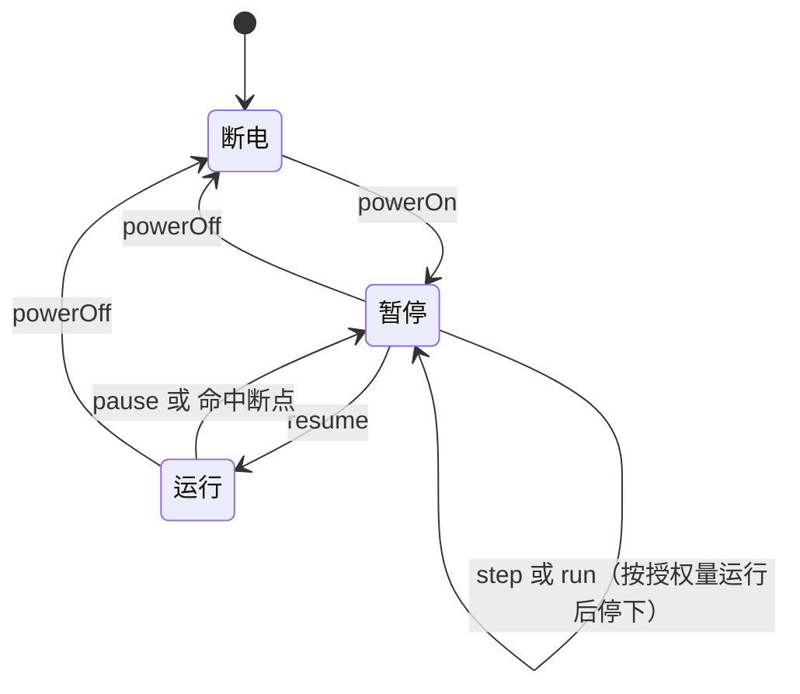

# 调试服务

调试服务让开发者和 Copilot 通过 TCP 实时控制模拟器、读取运行数据。模拟器只启动一次，之后的上电、复位、切换卡带、更换磁盘、录放磁带、更新 mapper 都通过请求完成，不用重启。界面不做调试窗口，调试能力只经本服务开放。整体架构见 [01-软件架构设计.md](01-软件架构设计.md)，硬件结构见 [02-硬件模块.md](02-硬件模块.md)。

状态说明同 01。

## 1. 决策

| 决策项 | 结论 | 状态 |
| --- | --- | --- |
| 形式 | 可开关的 TCP 服务，有状态的长连接；调试服务由核心直接监听，不经主进程和界面 | 已定 |
| 开放范围 | 模拟器的全部功能都有接口；调试服务与界面共用同一套请求，另有调试专用的请求 | 已定 |
| 运行数据 | 所有运行时的数据与状态都能实时获得：一次取得完整快照，或订阅变化 | 已定 |
| 界面 | 不做调试窗口，普通用户看不到调试功能 | 已定 |
| 默认状态 | 默认关闭；用启动参数 `--debug-port <端口>` 或首选项开启 | 拟定 |
| 监听地址 | 只监听 `127.0.0.1` | 拟定 |
| 报文格式 | 每条消息一行 JSON（换行分隔），请求、响应、事件三种 | 拟定 |
| 认证 | 可选令牌：设置了令牌时，连接后第一条消息必须是带令牌的 `debug.hello` | 拟定 |
| 多连接 | 允许多个连接；事件订阅按连接，写操作按到达顺序串行执行 | 拟定 |
| 单实例 | 指定了 `--debug-port` 的实例不把命令行转交给已运行的实例，可以与普通实例同时运行 | 拟定 |

## 2. 连接与报文

连接建立后，客户端发请求，服务端回响应，订阅了的事件由服务端主动推送。

| 报文 | 字段 |
| --- | --- |
| 请求 | `id`（客户端生成的整数或字符串）、`name`（`<模块>.<操作>`）、`params` |
| 响应 | `id`、`ok`（布尔）、成功时 `result`，失败时 `error`（`code`、`message`） |
| 事件 | `event`（`<模块>.<事件>`）、`data` |

```text
-> {"id":1,"name":"debug.hello","params":{"client":"copilot","token":"占位"}}
<- {"id":1,"ok":true,"result":{"version":"0.1.0","protocol":1}}
-> {"id":2,"name":"cartridges.load","params":{"path":"D:/roms/SB2K_BIOS.NES","powerOn":true}}
<- {"id":2,"ok":true,"result":{"machine":"sb2000","plugin":"sb2000"}}
-> {"id":3,"name":"runtime.run","params":{"frames":300,"wait":true}}
<- {"id":3,"ok":true,"result":{"frames":300,"stopped":"completed"}}
```

- 参数与结果按各模块的 Schema 校验，与界面共用；校验失败返回 `core.invalidParams`。
- 一条消息最大 4 MB；截图与大块内存读取可以写到调试输出目录，返回文件名。
- 请求可以并发发出，用 `id` 对应响应；改变硬件状态的请求按到达顺序由模拟线程执行。
- 连接断开时，该连接订阅的事件与监视自动取消；模拟器的运行状态不变。

## 3. 运行控制

### 3.1 状态



| 状态 | 操作 |
| --- | --- |
| 电源（断电、通电） | `powerOn`、`powerOff`、`reset`（硬复位等于断电再上电） |
| 运行模式（暂停、运行） | `pause`、`resume`、`run`、`step`；只在通电时有效 |
| 卡带（空、已插） | `cartridges.load` 切换并重新装配主机，`cartridges.eject` 取出；与介质无关 |
| 每个驱动器（无盘、有盘） | `floppyInsert`、`floppyEject`；驱动器之间互不影响，与电源无关 |
| 磁带机（停、播放、录音） | `tapePlay`、`tapeRecord`、`tapeStop`；与电源无关 |

- 软复位只发 RESET 线，不改变电源、运行模式、卡带和介质。
- 上电后默认进入暂停，调用 `resume` 或 `run` 才运行；`cartridges.load` 与 `runtime.powerOn` 可以带 `resume: true` 直接运行。
- 模拟器自由运行时，读写内存、改寄存器等请求由模拟线程在下一个指令边界代为执行，结果可靠，不需要先暂停；需要精确停在某一点时用断点或 `step`。

### 3.2 运行的授权量

`runtime.run` 的参数：`frames`、`cycles`、`instructions`、`scanlines` 四选一，`until`（断点命中、事件发生）可附加；`wait: true` 时等运行结束才返回响应，结果说明停止原因（`completed`、`breakpoint`、`error`、`powerOff`）。

## 4. 请求

没有特别说明的请求，界面和调试服务都能用；`inspector` 的请求只在调试服务开放（`debugOnly`）。参数只列主要字段，完整定义以 Schema 为准。

### 4.1 runtime

| 请求 | 说明 |
| --- | --- |
| `runtime.status` | 电源、运行模式、主机型号、卡带、帧号、总周期数、速度 |
| `runtime.powerOn`、`runtime.powerOff` | 上电、断电 |
| `runtime.reset` | `kind` 为 `soft` 或 `hard` |
| `runtime.run`、`runtime.step` | 授权运行；单步（`unit`：指令、周期、扫描线、帧） |
| `runtime.pause`、`runtime.resume` | 暂停、继续 |
| `runtime.setSpeed` | 速度百分比，或 `max` 最快 |

### 4.2 cartridges、mappers

| 请求 | 说明 |
| --- | --- |
| `cartridges.load` | `path`、`powerOn`、`resume`；解析、匹配插件、装配主机、插入卡槽；用来切换 ROM |
| `cartridges.eject`、`cartridges.info` | 取出卡带；当前卡带的描述、匹配到的插件、存储区清单 |
| `cartridges.parseHeader` | 只解析文件头并预览匹配结果，不装配 |
| `mappers.list`、`mappers.info` | 已安装的插件与清单摘要 |
| `mappers.install`、`mappers.uninstall`、`mappers.setEnabled` | 安装（包或开发目录）、卸载、启停 |
| `mappers.reload` | 重新加载插件脚本，下次装配或硬复位生效；开发者改了 mapper 后用它，不用重启 |

### 4.3 media

| 请求 | 说明 |
| --- | --- |
| `media.floppyInsert`、`media.floppyEject` | `drive`、`path`、`writeProtected` |
| `media.floppySave` | 把驱动器里的镜像写回文件 |
| `media.floppyStatus` | 各驱动器的状态 |
| `media.floppyFault` | 故障注入：取盘、写保护、无索引脉冲、磁头卡住、控制器无响应、指定扇区校验错、全部清除 |
| `media.tapeLoad`、`media.tapeEject` | 磁带机载入声音文件（`path`）、取出磁带；磁带机播放或录音时返回错误 |
| `media.tapePlay`、`media.tapeRecord`、`media.tapeStop`、`media.tapeStatus` | 磁带机的播放、录音、停止、状态；播放和录音需要已载入磁带；`kind` 区分数据磁带与声像磁带 |
| `media.printerStatus` | 打印机的状态（空闲、打印中、打印完成）、当前页是否有内容、已输出页数、最近一页的文件名 |
| `media.printerFlush` | 立即输出当前页，等同打印机收到换页；当前页没有内容时返回 `media.printerEmpty` |

### 4.4 input、output

| 请求 | 说明 |
| --- | --- |
| `input.key` | 按下或松开学习机键盘的键，`code` 为物理键位，`down` 为布尔 |
| `input.pad` | `port`（手柄口）与按键掩码 |
| `input.mouseMove`、`input.mouseButtons` | 鼠标相对位移与按键掩码；接口位置由主机与卡带决定 |
| `input.releaseAll` | 松开全部注入的按键 |
| `output.screenshot` | 截图，写到调试输出目录，或以 Base64 内联返回 |
| `output.setAudioMode` | `real` 按真实时间播放；`fast` 不等声卡，采样直接丢弃，模拟器内部时序不变 |
| `output.setVolume` | 音量与静音 |

### 4.5 inspector（调试专用）

| 请求 | 说明 |
| --- | --- |
| `inspector.snapshot` | 取得全部模块的完整状态；可指定模块 |
| `inspector.getState`、`inspector.setState` | 读写一个模块的状态：`module` 如 `cpu`、`ppu`、`mapper`、`device.fdc` |
| `inspector.listSpaces` | 列出可读写的内存空间 |
| `inspector.readMemory`、`inspector.writeMemory` | `space`、`addr`、`length` 或字节串 |
| `inspector.resolve` | 把总线地址解析为存储区与偏移 |
| `inspector.addBreakpoint`、`inspector.listBreakpoints`、`inspector.removeBreakpoint`、`inspector.clearBreakpoints` | 断点管理 |
| `inspector.traceStart`、`inspector.traceStop` | 跟踪：`kind` 为 `instruction`、`io`、`disk`、`irq`；有最大行数与 `unique`（每个地址只记第一次）选项 |
| `inspector.callLogStart`、`inspector.callLogStop` | 每次执行到指定地址就记录寄存器、栈顶与内存段 |
| `inspector.cdlStart`、`inspector.cdlStop`、`inspector.cdlSave` | 代码与数据标记 |
| `inspector.watch`、`inspector.unwatch` | 监视状态路径的变化，变化时推送事件 |

- 内存空间（`space`）：`cpu`、`ppu`（按总线译码后的视角）；各存储区的标识，如卡带的 `cart.prg`、芯片内的 `chip.oam`、主板的 `board.ram`；以及 `phys`（物理地址，对应分页后的地址）。读写经所有者的接口，不绕过。
- 断点种类：执行、读、写（可带地址范围与条件）、IRQ、NMI、复位、寄存器访问（`mapper`、设备）。
- 状态路径：`cpu.pc`、`ppu.scanline`、`mapper.prgBank`、`device.fdc.status` 等；字段名固定，由各模块的状态说明给出，见 02 第 9 节。

### 4.6 debug

| 请求 | 说明 |
| --- | --- |
| `debug.hello` | 握手：客户端名称、令牌；返回版本与协议版本 |
| `debug.subscribe`、`debug.unsubscribe` | 订阅、取消订阅事件 |
| `debug.getConfig`、`debug.setConfig` | 服务的开关、端口、令牌、调试输出目录；只有界面可以改 |

## 5. 事件

| 事件 | 触发 | 内容 |
| --- | --- | --- |
| `runtime.stateChanged` | 电源或运行模式改变 | 新状态与原因 |
| `runtime.frame` | 每一帧结束；订阅时可指定每 N 帧一次 | 帧号、总周期数、CPU 的 PC |
| `runtime.error` | 脚本异常、总线错误等 | 模块与说明 |
| `inspector.breakpointHit` | 命中断点 | 断点编号、地址、寄存器 |
| `inspector.stateChanged` | 监视的状态变化 | 路径、旧值、新值 |
| `media.changed` | 盘片、磁带状态变化 | 设备与状态 |
| `media.printed` | 打印机输出了一页 | 文件名、页序号 |
| `cartridges.loaded` | 卡带装配完成 | 描述与插件 |
| `mappers.changed` | 插件安装、卸载、重载 | 插件标识 |

- 事件按连接订阅；高频事件（`runtime.frame`）默认不推送。

## 6. 典型流程

开发者或 Copilot 调试一个程序，模拟器只启动一次：

1. 用 `--debug-port 5688` 启动模拟器，连接并 `debug.hello`。
2. `cartridges.load` 载入固件，`media.floppyInsert` 插入盘片，`runtime.powerOn` 带 `resume`。
3. `runtime.run` 等待若干帧，`output.screenshot` 看画面，`input.key` 输入命令，`inspector.readMemory` 读结果。
4. 改了程序：重新生成盘片后，再次 `media.floppyInsert`，`runtime.reset` 硬复位。
5. 改了 mapper 的脚本：`mappers.reload`，`runtime.reset` 硬复位。
6. 换另一个 ROM：`cartridges.load`。
7. 需要定位问题：`inspector.addBreakpoint`，`runtime.run` 的 `until` 等命中，`inspector.snapshot` 取全部状态。

## 7. 安全

- 默认关闭；开启后只监听 `127.0.0.1`，不接受远程连接；可以设置令牌。
- 调试专用的请求能读写任意内存，只在调试服务开放，界面不暴露。
- 跟踪、截图等写文件的请求，输出只能写到“调试输出目录”（首选项设置，默认在用户数据目录下），客户端只传文件名，不能传路径，防止写到任意位置。
- 读取 ROM、盘片、磁带的请求接受本机任意可读路径：它们是开发者自己的文件，工作流需要，风险随“只监听本机并可设令牌”接受。
- 打印机输出的 PNG 写到首选项里设置的“图片保存位置”，与调试输出目录无关；调试服务不能修改这个位置。

## 8. 与旧版调试命令的对照

旧版（`famiclone/virtuanes` 的调试服务）是一行一条的文本命令，新版全部改为请求。旧命令都有对应：

| 旧命令 | 新请求 |
| --- | --- |
| `status` | `runtime.status`、`inspector.snapshot` |
| `run`、`step` | `runtime.run`、`runtime.step` |
| `bp`、`regs` | `inspector.addBreakpoint` 等、`inspector.getState` 与 `setState` |
| `read`、`write`、`resolve` | `inspector.readMemory`、`inspector.writeMemory`、`inspector.resolve` |
| `key`、`pad`、`mouse` | `input.key`、`input.pad`、`input.mouseMove`、`input.mouseButtons` |
| `shot` | `output.screenshot` |
| `trace`、`io`、`disklog`、`calllog`、`cdl` | `inspector.traceStart`（`kind` 为 `instruction`、`io`、`disk`）、`inspector.callLogStart`、`inspector.cdlStart` |
| `tape` | `media.tapePlay`、`media.tapeRecord`、`media.tapeStop`、`media.tapeStatus` |
| `disk`、`savedisk` | `media.floppyInsert`、`media.floppySave` |
| `fdc` | `media.floppyFault` |
| `audio` | `output.setAudioMode` |
| `reset`、`softreset` | `runtime.reset` |
| `live` | 不再需要：自由运行时读写内存也可靠 |
| `dialogs` | 不再需要：调试服务的操作不弹出对话框；打印机也直接按设置保存，不弹出保存窗口 |
| `quit` | 待定：是否提供退出请求 |
| `savestate`、`loadstate` | 待定：是否做存档 |

- 旧版的调试客户端是 `fcdev` 的 `debug-client.mjs`；新协议稳定前，`fcdev` 仍使用旧模拟器。
