# 动作（190 个）

返回 [总览](README.md)

| 缩略图 | 游戏 | 映⁠射⁠号 | 文件路径 |
|---|---|---|---|
|  | 阿尔戈斯战士 | 4 | D:\GitCode\famiclone\reference\nes-games\动作\阿尔戈斯战士-v1.11[汉化你妹].nes |
| 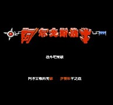 | 阿尔戈斯战士 | 2 | D:\GitCode\famiclone\reference\nes-games\动作\阿尔戈斯战士(修正版)[孔雀天+MS].nes |
| 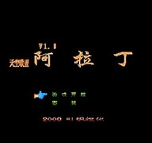 | 阿拉丁 | 4 | D:\GitCode\famiclone\reference\nes-games\动作\阿拉丁.nes |
| 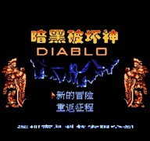 | 暗黑破坏神 | 163 | D:\GitCode\famiclone\reference\nes-games\动作\暗黑破坏神.nes |
|  | 爆笑三国 | 15 | D:\GitCode\famiclone\reference\nes-games\动作\爆笑三国[外星科技].nes |
|  | 爆笑三国 | 15 | D:\GitCode\famiclone\reference\nes-games\动作\爆笑三国[外星科技+147201688].nes |
| 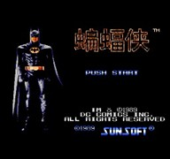 | 蝙蝠侠 | 69 | D:\GitCode\famiclone\reference\nes-games\动作\蝙蝠侠[汉化你妹].nes |
| 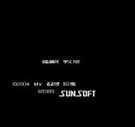 | 蝙蝠侠 | 4 | D:\GitCode\famiclone\reference\nes-games\动作\蝙蝠侠[幻想].nes |
|  | 蝙蝠侠 | 4 | D:\GitCode\famiclone\reference\nes-games\动作\蝙蝠侠[幻想+HK].nes |
| 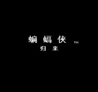 | 蝙蝠侠归来 | 5 | D:\GitCode\famiclone\reference\nes-games\动作\蝙蝠侠归来.nes |
| 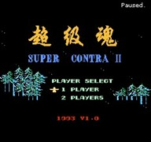 | 超级魂 | 2 | D:\GitCode\famiclone\reference\nes-games\动作\超级魂.nes |
| 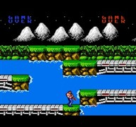 | 超级魂93 | 2 | D:\GitCode\famiclone\reference\nes-games\动作\超级魂93.nes |
| 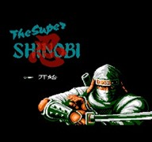 | 超级忍 | 4 | D:\GitCode\famiclone\reference\nes-games\动作\超级忍.nes |
| 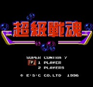 | 超级战魂 | 4 | D:\GitCode\famiclone\reference\nes-games\动作\超级战魂.nes |
| 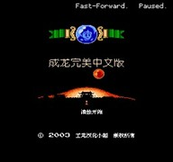 | 成龙 | 4 | D:\GitCode\famiclone\reference\nes-games\动作\成龙.nes |
| 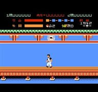 | 成龙踢馆 | 0 | D:\GitCode\famiclone\reference\nes-games\动作\成龙踢馆[高伟].nes |
| 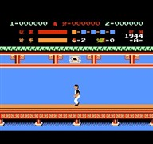 | 成龙踢馆 | 0 | D:\GitCode\famiclone\reference\nes-games\动作\成龙踢馆[MM之神].nes |
| 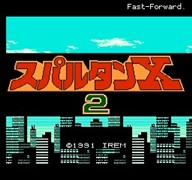 | 成龙踢馆2 | 65 | D:\GitCode\famiclone\reference\nes-games\动作\成龙踢馆2.nes |
| 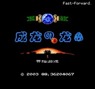 | 成龙之龙 | 4 | D:\GitCode\famiclone\reference\nes-games\动作\成龙之龙(带QQ号)[俞亮].nes |
|  | 成龙之龙 | 4 | D:\GitCode\famiclone\reference\nes-games\动作\成龙之龙[高伟].nes |
| 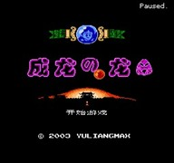 | 成龙之龙 | 4 | D:\GitCode\famiclone\reference\nes-games\动作\成龙之龙[俞亮].nes |
| 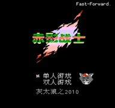 | 赤影战士 | 4 | D:\GitCode\famiclone\reference\nes-games\动作\赤影战士-v2.0[星空].nes |
| 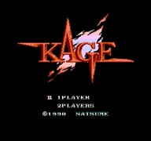 | 赤影战士 | 4 | D:\GitCode\famiclone\reference\nes-games\动作\赤影战士-v20220407[asiwish].nes |
|  | 赤影战士 | 4 | D:\GitCode\famiclone\reference\nes-games\动作\赤影战士-v3[高伟].nes |
| 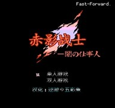 | 赤影战士 | 4 | D:\GitCode\famiclone\reference\nes-games\动作\赤影战士(标题汉化)-v20211022[逆游の五彩魚].nes |
| 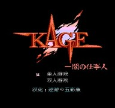 | 赤影战士 | 4 | D:\GitCode\famiclone\reference\nes-games\动作\赤影战士(实机修正)-v20220126[逆游の五彩魚+拒绝融化].nes |
| 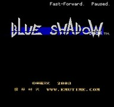 | 赤影战士 | 4 | D:\GitCode\famiclone\reference\nes-games\动作\赤影战士(小字版)[来福].nes |
| 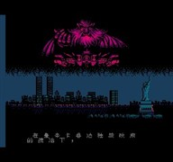 | 赤影战士 | 4 | D:\GitCode\famiclone\reference\nes-games\动作\赤影战士(小字版)[来福+HK].nes |
| 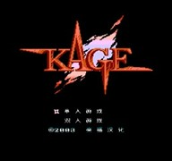 | 赤影战士 | 4 | D:\GitCode\famiclone\reference\nes-games\动作\赤影战士[来福].nes |
|  | 赤影战士 | 4 | D:\GitCode\famiclone\reference\nes-games\动作\赤影战士[王者荣耀].nes |
| 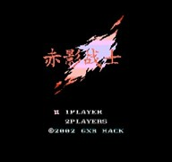 | 赤影战士 | 4 | D:\GitCode\famiclone\reference\nes-games\动作\赤影战士[GXB].nes |
| 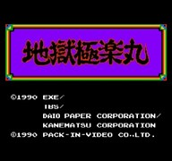 | 地狱极乐丸 | 4 | D:\GitCode\famiclone\reference\nes-games\动作\地狱极乐丸.nes |
| 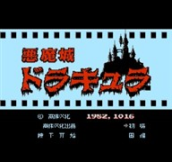 | 恶魔城 | 2 | D:\GitCode\famiclone\reference\nes-games\动作\恶魔城-v1.0[高伟].nes |
| 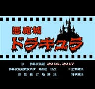 | 恶魔城 | 2 | D:\GitCode\famiclone\reference\nes-games\动作\恶魔城(作弊菜单)[吸血男爵].nes |
| 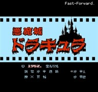 | 恶魔城 | 2 | D:\GitCode\famiclone\reference\nes-games\动作\恶魔城[虫儿].nes |
| 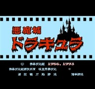 | 恶魔城 | 2 | D:\GitCode\famiclone\reference\nes-games\动作\恶魔城[吸血男爵].nes |
| 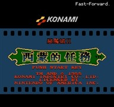 | 恶魔城2 西蒙的任务 | 10 | D:\GitCode\famiclone\reference\nes-games\动作\恶魔城2 西蒙的任务-v1.2[未名](繁).nes |
| 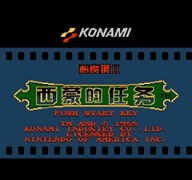 | 恶魔城2 西蒙的任务 | 10 | D:\GitCode\famiclone\reference\nes-games\动作\恶魔城2 西蒙的任务-v1.2[未名](简).nes |
| 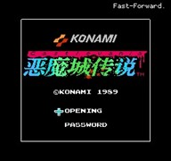 | 恶魔城传说 | 26 | D:\GitCode\famiclone\reference\nes-games\动作\恶魔城传说.nes |
| 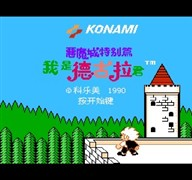 | 恶魔城特别篇 我是德古拉君 | 23 | D:\GitCode\famiclone\reference\nes-games\动作\恶魔城特别篇 我是德古拉君.nes |
| 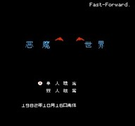 | 恶魔世界 | 0 | D:\GitCode\famiclone\reference\nes-games\动作\恶魔世界-v1.0[高伟].nes |
| 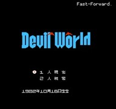 | 恶魔世界 | 0 | D:\GitCode\famiclone\reference\nes-games\动作\恶魔世界[虫虫].nes |
| 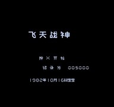 | 飞天战神 | 0 | D:\GitCode\famiclone\reference\nes-games\动作\飞天战神.nes |
| 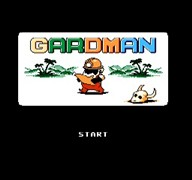 | 戈德曼 | 4 | D:\GitCode\famiclone\reference\nes-games\动作\戈德曼.nes |
|  | 孤独战士 惑星戒严令 | 4 | D:\GitCode\famiclone\reference\nes-games\动作\孤独战士 惑星戒严令.nes |
|  | 怪物制造者 | 198 | D:\GitCode\famiclone\reference\nes-games\动作\怪物制造者.nes |
|  | 怪物制造者1 | 4 | D:\GitCode\famiclone\reference\nes-games\动作\怪物制造者1(修正版)[外星科技+zxc987123835].nes |
|  | 怪物制造者1 | 4 | D:\GitCode\famiclone\reference\nes-games\动作\怪物制造者1[外星科技].nes |
|  | 怪物制造者2 | 4 | D:\GitCode\famiclone\reference\nes-games\动作\怪物制造者2.nes |
| 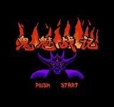 | 鬼魅战记 | 74 | D:\GitCode\famiclone\reference\nes-games\动作\鬼魅战记.nes |
| 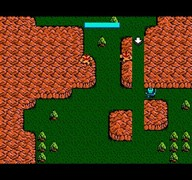 | 国王骑士 | 3 | D:\GitCode\famiclone\reference\nes-games\动作\国王骑士.nes |
|  | 轰天至尊 | 189 | D:\GitCode\famiclone\reference\nes-games\动作\轰天至尊.nes |
| 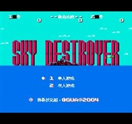 | 红巾特攻队 | 0 | D:\GitCode\famiclone\reference\nes-games\动作\红巾特攻队[8GUA].nes |
| 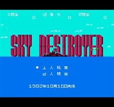 | 红巾特攻队 | 0 | D:\GitCode\famiclone\reference\nes-games\动作\红巾特攻队[高伟].nes |
| 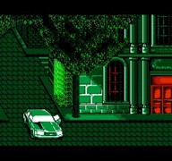 | 虎穴行动 | 1 | D:\GitCode\famiclone\reference\nes-games\动作\虎穴行动.nes |
| 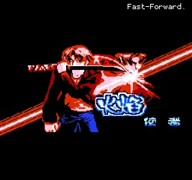 | 火焰使者 | 4 | D:\GitCode\famiclone\reference\nes-games\动作\火焰使者.nes |
|  | 火影忍者RPG | 163 | D:\GitCode\famiclone\reference\nes-games\动作\火影忍者RPG.nes |
|  | 机器子战记 | 4 | D:\GitCode\famiclone\reference\nes-games\动作\机器子战记.nes |
|  | 机械战警 未来的执法者 | 195 | D:\GitCode\famiclone\reference\nes-games\动作\机械战警 未来的执法者.nes |
| 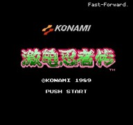 | 激龟忍者传 | 5 | D:\GitCode\famiclone\reference\nes-games\动作\激龟忍者传.nes |
|  | 假面的忍者 赤影 | 2 | D:\GitCode\famiclone\reference\nes-games\动作\假面的忍者 赤影.nes |
| 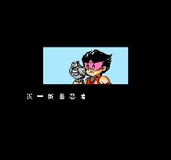 | 假面忍者 花丸 | 1 | D:\GitCode\famiclone\reference\nes-games\动作\假面忍者 花丸.nes |
| 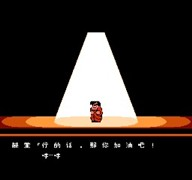 | 街头 热血进行曲 | 4 | D:\GitCode\famiclone\reference\nes-games\动作\街头 热血进行曲.nes |
| 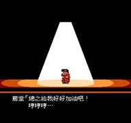 | 街头 热血进行曲 前进吧!!大运动会 | 4 | D:\GitCode\famiclone\reference\nes-games\动作\街头 热血进行曲 前进吧!!大运动会-v20220219[NOKOH].nes |
| 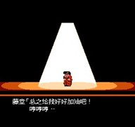 | 街头 热血进行曲 前进吧!!大运动会 | 4 | D:\GitCode\famiclone\reference\nes-games\动作\街头 热血进行曲 前进吧!!大运动会-v20220219[NOKOH+fciq].nes |
| 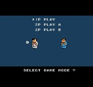 | 街头 热血物语 | 4 | D:\GitCode\famiclone\reference\nes-games\动作\街头 热血物语-v20220407[asiwish].nes |
| 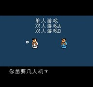 | 街头 热血物语 | 74 | D:\GitCode\famiclone\reference\nes-games\动作\街头 热血物语(大字体融合版)-v2[大糯米藕+asiwish+腓特烈].nes |
|  | 街头 热血物语 | 4 | D:\GitCode\famiclone\reference\nes-games\动作\街头 热血物语[空气].nes |
|  | 金属装甲 | 1 | D:\GitCode\famiclone\reference\nes-games\动作\金属装甲[虫儿].nes |
|  | 金属装甲 | 1 | D:\GitCode\famiclone\reference\nes-games\动作\金属装甲[高伟].nes |
|  | 荆轲新传 | 240 | D:\GitCode\famiclone\reference\nes-games\动作\荆轲新传[Super Tone].nes |
|  | 究极虎 | 4 | D:\GitCode\famiclone\reference\nes-games\动作\究极虎.nes |
|  | 救火英雄 | 2 | D:\GitCode\famiclone\reference\nes-games\动作\救火英雄.nes |
|  | 绝影战士 | 4 | D:\GitCode\famiclone\reference\nes-games\动作\绝影战士(2024,双武器)[逆游の五彩魚].nes |
|  | 绝影战士 | 4 | D:\GitCode\famiclone\reference\nes-games\动作\绝影战士(2024)[逆游の五彩魚].nes |
|  | 卡洛夫 | 4 | D:\GitCode\famiclone\reference\nes-games\动作\卡洛夫.nes |
|  | 卡诺夫 | 4 | D:\GitCode\famiclone\reference\nes-games\动作\卡诺夫.nes |
|  | 恐龙战队兽连者 | 195 | D:\GitCode\famiclone\reference\nes-games\动作\恐龙战队兽连者.nes |
|  | 快打旋风 | 4 | D:\GitCode\famiclone\reference\nes-games\动作\快打旋风-v0.8[Antigloss].nes |
|  | 快打旋风 | 4 | D:\GitCode\famiclone\reference\nes-games\动作\快打旋风-v1.0[代建峰].nes |
|  | 快打旋风 | 191 | D:\GitCode\famiclone\reference\nes-games\动作\快打旋风(实机修正)[Madcell+拒绝融化].nes |
|  | 快打旋风 | 4 | D:\GitCode\famiclone\reference\nes-games\动作\快打旋风(修正版)[模拟中文网+MS].nes |
|  | 快打旋风 | 4 | D:\GitCode\famiclone\reference\nes-games\动作\快打旋风[俞亮].nes |
|  | 快打旋风 | 4 | D:\GitCode\famiclone\reference\nes-games\动作\快打旋风[俞亮+HK].nes |
|  | 快打旋风 | 4 | D:\GitCode\famiclone\reference\nes-games\动作\快打旋风[Cony Soft].nes |
|  | 快打旋风3 | 90 | D:\GitCode\famiclone\reference\nes-games\动作\快打旋风3.nes |
|  | 快乐猫 | 0 | D:\GitCode\famiclone\reference\nes-games\动作\快乐猫-v1.0[MM之神].nes |
|  | 快乐猫 | 0 | D:\GitCode\famiclone\reference\nes-games\动作\快乐猫[高伟].nes |
|  | 快乐猫世界 | 4 | D:\GitCode\famiclone\reference\nes-games\动作\快乐猫世界.nes |
|  | 蕾拉 | 2 | D:\GitCode\famiclone\reference\nes-games\动作\蕾拉.nes |
|  | 力量刀锋 | 4 | D:\GitCode\famiclone\reference\nes-games\动作\力量刀锋.nes |
|  | 力量刀锋2 | 4 | D:\GitCode\famiclone\reference\nes-games\动作\力量刀锋2.nes |
|  | 烈火92 | 4 | D:\GitCode\famiclone\reference\nes-games\动作\烈火92[高伟].nes |
|  | 龙之忍者 | 19 | D:\GitCode\famiclone\reference\nes-games\动作\龙之忍者[虫儿].nes |
|  | 龙之忍者 | 19 | D:\GitCode\famiclone\reference\nes-games\动作\龙之忍者[MS].nes |
|  | 绿色兵团 | 2 | D:\GitCode\famiclone\reference\nes-games\动作\绿色兵团[星空].nes |
|  | 绿色兵团 | 2 | D:\GitCode\famiclone\reference\nes-games\动作\绿色兵团[星空+HK].nes |
|  | 绿色兵团 | 2 | D:\GitCode\famiclone\reference\nes-games\动作\绿色兵团[SW].nes |
|  | 马克斯战士 惑星戒严令 | 4 | D:\GitCode\famiclone\reference\nes-games\动作\马克斯战士 惑星戒严令.nes |
|  | 美国队长和复仇者联盟 | 192 | D:\GitCode\famiclone\reference\nes-games\动作\美国队长和复仇者联盟.nes |
|  | 盟军赶死队 | 241 | D:\GitCode\famiclone\reference\nes-games\动作\盟军赶死队.nes |
|  | 魔界霸主 | 163 | D:\GitCode\famiclone\reference\nes-games\动作\魔界霸主.nes |
|  | 魔界村 | 2 | D:\GitCode\famiclone\reference\nes-games\动作\魔界村.nes |
|  | 能源战士 | 33 | D:\GitCode\famiclone\reference\nes-games\动作\能源战士.nes |
|  | 鸟人战队 | 1 | D:\GitCode\famiclone\reference\nes-games\动作\鸟人战队(大字体)[高伟].nes |
|  | 鸟人战队 | 1 | D:\GitCode\famiclone\reference\nes-games\动作\鸟人战队[高伟].nes |
|  | 鸟人战队 | 1 | D:\GitCode\famiclone\reference\nes-games\动作\鸟人战队[烈火暴龙].nes |
|  | 怒 | 2 | D:\GitCode\famiclone\reference\nes-games\动作\怒.nes |
|  | 怒2 胜利之路 | 1 | D:\GitCode\famiclone\reference\nes-games\动作\怒2 胜利之路.nes |
|  | 怒3 | 1 | D:\GitCode\famiclone\reference\nes-games\动作\怒3(大字体)[高伟].nes |
|  | 怒3 | 1 | D:\GitCode\famiclone\reference\nes-games\动作\怒3[高伟].nes |
|  | 匹诺槽的复苏 | 4 | D:\GitCode\famiclone\reference\nes-games\动作\匹诺槽的复苏.nes |
|  | 前线大作战 | 0 | D:\GitCode\famiclone\reference\nes-games\动作\前线大作战[高伟].nes |
|  | 前线大作战 | 0 | D:\GitCode\famiclone\reference\nes-games\动作\前线大作战[MS].nes |
|  | 热血物语 | 4 | D:\GitCode\famiclone\reference\nes-games\动作\热血物语.nes |
|  | 人间兵器 | 4 | D:\GitCode\famiclone\reference\nes-games\动作\人间兵器-v2.0[星空].nes |
|  | 人间兵器 | 4 | D:\GitCode\famiclone\reference\nes-games\动作\人间兵器(大字体)[高伟].nes |
|  | 人间兵器 | 4 | D:\GitCode\famiclone\reference\nes-games\动作\人间兵器[TPU].nes |
|  | 忍者 阿修罗之章 | 2 | D:\GitCode\famiclone\reference\nes-games\动作\忍者 阿修罗之章-v1.0[高伟].nes |
|  | 忍者 阿修罗之章 | 2 | D:\GitCode\famiclone\reference\nes-games\动作\忍者 阿修罗之章[金明].nes |
|  | 忍者 阿修罗之章 | 2 | D:\GitCode\famiclone\reference\nes-games\动作\忍者 阿修罗之章[卡通].nes |
|  | 忍者龟 | 25 | D:\GitCode\famiclone\reference\nes-games\动作\忍者龟.nes |
|  | 忍者龟2 | 4 | D:\GitCode\famiclone\reference\nes-games\动作\忍者龟2.nes |
|  | 忍者神龟 | 25 | D:\GitCode\famiclone\reference\nes-games\动作\忍者神龟.nes |
|  | 忍者神龟2 街机游戏 | 4 | D:\GitCode\famiclone\reference\nes-games\动作\忍者神龟2 街机游戏-v1.0[樱组].nes |
|  | 忍者神龟2 街机游戏 | 4 | D:\GitCode\famiclone\reference\nes-games\动作\忍者神龟2 街机游戏(修正版)[勒大治+MS].nes |
|  | 忍者神龟2 街机游戏 | 4 | D:\GitCode\famiclone\reference\nes-games\动作\忍者神龟2 街机游戏[高伟].nes |
|  | 忍者神龟2 街机游戏 | 4 | D:\GitCode\famiclone\reference\nes-games\动作\忍者神龟2 街机游戏[星空].nes |
|  | 忍者神龟2 曼哈顿计划 | 25 | D:\GitCode\famiclone\reference\nes-games\动作\忍者神龟2 曼哈顿计划.nes |
|  | 忍者神龟3 | 25 | D:\GitCode\famiclone\reference\nes-games\动作\忍者神龟3.nes |
|  | 忍者神龟3 曼哈顿计划 | 25 | D:\GitCode\famiclone\reference\nes-games\动作\忍者神龟3 曼哈顿计划.nes |
|  | 忍者特训 | 0 | D:\GitCode\famiclone\reference\nes-games\动作\忍者特训.nes |
|  | 忍者战士 龙牙 | 4 | D:\GitCode\famiclone\reference\nes-games\动作\忍者战士 龙牙.nes |
|  | 三国无双 猛将传 | 163 | D:\GitCode\famiclone\reference\nes-games\动作\三国无双 猛将传.nes |
|  | 鲨鱼！鲨鱼！ | 0 | D:\GitCode\famiclone\reference\nes-games\动作\鲨鱼！鲨鱼！.nes |
|  | 神密金三角 | 245 | D:\GitCode\famiclone\reference\nes-games\动作\神密金三角.nes |
|  | 时空斗士 | 163 | D:\GitCode\famiclone\reference\nes-games\动作\时空斗士.nes |
|  | 时空小子 | 2 | D:\GitCode\famiclone\reference\nes-games\动作\时空小子.nes |
|  | 兽王记 | 4 | D:\GitCode\famiclone\reference\nes-games\动作\兽王记-v2[高伟].nes |
|  | 兽王记 | 4 | D:\GitCode\famiclone\reference\nes-games\动作\兽王记(大字体)[高伟].nes |
|  | 双截龙 | 1 | D:\GitCode\famiclone\reference\nes-games\动作\双截龙[高伟].nes |
|  | 双截龙 | 1 | D:\GitCode\famiclone\reference\nes-games\动作\双截龙[靳大治].nes |
|  | 双截龙 | 1 | D:\GitCode\famiclone\reference\nes-games\动作\双截龙[靳大治+HK].nes |
|  | 双截龙 | 1 | D:\GitCode\famiclone\reference\nes-games\动作\双截龙[吸血男爵].nes |
|  | 双截龙2 复仇 | 4 | D:\GitCode\famiclone\reference\nes-games\动作\双截龙2 复仇-v1.1[星空].nes |
|  | 双截龙2 复仇 | 4 | D:\GitCode\famiclone\reference\nes-games\动作\双截龙2 复仇[阿渊].nes |
|  | 双截龙2 复仇 | 4 | D:\GitCode\famiclone\reference\nes-games\动作\双截龙2 复仇[阿渊+HK].nes |
|  | 双截龙3 罗塞塔石碑 | 4 | D:\GitCode\famiclone\reference\nes-games\动作\双截龙3 罗塞塔石碑[asiwish].nes |
|  | 太阳超人 | 4 | D:\GitCode\famiclone\reference\nes-games\动作\太阳超人.nes |
|  | 特救指令 | 4 | D:\GitCode\famiclone\reference\nes-games\动作\特救指令[高伟].nes |
|  | 特救指令 | 4 | D:\GitCode\famiclone\reference\nes-games\动作\特救指令[逆游の五彩魚].nes |
|  | 特救指令 | 4 | D:\GitCode\famiclone\reference\nes-games\动作\特救指令[天蝎之忆].nes |
|  | 特救指令 | 4 | D:\GitCode\famiclone\reference\nes-games\动作\特救指令[asiwish].nes |
|  | 特救指令 | 4 | D:\GitCode\famiclone\reference\nes-games\动作\特救指令[Puszta].nes |
|  | 特种部队 一个真正的美国英雄 | 74 | D:\GitCode\famiclone\reference\nes-games\动作\特种部队 一个真正的美国英雄.nes |
|  | 天王降魔传 | 4 | D:\GitCode\famiclone\reference\nes-games\动作\天王降魔传.nes |
|  | 铁手套 | 68 | D:\GitCode\famiclone\reference\nes-games\动作\铁手套.nes |
|  | 铁血战士 | 1 | D:\GitCode\famiclone\reference\nes-games\动作\铁血战士.nes |
|  | 突然君 | 2 | D:\GitCode\famiclone\reference\nes-games\动作\突然君[高伟].nes |
|  | 突然君 | 2 | D:\GitCode\famiclone\reference\nes-games\动作\突然君[烈火暴龙].nes |
|  | 脱狱 被俘的战斗 | 1 | D:\GitCode\famiclone\reference\nes-games\动作\脱狱 被俘的战斗.nes |
|  | 脱狱 被俘之战 | 1 | D:\GitCode\famiclone\reference\nes-games\动作\脱狱 被俘之战(修正版)[Peacock Wang+MS].nes |
|  | 脱狱 被俘之战 | 1 | D:\GitCode\famiclone\reference\nes-games\动作\脱狱 被俘之战[死神DIY].nes |
|  | 鸵鸟骑士 | 0 | D:\GitCode\famiclone\reference\nes-games\动作\鸵鸟骑士.nes |
|  | 亡灵崛起 | 4 | D:\GitCode\famiclone\reference\nes-games\动作\亡灵崛起.nes |
|  | 王者无双 | 241 | D:\GitCode\famiclone\reference\nes-games\动作\王者无双.nes |
|  | 王子复仇记 | 177 | D:\GitCode\famiclone\reference\nes-games\动作\王子复仇记.nes |
|  | 威洛传奇 | 192 | D:\GitCode\famiclone\reference\nes-games\动作\威洛传奇(修正版)[金巴比伦+Vanyogin].nes |
|  | 威洛传奇 | 74 | D:\GitCode\famiclone\reference\nes-games\动作\威洛传奇[金巴比伦].nes |
|  | 无尽的任务 | 4 | D:\GitCode\famiclone\reference\nes-games\动作\无尽的任务.nes |
|  | 无双乱舞 | 4 | D:\GitCode\famiclone\reference\nes-games\动作\无双乱舞.nes |
|  | 新魔界 | 4 | D:\GitCode\famiclone\reference\nes-games\动作\新魔界.nes |
|  | 异域诛魂 | 3 | D:\GitCode\famiclone\reference\nes-games\动作\异域诛魂[虫虫].nes |
|  | 异域诛魂 | 3 | D:\GitCode\famiclone\reference\nes-games\动作\异域诛魂[孔雀天].nes |
|  | 银河忍者 禅 | 4 | D:\GitCode\famiclone\reference\nes-games\动作\银河忍者 禅.nes |
|  | 银河战士 | 1 | D:\GitCode\famiclone\reference\nes-games\动作\银河战士.nes |
|  | 英雄萨姆2 | 4 | D:\GitCode\famiclone\reference\nes-games\动作\英雄萨姆2.nes |
|  | 宇宙警备队SDF | 5 | D:\GitCode\famiclone\reference\nes-games\动作\宇宙警备队SDF(大字体)[高伟].nes |
|  | 宇宙警备队SDF | 5 | D:\GitCode\famiclone\reference\nes-games\动作\宇宙警备队SDF[虫虫].nes |
|  | 宇宙刑警加利邦 | 4 | D:\GitCode\famiclone\reference\nes-games\动作\宇宙刑警加利邦-v20250524[NOKOH](繁).nes |
|  | 宇宙刑警加利邦 | 4 | D:\GitCode\famiclone\reference\nes-games\动作\宇宙刑警加利邦-v20250524[NOKOH](简).nes |
|  | 宇宙战将 | 4 | D:\GitCode\famiclone\reference\nes-games\动作\宇宙战将.nes |
|  | 月风魔传 | 23 | D:\GitCode\famiclone\reference\nes-games\动作\月风魔传[冰组](繁).nes |
|  | 月风魔传 | 23 | D:\GitCode\famiclone\reference\nes-games\动作\月风魔传[冰组](简).nes |
|  | 战国无双 | 4 | D:\GitCode\famiclone\reference\nes-games\动作\战国无双.nes |
|  | 战神世界 | 4 | D:\GitCode\famiclone\reference\nes-games\动作\战神世界.nes |
|  | 真三国无双2 | 176 | D:\GitCode\famiclone\reference\nes-games\动作\真三国无双2.nes |
|  | 真田十勇士 | 165 | D:\GitCode\famiclone\reference\nes-games\动作\真田十勇士.nes |
|  | 中华大仙 | 4 | D:\GitCode\famiclone\reference\nes-games\动作\中华大仙-v20250526[NOKOH].nes |
|  | 中华大仙 | 1 | D:\GitCode\famiclone\reference\nes-games\动作\中华大仙[高伟].nes |
