# 射击（188 个）

返回 [总览](README.md)

| 缩略图 | 游戏 | 映⁠射⁠号 | 文件路径 |
|---|---|---|---|
| 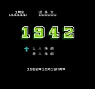 | 1942 | 0 | D:\GitCode\famiclone\reference\nes-games\射击\1942-v1[高伟]-mapper0.nes |
| 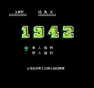 | 1942 | 0 | D:\GitCode\famiclone\reference\nes-games\射击\1942-v2[高伟]-mapper0.nes |
| 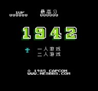 | 1942 | 4 | D:\GitCode\famiclone\reference\nes-games\射击\1942[6502]-mapper4.nes |
| 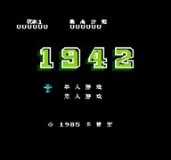 | 1942 | 0 | D:\GitCode\famiclone\reference\nes-games\射击\1942[MS]-mapper0.nes |
| 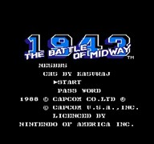 | 1943 中途岛海战 | 2 | D:\GitCode\famiclone\reference\nes-games\射击\1943 中途岛海战-v1.0[KasuraJ]-mapper2.nes |
| 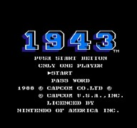 | 1943 中途岛海战 | 2 | D:\GitCode\famiclone\reference\nes-games\射击\1943 中途岛海战(大字体)[高伟]-mapper2.nes |
| 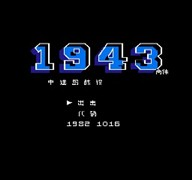 | 1943 中途岛海战 | 2 | D:\GitCode\famiclone\reference\nes-games\射击\1943 中途岛海战[高伟]-mapper2.nes |
|  | 1943 中途岛海战 | 2 | D:\GitCode\famiclone\reference\nes-games\射击\1943 中途岛海战[MM之神]-mapper2.nes |
|  | 1944 | 2 | D:\GitCode\famiclone\reference\nes-games\射击\1944-mapper2.nes |
| 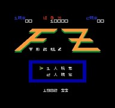 | 变形战机Z | 0 | D:\GitCode\famiclone\reference\nes-games\射击\变形战机Z[虫虫]-mapper0.nes |
| 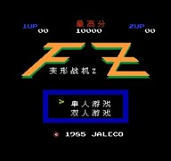 | 变形战机Z | 3 | D:\GitCode\famiclone\reference\nes-games\射击\变形战机Z[muxly]-mapper3.nes |
| 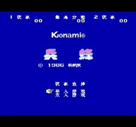 | 兵蜂 | 3 | D:\GitCode\famiclone\reference\nes-games\射击\兵蜂-v4[MS]-mapper3.nes |
| 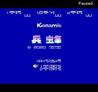 | 兵蜂 | 3 | D:\GitCode\famiclone\reference\nes-games\射击\兵蜂[虫虫]-mapper3.nes |
| 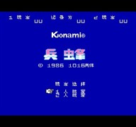 | 兵蜂 | 3 | D:\GitCode\famiclone\reference\nes-games\射击\兵蜂[高伟]-mapper3.nes |
| 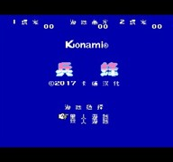 | 兵蜂 | 87 | D:\GitCode\famiclone\reference\nes-games\射击\兵蜂[卡通]-mapper87.nes |
| 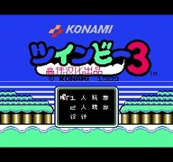 | 兵蜂3 | 22 | D:\GitCode\famiclone\reference\nes-games\射击\兵蜂3-mapper22.nes |
| 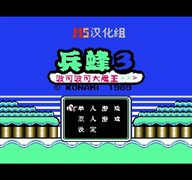 | 兵蜂3 波可波可大魔王 | 22 | D:\GitCode\famiclone\reference\nes-games\射击\兵蜂3 波可波可大魔王-mapper22.nes |
| 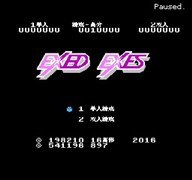 | 超浮游要塞 | 0 | D:\GitCode\famiclone\reference\nes-games\射击\超浮游要塞-mapper0.nes |
| 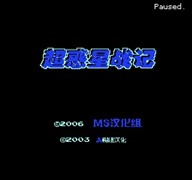 | 超惑星战记 | 1 | D:\GitCode\famiclone\reference\nes-games\射击\超惑星战记(修正版)[樱组+MS]-mapper1.nes |
| 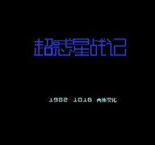 | 超惑星战记 | 1 | D:\GitCode\famiclone\reference\nes-games\射击\超惑星战记[高伟]-mapper1.nes |
| 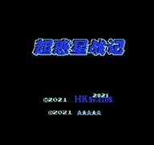 | 超惑星战记 | 1 | D:\GitCode\famiclone\reference\nes-games\射击\超惑星战记[樱组+MS+HK]-mapper1.nes |
| 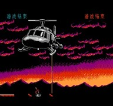 | 超级魂斗罗 | 4 | D:\GitCode\famiclone\reference\nes-games\射击\超级魂斗罗-v2.0[九班]-mapper4.nes |
| 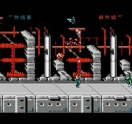 | 超级魂斗罗 | 4 | D:\GitCode\famiclone\reference\nes-games\射击\超级魂斗罗-v2009[未知]-mapper4.nes |
| 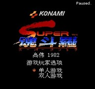 | 超级魂斗罗 | 4 | D:\GitCode\famiclone\reference\nes-games\射击\超级魂斗罗(大字体)[高伟]-mapper4.nes |
| 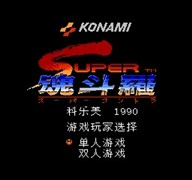 | 超级魂斗罗 | 4 | D:\GitCode\famiclone\reference\nes-games\射击\超级魂斗罗(大字体)[FlameCyclone]-mapper4.nes |
| 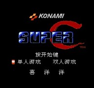 | 超级魂斗罗 | 4 | D:\GitCode\famiclone\reference\nes-games\射击\超级魂斗罗(美版)-v2[星空]-mapper4.nes |
| 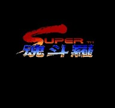 | 超级魂斗罗 | 4 | D:\GitCode\famiclone\reference\nes-games\射击\超级魂斗罗(日版)-v2[星空]-mapper4.nes |
|  | 超级魂斗罗 | 4 | D:\GitCode\famiclone\reference\nes-games\射击\超级魂斗罗[王大可]-mapper4.nes |
| 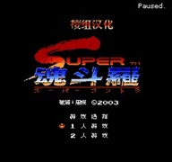 | 超级魂斗罗 | 4 | D:\GitCode\famiclone\reference\nes-games\射击\超级魂斗罗[樱组]-mapper4.nes |
| 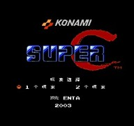 | 超级魂斗罗 | 4 | D:\GitCode\famiclone\reference\nes-games\射击\超级魂斗罗[Enta]-mapper4.nes |
| 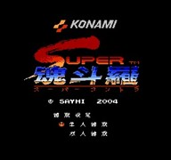 | 超级魂斗罗 | 4 | D:\GitCode\famiclone\reference\nes-games\射击\超级魂斗罗[SayHi]-mapper4.nes |
| 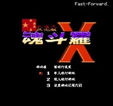 | 超级魂斗罗X | 4 | D:\GitCode\famiclone\reference\nes-games\射击\超级魂斗罗X-mapper4.nes |
| 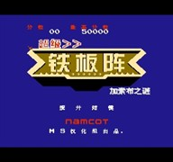 | 超级铁板阵 加索布之谜 | 4 | D:\GitCode\famiclone\reference\nes-games\射击\超级铁板阵 加索布之谜-mapper4.nes |
| 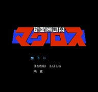 | 超时空要塞 | 0 | D:\GitCode\famiclone\reference\nes-games\射击\超时空要塞[高伟]-mapper0.nes |
|  | 超时空要塞 | 0 | D:\GitCode\famiclone\reference\nes-games\射击\超时空要塞[姜维第二]-mapper0.nes |
| 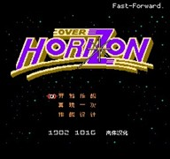 | 超越地平线 | 4 | D:\GitCode\famiclone\reference\nes-games\射击\超越地平线-v0.9[高伟]-mapper4.nes |
| 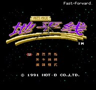 | 超越地平线 | 4 | D:\GitCode\famiclone\reference\nes-games\射击\超越地平线-v1.1[Nineswords]-mapper4.nes |
| 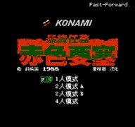 | 赤色要塞 最终任务 | 19 | D:\GitCode\famiclone\reference\nes-games\射击\赤色要塞 最终任务-mapper19.nes |
| 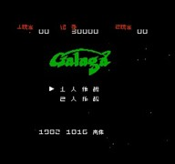 | 大蜜蜂 | 0 | D:\GitCode\famiclone\reference\nes-games\射击\大蜜蜂[高伟]-mapper0.nes |
| 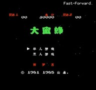 | 大蜜蜂 | 0 | D:\GitCode\famiclone\reference\nes-games\射击\大蜜蜂[MS]-mapper0.nes |
| 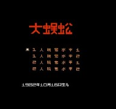 | 大蜈蚣 | 0 | D:\GitCode\famiclone\reference\nes-games\射击\大蜈蚣-mapper0.nes |
| 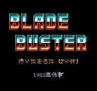 | 刀锋战机 | 4 | D:\GitCode\famiclone\reference\nes-games\射击\刀锋战机-mapper4.nes |
| 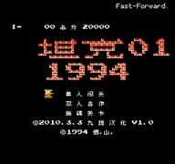 | 导弹坦克 | 0 | D:\GitCode\famiclone\reference\nes-games\射击\导弹坦克-v1.0[九班]-mapper0.nes |
| 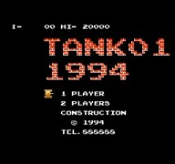 | 导弹坦克 | 0 | D:\GitCode\famiclone\reference\nes-games\射击\导弹坦克[烟山科技]-mapper0.nes |
| 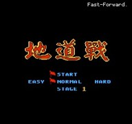 | 地道战 | 4 | D:\GitCode\famiclone\reference\nes-games\射击\地道战-mapper4.nes |
| 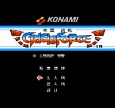 | 帝国战机 | 23 | D:\GitCode\famiclone\reference\nes-games\射击\帝国战机[虫虫]-mapper23.nes |
| 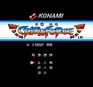 | 帝国战机 | 23 | D:\GitCode\famiclone\reference\nes-games\射击\帝国战机[高伟]-mapper23.nes |
| 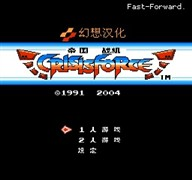 | 帝国战机 | 23 | D:\GitCode\famiclone\reference\nes-games\射击\帝国战机[幻想]-mapper23.nes |
| 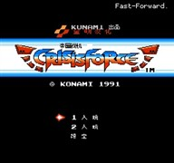 | 帝国战机 | 23 | D:\GitCode\famiclone\reference\nes-games\射击\帝国战机[金明]-mapper23.nes |
| 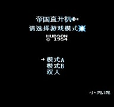 | 帝国直升机 | 0 | D:\GitCode\famiclone\reference\nes-games\射击\帝国直升机-mapper0.nes |
| 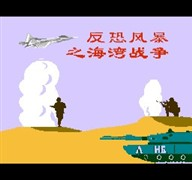 | 反恐风暴 海湾战争 | 74 | D:\GitCode\famiclone\reference\nes-games\射击\反恐风暴 海湾战争-mapper74.nes |
|  | 反恐精英 | 178 | D:\GitCode\famiclone\reference\nes-games\射击\反恐精英-mapper178.nes |
| 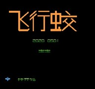 | 飞行蛟 | 1 | D:\GitCode\famiclone\reference\nes-games\射击\飞行蛟-mapper1.nes |
| 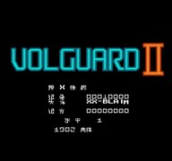 | 高机动战斗2 | 0 | D:\GitCode\famiclone\reference\nes-games\射击\高机动战斗2-mapper0.nes |
| 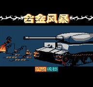 | 合金风暴 | 4 | D:\GitCode\famiclone\reference\nes-games\射击\合金风暴-mapper4.nes |
|  | 荒野大镖客 | 119 | D:\GitCode\famiclone\reference\nes-games\射击\荒野大镖客-v1.0[DMG]-mapper119.nes |
|  | 荒野大镖客 | 2 | D:\GitCode\famiclone\reference\nes-games\射击\荒野大镖客(修正版)-v3[高艳龙+MS]-mapper2.nes |
|  | 荒野枪手 | 0 | D:\GitCode\famiclone\reference\nes-games\射击\荒野枪手-mapper0.nes |
|  | 魂斗罗 | 23 | D:\GitCode\famiclone\reference\nes-games\射击\魂斗罗-v2[Jixun]-mapper23.nes |
|  | 魂斗罗 | 4 | D:\GitCode\famiclone\reference\nes-games\射击\魂斗罗(大字体)[高伟]-mapper4.nes |
|  | 魂斗罗 | 4 | D:\GitCode\famiclone\reference\nes-games\射击\魂斗罗(大字体)[FlameCyclone]-mapper4.nes |
|  | 魂斗罗 | 23 | D:\GitCode\famiclone\reference\nes-games\射击\魂斗罗(修正版)[酷酷小熊+MS]-mapper23.nes |
|  | 魂斗罗 | 23 | D:\GitCode\famiclone\reference\nes-games\射击\魂斗罗[九班]-mapper23.nes |
|  | 魂斗罗 | 23 | D:\GitCode\famiclone\reference\nes-games\射击\魂斗罗[星空]-mapper23.nes |
|  | 魂斗罗力量 | 192 | D:\GitCode\famiclone\reference\nes-games\射击\魂斗罗力量-v1.2[DMG]-mapper192.nes |
|  | 魂斗罗力量 | 4 | D:\GitCode\famiclone\reference\nes-games\射击\魂斗罗力量(修正版)[谈魈疯生+渣渣皮]-mapper4.nes |
|  | 魂斗罗力量 | 4 | D:\GitCode\famiclone\reference\nes-games\射击\魂斗罗力量(修正版)[谈魈疯生+渣渣皮+庞先生]-mapper4.nes |
|  | 魂斗罗力量 | 4 | D:\GitCode\famiclone\reference\nes-games\射击\魂斗罗力量[谈魈疯生]-mapper4.nes |
|  | 魂斗罗力量 | 4 | D:\GitCode\famiclone\reference\nes-games\射击\魂斗罗力量[MS]-mapper4.nes |
|  | 魂斗罗力量之战 | 4 | D:\GitCode\famiclone\reference\nes-games\射击\魂斗罗力量之战-mapper4.nes |
|  | 火凤凰 | 0 | D:\GitCode\famiclone\reference\nes-games\射击\火凤凰-v1.0[高伟]-mapper0.nes |
|  | 火凤凰 | 0 | D:\GitCode\famiclone\reference\nes-games\射击\火凤凰[虫虫]-mapper0.nes |
|  | 机甲战士 | 74 | D:\GitCode\famiclone\reference\nes-games\射击\机甲战士-mapper74.nes |
|  | 机甲战士3 | 74 | D:\GitCode\famiclone\reference\nes-games\射击\机甲战士3[恒格电子]-mapper74.nes |
|  | 机甲战士3 | 74 | D:\GitCode\famiclone\reference\nes-games\射击\机甲战士3[晶科泰]-mapper74.nes |
|  | 机械化突袭 | 1 | D:\GitCode\famiclone\reference\nes-games\射击\机械化突袭(大字体)[高伟]-mapper1.nes |
|  | 机械化突袭 | 1 | D:\GitCode\famiclone\reference\nes-games\射击\机械化突袭[高伟]-mapper1.nes |
|  | 加纳战机 | 4 | D:\GitCode\famiclone\reference\nes-games\射击\加纳战机(美版)-v1.0[九班+KasuraJ]-mapper4.nes |
|  | 加纳战机 | 4 | D:\GitCode\famiclone\reference\nes-games\射击\加纳战机(美版)[孔雀天]-mapper4.nes |
|  | 加纳战机 | 4 | D:\GitCode\famiclone\reference\nes-games\射击\加纳战机(日版,隐藏菜单)-v1.0[Advance]-mapper4.nes |
|  | 加纳战机 | 4 | D:\GitCode\famiclone\reference\nes-games\射击\加纳战机(日版)-v1.0[Advance]-mapper4.nes |
|  | 交叉火力 | 4 | D:\GitCode\famiclone\reference\nes-games\射击\交叉火力-mapper4.nes |
|  | 救援直升机 | 0 | D:\GitCode\famiclone\reference\nes-games\射击\救援直升机-mapper0.nes |
|  | 空间暗影 | 70 | D:\GitCode\famiclone\reference\nes-games\射击\空间暗影(大字体)[高伟]-mapper70.nes |
|  | 空间暗影 | 70 | D:\GitCode\famiclone\reference\nes-games\射击\空间暗影[高伟]-mapper70.nes |
|  | 空中魂斗罗 | 1 | D:\GitCode\famiclone\reference\nes-games\射击\空中魂斗罗[金明]-mapper1.nes |
|  | 空中魂斗罗 | 1 | D:\GitCode\famiclone\reference\nes-games\射击\空中魂斗罗[金明+HK]-mapper1.nes |
|  | 空中魂斗罗 纽约行动 | 1 | D:\GitCode\famiclone\reference\nes-games\射击\空中魂斗罗 纽约行动-mapper1.nes |
|  | 空中魂斗罗 最终任务 | 1 | D:\GitCode\famiclone\reference\nes-games\射击\空中魂斗罗 最终任务-mapper1.nes |
|  | 空中要塞 | 1 | D:\GitCode\famiclone\reference\nes-games\射击\空中要塞-mapper1.nes |
|  | 快杰洋枪丸2 机关之地大冒险 | 32 | D:\GitCode\famiclone\reference\nes-games\射击\快杰洋枪丸2 机关之地大冒险-mapper32.nes |
|  | 快杰洋枪丸2 机关之地大探险 | 32 | D:\GitCode\famiclone\reference\nes-games\射击\快杰洋枪丸2 机关之地大探险-mapper32.nes |
|  | 快杰洋枪丸3 对决！相凌轩 | 65 | D:\GitCode\famiclone\reference\nes-games\射击\快杰洋枪丸3 对决！相凌轩[高伟]-mapper65.nes |
|  | 快杰洋枪丸3 对决！相凌轩 | 65 | D:\GitCode\famiclone\reference\nes-games\射击\快杰洋枪丸3 对决！相凌轩[烈火暴龙]-mapper65.nes |
|  | 老虎直升机 | 3 | D:\GitCode\famiclone\reference\nes-games\射击\老虎直升机-mapper3.nes |
|  | 雷电2 | 115 | D:\GitCode\famiclone\reference\nes-games\射击\雷电2-mapper115.nes |
|  | 雷电皇 比卡丘传说 | 163 | D:\GitCode\famiclone\reference\nes-games\射击\雷电皇 比卡丘传说-mapper163.nes |
|  | 雷电节奏 | 2 | D:\GitCode\famiclone\reference\nes-games\射击\雷电节奏-mapper2.nes |
|  | 雷霆任务 | 64 | D:\GitCode\famiclone\reference\nes-games\射击\雷霆任务-mapper64.nes |
|  | 梦幻战机 | 32 | D:\GitCode\famiclone\reference\nes-games\射击\梦幻战机-mapper32.nes |
|  | 千足虫 | 0 | D:\GitCode\famiclone\reference\nes-games\射击\千足虫-mapper0.nes |
|  | 荣誉勋章 | 4 | D:\GitCode\famiclone\reference\nes-games\射击\荣誉勋章-mapper4.nes |
|  | 杀虫大战 | 0 | D:\GitCode\famiclone\reference\nes-games\射击\杀虫大战-mapper0.nes |
|  | 杀戮战场 | 3 | D:\GitCode\famiclone\reference\nes-games\射击\杀戮战场-v20100527[NOKOH]-mapper3.nes |
|  | 杀戮战场 | 3 | D:\GitCode\famiclone\reference\nes-games\射击\杀戮战场-v20100527[NOKOH+fciq]-mapper3.nes |
|  | 杀戮战场 | 0 | D:\GitCode\famiclone\reference\nes-games\射击\杀戮战场[高伟]-mapper0.nes |
|  | 沙罗曼蛇 | 19 | D:\GitCode\famiclone\reference\nes-games\射击\沙罗曼蛇-mapper19.nes |
|  | 沙罗曼蛇 仿街机 | 5 | D:\GitCode\famiclone\reference\nes-games\射击\沙罗曼蛇 仿街机-mapper5.nes |
|  | 沙罗曼蛇2 | 25 | D:\GitCode\famiclone\reference\nes-games\射击\沙罗曼蛇2-v3[MS]-mapper25.nes |
|  | 沙罗曼蛇2 | 25 | D:\GitCode\famiclone\reference\nes-games\射击\沙罗曼蛇2[烈火暴龙]-mapper25.nes |
|  | 神鹰一号 | 2 | D:\GitCode\famiclone\reference\nes-games\射击\神鹰一号-mapper2.nes |
|  | 圣斗士星矢 北欧突击篇 | 163 | D:\GitCode\famiclone\reference\nes-games\射击\圣斗士星矢 北欧突击篇-mapper163.nes |
|  | 守护者坦克 | 4 | D:\GitCode\famiclone\reference\nes-games\射击\守护者坦克-v1.0[高伟]-mapper4.nes |
|  | 守护者坦克 | 4 | D:\GitCode\famiclone\reference\nes-games\射击\守护者坦克[虫虫]-mapper4.nes |
|  | 守护者坦克 | 4 | D:\GitCode\famiclone\reference\nes-games\射击\守护者坦克[烈火暴龙]-mapper4.nes |
|  | 双鹰 | 146 | D:\GitCode\famiclone\reference\nes-games\射击\双鹰-mapper146.nes |
|  | 双鹰 乔兄弟的复仇 | 2 | D:\GitCode\famiclone\reference\nes-games\射击\双鹰 乔兄弟的复仇[虫儿]-mapper2.nes |
|  | 双鹰 乔兄弟的复仇 | 2 | D:\GitCode\famiclone\reference\nes-games\射击\双鹰 乔兄弟的复仇[烈火暴龙]-mapper2.nes |
|  | 太空立体战 | 0 | D:\GitCode\famiclone\reference\nes-games\射击\太空立体战-mapper0.nes |
|  | 太空入侵者 | 0 | D:\GitCode\famiclone\reference\nes-games\射击\太空入侵者-mapper0.nes |
|  | 太空射击战 | 140 | D:\GitCode\famiclone\reference\nes-games\射击\太空射击战-mapper140.nes |
|  | 坦克1990 | 0 | D:\GitCode\famiclone\reference\nes-games\射击\坦克1990-mapper0.nes |
|  | 坦克大战 | 4 | D:\GitCode\famiclone\reference\nes-games\射击\坦克大战-v1[高伟]-mapper4.nes |
|  | 坦克大战 | 0 | D:\GitCode\famiclone\reference\nes-games\射击\坦克大战-v2[高伟]-mapper0.nes |
|  | 坦克大战 | 0 | D:\GitCode\famiclone\reference\nes-games\射击\坦克大战[3DM]-mapper0.nes |
|  | 坦克大战 | 4 | D:\GitCode\famiclone\reference\nes-games\射击\坦克大战[虫虫]-mapper4.nes |
|  | 坦克大战 | 0 | D:\GitCode\famiclone\reference\nes-games\射击\坦克大战[郭元]-mapper0.nes |
|  | 坦克大战 | 0 | D:\GitCode\famiclone\reference\nes-games\射击\坦克大战[卡通]-mapper0.nes |
|  | 坦克大战 | 0 | D:\GitCode\famiclone\reference\nes-games\射击\坦克大战[ENTA]-mapper0.nes |
|  | 坦克大战 | 0 | D:\GitCode\famiclone\reference\nes-games\射击\坦克大战[HK]-mapper0.nes |
|  | 坦克大战2008 | 0 | D:\GitCode\famiclone\reference\nes-games\射击\坦克大战2008-mapper0.nes |
|  | 坦克大作战 | 0 | D:\GitCode\famiclone\reference\nes-games\射击\坦克大作战-mapper0.nes |
|  | 坦克风云 | 3 | D:\GitCode\famiclone\reference\nes-games\射击\坦克风云-v20241222[三协资讯+多情剑客阿飞]-mapper3.nes |
|  | 坦克风云 | 0 | D:\GitCode\famiclone\reference\nes-games\射击\坦克风云[金明]-mapper0.nes |
|  | 坦克风云 | 3 | D:\GitCode\famiclone\reference\nes-games\射击\坦克风云[三协资讯]-mapper3.nes |
|  | 坦克游戏大战 | 0 | D:\GitCode\famiclone\reference\nes-games\射击\坦克游戏大战-mapper0.nes |
|  | 坦克仔 | 0 | D:\GitCode\famiclone\reference\nes-games\射击\坦克仔-mapper0.nes |
|  | 铁板阵 | 0 | D:\GitCode\famiclone\reference\nes-games\射击\铁板阵-mapper0.nes |
|  | 铁甲威龙 | 4 | D:\GitCode\famiclone\reference\nes-games\射击\铁甲威龙-mapper4.nes |
|  | 突击 | 79 | D:\GitCode\famiclone\reference\nes-games\射击\突击-mapper79.nes |
|  | 外星战将 | 4 | D:\GitCode\famiclone\reference\nes-games\射击\外星战将(修正版)[AXI+庞先生]-mapper4.nes |
|  | 外星战将 | 4 | D:\GitCode\famiclone\reference\nes-games\射击\外星战将[冰组]-mapper4.nes |
|  | 外星战将 | 4 | D:\GitCode\famiclone\reference\nes-games\射击\外星战将[中伟]-mapper4.nes |
|  | 外星战将 | 4 | D:\GitCode\famiclone\reference\nes-games\射击\外星战将[AXI]-mapper4.nes |
|  | 外星战士 | 242 | D:\GitCode\famiclone\reference\nes-games\射击\外星战士[外星科技]-mapper242.nes |
|  | 外星战士 | 242 | D:\GitCode\famiclone\reference\nes-games\射击\外星战士[外星科技+147201688]-mapper242.nes |
|  | 外星战士2 | 15 | D:\GitCode\famiclone\reference\nes-games\射击\外星战士2[外星科技]-mapper15.nes |
|  | 外星战士2 | 15 | D:\GitCode\famiclone\reference\nes-games\射击\外星战士2[外星科技+147201688]-mapper15.nes |
|  | 王牌海战 | 4 | D:\GitCode\famiclone\reference\nes-games\射击\王牌海战-mapper4.nes |
|  | 小蜜蜂 | 0 | D:\GitCode\famiclone\reference\nes-games\射击\小蜜蜂-v1.0[MS]-mapper0.nes |
|  | 小蜜蜂 | 0 | D:\GitCode\famiclone\reference\nes-games\射击\小蜜蜂[高伟]-mapper0.nes |
|  | 小人子射击 | 33 | D:\GitCode\famiclone\reference\nes-games\射击\小人子射击-mapper33.nes |
|  | 星河战士 | 177 | D:\GitCode\famiclone\reference\nes-games\射击\星河战士-mapper177.nes |
|  | 星际号战机 | 3 | D:\GitCode\famiclone\reference\nes-games\射击\星际号战机-mapper3.nes |
|  | 星际魂斗罗 | 1 | D:\GitCode\famiclone\reference\nes-games\射击\星际魂斗罗(版本1)[星空]-mapper1.nes |
|  | 星际魂斗罗 | 1 | D:\GitCode\famiclone\reference\nes-games\射击\星际魂斗罗(版本2)[星空]-mapper1.nes |
|  | 星际魂斗罗 | 1 | D:\GitCode\famiclone\reference\nes-games\射击\星际魂斗罗(修正版)[樱组+MS]-mapper1.nes |
|  | 星际武士 | 4 | D:\GitCode\famiclone\reference\nes-games\射击\星际武士-mapper4.nes |
|  | 星际战机 | 3 | D:\GitCode\famiclone\reference\nes-games\射击\星际战机-v1[虫虫]-mapper3.nes |
|  | 星际战机 | 3 | D:\GitCode\famiclone\reference\nes-games\射击\星际战机-v1[高伟]-mapper3.nes |
|  | 星际战机 | 0 | D:\GitCode\famiclone\reference\nes-games\射击\星际战机-v3[MS]-mapper0.nes |
|  | 星际战士 | 3 | D:\GitCode\famiclone\reference\nes-games\射击\星际战士-mapper3.nes |
|  | 星空飞箭 | 0 | D:\GitCode\famiclone\reference\nes-games\射击\星空飞箭-mapper0.nes |
|  | 野狼行动 | 1 | D:\GitCode\famiclone\reference\nes-games\射击\野狼行动-mapper1.nes |
|  | 幽灵行动 | 74 | D:\GitCode\famiclone\reference\nes-games\射击\幽灵行动-mapper74.nes |
|  | 宇宙巡航机 | 3 | D:\GitCode\famiclone\reference\nes-games\射击\宇宙巡航机-v1.0[高伟]-mapper3.nes |
|  | 宇宙巡航机 | 3 | D:\GitCode\famiclone\reference\nes-games\射击\宇宙巡航机(美版)[虫虫]-mapper3.nes |
|  | 宇宙巡航机 | 3 | D:\GitCode\famiclone\reference\nes-games\射击\宇宙巡航机(日版)[虫虫]-mapper3.nes |
|  | 宇宙巡航机 | 3 | D:\GitCode\famiclone\reference\nes-games\射击\宇宙巡航机(日版)[卡通]-mapper3.nes |
|  | 宇宙巡航机 | 3 | D:\GitCode\famiclone\reference\nes-games\射击\宇宙巡航机[虫儿]-mapper3.nes |
|  | 宇宙巡航机 | 3 | D:\GitCode\famiclone\reference\nes-games\射击\宇宙巡航机[罗云]-mapper3.nes |
|  | 宇宙巡航机 仿街机 | 19 | D:\GitCode\famiclone\reference\nes-games\射击\宇宙巡航机 仿街机-mapper19.nes |
|  | 宇宙巡航机2 | 25 | D:\GitCode\famiclone\reference\nes-games\射击\宇宙巡航机2-v1.0[高伟]-mapper25.nes |
|  | 宇宙巡航机2 | 25 | D:\GitCode\famiclone\reference\nes-games\射击\宇宙巡航机2-v3[MS]-mapper25.nes |
|  | 宇宙巡航机2 | 25 | D:\GitCode\famiclone\reference\nes-games\射击\宇宙巡航机2[虫虫]-mapper25.nes |
|  | 宇宙巡航机2 | 25 | D:\GitCode\famiclone\reference\nes-games\射击\宇宙巡航机2[虫儿]-mapper25.nes |
|  | 宇宙巡航机2 | 25 | D:\GitCode\famiclone\reference\nes-games\射击\宇宙巡航机2[卡通]-mapper25.nes |
|  | 宇宙巡航机2 | 25 | D:\GitCode\famiclone\reference\nes-games\射击\宇宙巡航机2[未知]-mapper25.nes |
|  | 宇宙巡航机2 仿街机 高弗的野望 | 25 | D:\GitCode\famiclone\reference\nes-games\射击\宇宙巡航机2 仿街机 高弗的野望-mapper25.nes |
|  | 战场之狼 | 94 | D:\GitCode\famiclone\reference\nes-games\射击\战场之狼-mapper94.nes |
|  | 战斗直升机 | 0 | D:\GitCode\famiclone\reference\nes-games\射击\战斗直升机-mapper0.nes |
|  | 拯救世纪 | 4 | D:\GitCode\famiclone\reference\nes-games\射击\拯救世纪-mapper4.nes |
|  | 重力装甲 | 4 | D:\GitCode\famiclone\reference\nes-games\射击\重力装甲-mapper4.nes |
|  | 组合战机 | 3 | D:\GitCode\famiclone\reference\nes-games\射击\组合战机-mapper3.nes |
|  | 最终任务 | 1 | D:\GitCode\famiclone\reference\nes-games\射击\最终任务-v1.1[asiwish]-mapper1.nes |
|  | 最终任务 | 1 | D:\GitCode\famiclone\reference\nes-games\射击\最终任务[高伟]-mapper1.nes |
|  | 最终任务 | 1 | D:\GitCode\famiclone\reference\nes-games\射击\最终任务[逆游の五彩魚]-mapper1.nes |
|  | Q版沙罗曼蛇 | 4 | D:\GitCode\famiclone\reference\nes-games\射击\Q版沙罗曼蛇-mapper4.nes |
