# 平台（220 个）

返回 [总览](README.md)

| 缩略图 | 游戏 | 映⁠射⁠号 | 文件路径 |
|---|---|---|---|
| 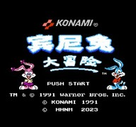 | 宾尼兔大冒险 | 23 | D:\GitCode\famiclone\reference\nes-games\平台\宾尼兔大冒险-mapper23.nes |
| 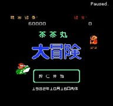 | 茶茶丸大冒险 | 66 | D:\GitCode\famiclone\reference\nes-games\平台\茶茶丸大冒险-mapper66.nes |
|  | 茶茶丸的大冒险 | 3 | D:\GitCode\famiclone\reference\nes-games\平台\茶茶丸的大冒险-mapper3.nes |
|  | 超级大金刚 香蕉船 | 4 | D:\GitCode\famiclone\reference\nes-games\平台\超级大金刚 香蕉船-mapper4.nes |
| 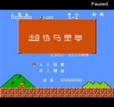 | 超级马里奥 | 0 | D:\GitCode\famiclone\reference\nes-games\平台\超级马里奥-mapper0.nes |
| 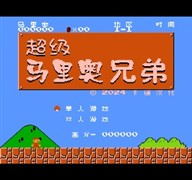 | 超级马里奥兄弟 | 87 | D:\GitCode\famiclone\reference\nes-games\平台\超级马里奥兄弟(修正版)-v20240107[卡通]-mapper87.nes |
|  | 超级马里奥兄弟 | 0 | D:\GitCode\famiclone\reference\nes-games\平台\超级马里奥兄弟[3DM]-mapper0.nes |
| 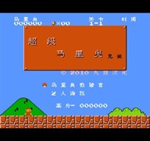 | 超级马里奥兄弟 | 0 | D:\GitCode\famiclone\reference\nes-games\平台\超级马里奥兄弟[九班]-mapper0.nes |
| 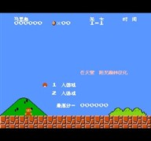 | 超级马里奥兄弟 | 0 | D:\GitCode\famiclone\reference\nes-games\平台\超级马里奥兄弟[阳光森林]-mapper0.nes |
|  | 超级马里奥兄弟 | 0 | D:\GitCode\famiclone\reference\nes-games\平台\超级马里奥兄弟[D]-mapper0.nes |
| 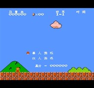 | 超级马里奥兄弟 | 0 | D:\GitCode\famiclone\reference\nes-games\平台\超级马里奥兄弟[F0REVERD]-mapper0.nes |
|  | 超级马里奥兄弟 路易基之谜团 | 0 | D:\GitCode\famiclone\reference\nes-games\平台\超级马里奥兄弟 路易基之谜团-mapper0.nes |
|  | 超级马里奥兄弟2 | 4 | D:\GitCode\famiclone\reference\nes-games\平台\超级马里奥兄弟2-mapper4.nes |
| 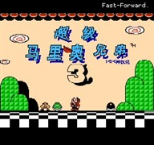 | 超级马里奥兄弟3 | 4 | D:\GitCode\famiclone\reference\nes-games\平台\超级马里奥兄弟3-v1.1[MM之神]-mapper4.nes |
| 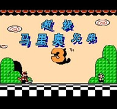 | 超级马里奥兄弟3 | 4 | D:\GitCode\famiclone\reference\nes-games\平台\超级马里奥兄弟3(美版)-v20240211[卡通]-mapper4.nes |
| 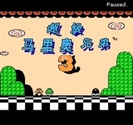 | 超级马里奥兄弟3 | 4 | D:\GitCode\famiclone\reference\nes-games\平台\超级马里奥兄弟3(日版)-v20231102[卡通]-mapper4.nes |
|  | 超级马力欧兄弟 | 140 | D:\GitCode\famiclone\reference\nes-games\平台\超级马力欧兄弟-mapper140.nes |
| 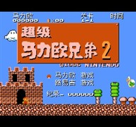 | 超级马力欧兄弟2 | 4 | D:\GitCode\famiclone\reference\nes-games\平台\超级马力欧兄弟2-mapper4.nes |
|  | 超级马利兄弟 | 0 | D:\GitCode\famiclone\reference\nes-games\平台\超级马利兄弟-mapper0.nes |
| 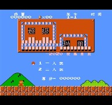 | 超级玛丽 | 0 | D:\GitCode\famiclone\reference\nes-games\平台\超级玛丽-mapper0.nes |
|  | 超级玛丽3 | 4 | D:\GitCode\famiclone\reference\nes-games\平台\超级玛丽3-mapper4.nes |
|  | 超级玛丽兄弟 | 0 | D:\GitCode\famiclone\reference\nes-games\平台\超级玛丽兄弟-mapper0.nes |
|  | 超级玛利欧兄弟 | 140 | D:\GitCode\famiclone\reference\nes-games\平台\超级玛利欧兄弟-mapper140.nes |
|  | 超级玛利欧兄弟2 | 4 | D:\GitCode\famiclone\reference\nes-games\平台\超级玛利欧兄弟2(美版)-v20250701[NOKOH]-mapper4.nes |
| 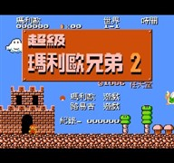 | 超级玛利欧兄弟2 | 4 | D:\GitCode\famiclone\reference\nes-games\平台\超级玛利欧兄弟2(日版)-v20250609[NOKOH]-mapper4.nes |
| 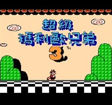 | 超级玛利欧兄弟3 | 4 | D:\GitCode\famiclone\reference\nes-games\平台\超级玛利欧兄弟3(美版)-v20250726[NOKOH]-mapper4.nes |
|  | 超级玛利欧兄弟3 | 4 | D:\GitCode\famiclone\reference\nes-games\平台\超级玛利欧兄弟3(日版)-v20250726[NOKOH]-mapper4.nes |
|  | 超级玛利兄弟 | 0 | D:\GitCode\famiclone\reference\nes-games\平台\超级玛利兄弟-mapper0.nes |
|  | 大大眼蛙大冒险 | 3 | D:\GitCode\famiclone\reference\nes-games\平台\大大眼蛙大冒险-mapper3.nes |
|  | 大盗伍佑卫门 天下宝藏 | 199 | D:\GitCode\famiclone\reference\nes-games\平台\大盗伍佑卫门 天下宝藏-mapper199.nes |
|  | 大金刚 | 3 | D:\GitCode\famiclone\reference\nes-games\平台\大金刚(大字体)[Madcell]-mapper3.nes |
|  | 大金刚 | 0 | D:\GitCode\famiclone\reference\nes-games\平台\大金刚[高伟]-mapper0.nes |
| 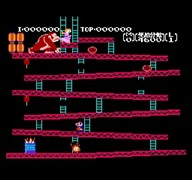 | 大金刚 | 0 | D:\GitCode\famiclone\reference\nes-games\平台\大金刚[MS]-mapper0.nes |
| 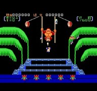 | 大金刚3 | 0 | D:\GitCode\famiclone\reference\nes-games\平台\大金刚3[高伟]-mapper0.nes |
| 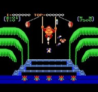 | 大金刚3 | 0 | D:\GitCode\famiclone\reference\nes-games\平台\大金刚3[MS]-mapper0.nes |
| 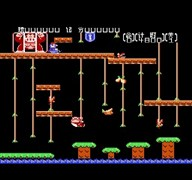 | 大金刚Jr | 0 | D:\GitCode\famiclone\reference\nes-games\平台\大金刚Jr[高伟]-mapper0.nes |
|  | 大金刚Jr | 0 | D:\GitCode\famiclone\reference\nes-games\平台\大金刚Jr[MS]-mapper0.nes |
|  | 大力水手 | 0 | D:\GitCode\famiclone\reference\nes-games\平台\大力水手[虫儿]-mapper0.nes |
|  | 大力水手 | 0 | D:\GitCode\famiclone\reference\nes-games\平台\大力水手[MS]-mapper0.nes |
|  | 大眼蛙大冒险 | 3 | D:\GitCode\famiclone\reference\nes-games\平台\大眼蛙大冒险-mapper3.nes |
|  | 大眼蛙可乐比的大冒险2 | 1 | D:\GitCode\famiclone\reference\nes-games\平台\大眼蛙可乐比的大冒险2-mapper1.nes |
|  | 大眼蛙可洛比的大冒险2 甜甜圈池塘大骚动 | 4 | D:\GitCode\famiclone\reference\nes-games\平台\大眼蛙可洛比的大冒险2 甜甜圈池塘大骚动-mapper4.nes |
|  | 大眼蛙可洛比的水炸弹！ | 1 | D:\GitCode\famiclone\reference\nes-games\平台\大眼蛙可洛比的水炸弹！-mapper1.nes |
| 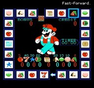 | 电视玛琍 | 3 | D:\GitCode\famiclone\reference\nes-games\平台\电视玛琍-mapper3.nes |
| 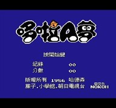 | 哆啦A梦 | 140 | D:\GitCode\famiclone\reference\nes-games\平台\哆啦A梦-v20090616[NOKOH]-mapper140.nes |
| 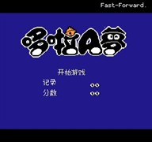 | 哆啦A梦 | 140 | D:\GitCode\famiclone\reference\nes-games\平台\哆啦A梦-v20250525[多情剑客阿飞]-mapper140.nes |
|  | 哆啦A梦 超时空历险 | 4 | D:\GitCode\famiclone\reference\nes-games\平台\哆啦A梦 超时空历险(修正版)-v2[外星科技+无敌阿尔宙斯]-mapper4.nes |
|  | 哆啦A梦 超时空历险 | 4 | D:\GitCode\famiclone\reference\nes-games\平台\哆啦A梦 超时空历险[外星科技]-mapper4.nes |
|  | 飞翼人 | 2 | D:\GitCode\famiclone\reference\nes-games\平台\飞翼人-mapper2.nes |
|  | 高桥名人的冒险岛 | 140 | D:\GitCode\famiclone\reference\nes-games\平台\高桥名人的冒险岛-v20100528[NOKOH+fciq]-mapper140.nes |
| 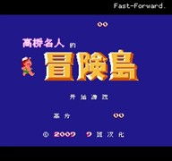 | 高桥名人的冒险岛 | 3 | D:\GitCode\famiclone\reference\nes-games\平台\高桥名人的冒险岛[九班]-mapper3.nes |
| 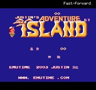 | 高桥名人的冒险岛 | 3 | D:\GitCode\famiclone\reference\nes-games\平台\高桥名人的冒险岛[Justin]-mapper3.nes |
| 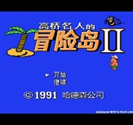 | 高桥名人的冒险岛2 | 4 | D:\GitCode\famiclone\reference\nes-games\平台\高桥名人的冒险岛2-v20101231[NOKOH+fciq]-mapper4.nes |
| 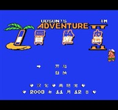 | 高桥名人的冒险岛2 | 4 | D:\GitCode\famiclone\reference\nes-games\平台\高桥名人的冒险岛2(修正版)-v1[高艳龙+MS]-mapper4.nes |
| 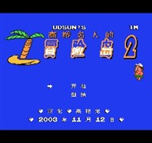 | 高桥名人的冒险岛2 | 4 | D:\GitCode\famiclone\reference\nes-games\平台\高桥名人的冒险岛2(修正版)-v2[高艳龙+MS]-mapper4.nes |
| 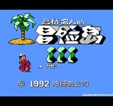 | 高桥名人的冒险岛3 | 4 | D:\GitCode\famiclone\reference\nes-games\平台\高桥名人的冒险岛3-v20110101[NOKOH+fciq]-mapper4.nes |
| 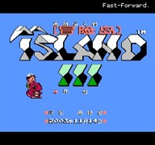 | 高桥名人的冒险岛3 | 4 | D:\GitCode\famiclone\reference\nes-games\平台\高桥名人的冒险岛3[高艳龙]-mapper4.nes |
| 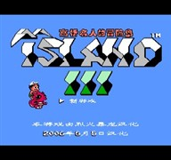 | 高桥名人的冒险岛3 | 4 | D:\GitCode\famiclone\reference\nes-games\平台\高桥名人的冒险岛3[烈火暴龙]-mapper4.nes |
| 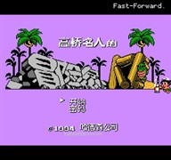 | 高桥名人的冒险岛4 | 4 | D:\GitCode\famiclone\reference\nes-games\平台\高桥名人的冒险岛4-v20220222[NOKOH+fciq]-mapper4.nes |
| 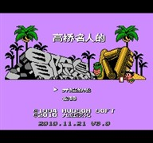 | 高桥名人的冒险岛4 | 4 | D:\GitCode\famiclone\reference\nes-games\平台\高桥名人的冒险岛4-v3.0[九班]-mapper4.nes |
| 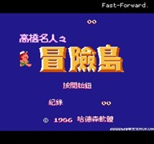 | 高桥名人之冒险岛 | 140 | D:\GitCode\famiclone\reference\nes-games\平台\高桥名人之冒险岛-v20100528[NOKOH]-mapper140.nes |
| 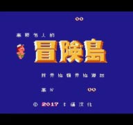 | 高桥名人之冒险岛 | 3 | D:\GitCode\famiclone\reference\nes-games\平台\高桥名人之冒险岛[卡通]-mapper3.nes |
| 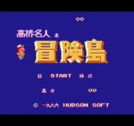 | 高桥名人之冒险岛 | 3 | D:\GitCode\famiclone\reference\nes-games\平台\高桥名人之冒险岛[WMM]-mapper3.nes |
| 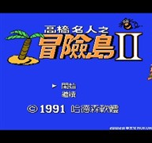 | 高桥名人之冒险岛2 | 4 | D:\GitCode\famiclone\reference\nes-games\平台\高桥名人之冒险岛2-mapper4.nes |
| 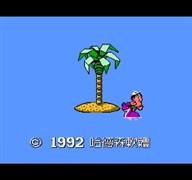 | 高桥名人之冒险岛3 | 4 | D:\GitCode\famiclone\reference\nes-games\平台\高桥名人之冒险岛3-mapper4.nes |
| 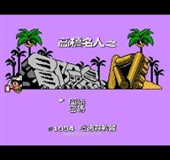 | 高桥名人之冒险岛4 | 4 | D:\GitCode\famiclone\reference\nes-games\平台\高桥名人之冒险岛4-mapper4.nes |
| 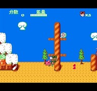 | 高桥名人之妖精哈尼 | 140 | D:\GitCode\famiclone\reference\nes-games\平台\高桥名人之妖精哈尼-mapper140.nes |
|  | 戈尔巴乔夫的水管大作战 | 3 | D:\GitCode\famiclone\reference\nes-games\平台\戈尔巴乔夫的水管大作战(大字体)[高伟]-mapper3.nes |
|  | 戈尔巴乔夫的水管大作战 | 3 | D:\GitCode\famiclone\reference\nes-games\平台\戈尔巴乔夫的水管大作战[verkkars]-mapper3.nes |
|  | 戈尔巴乔夫水管大作战 | 3 | D:\GitCode\famiclone\reference\nes-games\平台\戈尔巴乔夫水管大作战-mapper3.nes |
| 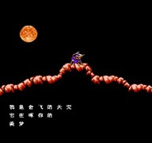 | 怪鸭飞天德 | 1 | D:\GitCode\famiclone\reference\nes-games\平台\怪鸭飞天德-mapper1.nes |
| 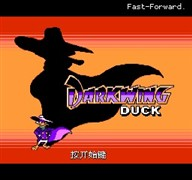 | 怪鸭历险记 | 4 | D:\GitCode\famiclone\reference\nes-games\平台\怪鸭历险记-mapper4.nes |
| 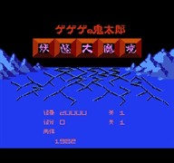 | 鬼太郎 妖怪大魔境 | 3 | D:\GitCode\famiclone\reference\nes-games\平台\鬼太郎 妖怪大魔境-mapper3.nes |
| 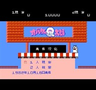 | 鬼之Q太郎 | 1 | D:\GitCode\famiclone\reference\nes-games\平台\鬼之Q太郎-mapper1.nes |
| 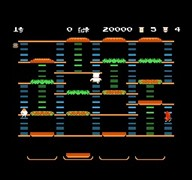 | 汉堡包 | 0 | D:\GitCode\famiclone\reference\nes-games\平台\汉堡包-mapper0.nes |
| 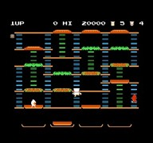 | 汉堡时代 | 0 | D:\GitCode\famiclone\reference\nes-games\平台\汉堡时代-mapper0.nes |
|  | 机器猫小叮当 | 4 | D:\GitCode\famiclone\reference\nes-games\平台\机器猫小叮当-mapper4.nes |
| 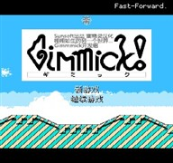 | 吉米克！ | 19 | D:\GitCode\famiclone\reference\nes-games\平台\吉米克！-mapper19.nes |
| 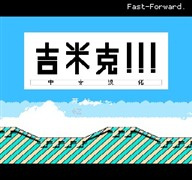 | 吉米克!!! | 69 | D:\GitCode\famiclone\reference\nes-games\平台\吉米克!!!-mapper69.nes |
| 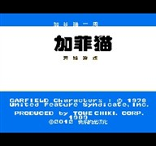 | 加菲猫一周 | 1 | D:\GitCode\famiclone\reference\nes-games\平台\加菲猫一周-mapper1.nes |
| 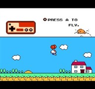 | 凯蒂猫气球世界 | 2 | D:\GitCode\famiclone\reference\nes-games\平台\凯蒂猫气球世界-mapper2.nes |
| 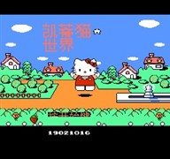 | 凯蒂猫世界 | 3 | D:\GitCode\famiclone\reference\nes-games\平台\凯蒂猫世界(大字体)[高伟]-mapper3.nes |
| 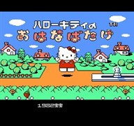 | 凯蒂猫世界 | 3 | D:\GitCode\famiclone\reference\nes-games\平台\凯蒂猫世界[虫虫]-mapper3.nes |
|  | 可鲁可鲁世界 | 0 | D:\GitCode\famiclone\reference\nes-games\平台\可鲁可鲁世界-mapper0.nes |
|  | 蜡笔小新 | 117 | D:\GitCode\famiclone\reference\nes-games\平台\蜡笔小新-mapper117.nes |
|  | 罗罗大冒险 | 1 | D:\GitCode\famiclone\reference\nes-games\平台\罗罗大冒险-mapper1.nes |
|  | 罗罗大冒险2 | 4 | D:\GitCode\famiclone\reference\nes-games\平台\罗罗大冒险2-mapper4.nes |
|  | 罗罗大冒险3 | 1 | D:\GitCode\famiclone\reference\nes-games\平台\罗罗大冒险3-mapper1.nes |
|  | 洛克人 | 2 | D:\GitCode\famiclone\reference\nes-games\平台\洛克人-v1.0[MS]-mapper2.nes |
|  | 洛克人 | 2 | D:\GitCode\famiclone\reference\nes-games\平台\洛克人-v20250825[NOKOH]-mapper2.nes |
|  | 洛克人 | 2 | D:\GitCode\famiclone\reference\nes-games\平台\洛克人[3DM]-mapper2.nes |
|  | 洛克人 | 2 | D:\GitCode\famiclone\reference\nes-games\平台\洛克人[天空联盟]-mapper2.nes |
|  | 洛克人 | 2 | D:\GitCode\famiclone\reference\nes-games\平台\洛克人[俞亮]-mapper2.nes |
|  | 洛克人2 威利博士之谜 | 1 | D:\GitCode\famiclone\reference\nes-games\平台\洛克人2 威利博士之谜-v2[NOKOH]-mapper1.nes |
|  | 洛克人2 威利博士之谜 | 1 | D:\GitCode\famiclone\reference\nes-games\平台\洛克人2 威利博士之谜-v20230321[NOKOH+fciq]-mapper1.nes |
|  | 洛克人2 威利博士之谜 | 1 | D:\GitCode\famiclone\reference\nes-games\平台\洛克人2 威利博士之谜[BBasilio2001]-mapper1.nes |
|  | 洛克人2 Dr.Wily之谜 | 1 | D:\GitCode\famiclone\reference\nes-games\平台\洛克人2 Dr.Wily之谜[HK]-mapper1.nes |
|  | 洛克人2 Dr.Wily之谜 | 1 | D:\GitCode\famiclone\reference\nes-games\平台\洛克人2 Dr.Wily之谜[MS]-mapper1.nes |
|  | 洛克人2 Dr.Wily之谜 | 1 | D:\GitCode\famiclone\reference\nes-games\平台\洛克人2 Dr.Wily之谜[NeoX]-mapper1.nes |
|  | 洛克人3 威利博士的末日！ | 4 | D:\GitCode\famiclone\reference\nes-games\平台\洛克人3 威利博士的末日！-v20230315[NOKOH]-mapper4.nes |
|  | 洛克人3 威利博士的末日！ | 4 | D:\GitCode\famiclone\reference\nes-games\平台\洛克人3 威利博士的末日！-v20230322[NOKOH+fciq]-mapper4.nes |
|  | 洛克人3 Dr.Wily的末日！ | 4 | D:\GitCode\famiclone\reference\nes-games\平台\洛克人3 Dr.Wily的末日！-mapper4.nes |
|  | 洛克人4 新的野心 | 4 | D:\GitCode\famiclone\reference\nes-games\平台\洛克人4 新的野心(修正版)-v1.1[中伟+HK]-mapper4.nes |
|  | 洛克人4 新的野心 | 245 | D:\GitCode\famiclone\reference\nes-games\平台\洛克人4 新的野心(M245)-v20250221[NOKOH]-mapper245.nes |
|  | 洛克人4 新的野心 | 4 | D:\GitCode\famiclone\reference\nes-games\平台\洛克人4 新的野心(M4)-v20250221[NOKOH]-mapper4.nes |
|  | 洛克人4 新的野心 | 4 | D:\GitCode\famiclone\reference\nes-games\平台\洛克人4 新的野心[中伟]-mapper4.nes |
|  | 洛克人4 新的野心 | 4 | D:\GitCode\famiclone\reference\nes-games\平台\洛克人4 新的野心[MS]-mapper4.nes |
|  | 洛克人4新的野心 | 4 | D:\GitCode\famiclone\reference\nes-games\平台\洛克人4新的野心-mapper4.nes |
|  | 洛克人5 布鲁斯的圈套 | 4 | D:\GitCode\famiclone\reference\nes-games\平台\洛克人5 布鲁斯的圈套(实机修正)[Shinwa+拒绝融化]-mapper4.nes |
|  | 洛克人5 布鲁斯的圈套 | 4 | D:\GitCode\famiclone\reference\nes-games\平台\洛克人5 布鲁斯的圈套(修正版)[中伟+HK]-mapper4.nes |
|  | 洛克人5 布鲁斯的圈套 | 4 | D:\GitCode\famiclone\reference\nes-games\平台\洛克人5 布鲁斯的圈套[斯泰因]-mapper4.nes |
|  | 洛克人5 布鲁斯的圈套 | 4 | D:\GitCode\famiclone\reference\nes-games\平台\洛克人5 布鲁斯的圈套[中伟]-mapper4.nes |
|  | 洛克人5 布鲁斯的圈套 | 4 | D:\GitCode\famiclone\reference\nes-games\平台\洛克人5 布鲁斯的圈套[MS]-mapper4.nes |
|  | 洛克人6 历史上最大的战争 | 4 | D:\GitCode\famiclone\reference\nes-games\平台\洛克人6 历史上最大的战争-v20061219[Madcell]-mapper4.nes |
|  | 洛克人6 历史上最大的战争 | 4 | D:\GitCode\famiclone\reference\nes-games\平台\洛克人6 历史上最大的战争-v20250710[NOKOH]-mapper4.nes |
|  | 洛克人6 历史上最大的战争 | 4 | D:\GitCode\famiclone\reference\nes-games\平台\洛克人6 历史上最大的战争(无片头)-v20061219[Madcell]-mapper4.nes |
|  | 洛克人6 历史上最大的战争 | 4 | D:\GitCode\famiclone\reference\nes-games\平台\洛克人6 历史上最大的战争[Madcell+天空联盟]-mapper4.nes |
|  | 洛克人6 史上最长的战斗！ | 4 | D:\GitCode\famiclone\reference\nes-games\平台\洛克人6 史上最长的战斗！[不知所云]-mapper4.nes |
|  | 洛克人6 史上最长的战斗！ | 4 | D:\GitCode\famiclone\reference\nes-games\平台\洛克人6 史上最长的战斗！[不知所云+HK]-mapper4.nes |
|  | 洛克人6 史上最长的战斗！ | 4 | D:\GitCode\famiclone\reference\nes-games\平台\洛克人6 史上最长的战斗！[未知]-mapper4.nes |
|  | 洛克人6 史上最长的战斗！ | 4 | D:\GitCode\famiclone\reference\nes-games\平台\洛克人6 史上最长的战斗！[严达贵]-mapper4.nes |
|  | 洛克人6 史上最长的战斗！ | 4 | D:\GitCode\famiclone\reference\nes-games\平台\洛克人6 史上最长的战斗！[MS]-mapper4.nes |
|  | 洛克人Exile | 1 | D:\GitCode\famiclone\reference\nes-games\平台\洛克人Exile-mapper1.nes |
|  | 洛克人X | 74 | D:\GitCode\famiclone\reference\nes-games\平台\洛克人X[外星科技]-mapper74.nes |
|  | 洛克人X | 4 | D:\GitCode\famiclone\reference\nes-games\平台\洛克人X[MS]-mapper4.nes |
|  | 马里奥水管工 | 0 | D:\GitCode\famiclone\reference\nes-games\平台\马里奥水管工-mapper0.nes |
|  | 马里奥兄弟 | 3 | D:\GitCode\famiclone\reference\nes-games\平台\马里奥兄弟[水火]-mapper3.nes |
|  | 马里奥兄弟 | 3 | D:\GitCode\famiclone\reference\nes-games\平台\马里奥兄弟[Madcell]-mapper3.nes |
|  | 马戏团 | 0 | D:\GitCode\famiclone\reference\nes-games\平台\马戏团-v1.1[九班]-mapper0.nes |
|  | 马戏团 | 3 | D:\GitCode\famiclone\reference\nes-games\平台\马戏团-v20100512[NOKOH]-mapper3.nes |
|  | 马戏团 | 3 | D:\GitCode\famiclone\reference\nes-games\平台\马戏团-v20100512[NOKOH+fciq]-mapper3.nes |
|  | 马戏团 | 0 | D:\GitCode\famiclone\reference\nes-games\平台\马戏团-v2020[虫虫]-mapper0.nes |
|  | 马戏团 | 0 | D:\GitCode\famiclone\reference\nes-games\平台\马戏团(修正版)[汉化情报站+MS]-mapper0.nes |
|  | 马戏团 | 0 | D:\GitCode\famiclone\reference\nes-games\平台\马戏团[虫虫]-mapper0.nes |
|  | 马戏团 | 0 | D:\GitCode\famiclone\reference\nes-games\平台\马戏团[高伟]-mapper0.nes |
|  | 马戏团 | 0 | D:\GitCode\famiclone\reference\nes-games\平台\马戏团[卡通]-mapper0.nes |
|  | 马戏团 | 3 | D:\GitCode\famiclone\reference\nes-games\平台\马戏团[水火]-mapper3.nes |
|  | 马戏团 | 0 | D:\GitCode\famiclone\reference\nes-games\平台\马戏团[夜幕星辰]-mapper0.nes |
|  | 玛利欧兄弟 | 3 | D:\GitCode\famiclone\reference\nes-games\平台\玛利欧兄弟-mapper3.nes |
|  | 玛利欧兄弟拆屋工 | 140 | D:\GitCode\famiclone\reference\nes-games\平台\玛利欧兄弟拆屋工-mapper140.nes |
|  | 猫和老鼠 | 0 | D:\GitCode\famiclone\reference\nes-games\平台\猫和老鼠-mapper0.nes |
|  | 猫捉老鼠 | 0 | D:\GitCode\famiclone\reference\nes-games\平台\猫捉老鼠[来福]-mapper0.nes |
|  | 猫捉老鼠 | 0 | D:\GitCode\famiclone\reference\nes-games\平台\猫捉老鼠[奇玉]-mapper0.nes |
|  | 美猴王 | 4 | D:\GitCode\famiclone\reference\nes-games\平台\美猴王-mapper4.nes |
|  | 梦企鹅物语 | 191 | D:\GitCode\famiclone\reference\nes-games\平台\梦企鹅物语-v1.2[汉化你妹]-mapper191.nes |
|  | 梦企鹅物语 | 4 | D:\GitCode\famiclone\reference\nes-games\平台\梦企鹅物语[天蝎之忆]-mapper4.nes |
|  | 米老鼠大冒险 | 3 | D:\GitCode\famiclone\reference\nes-games\平台\米老鼠大冒险-mapper3.nes |
|  | 摩登原始人 恐龙峰的惊喜！ | 115 | D:\GitCode\famiclone\reference\nes-games\平台\摩登原始人 恐龙峰的惊喜！-mapper115.nes |
|  | 摩登原始人 营救迪诺和霍比 | 115 | D:\GitCode\famiclone\reference\nes-games\平台\摩登原始人 营救迪诺和霍比-mapper115.nes |
|  | 鸟的故事 | 185 | D:\GitCode\famiclone\reference\nes-games\平台\鸟的故事-mapper185.nes |
|  | 齐天大圣 | 241 | D:\GitCode\famiclone\reference\nes-games\平台\齐天大圣-mapper241.nes |
|  | 奇奇与蒂蒂大作战 | 192 | D:\GitCode\famiclone\reference\nes-games\平台\奇奇与蒂蒂大作战-mapper192.nes |
|  | 奇奇与蒂蒂大作战2 | 192 | D:\GitCode\famiclone\reference\nes-games\平台\奇奇与蒂蒂大作战2-mapper192.nes |
|  | 企鹅先生冒险之旅 | 0 | D:\GitCode\famiclone\reference\nes-games\平台\企鹅先生冒险之旅-mapper0.nes |
|  | 忍者茶茶丸 | 3 | D:\GitCode\famiclone\reference\nes-games\平台\忍者茶茶丸-mapper3.nes |
|  | 忍者茶茶丸君 | 3 | D:\GitCode\famiclone\reference\nes-games\平台\忍者茶茶丸君-v20111227[NOKOH]-mapper3.nes |
|  | 忍者茶茶丸君 | 3 | D:\GitCode\famiclone\reference\nes-games\平台\忍者茶茶丸君-v3[MS]-mapper3.nes |
|  | 三目童子 | 4 | D:\GitCode\famiclone\reference\nes-games\平台\三目童子-v3[逆游の五彩魚]-mapper4.nes |
|  | 三目童子 | 4 | D:\GitCode\famiclone\reference\nes-games\平台\三目童子[高伟]-mapper4.nes |
|  | 三目童子 | 4 | D:\GitCode\famiclone\reference\nes-games\平台\三目童子[asiwish]-mapper4.nes |
|  | 三目童子 | 4 | D:\GitCode\famiclone\reference\nes-games\平台\三目童子[Jeff.Ma]-mapper4.nes |
|  | 三目童子 | 4 | D:\GitCode\famiclone\reference\nes-games\平台\三目童子[MS]-mapper4.nes |
|  | 三眼神童 | 4 | D:\GitCode\famiclone\reference\nes-games\平台\三眼神童-v1.1[星空]-mapper4.nes |
|  | 三眼神童 | 4 | D:\GitCode\famiclone\reference\nes-games\平台\三眼神童(修改版)[Flow Wolf]-mapper4.nes |
|  | 三只小猪 | 0 | D:\GitCode\famiclone\reference\nes-games\平台\三只小猪-v1.0[MS]-mapper0.nes |
|  | 三只小猪 | 0 | D:\GitCode\famiclone\reference\nes-games\平台\三只小猪[高伟]-mapper0.nes |
|  | 狮王传奇 | 4 | D:\GitCode\famiclone\reference\nes-games\平台\狮王传奇-mapper4.nes |
|  | 水管工马里奥 | 0 | D:\GitCode\famiclone\reference\nes-games\平台\水管工马里奥-mapper0.nes |
|  | 水管马里奥 | 0 | D:\GitCode\famiclone\reference\nes-games\平台\水管马里奥-mapper0.nes |
|  | 水果狸 | 3 | D:\GitCode\famiclone\reference\nes-games\平台\水果狸-v1.1[九班]-mapper3.nes |
|  | 水果狸 | 3 | D:\GitCode\famiclone\reference\nes-games\平台\水果狸[普泽]-mapper3.nes |
|  | 松鼠大作战 | 1 | D:\GitCode\famiclone\reference\nes-games\平台\松鼠大作战-mapper1.nes |
|  | 松鼠大作战2 | 1 | D:\GitCode\famiclone\reference\nes-games\平台\松鼠大作战2-mapper1.nes |
|  | 索尼克 | 4 | D:\GitCode\famiclone\reference\nes-games\平台\索尼克-mapper4.nes |
|  | 太空青蛙 | 0 | D:\GitCode\famiclone\reference\nes-games\平台\太空青蛙-v1.0[高伟]-mapper0.nes |
|  | 太空青蛙 | 0 | D:\GitCode\famiclone\reference\nes-games\平台\太空青蛙[虫虫]-mapper0.nes |
|  | 汤姆和杰瑞和塔菲 | 4 | D:\GitCode\famiclone\reference\nes-games\平台\汤姆和杰瑞和塔菲-mapper4.nes |
|  | 唐老鸭历险记2 | 4 | D:\GitCode\famiclone\reference\nes-games\平台\唐老鸭历险记2-v1.2[DMG]-mapper4.nes |
|  | 唐老鸭历险记2 | 2 | D:\GitCode\famiclone\reference\nes-games\平台\唐老鸭历险记2[yzdyjj]-mapper2.nes |
|  | 淘气厨师 食物的世界 | 4 | D:\GitCode\famiclone\reference\nes-games\平台\淘气厨师 食物的世界[MS]-mapper4.nes |
|  | 淘气厨师 食物的世界 | 4 | D:\GitCode\famiclone\reference\nes-games\平台\淘气厨师 食物的世界[Zero Boy]-mapper4.nes |
|  | 兔宝宝大冒险 | 23 | D:\GitCode\famiclone\reference\nes-games\平台\兔宝宝大冒险(修正版)[MS]-mapper23.nes |
|  | 兔宝宝大冒险 | 4 | D:\GitCode\famiclone\reference\nes-games\平台\兔宝宝大冒险[逆游の五彩魚]-mapper4.nes |
|  | 兔宝宝的大冒险2 欢迎光临蒙塔纳乐园 | 85 | D:\GitCode\famiclone\reference\nes-games\平台\兔宝宝的大冒险2 欢迎光临蒙塔纳乐园-mapper85.nes |
|  | 兔宝宝历险记2 欢迎来到蒙特那乐园 | 85 | D:\GitCode\famiclone\reference\nes-games\平台\兔宝宝历险记2 欢迎来到蒙特那乐园-mapper85.nes |
|  | 兔子邦妮 疯狂城堡 | 1 | D:\GitCode\famiclone\reference\nes-games\平台\兔子邦妮 疯狂城堡(大字体)[高伟]-mapper1.nes |
|  | 兔子邦妮 疯狂城堡 | 1 | D:\GitCode\famiclone\reference\nes-games\平台\兔子邦妮 疯狂城堡[高伟]-mapper1.nes |
|  | 哇咿哇咿世界 | 23 | D:\GitCode\famiclone\reference\nes-games\平台\哇咿哇咿世界-mapper23.nes |
|  | 哇咿哇咿世界2 SOS!!帕塞利城 | 21 | D:\GitCode\famiclone\reference\nes-games\平台\哇咿哇咿世界2 SOS!!帕塞利城-mapper21.nes |
|  | 顽皮狗 | 4 | D:\GitCode\famiclone\reference\nes-games\平台\顽皮狗-mapper4.nes |
|  | 顽皮老鸭梦冒险 | 119 | D:\GitCode\famiclone\reference\nes-games\平台\顽皮老鸭梦冒险-mapper119.nes |
|  | 香蕉王子大冒险 | 4 | D:\GitCode\famiclone\reference\nes-games\平台\香蕉王子大冒险-mapper4.nes |
|  | 小红帽 | 0 | D:\GitCode\famiclone\reference\nes-games\平台\小红帽-mapper0.nes |
|  | 小玛琍 | 0 | D:\GitCode\famiclone\reference\nes-games\平台\小玛琍-mapper0.nes |
|  | 小美人鱼 人鱼公主 | 2 | D:\GitCode\famiclone\reference\nes-games\平台\小美人鱼 人鱼公主[冰组]-mapper2.nes |
|  | 小美人鱼 人鱼公主 | 2 | D:\GitCode\famiclone\reference\nes-games\平台\小美人鱼 人鱼公主[中伟]-mapper2.nes |
|  | 小魔怪2 新种诞生 | 4 | D:\GitCode\famiclone\reference\nes-games\平台\小魔怪2 新种诞生[虫虫]-mapper4.nes |
|  | 小魔怪2 新种诞生 | 69 | D:\GitCode\famiclone\reference\nes-games\平台\小魔怪2 新种诞生[满天星]-mapper69.nes |
|  | 星之卡比 梦之泉的物语 | 5 | D:\GitCode\famiclone\reference\nes-games\平台\星之卡比 梦之泉的物语-v1.0[DMG]-mapper5.nes |
|  | 星之卡比 梦之泉的物语 | 4 | D:\GitCode\famiclone\reference\nes-games\平台\星之卡比 梦之泉的物语[烈火暴龙]-mapper4.nes |
|  | 雪人兄弟 | 1 | D:\GitCode\famiclone\reference\nes-games\平台\雪人兄弟-v1.0[高伟]-mapper1.nes |
|  | 雪人兄弟 | 192 | D:\GitCode\famiclone\reference\nes-games\平台\雪人兄弟[LSP]-mapper192.nes |
|  | 雪人兄弟 | 1 | D:\GitCode\famiclone\reference\nes-games\平台\雪人兄弟[MS]-mapper1.nes |
|  | 亚当斯一家 法斯特叔叔的探索 | 5 | D:\GitCode\famiclone\reference\nes-games\平台\亚当斯一家 法斯特叔叔的探索-mapper5.nes |
|  | 耀西的饼干 | 4 | D:\GitCode\famiclone\reference\nes-games\平台\耀西的饼干-v1.3[九班]-mapper4.nes |
|  | 耀西的饼干 | 4 | D:\GitCode\famiclone\reference\nes-games\平台\耀西的饼干(美版,大字体)[高伟]-mapper4.nes |
|  | 耀西的饼干 | 4 | D:\GitCode\famiclone\reference\nes-games\平台\耀西的饼干(日版,大字体)[高伟]-mapper4.nes |
|  | 耀西的蛋 | 1 | D:\GitCode\famiclone\reference\nes-games\平台\耀西的蛋-mapper1.nes |
|  | 樱桃小丸子 | 164 | D:\GitCode\famiclone\reference\nes-games\平台\樱桃小丸子-mapper164.nes |
|  | 幽灵列车 | 4 | D:\GitCode\famiclone\reference\nes-games\平台\幽灵列车-mapper4.nes |
|  | 原始人 | 4 | D:\GitCode\famiclone\reference\nes-games\平台\原始人-mapper4.nes |
|  | 原始人2 | 4 | D:\GitCode\famiclone\reference\nes-games\平台\原始人2-mapper4.nes |
|  | 战斗原始人 | 4 | D:\GitCode\famiclone\reference\nes-games\平台\战斗原始人(美版,大字体)[高伟]-mapper4.nes |
|  | 战斗原始人 | 4 | D:\GitCode\famiclone\reference\nes-games\平台\战斗原始人(欧版,大字体)[高伟]-mapper4.nes |
|  | 战斗原始人 | 4 | D:\GitCode\famiclone\reference\nes-games\平台\战斗原始人[高伟]-mapper4.nes |
|  | 真假猴王 | 4 | D:\GitCode\famiclone\reference\nes-games\平台\真假猴王-mapper4.nes |
|  | 蜘蛛侠 六邪归来 | 4 | D:\GitCode\famiclone\reference\nes-games\平台\蜘蛛侠 六邪归来-mapper4.nes |
|  | 中国兔宝宝 | 4 | D:\GitCode\famiclone\reference\nes-games\平台\中国兔宝宝-mapper4.nes |
|  | FC原人 | 4 | D:\GitCode\famiclone\reference\nes-games\平台\FC原人-v1.0[高伟]-mapper4.nes |
|  | FC原人 | 4 | D:\GitCode\famiclone\reference\nes-games\平台\FC原人[MS]-mapper4.nes |
