# 角色扮演（286 个）

返回 [总览](README.md)

| 缩略图 | 游戏 | 映⁠射⁠号 | 文件路径 |
|---|---|---|---|
| 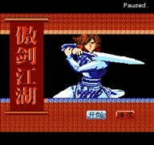 | 傲剑江湖 | 241 | D:\GitCode\famiclone\reference\nes-games\角色扮演\傲剑江湖.nes |
| 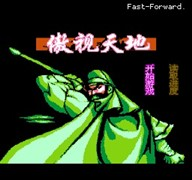 | 傲视天地 | 4 | D:\GitCode\famiclone\reference\nes-games\角色扮演\傲视天地.nes |
| 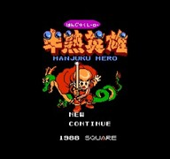 | 半熟英雄 | 4 | D:\GitCode\famiclone\reference\nes-games\角色扮演\半熟英雄(标题修正)[外星科技+寒雪使者].nes |
|  | 宠物 翡翠版 | 241 | D:\GitCode\famiclone\reference\nes-games\角色扮演\宠物 翡翠版.nes |
| 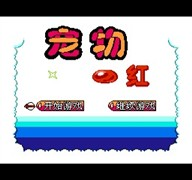 | 宠物 红 | 164 | D:\GitCode\famiclone\reference\nes-games\角色扮演\宠物 红.nes |
| 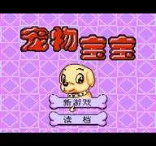 | 宠物宝宝 | 268 | D:\GitCode\famiclone\reference\nes-games\角色扮演\宠物宝宝.nes |
|  | 宠物大家族 | 178 | D:\GitCode\famiclone\reference\nes-games\角色扮演\宠物大家族.nes |
| 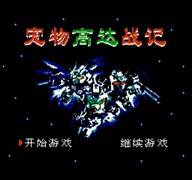 | 宠物高达战记 | 163 | D:\GitCode\famiclone\reference\nes-games\角色扮演\宠物高达战记.nes |
|  | 宠物进化史 | 162 | D:\GitCode\famiclone\reference\nes-games\角色扮演\宠物进化史.nes |
|  | 宠物小精灵6 | 178 | D:\GitCode\famiclone\reference\nes-games\角色扮演\宠物小精灵6.nes |
| 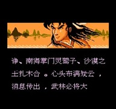 | 楚留香 香帅传奇之血海飘零 | 4 | D:\GitCode\famiclone\reference\nes-games\角色扮演\楚留香 香帅传奇之血海飘零.nes |
| 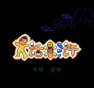 | 大话水浒 | 4 | D:\GitCode\famiclone\reference\nes-games\角色扮演\大话水浒.nes |
| 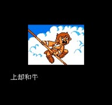 | 大话西游 | 15 | D:\GitCode\famiclone\reference\nes-games\角色扮演\大话西游[火星电子].nes |
| 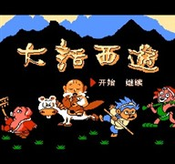 | 大话西游 | 163 | D:\GitCode\famiclone\reference\nes-games\角色扮演\大话西游[南晶科技].nes |
| 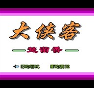 | 大侠客 楚留香 | 227 | D:\GitCode\famiclone\reference\nes-games\角色扮演\大侠客 楚留香.nes |
| 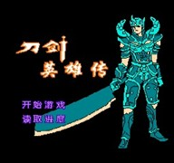 | 刀剑英雄传 | 4 | D:\GitCode\famiclone\reference\nes-games\角色扮演\刀剑英雄传.nes |
| 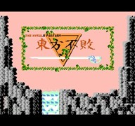 | 东方不败 | 245 | D:\GitCode\famiclone\reference\nes-games\角色扮演\东方不败.nes |
| 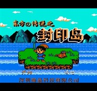 | 东方传说 封印岛 | 4 | D:\GitCode\famiclone\reference\nes-games\角色扮演\东方传说 封印岛.nes |
| 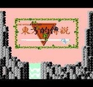 | 东方的传说 | 4 | D:\GitCode\famiclone\reference\nes-games\角色扮演\东方的传说[外星科技].nes |
| 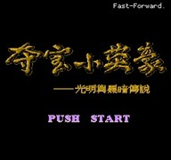 | 夺宝小英豪 光明与黑暗传说 | 249 | D:\GitCode\famiclone\reference\nes-games\角色扮演\夺宝小英豪 光明与黑暗传说.nes |
| 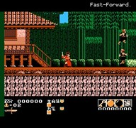 | 恶魔之剑 | 1 | D:\GitCode\famiclone\reference\nes-games\角色扮演\恶魔之剑.nes |
|  | 封神榜 | 249 | D:\GitCode\famiclone\reference\nes-games\角色扮演\封神榜.nes |
| 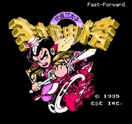 | 封神榜 伏魔三太子 | 246 | D:\GitCode\famiclone\reference\nes-games\角色扮演\封神榜 伏魔三太子[全崴资讯].nes |
|  | 封神榜 伏魔三太子 | 246 | D:\GitCode\famiclone\reference\nes-games\角色扮演\封神榜 伏魔三太子[全崴资讯+147201688].nes |
| 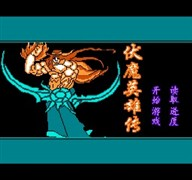 | 伏魔英雄传 | 4 | D:\GitCode\famiclone\reference\nes-games\角色扮演\伏魔英雄传.nes |
| 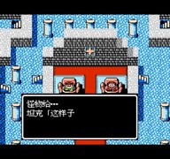 | 高达之骑士物语1 | 199 | D:\GitCode\famiclone\reference\nes-games\角色扮演\高达之骑士物语1.nes |
|  | 格兰蒂亚 | 227 | D:\GitCode\famiclone\reference\nes-games\角色扮演\格兰蒂亚.nes |
|  | 格兰蒂亚传说 | 227 | D:\GitCode\famiclone\reference\nes-games\角色扮演\格兰蒂亚传说.nes |
| 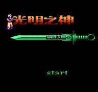 | 光明之神 | 4 | D:\GitCode\famiclone\reference\nes-games\角色扮演\光明之神.nes |
| 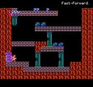 | 光神话 帕露蒂娜之镜 | 1 | D:\GitCode\famiclone\reference\nes-games\角色扮演\光神话 帕露蒂娜之镜.nes |
| 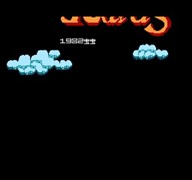 | 光之神话 射箭小天使 | 1 | D:\GitCode\famiclone\reference\nes-games\角色扮演\光之神话 射箭小天使.nes |
| 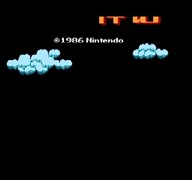 | 光之神话 天使岛传说 | 1 | D:\GitCode\famiclone\reference\nes-games\角色扮演\光之神话 天使岛传说.nes |
| 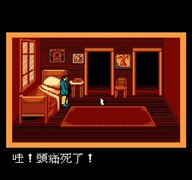 | 黑暗之蛊 | 164 | D:\GitCode\famiclone\reference\nes-games\角色扮演\黑暗之蛊.nes |
| 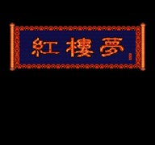 | 红楼梦 | 4 | D:\GitCode\famiclone\reference\nes-games\角色扮演\红楼梦.nes |
| 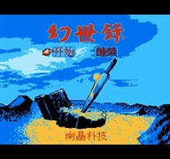 | 幻世录 | 163 | D:\GitCode\famiclone\reference\nes-games\角色扮演\幻世录.nes |
| 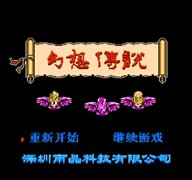 | 幻想传说 | 163 | D:\GitCode\famiclone\reference\nes-games\角色扮演\幻想传说.nes |
| 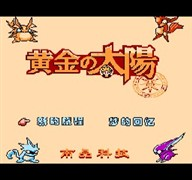 | 黄金太阳 | 163 | D:\GitCode\famiclone\reference\nes-games\角色扮演\黄金太阳.nes |
| 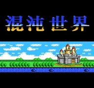 | 混沌世界 | 176 | D:\GitCode\famiclone\reference\nes-games\角色扮演\混沌世界(修正版)[外星科技+Vanyogin].nes |
| 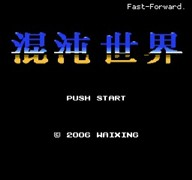 | 混沌世界 | 74 | D:\GitCode\famiclone\reference\nes-games\角色扮演\混沌世界[外星科技].nes |
| 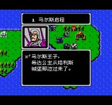 | 火焰纹章 | 165 | D:\GitCode\famiclone\reference\nes-games\角色扮演\火焰纹章.nes |
|  | 火焰纹章 圣战的系谱 | 162 | D:\GitCode\famiclone\reference\nes-games\角色扮演\火焰纹章 圣战的系谱.nes |
| 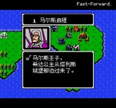 | 火焰之纹章 暗黑龙与光之剑 | 165 | D:\GitCode\famiclone\reference\nes-games\角色扮演\火焰之纹章 暗黑龙与光之剑-v1.05[寒雪使者].nes |
| 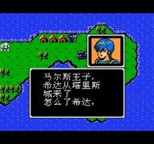 | 火焰之纹章 暗黑龙与光之剑 | 165 | D:\GitCode\famiclone\reference\nes-games\角色扮演\火焰之纹章 暗黑龙与光之剑(修正版)-v4.0[外星科技+庞先生+寒雪使者].nes |
| 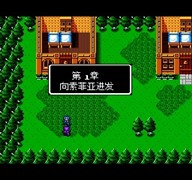 | 火焰之纹章外传 | 165 | D:\GitCode\famiclone\reference\nes-games\角色扮演\火焰之纹章外传-v20210914[寒雪使者].nes |
|  | 火焰之纹章外传 | 165 | D:\GitCode\famiclone\reference\nes-games\角色扮演\火焰之纹章外传(修正版)[外星科技+庞先生+寒雪使者].nes |
|  | 机器战士高达 | 4 | D:\GitCode\famiclone\reference\nes-games\角色扮演\机器战士高达.nes |
|  | 剑王 | 4 | D:\GitCode\famiclone\reference\nes-games\角色扮演\剑王[虫虫].nes |
| 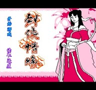 | 剑侠情缘 | 4 | D:\GitCode\famiclone\reference\nes-games\角色扮演\剑侠情缘[晶科泰].nes |
| 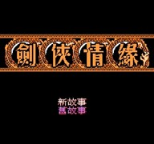 | 剑侠情缘 | 74 | D:\GitCode\famiclone\reference\nes-games\角色扮演\剑侠情缘[酷哥电子].nes |
| 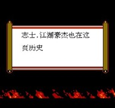 | 剑侠情缘 | 163 | D:\GitCode\famiclone\reference\nes-games\角色扮演\剑侠情缘[南晶科技].nes |
| 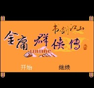 | 金庸群侠传 书剑江山 | 163 | D:\GitCode\famiclone\reference\nes-games\角色扮演\金庸群侠传 书剑江山.nes |
| 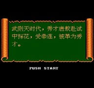 | 镜花缘 | 4 | D:\GitCode\famiclone\reference\nes-games\角色扮演\镜花缘.nes |
|  | 绝代英雄 | 4 | D:\GitCode\famiclone\reference\nes-games\角色扮演\绝代英雄.nes |
|  | 口袋宝石 红 | 163 | D:\GitCode\famiclone\reference\nes-games\角色扮演\口袋宝石 红.nes |
| 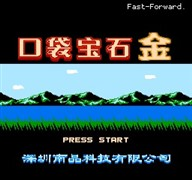 | 口袋宝石 金 | 163 | D:\GitCode\famiclone\reference\nes-games\角色扮演\口袋宝石 金.nes |
| 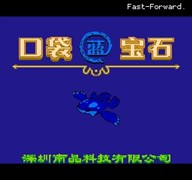 | 口袋宝石 蓝 | 163 | D:\GitCode\famiclone\reference\nes-games\角色扮演\口袋宝石 蓝.nes |
| 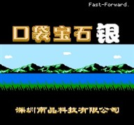 | 口袋宝石 银 | 163 | D:\GitCode\famiclone\reference\nes-games\角色扮演\口袋宝石 银.nes |
| 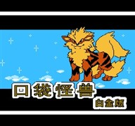 | 口袋怪兽 白金版 | 4 | D:\GitCode\famiclone\reference\nes-games\角色扮演\口袋怪兽 白金版.nes |
| 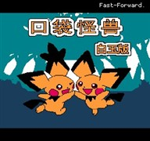 | 口袋怪兽 白玉版 | 4 | D:\GitCode\famiclone\reference\nes-games\角色扮演\口袋怪兽 白玉版.nes |
|  | 口袋怪兽 翡翠版 | 4 | D:\GitCode\famiclone\reference\nes-games\角色扮演\口袋怪兽 翡翠版.nes |
| 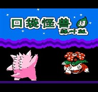 | 口袋怪兽 绿 绿叶版 | 4 | D:\GitCode\famiclone\reference\nes-games\角色扮演\口袋怪兽 绿 绿叶版.nes |
| 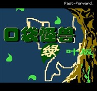 | 口袋怪兽 绿叶版 | 4 | D:\GitCode\famiclone\reference\nes-games\角色扮演\口袋怪兽 绿叶版.nes |
|  | 口袋怪兽 水晶版 | 4 | D:\GitCode\famiclone\reference\nes-games\角色扮演\口袋怪兽 水晶版.nes |
|  | 口袋怪兽 珍珠版 | 4 | D:\GitCode\famiclone\reference\nes-games\角色扮演\口袋怪兽 珍珠版.nes |
| 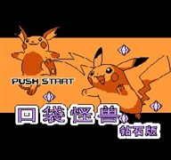 | 口袋怪兽 钻石版 | 4 | D:\GitCode\famiclone\reference\nes-games\角色扮演\口袋怪兽 钻石版.nes |
| 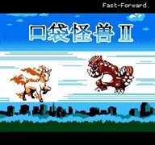 | 口袋怪兽2 | 4 | D:\GitCode\famiclone\reference\nes-games\角色扮演\口袋怪兽2.nes |
| 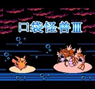 | 口袋怪兽3 | 4 | D:\GitCode\famiclone\reference\nes-games\角色扮演\口袋怪兽3.nes |
|  | 口袋精灵 金 | 176 | D:\GitCode\famiclone\reference\nes-games\角色扮演\口袋精灵 金(解密版)[外星科技+WXN].nes |
|  | 口袋精灵 金 | 15 | D:\GitCode\famiclone\reference\nes-games\角色扮演\口袋精灵 金[火星电子].nes |
|  | 口袋精灵 金 | 15 | D:\GitCode\famiclone\reference\nes-games\角色扮演\口袋精灵 金[火星电子+147201688].nes |
|  | 口袋精灵 水晶 | 164 | D:\GitCode\famiclone\reference\nes-games\角色扮演\口袋精灵 水晶.nes |
|  | 口袋里的魔鬼 | 4 | D:\GitCode\famiclone\reference\nes-games\角色扮演\口袋里的魔鬼-v1.0[DMG].nes |
|  | 口袋里的魔鬼 | 4 | D:\GitCode\famiclone\reference\nes-games\角色扮演\口袋里的魔鬼[MM之神].nes |
|  | 口袋里的妖怪 | 4 | D:\GitCode\famiclone\reference\nes-games\角色扮演\口袋里的妖怪.nes |
|  | 口袋水晶 | 163 | D:\GitCode\famiclone\reference\nes-games\角色扮演\口袋水晶.nes |
|  | 口袋妖怪 绿叶版 | 4 | D:\GitCode\famiclone\reference\nes-games\角色扮演\口袋妖怪 绿叶版.nes |
|  | 口袋妖怪 钻石版 | 164 | D:\GitCode\famiclone\reference\nes-games\角色扮演\口袋妖怪 钻石版.nes |
|  | 口袋钻石 | 163 | D:\GitCode\famiclone\reference\nes-games\角色扮演\口袋钻石.nes |
|  | 快打传说 | 189 | D:\GitCode\famiclone\reference\nes-games\角色扮演\快打传说.nes |
|  | 里见八犬传 | 4 | D:\GitCode\famiclone\reference\nes-games\角色扮演\里见八犬传.nes |
|  | 梁山英雄 | 163 | D:\GitCode\famiclone\reference\nes-games\角色扮演\梁山英雄.nes |
|  | 梁山英雄传 | 74 | D:\GitCode\famiclone\reference\nes-games\角色扮演\梁山英雄传.nes |
|  | 灵魂封魔录 | 4 | D:\GitCode\famiclone\reference\nes-games\角色扮演\灵魂封魔录.nes |
|  | 灵界护法 | 4 | D:\GitCode\famiclone\reference\nes-games\角色扮演\灵界护法.nes |
|  | 龙魂 | 4 | D:\GitCode\famiclone\reference\nes-games\角色扮演\龙魂.nes |
|  | 龙魂 新的传说 | 88 | D:\GitCode\famiclone\reference\nes-games\角色扮演\龙魂 新的传说.nes |
|  | 龙魂 新的血族 | 88 | D:\GitCode\famiclone\reference\nes-games\角色扮演\龙魂 新的血族.nes |
|  | 龙域天下 | 74 | D:\GitCode\famiclone\reference\nes-games\角色扮演\龙域天下.nes |
|  | 龙战士 | 1 | D:\GitCode\famiclone\reference\nes-games\角色扮演\龙战士-v1.0[高伟].nes |
|  | 龙战士 | 1 | D:\GitCode\famiclone\reference\nes-games\角色扮演\龙战士(大字体,美版)[高伟].nes |
|  | 龙战士 | 1 | D:\GitCode\famiclone\reference\nes-games\角色扮演\龙战士(大字体,日版)[高伟].nes |
|  | 龙之城堡 | 2 | D:\GitCode\famiclone\reference\nes-games\角色扮演\龙之城堡(大字体,美版)[高伟].nes |
|  | 龙之城堡 | 2 | D:\GitCode\famiclone\reference\nes-games\角色扮演\龙之城堡(大字体,日版)[高伟].nes |
|  | 龙之城堡 | 2 | D:\GitCode\famiclone\reference\nes-games\角色扮演\龙之城堡[虫虫].nes |
|  | 龙之谷 | 4 | D:\GitCode\famiclone\reference\nes-games\角色扮演\龙之谷.nes |
|  | 鹿鼎记 | 241 | D:\GitCode\famiclone\reference\nes-games\角色扮演\鹿鼎记.nes |
|  | 绿野仙踪 | 4 | D:\GitCode\famiclone\reference\nes-games\角色扮演\绿野仙踪.nes |
|  | 梦幻 香帅传奇之血海飘零 | 4 | D:\GitCode\famiclone\reference\nes-games\角色扮演\梦幻 香帅传奇之血海飘零.nes |
|  | 梦幻仙境 | 4 | D:\GitCode\famiclone\reference\nes-games\角色扮演\梦幻仙境.nes |
|  | 梦幻之星4 | 176 | D:\GitCode\famiclone\reference\nes-games\角色扮演\梦幻之星4.nes |
|  | 梦境之王 | 176 | D:\GitCode\famiclone\reference\nes-games\角色扮演\梦境之王(修正版)[外星科技+Vanyogin].nes |
|  | 梦境之王 | 74 | D:\GitCode\famiclone\reference\nes-games\角色扮演\梦境之王[外星科技].nes |
|  | 魔城传说2 大魔司教加里奥斯 | 4 | D:\GitCode\famiclone\reference\nes-games\角色扮演\魔城传说2 大魔司教加里奥斯.nes |
|  | 魔道劫 | 4 | D:\GitCode\famiclone\reference\nes-games\角色扮演\魔道劫.nes |
|  | 魔道士阴谋 | 4 | D:\GitCode\famiclone\reference\nes-games\角色扮演\魔道士阴谋(修正版)-v2[外星科技+MS].nes |
|  | 魔道士阴谋 | 4 | D:\GitCode\famiclone\reference\nes-games\角色扮演\魔道士阴谋(修正版)[外星科技+姜维第二].nes |
|  | 魔法总动员 | 4 | D:\GitCode\famiclone\reference\nes-games\角色扮演\魔法总动员.nes |
|  | 魔幻世界 | 163 | D:\GitCode\famiclone\reference\nes-games\角色扮演\魔幻世界.nes |
|  | 魔界塔士 | 163 | D:\GitCode\famiclone\reference\nes-games\角色扮演\魔界塔士.nes |
|  | 魔神法师 | 4 | D:\GitCode\famiclone\reference\nes-games\角色扮演\魔神法师.nes |
|  | 魔神英雄传外传 | 4 | D:\GitCode\famiclone\reference\nes-games\角色扮演\魔神英雄传外传.nes |
|  | 魔兽世界 恶魔猎人 | 163 | D:\GitCode\famiclone\reference\nes-games\角色扮演\魔兽世界 恶魔猎人.nes |
|  | 魔天童子 | 4 | D:\GitCode\famiclone\reference\nes-games\角色扮演\魔天童子.nes |
|  | 魔域英雄传 | 4 | D:\GitCode\famiclone\reference\nes-games\角色扮演\魔域英雄传.nes |
|  | 哪吒传奇 | 163 | D:\GitCode\famiclone\reference\nes-games\角色扮演\哪吒传奇.nes |
|  | 女神的救赎 | 74 | D:\GitCode\famiclone\reference\nes-games\角色扮演\女神的救赎.nes |
|  | 皮卡丘4合1 | 4 | D:\GitCode\famiclone\reference\nes-games\角色扮演\皮卡丘4合1.nes |
|  | 皮卡丘Y2K | 4 | D:\GitCode\famiclone\reference\nes-games\角色扮演\皮卡丘Y2K.nes |
|  | 骑士物语2 光之骑士 | 199 | D:\GitCode\famiclone\reference\nes-games\角色扮演\骑士物语2 光之骑士.nes |
|  | 热带之星 | 74 | D:\GitCode\famiclone\reference\nes-games\角色扮演\热带之星.nes |
|  | 忍者传说 | 3 | D:\GitCode\famiclone\reference\nes-games\角色扮演\忍者传说.nes |
|  | 忍者龙剑传2 暗黑邪神剑 | 4 | D:\GitCode\famiclone\reference\nes-games\角色扮演\忍者龙剑传2 暗黑邪神剑.nes |
|  | 忍者龙剑传3 黄泉方舟 | 4 | D:\GitCode\famiclone\reference\nes-games\角色扮演\忍者龙剑传3 黄泉方舟[Peacock Wang].nes |
|  | 忍者龙剑传3 黄泉方舟 | 4 | D:\GitCode\famiclone\reference\nes-games\角色扮演\忍者龙剑传3 黄泉方舟[TPU].nes |
|  | 荣耀之骑士团 | 199 | D:\GitCode\famiclone\reference\nes-games\角色扮演\荣耀之骑士团.nes |
|  | 萨尔达传说1 海拉尔的幻想 | 1 | D:\GitCode\famiclone\reference\nes-games\角色扮演\萨尔达传说1 海拉尔的幻想.nes |
|  | 塞尔达传说 | 1 | D:\GitCode\famiclone\reference\nes-games\角色扮演\塞尔达传说(Zpix)[小笨笨].nes |
|  | 塞尔达传说 | 1 | D:\GitCode\famiclone\reference\nes-games\角色扮演\塞尔达传说[小笨笨].nes |
|  | 塞尔达传说 三神之力 | 162 | D:\GitCode\famiclone\reference\nes-games\角色扮演\塞尔达传说 三神之力.nes |
|  | 塞尔达传说 神奇的帽子 | 163 | D:\GitCode\famiclone\reference\nes-games\角色扮演\塞尔达传说 神奇的帽子.nes |
|  | 塞尔达传说1 海拉尔的幻想 | 1 | D:\GitCode\famiclone\reference\nes-games\角色扮演\塞尔达传说1 海拉尔的幻想-v20220314[NOKOH+fciq].nes |
|  | 塞尔达传说1 海拉尔的幻想 | 1 | D:\GitCode\famiclone\reference\nes-games\角色扮演\塞尔达传说1 海拉尔的幻想(中文名字)-v20220314[NOKOH+fciq].nes |
|  | 塞尔达传说2 林克的冒险 | 19 | D:\GitCode\famiclone\reference\nes-games\角色扮演\塞尔达传说2 林克的冒险.nes |
|  | 塞外奇侠传 | 4 | D:\GitCode\famiclone\reference\nes-games\角色扮演\塞外奇侠传.nes |
|  | 三国群侠传 | 163 | D:\GitCode\famiclone\reference\nes-games\角色扮演\三国群侠传.nes |
|  | 上古神殿 | 199 | D:\GitCode\famiclone\reference\nes-games\角色扮演\上古神殿.nes |
|  | 上古神剑 | 177 | D:\GitCode\famiclone\reference\nes-games\角色扮演\上古神剑.nes |
|  | 少年游侠 | 74 | D:\GitCode\famiclone\reference\nes-games\角色扮演\少年游侠.nes |
|  | 射雕英雄传 | 241 | D:\GitCode\famiclone\reference\nes-games\角色扮演\射雕英雄传.nes |
|  | 神风剑 | 176 | D:\GitCode\famiclone\reference\nes-games\角色扮演\神风剑.nes |
|  | 神鬼传奇 | 162 | D:\GitCode\famiclone\reference\nes-games\角色扮演\神鬼传奇.nes |
|  | 神魔大陆 | 4 | D:\GitCode\famiclone\reference\nes-games\角色扮演\神魔大陆.nes |
|  | 神奇宝贝 | 4 | D:\GitCode\famiclone\reference\nes-games\角色扮演\神奇宝贝.nes |
|  | 圣斗士 | 176 | D:\GitCode\famiclone\reference\nes-games\角色扮演\圣斗士.nes |
|  | 圣斗士星矢 黄金传说 | 5 | D:\GitCode\famiclone\reference\nes-games\角色扮演\圣斗士星矢 黄金传说.nes |
|  | 圣斗士星矢 黄金传说完结篇 | 67 | D:\GitCode\famiclone\reference\nes-games\角色扮演\圣斗士星矢 黄金传说完结篇-v1.0[汉化你妹](繁).nes |
|  | 圣斗士星矢 黄金传说完结篇 | 67 | D:\GitCode\famiclone\reference\nes-games\角色扮演\圣斗士星矢 黄金传说完结篇-v1.0[汉化你妹](简).nes |
|  | 圣斗士星矢 黄金传说完结篇 | 1 | D:\GitCode\famiclone\reference\nes-games\角色扮演\圣斗士星矢 黄金传说完结篇[勇者].nes |
|  | 圣斗士星矢 天马之幻想 | 163 | D:\GitCode\famiclone\reference\nes-games\角色扮演\圣斗士星矢 天马之幻想.nes |
|  | 圣火徽章 | 165 | D:\GitCode\famiclone\reference\nes-games\角色扮演\圣火徽章.nes |
|  | 圣火徽章 索非亚复苏 | 165 | D:\GitCode\famiclone\reference\nes-games\角色扮演\圣火徽章 索非亚复苏.nes |
|  | 圣火徽章2 | 165 | D:\GitCode\famiclone\reference\nes-games\角色扮演\圣火徽章2.nes |
|  | 圣火徽章3 | 162 | D:\GitCode\famiclone\reference\nes-games\角色扮演\圣火徽章3.nes |
|  | 圣火徽章外传 | 165 | D:\GitCode\famiclone\reference\nes-games\角色扮演\圣火徽章外传.nes |
|  | 圣火列传 | 240 | D:\GitCode\famiclone\reference\nes-games\角色扮演\圣火列传[全崴资讯].nes |
|  | 圣火少侠 | 240 | D:\GitCode\famiclone\reference\nes-games\角色扮演\圣火少侠.nes |
|  | 圣剑传说 | 163 | D:\GitCode\famiclone\reference\nes-games\角色扮演\圣剑传说.nes |
|  | 圣铃传说 | 4 | D:\GitCode\famiclone\reference\nes-games\角色扮演\圣铃传说-v2[MS].nes |
|  | 圣铃传说 | 4 | D:\GitCode\famiclone\reference\nes-games\角色扮演\圣铃传说[高伟].nes |
|  | 圣魔术师 | 78 | D:\GitCode\famiclone\reference\nes-games\角色扮演\圣魔术师[高伟].nes |
|  | 圣魔术师 | 5 | D:\GitCode\famiclone\reference\nes-games\角色扮演\圣魔术师[逆游の五彩魚].nes |
|  | 失落的神器 | 4 | D:\GitCode\famiclone\reference\nes-games\角色扮演\失落的神器.nes |
|  | 石器时代 | 163 | D:\GitCode\famiclone\reference\nes-games\角色扮演\石器时代.nes |
|  | 时空之轮 | 163 | D:\GitCode\famiclone\reference\nes-games\角色扮演\时空之轮.nes |
|  | 数码宝贝 | 241 | D:\GitCode\famiclone\reference\nes-games\角色扮演\数码宝贝.nes |
|  | 数码暴龙 | 163 | D:\GitCode\famiclone\reference\nes-games\角色扮演\数码暴龙.nes |
|  | 数码暴龙4 水晶版 | 164 | D:\GitCode\famiclone\reference\nes-games\角色扮演\数码暴龙4 水晶版.nes |
|  | 数码恶魔物语 女神转生2 | 19 | D:\GitCode\famiclone\reference\nes-games\角色扮演\数码恶魔物语 女神转生2.nes |
|  | 数码战队2 | 163 | D:\GitCode\famiclone\reference\nes-games\角色扮演\数码战队2.nes |
|  | 双月传 | 176 | D:\GitCode\famiclone\reference\nes-games\角色扮演\双月传[外星科技].nes |
|  | 水浒 | 163 | D:\GitCode\famiclone\reference\nes-games\角色扮演\水浒.nes |
|  | 水浒传 | 249 | D:\GitCode\famiclone\reference\nes-games\角色扮演\水浒传.nes |
|  | 水浒神兽 | 163 | D:\GitCode\famiclone\reference\nes-games\角色扮演\水浒神兽[南晶科技].nes |
|  | 水浒神兽 | 176 | D:\GitCode\famiclone\reference\nes-games\角色扮演\水浒神兽[外星科技].nes |
|  | 水浒新传 | 4 | D:\GitCode\famiclone\reference\nes-games\角色扮演\水浒新传.nes |
|  | 太空幻想 | 163 | D:\GitCode\famiclone\reference\nes-games\角色扮演\太空幻想.nes |
|  | 太空战士5 | 164 | D:\GitCode\famiclone\reference\nes-games\角色扮演\太空战士5.nes |
|  | 太阳勇者 火鸟 | 4 | D:\GitCode\famiclone\reference\nes-games\角色扮演\太阳勇者 火鸟.nes |
|  | 唐伯虎点秋香 | 241 | D:\GitCode\famiclone\reference\nes-games\角色扮演\唐伯虎点秋香.nes |
|  | 天龙八部 | 163 | D:\GitCode\famiclone\reference\nes-games\角色扮演\天龙八部.nes |
|  | 天神之剑 | 195 | D:\GitCode\famiclone\reference\nes-games\角色扮演\天神之剑(修正版)[外星科技+Vanyogin].nes |
|  | 屠龙刀 | 4 | D:\GitCode\famiclone\reference\nes-games\角色扮演\屠龙刀.nes |
|  | 屠龙记4 | 4 | D:\GitCode\famiclone\reference\nes-games\角色扮演\屠龙记4.nes |
|  | 吞食天地 | 4 | D:\GitCode\famiclone\reference\nes-games\角色扮演\吞食天地[酷哥电子].nes |
|  | 吞食天地 | 4 | D:\GitCode\famiclone\reference\nes-games\角色扮演\吞食天地[kwjxqy].nes |
|  | 吞食天地 三国外传 | 74 | D:\GitCode\famiclone\reference\nes-games\角色扮演\吞食天地 三国外传(不花屏版)[先锋卡通].nes |
|  | 吞食天地2 秋风五丈原 | 198 | D:\GitCode\famiclone\reference\nes-games\角色扮演\吞食天地2 秋风五丈原.nes |
|  | 吞食天地2 诸葛孔明传 | 198 | D:\GitCode\famiclone\reference\nes-games\角色扮演\吞食天地2 诸葛孔明传(大字体)-v20201226[先锋卡通+悠然小赐].nes |
|  | 吞食天地6 刘备传 | 163 | D:\GitCode\famiclone\reference\nes-games\角色扮演\吞食天地6 刘备传.nes |
|  | 无极魔界 | 241 | D:\GitCode\famiclone\reference\nes-games\角色扮演\无极魔界.nes |
|  | 无名传说 | 268 | D:\GitCode\famiclone\reference\nes-games\角色扮演\无名传说.nes |
|  | 武林外传 | 4 | D:\GitCode\famiclone\reference\nes-games\角色扮演\武林外传.nes |
|  | 武侠天地 | 163 | D:\GitCode\famiclone\reference\nes-games\角色扮演\武侠天地.nes |
|  | 西天取经 | 241 | D:\GitCode\famiclone\reference\nes-games\角色扮演\西天取经.nes |
|  | 西天取经2 | 4 | D:\GitCode\famiclone\reference\nes-games\角色扮演\西天取经2.nes |
|  | 西游记后传 | 162 | D:\GitCode\famiclone\reference\nes-games\角色扮演\西游记后传.nes |
|  | 西游记世界 | 4 | D:\GitCode\famiclone\reference\nes-games\角色扮演\西游记世界.nes |
|  | 西游记世界2 天上界的魔神 | 18 | D:\GitCode\famiclone\reference\nes-games\角色扮演\西游记世界2 天上界的魔神.nes |
|  | 侠客情 荆轲刺秦王 | 4 | D:\GitCode\famiclone\reference\nes-games\角色扮演\侠客情 荆轲刺秦王.nes |
|  | 仙剑奇侠 | 163 | D:\GitCode\famiclone\reference\nes-games\角色扮演\仙剑奇侠.nes |
|  | 仙剑神曲 | 245 | D:\GitCode\famiclone\reference\nes-games\角色扮演\仙剑神曲.nes |
|  | 仙剑问情 | 163 | D:\GitCode\famiclone\reference\nes-games\角色扮演\仙剑问情.nes |
|  | 仙界精灵 | 163 | D:\GitCode\famiclone\reference\nes-games\角色扮演\仙界精灵.nes |
|  | 香帅传奇 | 227 | D:\GitCode\famiclone\reference\nes-games\角色扮演\香帅传奇.nes |
|  | 小小魔法师 | 192 | D:\GitCode\famiclone\reference\nes-games\角色扮演\小小魔法师.nes |
|  | 笑傲江湖 | 15 | D:\GitCode\famiclone\reference\nes-games\角色扮演\笑傲江湖.nes |
|  | 笑傲江湖 群侠记 | 241 | D:\GitCode\famiclone\reference\nes-games\角色扮演\笑傲江湖 群侠记.nes |
|  | 新英雄传 | 240 | D:\GitCode\famiclone\reference\nes-games\角色扮演\新英雄传.nes |
|  | 新月剑痕 | 241 | D:\GitCode\famiclone\reference\nes-games\角色扮演\新月剑痕.nes |
|  | 星战情缘 | 177 | D:\GitCode\famiclone\reference\nes-games\角色扮演\星战情缘.nes |
|  | 轩辕剑 枫之舞 | 4 | D:\GitCode\famiclone\reference\nes-games\角色扮演\轩辕剑 枫之舞.nes |
|  | 轩辕剑 天之痕 | 4 | D:\GitCode\famiclone\reference\nes-games\角色扮演\轩辕剑 天之痕.nes |
|  | 轩辕剑 王者归来 | 4 | D:\GitCode\famiclone\reference\nes-games\角色扮演\轩辕剑 王者归来.nes |
|  | 轩辕剑 云的彼端 | 4 | D:\GitCode\famiclone\reference\nes-games\角色扮演\轩辕剑 云的彼端.nes |
|  | 轩辕剑外传 天之痕 | 163 | D:\GitCode\famiclone\reference\nes-games\角色扮演\轩辕剑外传 天之痕.nes |
|  | 寻秦记 | 241 | D:\GitCode\famiclone\reference\nes-games\角色扮演\寻秦记.nes |
|  | 杨家将 | 4 | D:\GitCode\famiclone\reference\nes-games\角色扮演\杨家将.nes |
|  | 妖怪道中记 | 19 | D:\GitCode\famiclone\reference\nes-games\角色扮演\妖怪道中记.nes |
|  | 伊苏 菲尔盖纳之誓约 | 4 | D:\GitCode\famiclone\reference\nes-games\角色扮演\伊苏 菲尔盖纳之誓约.nes |
|  | 伊苏6 纳比斯订的方舟 | 4 | D:\GitCode\famiclone\reference\nes-games\角色扮演\伊苏6 纳比斯订的方舟.nes |
|  | 伊苏的起源 尤格 | 4 | D:\GitCode\famiclone\reference\nes-games\角色扮演\伊苏的起源 尤格.nes |
|  | 伊苏的起源 尤妮卡 | 74 | D:\GitCode\famiclone\reference\nes-games\角色扮演\伊苏的起源 尤妮卡.nes |
|  | 倚天传说 | 163 | D:\GitCode\famiclone\reference\nes-games\角色扮演\倚天传说.nes |
|  | 倚天剑传奇 | 163 | D:\GitCode\famiclone\reference\nes-games\角色扮演\倚天剑传奇.nes |
|  | 倚天屠龙记 | 163 | D:\GitCode\famiclone\reference\nes-games\角色扮演\倚天屠龙记.nes |
|  | 银白色沙加 | 199 | D:\GitCode\famiclone\reference\nes-games\角色扮演\银白色沙加(修正版)[外星科技+Vanyogin].nes |
|  | 银白色沙加 | 199 | D:\GitCode\famiclone\reference\nes-games\角色扮演\银白色沙加[外星科技].nes |
|  | 英烈群侠传 | 245 | D:\GitCode\famiclone\reference\nes-games\角色扮演\英烈群侠传.nes |
|  | 英雄传 | 27 | D:\GitCode\famiclone\reference\nes-games\角色扮演\英雄传.nes |
|  | 英雄传奇 | 74 | D:\GitCode\famiclone\reference\nes-games\角色扮演\英雄传奇.nes |
|  | 影之传说 | 140 | D:\GitCode\famiclone\reference\nes-games\角色扮演\影之传说-v20220217[NOKOH].nes |
|  | 影之传说 | 140 | D:\GitCode\famiclone\reference\nes-games\角色扮演\影之传说-v20230420[NOKOH+fciq].nes |
|  | 影之传说 | 4 | D:\GitCode\famiclone\reference\nes-games\角色扮演\影之传说(仿街机)-v1.0[KasuraJ].nes |
|  | 影子传说 | 87 | D:\GitCode\famiclone\reference\nes-games\角色扮演\影子传说-v1.0[高伟].nes |
|  | 影子传说 | 3 | D:\GitCode\famiclone\reference\nes-games\角色扮演\影子传说[冰组].nes |
|  | 影子传说 | 3 | D:\GitCode\famiclone\reference\nes-games\角色扮演\影子传说[中伟].nes |
|  | 勇者传说 | 163 | D:\GitCode\famiclone\reference\nes-games\角色扮演\勇者传说.nes |
|  | 勇者斗恶龙 勇者的试练 | 4 | D:\GitCode\famiclone\reference\nes-games\角色扮演\勇者斗恶龙 勇者的试练.nes |
|  | 勇者斗恶龙2 | 245 | D:\GitCode\famiclone\reference\nes-games\角色扮演\勇者斗恶龙2(修正版)-v0100382[外星科技+庞先生].nes |
|  | 勇者斗恶龙2 | 245 | D:\GitCode\famiclone\reference\nes-games\角色扮演\勇者斗恶龙2(修正版)-v980342[外星科技+庞先生].nes |
|  | 勇者斗恶龙3 | 4 | D:\GitCode\famiclone\reference\nes-games\角色扮演\勇者斗恶龙3.nes |
|  | 勇者斗恶龙3 天空篇 | 4 | D:\GitCode\famiclone\reference\nes-games\角色扮演\勇者斗恶龙3 天空篇.nes |
|  | 勇者斗恶龙3 罪恶渊源 | 4 | D:\GitCode\famiclone\reference\nes-games\角色扮演\勇者斗恶龙3 罪恶渊源.nes |
|  | 勇者斗恶龙4 | 245 | D:\GitCode\famiclone\reference\nes-games\角色扮演\勇者斗恶龙4[外星科技](繁).nes |
|  | 勇者斗恶龙5 | 245 | D:\GitCode\famiclone\reference\nes-games\角色扮演\勇者斗恶龙5-v0100382[外星科技](繁).nes |
|  | 勇者斗恶龙5 | 245 | D:\GitCode\famiclone\reference\nes-games\角色扮演\勇者斗恶龙5-v0100382[外星科技](简).nes |
|  | 勇者斗恶龙6 | 4 | D:\GitCode\famiclone\reference\nes-games\角色扮演\勇者斗恶龙6.nes |
|  | 勇者斗恶龙7 | 245 | D:\GitCode\famiclone\reference\nes-games\角色扮演\勇者斗恶龙7.nes |
|  | 勇者斗恶龙8 | 242 | D:\GitCode\famiclone\reference\nes-games\角色扮演\勇者斗恶龙8.nes |
|  | 勇者黑暗世界 混沌世界 | 4 | D:\GitCode\famiclone\reference\nes-games\角色扮演\勇者黑暗世界 混沌世界.nes |
|  | 御猫传奇 | 176 | D:\GitCode\famiclone\reference\nes-games\角色扮演\御猫传奇.nes |
|  | 真本西游记 | 112 | D:\GitCode\famiclone\reference\nes-games\角色扮演\真本西游记.nes |
|  | 重装机兵 | 74 | D:\GitCode\famiclone\reference\nes-games\角色扮演\重装机兵(简体菜单)[先锋卡通+ZYM].nes |
|  | 重装机兵 | 74 | D:\GitCode\famiclone\reference\nes-games\角色扮演\重装机兵(修正版)-v5.2[先锋卡通+kook].nes |
|  | 重装机兵 | 74 | D:\GitCode\famiclone\reference\nes-games\角色扮演\重装机兵(修正版)[先锋卡通+星夜之幻].nes |
|  | 重装机兵 | 74 | D:\GitCode\famiclone\reference\nes-games\角色扮演\重装机兵(修正版)[先锋卡通+leesoft].nes |
|  | 重装机兵 | 74 | D:\GitCode\famiclone\reference\nes-games\角色扮演\重装机兵(修正版)[先锋卡通+MS].nes |
|  | 重装机兵 | 74 | D:\GitCode\famiclone\reference\nes-games\角色扮演\重装机兵(修正版)[先锋卡通+Vanyogin].nes |
|  | 重装机兵 | 74 | D:\GitCode\famiclone\reference\nes-games\角色扮演\重装机兵[恒格电子].nes |
|  | 重装机兵 | 74 | D:\GitCode\famiclone\reference\nes-games\角色扮演\重装机兵[先锋卡通].nes |
|  | 卓越之剑 | 241 | D:\GitCode\famiclone\reference\nes-games\角色扮演\卓越之剑.nes |
|  | 最游记 唐三藏 | 4 | D:\GitCode\famiclone\reference\nes-games\角色扮演\最游记 唐三藏.nes |
|  | 最终幻想 | 4 | D:\GitCode\famiclone\reference\nes-games\角色扮演\最终幻想(修正版)-v20221112[外星科技+晚风轻起].nes |
|  | 最终幻想 | 4 | D:\GitCode\famiclone\reference\nes-games\角色扮演\最终幻想(修正版)[外星科技+SSforME].nes |
|  | 最终幻想1 黑暗篇 | 4 | D:\GitCode\famiclone\reference\nes-games\角色扮演\最终幻想1 黑暗篇.nes |
|  | 最终幻想2 | 5 | D:\GitCode\famiclone\reference\nes-games\角色扮演\最终幻想2(纯净官译)-v20240622[LSP].nes |
|  | 最终幻想2 | 245 | D:\GitCode\famiclone\reference\nes-games\角色扮演\最终幻想2(系统优化)-v20211024[外星科技+渣渣皮].nes |
|  | 最终幻想2 | 245 | D:\GitCode\famiclone\reference\nes-games\角色扮演\最终幻想2(系统优化)-v20211218[外星科技+渣渣皮].nes |
|  | 最终幻想2 | 245 | D:\GitCode\famiclone\reference\nes-games\角色扮演\最终幻想2(系统优化)-v20221112[外星科技+晚风轻起].nes |
|  | 最终幻想2 | 4 | D:\GitCode\famiclone\reference\nes-games\角色扮演\最终幻想2(修正版)[外星科技+SSforME].nes |
|  | 最终幻想2 | 5 | D:\GitCode\famiclone\reference\nes-games\角色扮演\最终幻想2(原版修复)-v20240622[LSP].nes |
|  | 最终幻想2 | 4 | D:\GitCode\famiclone\reference\nes-games\角色扮演\最终幻想2[外星科技+未知].nes |
|  | 最终幻想2 光明篇 | 4 | D:\GitCode\famiclone\reference\nes-games\角色扮演\最终幻想2 光明篇.nes |
|  | 最终幻想3 | 4 | D:\GitCode\famiclone\reference\nes-games\角色扮演\最终幻想3(修正版)-v20221112[外星科技+晚风轻起].nes |
|  | 最终幻想3 | 4 | D:\GitCode\famiclone\reference\nes-games\角色扮演\最终幻想3[外星游戏大厅].nes |
|  | 最终幻想3 | 5 | D:\GitCode\famiclone\reference\nes-games\角色扮演\最终幻想3[LSP].nes |
|  | 最终幻想3 终结篇 | 4 | D:\GitCode\famiclone\reference\nes-games\角色扮演\最终幻想3 终结篇.nes |
|  | 最终幻想4 光与暗 水晶纷争 | 163 | D:\GitCode\famiclone\reference\nes-games\角色扮演\最终幻想4 光与暗 水晶纷争.nes |
|  | 最终幻想7 | 163 | D:\GitCode\famiclone\reference\nes-games\角色扮演\最终幻想7[南晶科技](繁).nes |
|  | 最终幻想7 | 163 | D:\GitCode\famiclone\reference\nes-games\角色扮演\最终幻想7[南晶科技](简).nes |
|  | 最终幻想7 核心危机 | 163 | D:\GitCode\famiclone\reference\nes-games\角色扮演\最终幻想7 核心危机.nes |
|  | JuJu传说 | 4 | D:\GitCode\famiclone\reference\nes-games\角色扮演\JuJu传说.nes |
|  | SD高达外传 骑士高达故事3 传说之骑士团 | 199 | D:\GitCode\famiclone\reference\nes-games\角色扮演\SD高达外传 骑士高达故事3 传说之骑士团.nes |
|  | SD英雄总决战 打倒！恶之军团 | 4 | D:\GitCode\famiclone\reference\nes-games\角色扮演\SD英雄总决战 打倒！恶之军团(大字体)[高伟].nes |
|  | SD英雄总决战 打倒！恶之军团 | 4 | D:\GitCode\famiclone\reference\nes-games\角色扮演\SD英雄总决战 打倒！恶之军团[Zero Boy].nes |
|  | SD英雄总决战 打倒！邪恶军团 | 4 | D:\GitCode\famiclone\reference\nes-games\角色扮演\SD英雄总决战 打倒！邪恶军团.nes |
