# 策略模拟（103 个）

返回 [总览](README.md)

| 缩略图 | 游戏 | 映⁠射⁠号 | 文件路径 |
|---|---|---|---|
|  | 傲视三国志 | 163 | D:\GitCode\famiclone\reference\nes-games\策略模拟\傲视三国志-mapper163.nes |
| 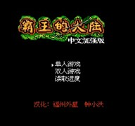 | 霸王的大陆 | 544 | D:\GitCode\famiclone\reference\nes-games\策略模拟\霸王的大陆-mapper544.nes |
|  | 百万富翁 | 227 | D:\GitCode\famiclone\reference\nes-games\策略模拟\百万富翁-mapper227.nes |
|  | 超级大富翁 | 227 | D:\GitCode\famiclone\reference\nes-games\策略模拟\超级大富翁-mapper227.nes |
|  | 超级大战略 | 4 | D:\GitCode\famiclone\reference\nes-games\策略模拟\超级大战略-mapper4.nes |
|  | 超级机器人大战A | 163 | D:\GitCode\famiclone\reference\nes-games\策略模拟\超级机器人大战A-mapper163.nes |
|  | 楚汉风云 | 163 | D:\GitCode\famiclone\reference\nes-games\策略模拟\楚汉风云-mapper163.nes |
|  | 楚汉争霸 | 4 | D:\GitCode\famiclone\reference\nes-games\策略模拟\楚汉争霸-mapper4.nes |
|  | 大航海7 | 178 | D:\GitCode\famiclone\reference\nes-games\策略模拟\大航海7-mapper178.nes |
| 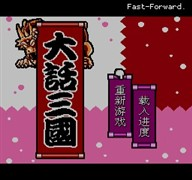 | 大话三国 | 164 | D:\GitCode\famiclone\reference\nes-games\策略模拟\大话三国-mapper164.nes |
| 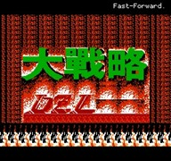 | 大战略 | 4 | D:\GitCode\famiclone\reference\nes-games\策略模拟\大战略-mapper4.nes |
| 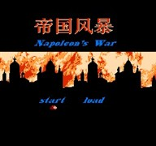 | 帝国风暴 | 4 | D:\GitCode\famiclone\reference\nes-games\策略模拟\帝国风暴-mapper4.nes |
|  | 帝国时代 | 245 | D:\GitCode\famiclone\reference\nes-games\策略模拟\帝国时代-mapper245.nes |
|  | 第2次超级机器人大战 | 74 | D:\GitCode\famiclone\reference\nes-games\策略模拟\第2次超级机器人大战(记忆修正版)[先锋卡通]-mapper74.nes |
| 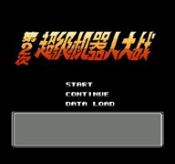 | 第2次超级机器人大战 | 194 | D:\GitCode\famiclone\reference\nes-games\策略模拟\第2次超级机器人大战(修正版)-v1.2[外星科技+心傷誰知]-mapper194.nes |
| 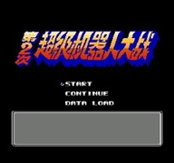 | 第2次超级机器人大战 | 74 | D:\GitCode\famiclone\reference\nes-games\策略模拟\第2次超级机器人大战[恒格电子]-mapper74.nes |
| 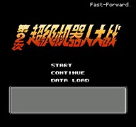 | 第2次超级机器人大战 | 74 | D:\GitCode\famiclone\reference\nes-games\策略模拟\第2次超级机器人大战[晶科泰]-mapper74.nes |
| 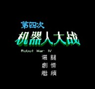 | 第四次机器人大战 | 74 | D:\GitCode\famiclone\reference\nes-games\策略模拟\第四次机器人大战-mapper74.nes |
|  | 东周列国志 | 4 | D:\GitCode\famiclone\reference\nes-games\策略模拟\东周列国志-mapper4.nes |
| 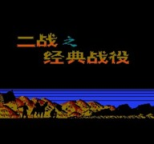 | 二战 经典战役 | 241 | D:\GitCode\famiclone\reference\nes-games\策略模拟\二战 经典战役-mapper241.nes |
| 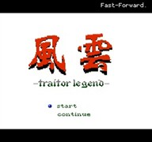 | 风云 | 4 | D:\GitCode\famiclone\reference\nes-games\策略模拟\风云-mapper4.nes |
|  | 富甲三国 | 162 | D:\GitCode\famiclone\reference\nes-games\策略模拟\富甲三国-mapper162.nes |
| 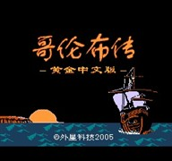 | 哥伦布传 | 74 | D:\GitCode\famiclone\reference\nes-games\策略模拟\哥伦布传-mapper74.nes |
|  | 汉刘邦 | 163 | D:\GitCode\famiclone\reference\nes-games\策略模拟\汉刘邦-mapper163.nes |
|  | 虎门硝烟 | 4 | D:\GitCode\famiclone\reference\nes-games\策略模拟\虎门硝烟-mapper4.nes |
|  | 黄帝 涿鹿之战 | 112 | D:\GitCode\famiclone\reference\nes-games\策略模拟\黄帝 涿鹿之战-mapper112.nes |
|  | 机器人大战 | 163 | D:\GitCode\famiclone\reference\nes-games\策略模拟\机器人大战-mapper163.nes |
|  | 甲A 中国足球俱乐部之经营 | 4 | D:\GitCode\famiclone\reference\nes-games\策略模拟\甲A 中国足球俱乐部之经营-mapper4.nes |
| 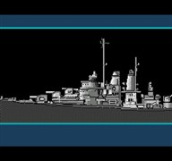 | 决战太平洋 | 227 | D:\GitCode\famiclone\reference\nes-games\策略模拟\决战太平洋-mapper227.nes |
|  | 林则徐禁烟 | 4 | D:\GitCode\famiclone\reference\nes-games\策略模拟\林则徐禁烟-mapper4.nes |
| 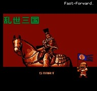 | 乱世三国 | 4 | D:\GitCode\famiclone\reference\nes-games\策略模拟\乱世三国-mapper4.nes |
| 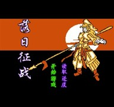 | 落日征战 | 4 | D:\GitCode\famiclone\reference\nes-games\策略模拟\落日征战-mapper4.nes |
|  | 美国富豪 | 177 | D:\GitCode\famiclone\reference\nes-games\策略模拟\美国富豪-mapper177.nes |
| 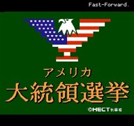 | 美国总统选举 | 4 | D:\GitCode\famiclone\reference\nes-games\策略模拟\美国总统选举-mapper4.nes |
| 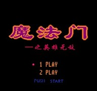 | 魔法门 英雄无敌 | 4 | D:\GitCode\famiclone\reference\nes-games\策略模拟\魔法门 英雄无敌-mapper4.nes |
| 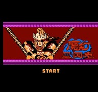 | 魔幻三国志 | 4 | D:\GitCode\famiclone\reference\nes-games\策略模拟\魔幻三国志-mapper4.nes |
|  | 牧场物语 | 163 | D:\GitCode\famiclone\reference\nes-games\策略模拟\牧场物语-mapper163.nes |
|  | 农场小精灵 | 163 | D:\GitCode\famiclone\reference\nes-games\策略模拟\农场小精灵-mapper163.nes |
|  | 欧陆之战 | 4 | D:\GitCode\famiclone\reference\nes-games\策略模拟\欧陆之战-mapper4.nes |
|  | 平成BT帝国战 | 19 | D:\GitCode\famiclone\reference\nes-games\策略模拟\平成BT帝国战-mapper19.nes |
|  | 破釜沉舟 | 176 | D:\GitCode\famiclone\reference\nes-games\策略模拟\破釜沉舟-mapper176.nes |
| 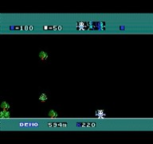 | 菩故须苛战争 | 0 | D:\GitCode\famiclone\reference\nes-games\策略模拟\菩故须苛战争-mapper0.nes |
| 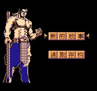 | 七国大战 | 163 | D:\GitCode\famiclone\reference\nes-games\策略模拟\七国大战-mapper163.nes |
|  | 三国春秋 四川省 | 115 | D:\GitCode\famiclone\reference\nes-games\策略模拟\三国春秋 四川省-mapper115.nes |
|  | 三国大乱斗 战国 | 163 | D:\GitCode\famiclone\reference\nes-games\策略模拟\三国大乱斗 战国-mapper163.nes |
|  | 三国群英传 | 4 | D:\GitCode\famiclone\reference\nes-games\策略模拟\三国群英传-mapper4.nes |
|  | 三国桃园记 | 227 | D:\GitCode\famiclone\reference\nes-games\策略模拟\三国桃园记-mapper227.nes |
| 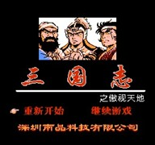 | 三国志 傲视天地 | 163 | D:\GitCode\famiclone\reference\nes-games\策略模拟\三国志 傲视天地-mapper163.nes |
| 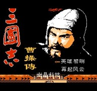 | 三国志 曹操传 | 163 | D:\GitCode\famiclone\reference\nes-games\策略模拟\三国志 曹操传-mapper163.nes |
| 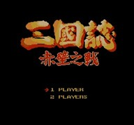 | 三国志 赤壁之战 | 112 | D:\GitCode\famiclone\reference\nes-games\策略模拟\三国志 赤壁之战-mapper112.nes |
| 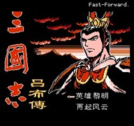 | 三国志 吕布传 | 163 | D:\GitCode\famiclone\reference\nes-games\策略模拟\三国志 吕布传-mapper163.nes |
|  | 三国志 千军破 | 241 | D:\GitCode\famiclone\reference\nes-games\策略模拟\三国志 千军破-mapper241.nes |
| 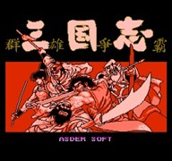 | 三国志 群雄争霸 | 112 | D:\GitCode\famiclone\reference\nes-games\策略模拟\三国志 群雄争霸-mapper112.nes |
| 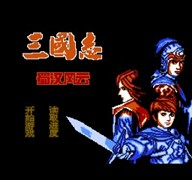 | 三国志 蜀汉风云 | 4 | D:\GitCode\famiclone\reference\nes-games\策略模拟\三国志 蜀汉风云-mapper4.nes |
| 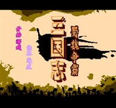 | 三国志 蜀魏争霸 | 4 | D:\GitCode\famiclone\reference\nes-games\策略模拟\三国志 蜀魏争霸-mapper4.nes |
| 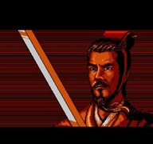 | 三国志 雄霸天下 | 176 | D:\GitCode\famiclone\reference\nes-games\策略模拟\三国志 雄霸天下-mapper176.nes |
| 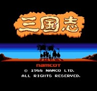 | 三国志 中原之霸者 | 19 | D:\GitCode\famiclone\reference\nes-games\策略模拟\三国志 中原之霸者(大字体)-v2019[谈魈疯生]-mapper19.nes |
| 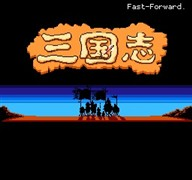 | 三国志 中原之霸者 | 252 | D:\GitCode\famiclone\reference\nes-games\策略模拟\三国志 中原之霸者(修正版)-v2015[外星科技+粉墨登场+浪漫小生]-mapper252.nes |
|  | 三国志 中原之霸者 | 19 | D:\GitCode\famiclone\reference\nes-games\策略模拟\三国志 中原之霸者[Setsuna362]-mapper19.nes |
| 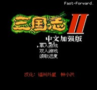 | 三国志2 | 74 | D:\GitCode\famiclone\reference\nes-games\策略模拟\三国志2(中文加强版)[外星游戏大厅]-mapper74.nes |
|  | 三国志2 | 241 | D:\GitCode\famiclone\reference\nes-games\策略模拟\三国志2[恒格电子]-mapper241.nes |
| 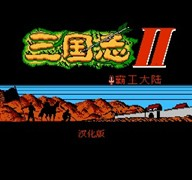 | 三国志2 霸王大陆 | 19 | D:\GitCode\famiclone\reference\nes-games\策略模拟\三国志2 霸王大陆-mapper19.nes |
|  | 三国志2 霸王的大陆 | 19 | D:\GitCode\famiclone\reference\nes-games\策略模拟\三国志2 霸王的大陆(大字体,纯净版,全动画非全头像)-v0.96[kagnhweu+数字兄+渣渣皮]-mapper19.nes |
| 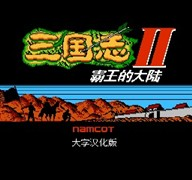 | 三国志2 霸王的大陆 | 5 | D:\GitCode\famiclone\reference\nes-games\策略模拟\三国志2 霸王的大陆(大字体,纯净版,全动画全头像)-v0.96[kagnhweu+数字兄+渣渣皮]-mapper5.nes |
|  | 三国志2 霸王的大陆 | 19 | D:\GitCode\famiclone\reference\nes-games\策略模拟\三国志2 霸王的大陆(大字体,纯净版,全头像非全动画)-v0.96[kagnhweu+数字兄+渣渣皮]-mapper19.nes |
|  | 三国志2 霸王的大陆 | 19 | D:\GitCode\famiclone\reference\nes-games\策略模拟\三国志2 霸王的大陆(大字体,修正优化版,全动画非全头像)-v0.96[kagnhweu+数字兄+渣渣皮]-mapper19.nes |
|  | 三国志2 霸王的大陆 | 5 | D:\GitCode\famiclone\reference\nes-games\策略模拟\三国志2 霸王的大陆(大字体,修正优化版,全动画全头像)-v0.96[kagnhweu+数字兄+渣渣皮]-mapper5.nes |
| 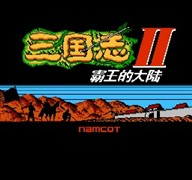 | 三国志2 霸王的大陆 | 19 | D:\GitCode\famiclone\reference\nes-games\策略模拟\三国志2 霸王的大陆(大字体,修正优化版,全头像非全动画,4人)-v0.96[kagnhweu+数字兄+渣渣皮]-mapper19.nes |
| 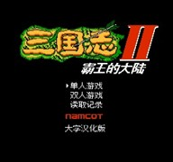 | 三国志2 霸王的大陆 | 19 | D:\GitCode\famiclone\reference\nes-games\策略模拟\三国志2 霸王的大陆(大字体,修正优化版,全头像非全动画)-v0.96[kagnhweu+数字兄+渣渣皮]-mapper19.nes |
|  | 三国志2 霸王的大陆 | 19 | D:\GitCode\famiclone\reference\nes-games\策略模拟\三国志2 霸王的大陆(楷体)-v0.9976[kagnhweu+渣渣皮+数字兄]-mapper19.nes |
|  | 三国志2 霸王的大陆 | 5 | D:\GitCode\famiclone\reference\nes-games\策略模拟\三国志2 霸王的大陆(隶书)-v0.96[kagnhweu+渣渣皮+数字兄]-mapper5.nes |
|  | 三国志2 霸王的大陆 | 5 | D:\GitCode\famiclone\reference\nes-games\策略模拟\三国志2 霸王的大陆(宋体)-v0.96[kagnhweu+渣渣皮+数字兄]-mapper5.nes |
| 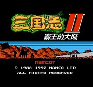 | 三国志2 霸王的大陆 | 19 | D:\GitCode\famiclone\reference\nes-games\策略模拟\三国志2 霸王的大陆(小字体,纯净版,全动画非全头像)-v3.1[南方文苑+qxqy19+粉墨登场+幽科南+渣渣皮]-mapper19.nes |
|  | 三国志2 霸王的大陆 | 19 | D:\GitCode\famiclone\reference\nes-games\策略模拟\三国志2 霸王的大陆(小字体,纯净版,全动画全头像)-v3.1[南方文苑+qxqy19+粉墨登场+幽科南+渣渣皮]-mapper19.nes |
|  | 三国志2 霸王的大陆 | 19 | D:\GitCode\famiclone\reference\nes-games\策略模拟\三国志2 霸王的大陆(小字体,纯净版,全头像非全动画)-v3.1[南方文苑+qxqy19+粉墨登场+幽科南+渣渣皮]-mapper19.nes |
| 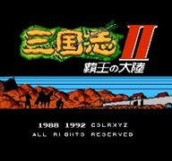 | 三国志2 霸王的大陆 | 19 | D:\GitCode\famiclone\reference\nes-games\策略模拟\三国志2 霸王的大陆[CSLRZYZ]-mapper19.nes |
|  | 三国志2 霸王的大陆 | 5 | D:\GitCode\famiclone\reference\nes-games\策略模拟\三国志2 霸王的大陆[PPPOE]-mapper5.nes |
| 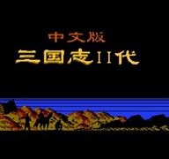 | 三国志2代 | 164 | D:\GitCode\famiclone\reference\nes-games\策略模拟\三国志2代-mapper164.nes |
| 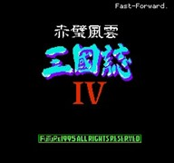 | 三国志4 赤壁风云 | 117 | D:\GitCode\famiclone\reference\nes-games\策略模拟\三国志4 赤壁风云-mapper117.nes |
|  | 三国志英杰传 | 4 | D:\GitCode\famiclone\reference\nes-games\策略模拟\三国志英杰传[外星科技](繁)-mapper4.nes |
|  | 三国志英杰传 | 4 | D:\GitCode\famiclone\reference\nes-games\策略模拟\三国志英杰传[外星科技](简)-mapper4.nes |
| 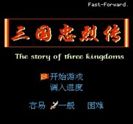 | 三国忠烈传 | 178 | D:\GitCode\famiclone\reference\nes-games\策略模拟\三国忠烈传-mapper178.nes |
|  | 三十六计 | 249 | D:\GitCode\famiclone\reference\nes-games\策略模拟\三十六计-mapper249.nes |
| 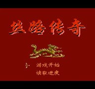 | 丝路传奇 | 241 | D:\GitCode\famiclone\reference\nes-games\策略模拟\丝路传奇-mapper241.nes |
| 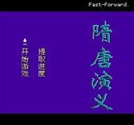 | 隋唐演义 | 4 | D:\GitCode\famiclone\reference\nes-games\策略模拟\隋唐演义-mapper4.nes |
| 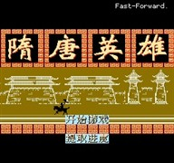 | 隋唐英雄 | 163 | D:\GitCode\famiclone\reference\nes-games\策略模拟\隋唐英雄-mapper163.nes |
|  | 王之霸者 | 4 | D:\GitCode\famiclone\reference\nes-games\策略模拟\王之霸者-mapper4.nes |
|  | 无间道风云 | 241 | D:\GitCode\famiclone\reference\nes-games\策略模拟\无间道风云-mapper241.nes |
| 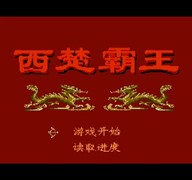 | 西楚霸王 | 176 | D:\GitCode\famiclone\reference\nes-games\策略模拟\西楚霸王-mapper176.nes |
|  | 星际争霸 | 178 | D:\GitCode\famiclone\reference\nes-games\策略模拟\星际争霸-mapper178.nes |
| 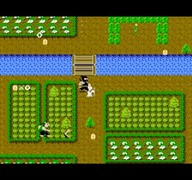 | 一揆 | 0 | D:\GitCode\famiclone\reference\nes-games\策略模拟\一揆-mapper0.nes |
|  | 英雄无敌 | 4 | D:\GitCode\famiclone\reference\nes-games\策略模拟\英雄无敌[未知]-mapper4.nes |
|  | 英雄无敌 | 4 | D:\GitCode\famiclone\reference\nes-games\策略模拟\英雄无敌[振华]-mapper4.nes |
| 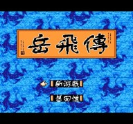 | 岳飞传 | 15 | D:\GitCode\famiclone\reference\nes-games\策略模拟\岳飞传-mapper15.nes |
| 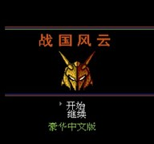 | 战国风云 | 4 | D:\GitCode\famiclone\reference\nes-games\策略模拟\战国风云[外星科技]-mapper4.nes |
| 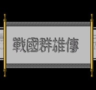 | 战国群雄传 | 4 | D:\GitCode\famiclone\reference\nes-games\策略模拟\战国群雄传-mapper4.nes |
| 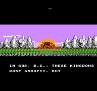 | 战国四川省 | 132 | D:\GitCode\famiclone\reference\nes-games\策略模拟\战国四川省-mapper132.nes |
| 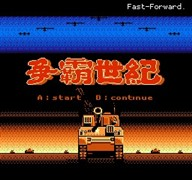 | 争霸世纪 | 4 | D:\GitCode\famiclone\reference\nes-games\策略模拟\争霸世纪-mapper4.nes |
|  | 征服太阳系+小管家 | 241 | D:\GitCode\famiclone\reference\nes-games\策略模拟\征服太阳系+小管家-mapper241.nes |
|  | 征战天下 | 4 | D:\GitCode\famiclone\reference\nes-games\策略模拟\征战天下-mapper4.nes |
| 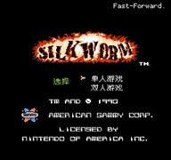 | 中东战争 | 4 | D:\GitCode\famiclone\reference\nes-games\策略模拟\中东战争-v1.1[汉化你妹]-mapper4.nes |
|  | 中东战争 | 1 | D:\GitCode\famiclone\reference\nes-games\策略模拟\中东战争-v1.1[星空]-mapper1.nes |
|  | 中东战争 | 1 | D:\GitCode\famiclone\reference\nes-games\策略模拟\中东战争[高伟]-mapper1.nes |
