# 格斗（50 个）

返回 [总览](README.md)

| 缩略图 | 游戏 | 映⁠射⁠号 | 文件路径 |
|---|---|---|---|
| 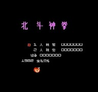 | 北斗神拳 | 3 | D:\GitCode\famiclone\reference\nes-games\格斗\北斗神拳.nes |
|  | 方世玉 | 163 | D:\GitCode\famiclone\reference\nes-games\格斗\方世玉.nes |
| 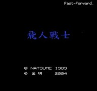 | 飞人战士 | 1 | D:\GitCode\famiclone\reference\nes-games\格斗\飞人战士[金明].nes |
| 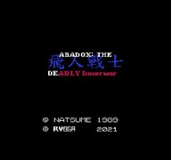 | 飞人战士 | 1 | D:\GitCode\famiclone\reference\nes-games\格斗\飞人战士[金明+HK].nes |
| 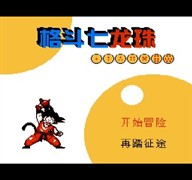 | 格斗七龙珠 | 241 | D:\GitCode\famiclone\reference\nes-games\格斗\格斗七龙珠.nes |
| 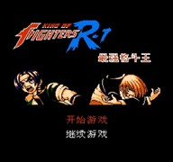 | 格斗之王R1 最强格斗王 | 163 | D:\GitCode\famiclone\reference\nes-games\格斗\格斗之王R1 最强格斗王.nes |
| 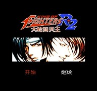 | 格斗之王R2 大蛇四天王 | 241 | D:\GitCode\famiclone\reference\nes-games\格斗\格斗之王R2 大蛇四天王.nes |
| 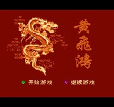 | 黄飞鸿 | 241 | D:\GitCode\famiclone\reference\nes-games\格斗\黄飞鸿.nes |
|  | 霍元甲 | 241 | D:\GitCode\famiclone\reference\nes-games\格斗\霍元甲.nes |
|  | 激斗圣战士 | 176 | D:\GitCode\famiclone\reference\nes-games\格斗\激斗圣战士(修正版)[外星科技+Vanyogin].nes |
|  | 激斗圣战士 | 74 | D:\GitCode\famiclone\reference\nes-games\格斗\激斗圣战士[外星科技].nes |
|  | 激龟格斗 | 4 | D:\GitCode\famiclone\reference\nes-games\格斗\激龟格斗.nes |
|  | 街霸3 | 91 | D:\GitCode\famiclone\reference\nes-games\格斗\街霸3.nes |
| 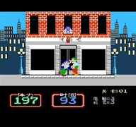 | 街头格斗小子 | 0 | D:\GitCode\famiclone\reference\nes-games\格斗\街头格斗小子.nes |
| 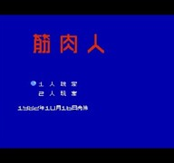 | 筋肉人 | 0 | D:\GitCode\famiclone\reference\nes-games\格斗\筋肉人[高伟].nes |
| 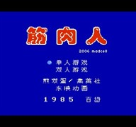 | 筋肉人 | 0 | D:\GitCode\famiclone\reference\nes-games\格斗\筋肉人[Madcell].nes |
|  | 筋肉人 摔角大赛 | 0 | D:\GitCode\famiclone\reference\nes-games\格斗\筋肉人 摔角大赛.nes |
| 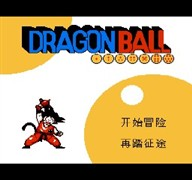 | 龙珠 | 163 | D:\GitCode\famiclone\reference\nes-games\格斗\龙珠.nes |
|  | 龙珠Z 超武斗传2 | 91 | D:\GitCode\famiclone\reference\nes-games\格斗\龙珠Z 超武斗传2.nes |
| 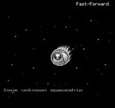 | 龙珠Z 超武斗传5 | 12 | D:\GitCode\famiclone\reference\nes-games\格斗\龙珠Z 超武斗传5.nes |
| 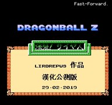 | 龙珠Z 强袭！撒亚人 | 253 | D:\GitCode\famiclone\reference\nes-games\格斗\龙珠Z 强袭！撒亚人.nes |
|  | 龙珠Z 强袭！赛亚人 | 253 | D:\GitCode\famiclone\reference\nes-games\格斗\龙珠Z 强袭！赛亚人.nes |
|  | 龙珠Z2 电光石火!! | 74 | D:\GitCode\famiclone\reference\nes-games\格斗\龙珠Z2 电光石火!!.nes |
|  | 龙珠Z2 激战弗利萨!! | 74 | D:\GitCode\famiclone\reference\nes-games\格斗\龙珠Z2 激战弗利萨!!(无片头)[外星科技].nes |
|  | 龙珠Z2 激战弗利萨!!之孙悟饭 | 74 | D:\GitCode\famiclone\reference\nes-games\格斗\龙珠Z2 激战弗利萨!!之孙悟饭.nes |
|  | 龙珠Z3 人造人列传 | 74 | D:\GitCode\famiclone\reference\nes-games\格斗\龙珠Z3 人造人列传.nes |
|  | 猫党忍传 胡扯什么 | 195 | D:\GitCode\famiclone\reference\nes-games\格斗\猫党忍传 胡扯什么.nes |
|  | 美女拳 | 150 | D:\GitCode\famiclone\reference\nes-games\格斗\美女拳.nes |
| 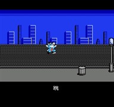 | 纽约大拳猫 | 4 | D:\GitCode\famiclone\reference\nes-games\格斗\纽约大拳猫-v1[逆游の五彩魚].nes |
|  | 纽约大拳猫 | 4 | D:\GitCode\famiclone\reference\nes-games\格斗\纽约大拳猫[高伟].nes |
| 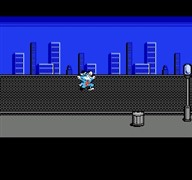 | 纽约大拳猫 | 4 | D:\GitCode\famiclone\reference\nes-games\格斗\纽约大拳猫[MS].nes |
|  | 七龙珠 | 253 | D:\GitCode\famiclone\reference\nes-games\格斗\七龙珠[外星科技].nes |
|  | 七龙珠 | 253 | D:\GitCode\famiclone\reference\nes-games\格斗\七龙珠[小铭电脑].nes |
|  | 拳霸4 | 4 | D:\GitCode\famiclone\reference\nes-games\格斗\拳霸4.nes |
| 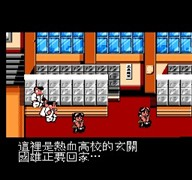 | 热血格斗传说 | 74 | D:\GitCode\famiclone\reference\nes-games\格斗\热血格斗传说-v20130718[8-bit Zone+热血的鱼缸](繁).nes |
|  | 热血格斗传说 | 74 | D:\GitCode\famiclone\reference\nes-games\格斗\热血格斗传说-v20130718[8-bit Zone+热血的鱼缸](简).nes |
|  | 热血格斗传说 | 74 | D:\GitCode\famiclone\reference\nes-games\格斗\热血格斗传说(实机修正)-v20220403[热血的鱼缸+asiwish+拒绝融化].nes |
| 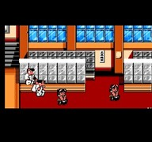 | 热血格斗传说 | 4 | D:\GitCode\famiclone\reference\nes-games\格斗\热血格斗传说[Old Liu].nes |
| 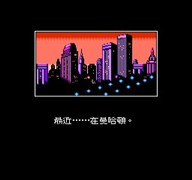 | 忍者龟 激烈格斗 | 4 | D:\GitCode\famiclone\reference\nes-games\格斗\忍者龟 激烈格斗.nes |
|  | 忍者神龟 激烈格斗 | 4 | D:\GitCode\famiclone\reference\nes-games\格斗\忍者神龟 激烈格斗.nes |
| 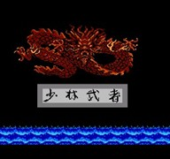 | 少林武者 | 147 | D:\GitCode\famiclone\reference\nes-games\格斗\少林武者.nes |
| 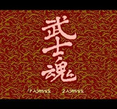 | 武士魂 | 4 | D:\GitCode\famiclone\reference\nes-games\格斗\武士魂[天空联盟].nes |
|  | 武士魂 | 4 | D:\GitCode\famiclone\reference\nes-games\格斗\武士魂[Rex].nes |
|  | 悟空斗剧 | 253 | D:\GitCode\famiclone\reference\nes-games\格斗\悟空斗剧.nes |
| 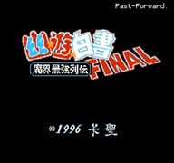 | 幽游白书 魔界最强列传 | 115 | D:\GitCode\famiclone\reference\nes-games\格斗\幽游白书 魔界最强列传.nes |
|  | 幽游白书5 | 121 | D:\GitCode\famiclone\reference\nes-games\格斗\幽游白书5.nes |
| 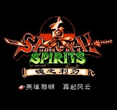 | 真侍魂 魂之利刃 | 163 | D:\GitCode\famiclone\reference\nes-games\格斗\真侍魂 魂之利刃.nes |
|  | 真侍魂 武士道列传 | 163 | D:\GitCode\famiclone\reference\nes-games\格斗\真侍魂 武士道列传.nes |
|  | YieAr功夫 | 0 | D:\GitCode\famiclone\reference\nes-games\格斗\YieAr功夫-v1.0[九班].nes |
|  | YieAr功夫 | 0 | D:\GitCode\famiclone\reference\nes-games\格斗\YieAr功夫[高伟].nes |
