# 格斗（50 个）

返回 [总览](README.md)

| 缩略图 | 游戏 | 映⁠射⁠号 | 文件路径 |
|---|---|---|---|
|  | 北斗神拳 | 3 | D:\GitCode\famiclone\reference\nes-games\格斗\北斗神拳-mapper3.nes |
|  | 方世玉 | 163 | D:\GitCode\famiclone\reference\nes-games\格斗\方世玉-mapper163.nes |
|  | 飞人战士 | 1 | D:\GitCode\famiclone\reference\nes-games\格斗\飞人战士[金明]-mapper1.nes |
|  | 飞人战士 | 1 | D:\GitCode\famiclone\reference\nes-games\格斗\飞人战士[金明+HK]-mapper1.nes |
|  | 格斗七龙珠 | 241 | D:\GitCode\famiclone\reference\nes-games\格斗\格斗七龙珠-mapper241.nes |
|  | 格斗之王R1 最强格斗王 | 163 | D:\GitCode\famiclone\reference\nes-games\格斗\格斗之王R1 最强格斗王-mapper163.nes |
|  | 格斗之王R2 大蛇四天王 | 241 | D:\GitCode\famiclone\reference\nes-games\格斗\格斗之王R2 大蛇四天王-mapper241.nes |
|  | 黄飞鸿 | 241 | D:\GitCode\famiclone\reference\nes-games\格斗\黄飞鸿-mapper241.nes |
|  | 霍元甲 | 241 | D:\GitCode\famiclone\reference\nes-games\格斗\霍元甲-mapper241.nes |
|  | 激斗圣战士 | 176 | D:\GitCode\famiclone\reference\nes-games\格斗\激斗圣战士(修正版)[外星科技+Vanyogin]-mapper176.nes |
| 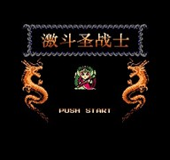 | 激斗圣战士 | 74 | D:\GitCode\famiclone\reference\nes-games\格斗\激斗圣战士[外星科技]-mapper74.nes |
| 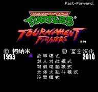 | 激龟格斗 | 4 | D:\GitCode\famiclone\reference\nes-games\格斗\激龟格斗-mapper4.nes |
| 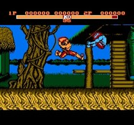 | 街霸3 | 91 | D:\GitCode\famiclone\reference\nes-games\格斗\街霸3-mapper91.nes |
|  | 街头格斗小子 | 0 | D:\GitCode\famiclone\reference\nes-games\格斗\街头格斗小子-mapper0.nes |
|  | 筋肉人 | 0 | D:\GitCode\famiclone\reference\nes-games\格斗\筋肉人[高伟]-mapper0.nes |
|  | 筋肉人 | 0 | D:\GitCode\famiclone\reference\nes-games\格斗\筋肉人[Madcell]-mapper0.nes |
| 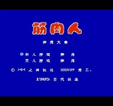 | 筋肉人 摔角大赛 | 0 | D:\GitCode\famiclone\reference\nes-games\格斗\筋肉人 摔角大赛-mapper0.nes |
|  | 龙珠 | 163 | D:\GitCode\famiclone\reference\nes-games\格斗\龙珠-mapper163.nes |
| 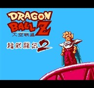 | 龙珠Z 超武斗传2 | 91 | D:\GitCode\famiclone\reference\nes-games\格斗\龙珠Z 超武斗传2-mapper91.nes |
|  | 龙珠Z 超武斗传5 | 12 | D:\GitCode\famiclone\reference\nes-games\格斗\龙珠Z 超武斗传5-mapper12.nes |
|  | 龙珠Z 强袭！撒亚人 | 253 | D:\GitCode\famiclone\reference\nes-games\格斗\龙珠Z 强袭！撒亚人-mapper253.nes |
|  | 龙珠Z 强袭！赛亚人 | 253 | D:\GitCode\famiclone\reference\nes-games\格斗\龙珠Z 强袭！赛亚人-mapper253.nes |
|  | 龙珠Z2 电光石火!! | 74 | D:\GitCode\famiclone\reference\nes-games\格斗\龙珠Z2 电光石火!!-mapper74.nes |
| 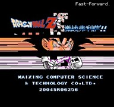 | 龙珠Z2 激战弗利萨!! | 74 | D:\GitCode\famiclone\reference\nes-games\格斗\龙珠Z2 激战弗利萨!!(无片头)[外星科技]-mapper74.nes |
|  | 龙珠Z2 激战弗利萨!!之孙悟饭 | 74 | D:\GitCode\famiclone\reference\nes-games\格斗\龙珠Z2 激战弗利萨!!之孙悟饭-mapper74.nes |
| 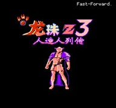 | 龙珠Z3 人造人列传 | 74 | D:\GitCode\famiclone\reference\nes-games\格斗\龙珠Z3 人造人列传-mapper74.nes |
| 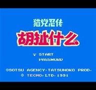 | 猫党忍传 胡扯什么 | 195 | D:\GitCode\famiclone\reference\nes-games\格斗\猫党忍传 胡扯什么-mapper195.nes |
| 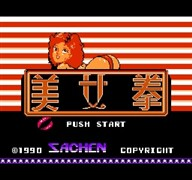 | 美女拳 | 150 | D:\GitCode\famiclone\reference\nes-games\格斗\美女拳-mapper150.nes |
|  | 纽约大拳猫 | 4 | D:\GitCode\famiclone\reference\nes-games\格斗\纽约大拳猫-v1[逆游の五彩魚]-mapper4.nes |
| 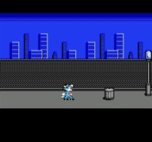 | 纽约大拳猫 | 4 | D:\GitCode\famiclone\reference\nes-games\格斗\纽约大拳猫[高伟]-mapper4.nes |
|  | 纽约大拳猫 | 4 | D:\GitCode\famiclone\reference\nes-games\格斗\纽约大拳猫[MS]-mapper4.nes |
|  | 七龙珠 | 253 | D:\GitCode\famiclone\reference\nes-games\格斗\七龙珠[外星科技]-mapper253.nes |
|  | 七龙珠 | 253 | D:\GitCode\famiclone\reference\nes-games\格斗\七龙珠[小铭电脑]-mapper253.nes |
|  | 拳霸4 | 4 | D:\GitCode\famiclone\reference\nes-games\格斗\拳霸4-mapper4.nes |
|  | 热血格斗传说 | 74 | D:\GitCode\famiclone\reference\nes-games\格斗\热血格斗传说-v20130718[8-bit Zone+热血的鱼缸](繁)-mapper74.nes |
| 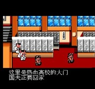 | 热血格斗传说 | 74 | D:\GitCode\famiclone\reference\nes-games\格斗\热血格斗传说-v20130718[8-bit Zone+热血的鱼缸](简)-mapper74.nes |
|  | 热血格斗传说 | 74 | D:\GitCode\famiclone\reference\nes-games\格斗\热血格斗传说(实机修正)-v20220403[热血的鱼缸+asiwish+拒绝融化]-mapper74.nes |
|  | 热血格斗传说 | 4 | D:\GitCode\famiclone\reference\nes-games\格斗\热血格斗传说[Old Liu]-mapper4.nes |
|  | 忍者龟 激烈格斗 | 4 | D:\GitCode\famiclone\reference\nes-games\格斗\忍者龟 激烈格斗-mapper4.nes |
| 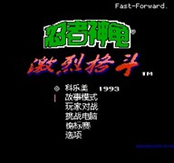 | 忍者神龟 激烈格斗 | 4 | D:\GitCode\famiclone\reference\nes-games\格斗\忍者神龟 激烈格斗-mapper4.nes |
|  | 少林武者 | 147 | D:\GitCode\famiclone\reference\nes-games\格斗\少林武者-mapper147.nes |
|  | 武士魂 | 4 | D:\GitCode\famiclone\reference\nes-games\格斗\武士魂[天空联盟]-mapper4.nes |
|  | 武士魂 | 4 | D:\GitCode\famiclone\reference\nes-games\格斗\武士魂[Rex]-mapper4.nes |
| 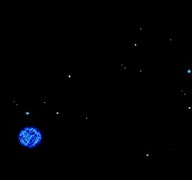 | 悟空斗剧 | 253 | D:\GitCode\famiclone\reference\nes-games\格斗\悟空斗剧-mapper253.nes |
|  | 幽游白书 魔界最强列传 | 115 | D:\GitCode\famiclone\reference\nes-games\格斗\幽游白书 魔界最强列传-mapper115.nes |
| 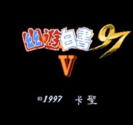 | 幽游白书5 | 121 | D:\GitCode\famiclone\reference\nes-games\格斗\幽游白书5-mapper121.nes |
|  | 真侍魂 魂之利刃 | 163 | D:\GitCode\famiclone\reference\nes-games\格斗\真侍魂 魂之利刃-mapper163.nes |
|  | 真侍魂 武士道列传 | 163 | D:\GitCode\famiclone\reference\nes-games\格斗\真侍魂 武士道列传-mapper163.nes |
| 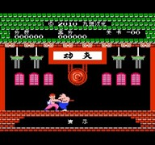 | YieAr功夫 | 0 | D:\GitCode\famiclone\reference\nes-games\格斗\YieAr功夫-v1.0[九班]-mapper0.nes |
| 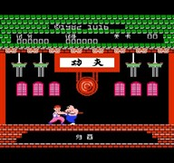 | YieAr功夫 | 0 | D:\GitCode\famiclone\reference\nes-games\格斗\YieAr功夫[高伟]-mapper0.nes |
