# 益智（87 个）

返回 [总览](README.md)

| 缩略图 | 游戏 | 映⁠射⁠号 | 文件路径 |
|---|---|---|---|
| 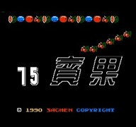 | 75宾果 | 79 | D:\GitCode\famiclone\reference\nes-games\益智\75宾果-mapper79.nes |
| 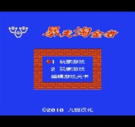 | 暴走淘金者 | 0 | D:\GitCode\famiclone\reference\nes-games\益智\暴走淘金者-mapper0.nes |
|  | 暴走淘金者2 | 0 | D:\GitCode\famiclone\reference\nes-games\益智\暴走淘金者2-mapper0.nes |
| 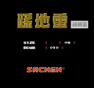 | 踩地雷 编辑篇 | 0 | D:\GitCode\famiclone\reference\nes-games\益智\踩地雷 编辑篇-mapper0.nes |
| 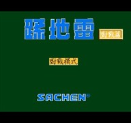 | 踩地雷 对战篇 | 0 | D:\GitCode\famiclone\reference\nes-games\益智\踩地雷 对战篇-mapper0.nes |
| 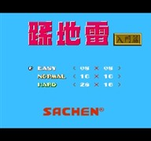 | 踩地雷 入门篇 | 0 | D:\GitCode\famiclone\reference\nes-games\益智\踩地雷 入门篇-mapper0.nes |
| 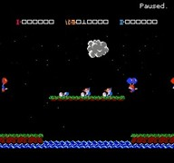 | 踩气球 | 0 | D:\GitCode\famiclone\reference\nes-games\益智\踩气球[虫儿]-mapper0.nes |
| 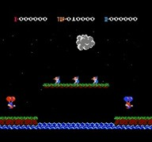 | 踩气球 | 0 | D:\GitCode\famiclone\reference\nes-games\益智\踩气球[卡通]-mapper0.nes |
| 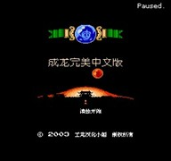 | 吃豆 | 3 | D:\GitCode\famiclone\reference\nes-games\益智\吃豆-mapper3.nes |
| 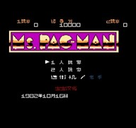 | 吃豆人小姐 | 0 | D:\GitCode\famiclone\reference\nes-games\益智\吃豆人小姐-mapper0.nes |
| 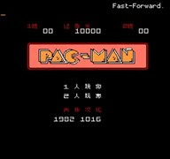 | 吃豆小精灵 | 0 | D:\GitCode\famiclone\reference\nes-games\益智\吃豆小精灵[高伟]-mapper0.nes |
| 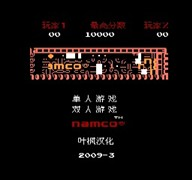 | 吃豆小精灵 | 18 | D:\GitCode\famiclone\reference\nes-games\益智\吃豆小精灵[叶枫]-mapper18.nes |
| 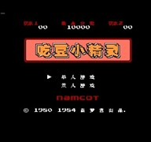 | 吃豆小精灵 | 0 | D:\GitCode\famiclone\reference\nes-games\益智\吃豆小精灵[MS]-mapper0.nes |
| 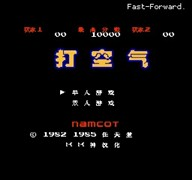 | 打空气 | 0 | D:\GitCode\famiclone\reference\nes-games\益智\打空气-v3[MM之神]-mapper0.nes |
| 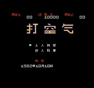 | 打空气 | 0 | D:\GitCode\famiclone\reference\nes-games\益智\打空气[高伟]-mapper0.nes |
| 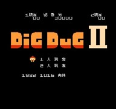 | 打空气2 | 0 | D:\GitCode\famiclone\reference\nes-games\益智\打空气2-mapper0.nes |
| 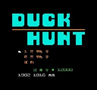 | 打鸭子 | 0 | D:\GitCode\famiclone\reference\nes-games\益智\打鸭子-mapper0.nes |
| 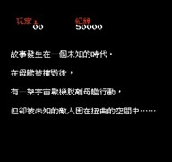 | 打砖块 | 140 | D:\GitCode\famiclone\reference\nes-games\益智\打砖块-v20100513[NOKOH]-mapper140.nes |
| 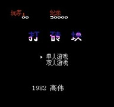 | 打砖块 | 140 | D:\GitCode\famiclone\reference\nes-games\益智\打砖块(大字体)[高伟]-mapper140.nes |
| 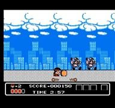 | 大力工头阿源君 | 4 | D:\GitCode\famiclone\reference\nes-games\益智\大力工头阿源君-mapper4.nes |
|  | 大力工头阿源君2 赤毛弹的逆袭 | 65 | D:\GitCode\famiclone\reference\nes-games\益智\大力工头阿源君2 赤毛弹的逆袭(H3001)-v1.0[DMG+Advance]-mapper65.nes |
| 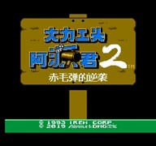 | 大力工头阿源君2 赤毛弹的逆袭 | 5 | D:\GitCode\famiclone\reference\nes-games\益智\大力工头阿源君2 赤毛弹的逆袭(MMC5)-v1.0[DMG+Advance]-mapper5.nes |
| 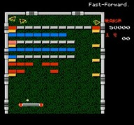 | 弹射球 | 0 | D:\GitCode\famiclone\reference\nes-games\益智\弹射球-mapper0.nes |
| 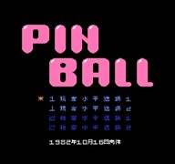 | 弹珠台 | 0 | D:\GitCode\famiclone\reference\nes-games\益智\弹珠台[高伟]-mapper0.nes |
| 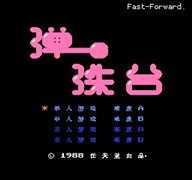 | 弹珠台 | 0 | D:\GitCode\famiclone\reference\nes-games\益智\弹珠台[MS]-mapper0.nes |
| 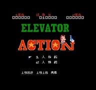 | 电梯迷宫 | 0 | D:\GitCode\famiclone\reference\nes-games\益智\电梯迷宫-mapper0.nes |
| 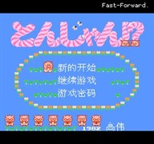 | 掉落解谜 小猪猪！ | 1 | D:\GitCode\famiclone\reference\nes-games\益智\掉落解谜 小猪猪！-mapper1.nes |
| 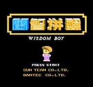 | 斗智拼盘 | 3 | D:\GitCode\famiclone\reference\nes-games\益智\斗智拼盘-mapper3.nes |
| 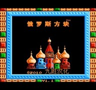 | 俄罗斯方块 | 3 | D:\GitCode\famiclone\reference\nes-games\益智\俄罗斯方块-v1.1[九班]-mapper3.nes |
| 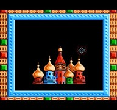 | 俄罗斯方块 | 3 | D:\GitCode\famiclone\reference\nes-games\益智\俄罗斯方块(修正版)[8GUA+MS]-mapper3.nes |
| 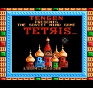 | 俄罗斯方块 | 3 | D:\GitCode\famiclone\reference\nes-games\益智\俄罗斯方块[虫虫]-mapper3.nes |
| 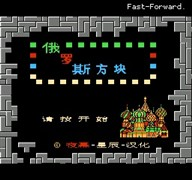 | 俄罗斯方块 | 1 | D:\GitCode\famiclone\reference\nes-games\益智\俄罗斯方块[夜幕星辰]-mapper1.nes |
| 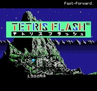 | 俄罗斯方块2 | 4 | D:\GitCode\famiclone\reference\nes-games\益智\俄罗斯方块2-mapper4.nes |
| 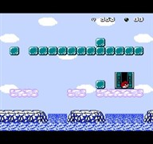 | 愤怒的小鸟 | 3 | D:\GitCode\famiclone\reference\nes-games\益智\愤怒的小鸟[九班]-mapper3.nes |
|  | 愤怒的小鸟 | 4 | D:\GitCode\famiclone\reference\nes-games\益智\愤怒的小鸟[快乐的龙]-mapper4.nes |
| 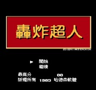 | 轰炸超人 | 3 | D:\GitCode\famiclone\reference\nes-games\益智\轰炸超人-mapper3.nes |
| 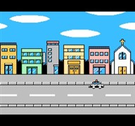 | 轰炸超人2 | 1 | D:\GitCode\famiclone\reference\nes-games\益智\轰炸超人2-mapper1.nes |
| 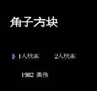 | 角子方块 | 1 | D:\GitCode\famiclone\reference\nes-games\益智\角子方块-mapper1.nes |
| 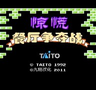 | 惊慌餐厅争夺战 | 4 | D:\GitCode\famiclone\reference\nes-games\益智\惊慌餐厅争夺战-mapper4.nes |
| 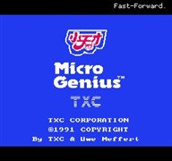 | 六角方块 | 132 | D:\GitCode\famiclone\reference\nes-games\益智\六角方块-mapper132.nes |
| 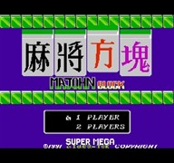 | 麻将方块 | 173 | D:\GitCode\famiclone\reference\nes-games\益智\麻将方块-mapper173.nes |
| 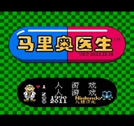 | 马里奥医生 | 1 | D:\GitCode\famiclone\reference\nes-games\益智\马里奥医生-mapper1.nes |
| 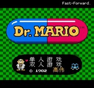 | 玛丽医生 | 1 | D:\GitCode\famiclone\reference\nes-games\益智\玛丽医生-mapper1.nes |
| 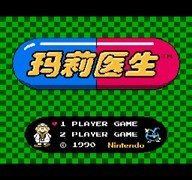 | 玛莉医生 | 1 | D:\GitCode\famiclone\reference\nes-games\益智\玛莉医生-mapper1.nes |
|  | 梦幻沙漏 | 163 | D:\GitCode\famiclone\reference\nes-games\益智\梦幻沙漏-mapper163.nes |
| 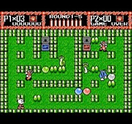 | 迷宫封印 | 141 | D:\GitCode\famiclone\reference\nes-games\益智\迷宫封印-mapper141.nes |
| 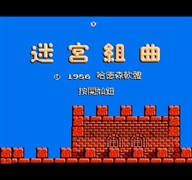 | 迷宫组曲 | 140 | D:\GitCode\famiclone\reference\nes-games\益智\迷宫组曲-v20241202[NOKOH]-mapper140.nes |
| 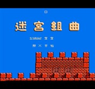 | 迷宫组曲 | 3 | D:\GitCode\famiclone\reference\nes-games\益智\迷宫组曲[虫虫]-mapper3.nes |
| 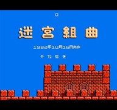 | 迷宫组曲 | 3 | D:\GitCode\famiclone\reference\nes-games\益智\迷宫组曲[高伟]-mapper3.nes |
| 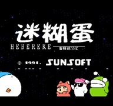 | 迷糊蛋 | 69 | D:\GitCode\famiclone\reference\nes-games\益智\迷糊蛋-v1.2[雷精灵+砂糖]-mapper69.nes |
| 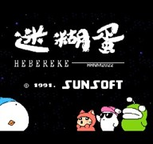 | 迷糊蛋 | 69 | D:\GitCode\famiclone\reference\nes-games\益智\迷糊蛋[汉化你妹]-mapper69.nes |
| 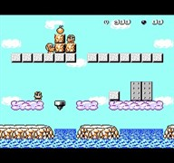 | 摩艾君 | 3 | D:\GitCode\famiclone\reference\nes-games\益智\摩艾君[虫儿]-mapper3.nes |
| 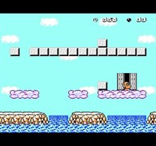 | 摩艾君 | 3 | D:\GitCode\famiclone\reference\nes-games\益智\摩艾君[九班]-mapper3.nes |
| 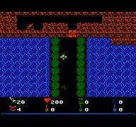 | 魔塔 | 4 | D:\GitCode\famiclone\reference\nes-games\益智\魔塔-mapper4.nes |
|  | 泡泡龙 | 1 | D:\GitCode\famiclone\reference\nes-games\益智\泡泡龙-mapper1.nes |
|  | 泡泡龙2 | 48 | D:\GitCode\famiclone\reference\nes-games\益智\泡泡龙2-v20110207[NOKOH]-mapper48.nes |
|  | 泡泡龙2 | 4 | D:\GitCode\famiclone\reference\nes-games\益智\泡泡龙2[MM之神]-mapper4.nes |
|  | 气球大战 | 0 | D:\GitCode\famiclone\reference\nes-games\益智\气球大战-v1.0[MS]-mapper0.nes |
|  | 气球大战 | 0 | D:\GitCode\famiclone\reference\nes-games\益智\气球大战[快乐的龙]-mapper0.nes |
|  | 敲冰块 | 0 | D:\GitCode\famiclone\reference\nes-games\益智\敲冰块-v1.0[MM之神]-mapper0.nes |
|  | 敲冰块 | 3 | D:\GitCode\famiclone\reference\nes-games\益智\敲冰块-v20120102[NOKOH]-mapper3.nes |
|  | 敲冰块 | 3 | D:\GitCode\famiclone\reference\nes-games\益智\敲冰块[水火]-mapper3.nes |
|  | 敲冰块 | 0 | D:\GitCode\famiclone\reference\nes-games\益智\敲冰块[F0REVERD]-mapper0.nes |
|  | 敲冰块 | 3 | D:\GitCode\famiclone\reference\nes-games\益智\敲冰块[NOKOH]-mapper3.nes |
|  | 趣味方块 | 3 | D:\GitCode\famiclone\reference\nes-games\益智\趣味方块-v1.0[高伟]-mapper3.nes |
|  | 趣味方块 | 3 | D:\GitCode\famiclone\reference\nes-games\益智\趣味方块[水火]-mapper3.nes |
|  | 上海2 | 2 | D:\GitCode\famiclone\reference\nes-games\益智\上海2-mapper2.nes |
|  | 上海大亨 | 15 | D:\GitCode\famiclone\reference\nes-games\益智\上海大亨-mapper15.nes |
|  | 数独+五子棋 | 198 | D:\GitCode\famiclone\reference\nes-games\益智\数独+五子棋-mapper198.nes |
|  | 淘金者 | 3 | D:\GitCode\famiclone\reference\nes-games\益智\淘金者-v2[叶枫]-mapper3.nes |
|  | 淘金者 | 0 | D:\GitCode\famiclone\reference\nes-games\益智\淘金者[高伟]-mapper0.nes |
|  | 淘金者2 | 0 | D:\GitCode\famiclone\reference\nes-games\益智\淘金者2-mapper0.nes |
|  | 淘金者竞标赛 | 3 | D:\GitCode\famiclone\reference\nes-games\益智\淘金者竞标赛-mapper3.nes |
|  | 推箱子 | 0 | D:\GitCode\famiclone\reference\nes-games\益智\推箱子(大字体)[高伟]-mapper0.nes |
|  | 推箱子 | 0 | D:\GitCode\famiclone\reference\nes-games\益智\推箱子[快乐的龙]-mapper0.nes |
|  | 挖地雷 | 1 | D:\GitCode\famiclone\reference\nes-games\益智\挖地雷-mapper1.nes |
|  | 挖金 | 0 | D:\GitCode\famiclone\reference\nes-games\益智\挖金-mapper0.nes |
|  | 挖掘 | 0 | D:\GitCode\famiclone\reference\nes-games\益智\挖掘-mapper0.nes |
|  | 挖掘2 | 0 | D:\GitCode\famiclone\reference\nes-games\益智\挖掘2-mapper0.nes |
|  | 有趣的方块游戏 | 3 | D:\GitCode\famiclone\reference\nes-games\益智\有趣的方块游戏-mapper3.nes |
|  | 炸弹人 | 3 | D:\GitCode\famiclone\reference\nes-games\益智\炸弹人-v1.0[惊风]-mapper3.nes |
|  | 炸弹人 | 0 | D:\GitCode\famiclone\reference\nes-games\益智\炸弹人-v1.0[MS]-mapper0.nes |
|  | 炸弹人 | 3 | D:\GitCode\famiclone\reference\nes-games\益智\炸弹人(大字体)[高伟]-mapper3.nes |
|  | 炸弹人 | 3 | D:\GitCode\famiclone\reference\nes-games\益智\炸弹人[水火]-mapper3.nes |
|  | 智慧方块 | 3 | D:\GitCode\famiclone\reference\nes-games\益智\智慧方块-mapper3.nes |
|  | Q波特 | 3 | D:\GitCode\famiclone\reference\nes-games\益智\Q波特-v2020[虫虫]-mapper3.nes |
|  | Q波特 | 3 | D:\GitCode\famiclone\reference\nes-games\益智\Q波特[高伟]-mapper3.nes |
