# 棋牌（35 个）

返回 [总览](README.md)

| 缩略图 | 游戏 | 映⁠射⁠号 | 文件路径 |
|---|---|---|---|
|  | 4人麻将 | 0 | D:\GitCode\famiclone\reference\nes-games\棋牌\4人麻将-mapper0.nes |
| 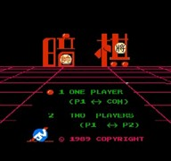 | 暗棋 | 0 | D:\GitCode\famiclone\reference\nes-games\棋牌\暗棋-mapper0.nes |
| 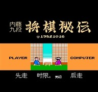 | 本将棋 内藤九段 将棋秘传 | 0 | D:\GitCode\famiclone\reference\nes-games\棋牌\本将棋 内藤九段 将棋秘传(大字体)[高伟]-mapper0.nes |
| 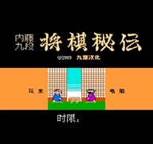 | 本将棋 内藤九段 将棋秘传 | 0 | D:\GitCode\famiclone\reference\nes-games\棋牌\本将棋 内藤九段 将棋秘传[九班]-mapper0.nes |
|  | 财神到 | 4 | D:\GitCode\famiclone\reference\nes-games\棋牌\财神到-mapper4.nes |
| 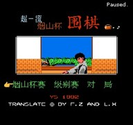 | 超一流烟山杯围棋 | 3 | D:\GitCode\famiclone\reference\nes-games\棋牌\超一流烟山杯围棋-mapper3.nes |
|  | 锄大D | 4 | D:\GitCode\famiclone\reference\nes-games\棋牌\锄大D-mapper4.nes |
| 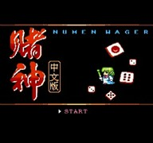 | 赌神 | 74 | D:\GitCode\famiclone\reference\nes-games\棋牌\赌神-mapper74.nes |
|  | 赌神 掷骰战士 | 191 | D:\GitCode\famiclone\reference\nes-games\棋牌\赌神 掷骰战士(修正版)[先锋卡通+星夜之幻]-mapper191.nes |
|  | 赌神 掷骰战士 | 74 | D:\GitCode\famiclone\reference\nes-games\棋牌\赌神 掷骰战士[先锋卡通]-mapper74.nes |
| 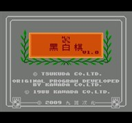 | 黑白棋 | 0 | D:\GitCode\famiclone\reference\nes-games\棋牌\黑白棋-mapper0.nes |
| 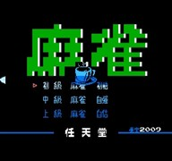 | 麻雀 | 0 | D:\GitCode\famiclone\reference\nes-games\棋牌\麻雀-mapper0.nes |
| 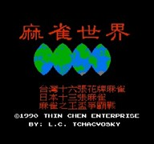 | 麻雀世界 | 148 | D:\GitCode\famiclone\reference\nes-games\棋牌\麻雀世界-mapper148.nes |
| 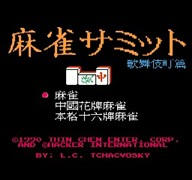 | 麻雀世界 歌舞伎町篇 | 146 | D:\GitCode\famiclone\reference\nes-games\棋牌\麻雀世界 歌舞伎町篇-mapper146.nes |
|  | 扑克 | 3 | D:\GitCode\famiclone\reference\nes-games\棋牌\扑克-mapper3.nes |
| 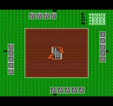 | 扑克集锦 | 0 | D:\GitCode\famiclone\reference\nes-games\棋牌\扑克集锦-mapper0.nes |
|  | 扑克精灵 | 3 | D:\GitCode\famiclone\reference\nes-games\棋牌\扑克精灵-mapper3.nes |
| 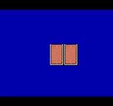 | 扑克麻雀 | 141 | D:\GitCode\famiclone\reference\nes-games\棋牌\扑克麻雀-mapper141.nes |
| 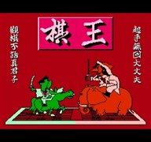 | 棋王 | 133 | D:\GitCode\famiclone\reference\nes-games\棋牌\棋王-mapper133.nes |
|  | 四川麻将 | 3 | D:\GitCode\famiclone\reference\nes-games\棋牌\四川麻将-mapper3.nes |
|  | 四川麻雀 制服篇 | 3 | D:\GitCode\famiclone\reference\nes-games\棋牌\四川麻雀 制服篇-mapper3.nes |
| 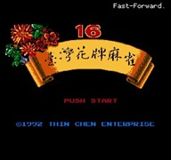 | 台湾花牌麻雀 | 150 | D:\GitCode\famiclone\reference\nes-games\棋牌\台湾花牌麻雀-mapper150.nes |
| 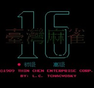 | 台湾麻雀 | 149 | D:\GitCode\famiclone\reference\nes-games\棋牌\台湾麻雀-mapper149.nes |
|  | 偷看扑克 | 3 | D:\GitCode\famiclone\reference\nes-games\棋牌\偷看扑克(大字体)[高伟]-mapper3.nes |
| 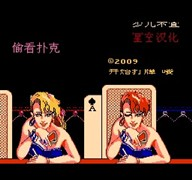 | 偷看扑克 | 3 | D:\GitCode\famiclone\reference\nes-games\棋牌\偷看扑克[星空]-mapper3.nes |
| 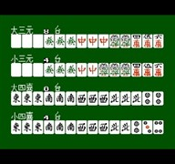 | 推倒胡麻将 | 171 | D:\GitCode\famiclone\reference\nes-games\棋牌\推倒胡麻将-mapper171.nes |
| 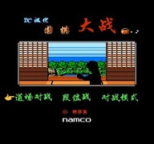 | 围棋大战 | 3 | D:\GitCode\famiclone\reference\nes-games\棋牌\围棋大战-mapper3.nes |
| 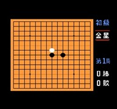 | 五子棋 | 0 | D:\GitCode\famiclone\reference\nes-games\棋牌\五子棋-mapper0.nes |
| 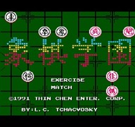 | 象棋学园 | 150 | D:\GitCode\famiclone\reference\nes-games\棋牌\象棋学园-mapper150.nes |
| 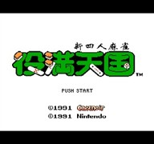 | 新四人麻雀 役满天国 | 5 | D:\GitCode\famiclone\reference\nes-games\棋牌\新四人麻雀 役满天国-mapper5.nes |
| 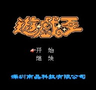 | 游戏王 | 163 | D:\GitCode\famiclone\reference\nes-games\棋牌\游戏王-mapper163.nes |
| 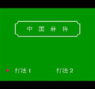 | 中国麻将 | 0 | D:\GitCode\famiclone\reference\nes-games\棋牌\中国麻将-mapper0.nes |
| 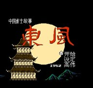 | 中国雀士故事 东风 | 1 | D:\GitCode\famiclone\reference\nes-games\棋牌\中国雀士故事 东风(大字体)[高伟]-mapper1.nes |
| 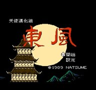 | 中国雀士故事 东风 | 1 | D:\GitCode\famiclone\reference\nes-games\棋牌\中国雀士故事 东风[天使]-mapper1.nes |
| 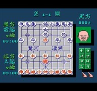 | 中国象棋 | 0 | D:\GitCode\famiclone\reference\nes-games\棋牌\中国象棋-mapper0.nes |
