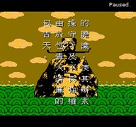
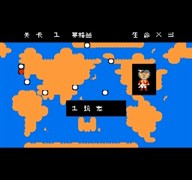
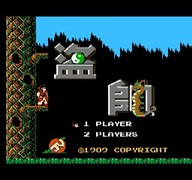
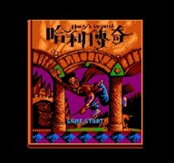
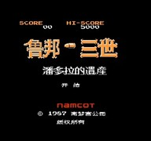
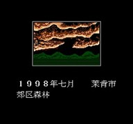

# 冒险解谜（32 个）

返回 [总览](README.md)

| 缩略图 | 游戏 | 映⁠射⁠号 | 文件路径 |
|---|---|---|---|
|  | 包青天 | 4 | D:\GitCode\famiclone\reference\nes-games\冒险解谜\包青天(解密版)[外星科技+WXN]-mapper4.nes |
|  | 包青天 | 248 | D:\GitCode\famiclone\reference\nes-games\冒险解谜\包青天[卡圣]-mapper248.nes |
|  | 不可能完成的任务 | 192 | D:\GitCode\famiclone\reference\nes-games\冒险解谜\不可能完成的任务-mapper192.nes |
|  | 城堡探险 | 3 | D:\GitCode\famiclone\reference\nes-games\冒险解谜\城堡探险-mapper3.nes |
|  | 穿长靴的猫 环游世界80天大冒险 | 3 | D:\GitCode\famiclone\reference\nes-games\冒险解谜\穿长靴的猫 环游世界80天大冒险-mapper3.nes |
|  | 穿长靴的猫 皮洛的伟大探险 | 2 | D:\GitCode\famiclone\reference\nes-games\冒险解谜\穿长靴的猫 皮洛的伟大探险-mapper2.nes |
|  | 盗帅 | 0 | D:\GitCode\famiclone\reference\nes-games\冒险解谜\盗帅-mapper0.nes |
|  | 地狱神探 | 241 | D:\GitCode\famiclone\reference\nes-games\冒险解谜\地狱神探-mapper241.nes |
|  | 古墓丽影 | 4 | D:\GitCode\famiclone\reference\nes-games\冒险解谜\古墓丽影-mapper4.nes |
|  | 哈利传奇 | 4 | D:\GitCode\famiclone\reference\nes-games\冒险解谜\哈利传奇-mapper4.nes |
|  | 合金装备 | 4 | D:\GitCode\famiclone\reference\nes-games\冒险解谜\合金装备-mapper4.nes |
|  | 黑客 | 4 | D:\GitCode\famiclone\reference\nes-games\冒险解谜\黑客-mapper4.nes |
|  | 火炮侦探 | 4 | D:\GitCode\famiclone\reference\nes-games\冒险解谜\火炮侦探-mapper4.nes |
|  | 骷髅13 第一章 诸神的黄昏 | 192 | D:\GitCode\famiclone\reference\nes-games\冒险解谜\骷髅13 第一章 诸神的黄昏-mapper192.nes |
|  | 拉格朗日点 | 85 | D:\GitCode\famiclone\reference\nes-games\冒险解谜\拉格朗日点-mapper85.nes |
|  | 列车奇案 | 4 | D:\GitCode\famiclone\reference\nes-games\冒险解谜\列车奇案-mapper4.nes |
|  | 鲁邦三世 潘多拉的遗产 | 4 | D:\GitCode\famiclone\reference\nes-games\冒险解谜\鲁邦三世 潘多拉的遗产-mapper4.nes |
|  | 南极大冒险 | 3 | D:\GitCode\famiclone\reference\nes-games\冒险解谜\南极大冒险-mapper3.nes |
|  | 南极冒险 | 0 | D:\GitCode\famiclone\reference\nes-games\冒险解谜\南极冒险-mapper0.nes |
|  | 少年印第安纳琼斯大冒险 | 4 | D:\GitCode\famiclone\reference\nes-games\冒险解谜\少年印第安纳琼斯大冒险-mapper4.nes |
|  | 神探柯南 | 4 | D:\GitCode\famiclone\reference\nes-games\冒险解谜\神探柯南-mapper4.nes |
|  | 生化危机 | 15 | D:\GitCode\famiclone\reference\nes-games\冒险解谜\生化危机-mapper15.nes |
|  | 双截龙3 神秘的魔石之谜 | 4 | D:\GitCode\famiclone\reference\nes-games\冒险解谜\双截龙3 神秘的魔石之谜-mapper4.nes |
|  | 双截龙3 神秘魔石之谜 | 4 | D:\GitCode\famiclone\reference\nes-games\冒险解谜\双截龙3 神秘魔石之谜(简+英)-v0.3[苦练汉化]-mapper4.nes |
|  | 双截龙3 神秘魔石之谜 | 4 | D:\GitCode\famiclone\reference\nes-games\冒险解谜\双截龙3 神秘魔石之谜[幻想]-mapper4.nes |
|  | 泰坦尼克号 | 34 | D:\GitCode\famiclone\reference\nes-games\冒险解谜\泰坦尼克号[火星电子]-mapper34.nes |
|  | 泰坦尼克号 | 4 | D:\GitCode\famiclone\reference\nes-games\冒险解谜\泰坦尼克号[南晶科技]-mapper4.nes |
|  | 五号特工队 | 4 | D:\GitCode\famiclone\reference\nes-games\冒险解谜\五号特工队-mapper4.nes |
|  | 新地底探险 | 1 | D:\GitCode\famiclone\reference\nes-games\冒险解谜\新地底探险-mapper1.nes |
|  | 星际之门 | 0 | D:\GitCode\famiclone\reference\nes-games\冒险解谜\星际之门-mapper0.nes |
|  | 异形 太空探险者 | 4 | D:\GitCode\famiclone\reference\nes-games\冒险解谜\异形 太空探险者-mapper4.nes |
|  | 异形3 | 4 | D:\GitCode\famiclone\reference\nes-games\冒险解谜\异形3-mapper4.nes |
