# 其他（84 个）

返回 [总览](README.md)

| 缩略图 | 游戏 | 映⁠射⁠号 | 文件路径 |
|---|---|---|---|
| 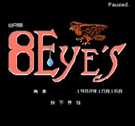 | 8只眼 | 4 | D:\GitCode\famiclone\reference\nes-games\其他\8只眼-mapper4.nes |
| 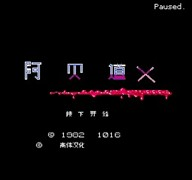 | 阿贝道X | 1 | D:\GitCode\famiclone\reference\nes-games\其他\阿贝道X-mapper1.nes |
| 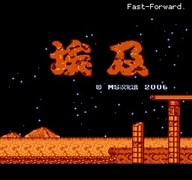 | 埃及 | 3 | D:\GitCode\famiclone\reference\nes-games\其他\埃及-mapper3.nes |
|  | 爱的小屋 | 0 | D:\GitCode\famiclone\reference\nes-games\其他\爱的小屋-mapper0.nes |
| 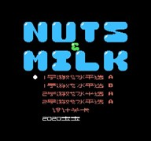 | 爱情小屋 | 0 | D:\GitCode\famiclone\reference\nes-games\其他\爱情小屋[虫虫]-mapper0.nes |
|  | 爱情小屋 | 0 | D:\GitCode\famiclone\reference\nes-games\其他\爱情小屋[高伟]-mapper0.nes |
| 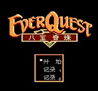 | 八宝奇珠 | 74 | D:\GitCode\famiclone\reference\nes-games\其他\八宝奇珠-mapper74.nes |
| 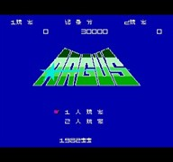 | 百眼巨神 | 87 | D:\GitCode\famiclone\reference\nes-games\其他\百眼巨神-mapper87.nes |
| 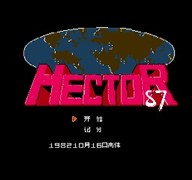 | 爆击战士87 | 2 | D:\GitCode\famiclone\reference\nes-games\其他\爆击战士87-mapper2.nes |
| 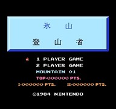 | 冰山登山者 | 0 | D:\GitCode\famiclone\reference\nes-games\其他\冰山登山者-mapper0.nes |
| 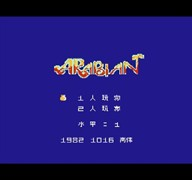 | 超级阿拉伯 | 0 | D:\GitCode\famiclone\reference\nes-games\其他\超级阿拉伯-mapper0.nes |
| 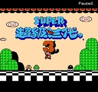 | 超级三代 | 4 | D:\GitCode\famiclone\reference\nes-games\其他\超级三代-mapper4.nes |
| 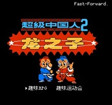 | 超级中国人2 龙之子 | 5 | D:\GitCode\famiclone\reference\nes-games\其他\超级中国人2 龙之子-mapper5.nes |
| 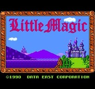 | 超魔兽大战 | 4 | D:\GitCode\famiclone\reference\nes-games\其他\超魔兽大战-mapper4.nes |
| 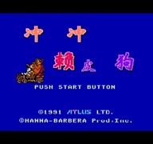 | 冲冲赖皮狗 | 4 | D:\GitCode\famiclone\reference\nes-games\其他\冲冲赖皮狗-mapper4.nes |
|  | 创世纪英雄 | 4 | D:\GitCode\famiclone\reference\nes-games\其他\创世纪英雄-mapper4.nes |
| 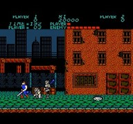 | 斗者的挽歌 | 2 | D:\GitCode\famiclone\reference\nes-games\其他\斗者的挽歌-mapper2.nes |
| 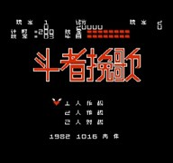 | 斗者挽歌 | 2 | D:\GitCode\famiclone\reference\nes-games\其他\斗者挽歌-mapper2.nes |
| 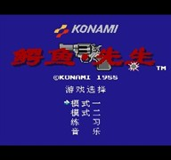 | 鳄鱼先生 | 4 | D:\GitCode\famiclone\reference\nes-games\其他\鳄鱼先生-mapper4.nes |
|  | 法老王 | 162 | D:\GitCode\famiclone\reference\nes-games\其他\法老王-mapper162.nes |
|  | 反重力战士 | 4 | D:\GitCode\famiclone\reference\nes-games\其他\反重力战士-mapper4.nes |
| 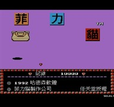 | 菲力貓 | 4 | D:\GitCode\famiclone\reference\nes-games\其他\菲力貓-mapper4.nes |
|  | 疯狂鸡蛋仔 | 4 | D:\GitCode\famiclone\reference\nes-games\其他\疯狂鸡蛋仔-mapper4.nes |
| 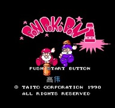 | 工人战记 | 33 | D:\GitCode\famiclone\reference\nes-games\其他\工人战记-mapper33.nes |
| 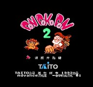 | 工人战记2 | 48 | D:\GitCode\famiclone\reference\nes-games\其他\工人战记2-mapper48.nes |
|  | 古巴战士 | 1 | D:\GitCode\famiclone\reference\nes-games\其他\古巴战士-v1.1[惊风]-mapper1.nes |
|  | 古巴战士 | 1 | D:\GitCode\famiclone\reference\nes-games\其他\古巴战士-v2.0[未知]-mapper1.nes |
| 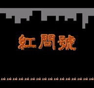 | 红问号 | 4 | D:\GitCode\famiclone\reference\nes-games\其他\红问号-mapper4.nes |
| 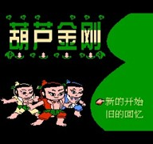 | 葫芦金刚 | 163 | D:\GitCode\famiclone\reference\nes-games\其他\葫芦金刚-mapper163.nes |
| 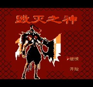 | 毁灭之神 | 163 | D:\GitCode\famiclone\reference\nes-games\其他\毁灭之神-mapper163.nes |
|  | 火龙 | 0 | D:\GitCode\famiclone\reference\nes-games\其他\火龙-mapper0.nes |
| 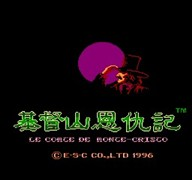 | 基督山恩仇记 | 4 | D:\GitCode\famiclone\reference\nes-games\其他\基督山恩仇记-mapper4.nes |
| 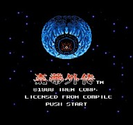 | 嘉蒂外传 | 1 | D:\GitCode\famiclone\reference\nes-games\其他\嘉蒂外传-mapper1.nes |
| 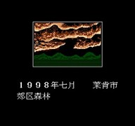 | 精卫填海 | 241 | D:\GitCode\famiclone\reference\nes-games\其他\精卫填海-mapper241.nes |
| 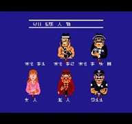 | 警察特训 | 0 | D:\GitCode\famiclone\reference\nes-games\其他\警察特训-mapper0.nes |
| 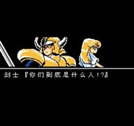 | 救世主 | 5 | D:\GitCode\famiclone\reference\nes-games\其他\救世主-mapper5.nes |
| 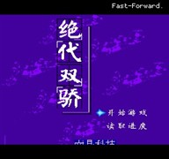 | 绝代双娇 | 241 | D:\GitCode\famiclone\reference\nes-games\其他\绝代双娇-mapper241.nes |
|  | 快乐比奇3 地球战士 | 4 | D:\GitCode\famiclone\reference\nes-games\其他\快乐比奇3 地球战士-mapper4.nes |
|  | 快乐鼠 | 19 | D:\GitCode\famiclone\reference\nes-games\其他\快乐鼠-mapper19.nes |
| 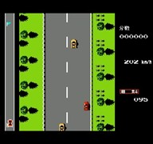 | 马路英雄 | 0 | D:\GitCode\famiclone\reference\nes-games\其他\马路英雄-mapper0.nes |
|  | 梦之勇士 | 4 | D:\GitCode\famiclone\reference\nes-games\其他\梦之勇士-v1.0[冰组]-mapper4.nes |
| 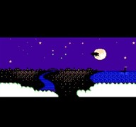 | 梦之勇士 | 4 | D:\GitCode\famiclone\reference\nes-games\其他\梦之勇士-v2[中伟]-mapper4.nes |
|  | 梦之勇士 | 4 | D:\GitCode\famiclone\reference\nes-games\其他\梦之勇士(修正版)-v0.9[冰组+庞先生]-mapper4.nes |
| 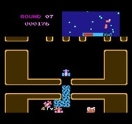 | 迷魂车 | 0 | D:\GitCode\famiclone\reference\nes-games\其他\迷魂车[黄信维]-mapper0.nes |
|  | 迷魂车 | 133 | D:\GitCode\famiclone\reference\nes-games\其他\迷魂车[Puszta]-mapper133.nes |
| 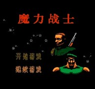 | 魔力战士 | 241 | D:\GitCode\famiclone\reference\nes-games\其他\魔力战士-mapper241.nes |
| 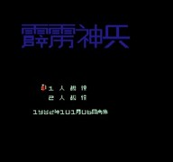 | 霹雳神兵 | 4 | D:\GitCode\famiclone\reference\nes-games\其他\霹雳神兵[高伟]-mapper4.nes |
| 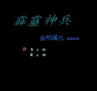 | 霹雳神兵 | 4 | D:\GitCode\famiclone\reference\nes-games\其他\霹雳神兵[金明]-mapper4.nes |
| 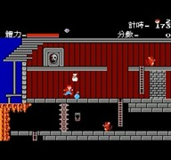 | 七宝奇谋 | 140 | D:\GitCode\famiclone\reference\nes-games\其他\七宝奇谋(简+繁)-v20250617[NOKOH]-mapper140.nes |
| 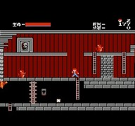 | 七宝奇谋 | 3 | D:\GitCode\famiclone\reference\nes-games\其他\七宝奇谋(修正版)[王龙+MS]-mapper3.nes |
| 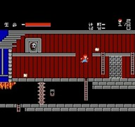 | 七宝奇谋 | 87 | D:\GitCode\famiclone\reference\nes-games\其他\七宝奇谋[高伟]-mapper87.nes |
| 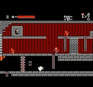 | 七宝奇谋 | 87 | D:\GitCode\famiclone\reference\nes-games\其他\七宝奇谋[卡通]-mapper87.nes |
| 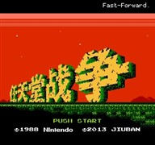 | 任天堂战争 | 10 | D:\GitCode\famiclone\reference\nes-games\其他\任天堂战争-v1[九班]-mapper10.nes |
| 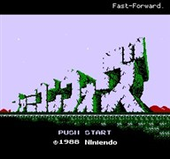 | 任天堂战争 | 10 | D:\GitCode\famiclone\reference\nes-games\其他\任天堂战争[快乐的龙]-mapper10.nes |
|  | 闪闪的红星 | 163 | D:\GitCode\famiclone\reference\nes-games\其他\闪闪的红星-mapper163.nes |
| 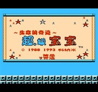 | 生命的奇迹 超级宝宝 | 25 | D:\GitCode\famiclone\reference\nes-games\其他\生命的奇迹 超级宝宝-mapper25.nes |
| 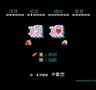 | 孙孙 | 66 | D:\GitCode\famiclone\reference\nes-games\其他\孙孙-v20220219[NOKOH]-mapper66.nes |
| 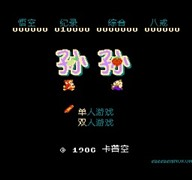 | 孙孙 | 66 | D:\GitCode\famiclone\reference\nes-games\其他\孙孙-v20220219[NOKOH+fciq]-mapper66.nes |
| 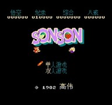 | 孙孙 | 66 | D:\GitCode\famiclone\reference\nes-games\其他\孙孙(大字体)[高伟]-mapper66.nes |
| 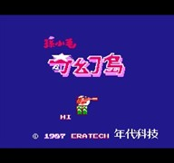 | 孙小毛奇幻岛 | 3 | D:\GitCode\famiclone\reference\nes-games\其他\孙小毛奇幻岛-mapper3.nes |
| 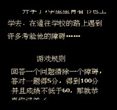 | 天才小子 | 4 | D:\GitCode\famiclone\reference\nes-games\其他\天才小子-mapper4.nes |
| 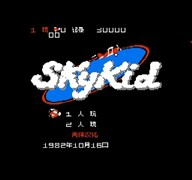 | 天堂鸟 | 4 | D:\GitCode\famiclone\reference\nes-games\其他\天堂鸟-mapper4.nes |
| 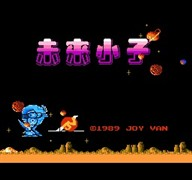 | 未来小子 | 3 | D:\GitCode\famiclone\reference\nes-games\其他\未来小子-mapper3.nes |
| 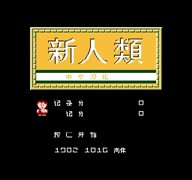 | 新人类 | 3 | D:\GitCode\famiclone\reference\nes-games\其他\新人类[高伟]-mapper3.nes |
| 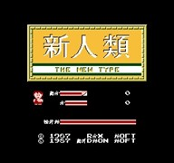 | 新人类 | 3 | D:\GitCode\famiclone\reference\nes-games\其他\新人类[Yurica]-mapper3.nes |
|  | 新西兰故事 | 4 | D:\GitCode\famiclone\reference\nes-games\其他\新西兰故事(作弊菜单)-v2.0[rym1020]-mapper4.nes |
|  | 新西兰故事 | 4 | D:\GitCode\famiclone\reference\nes-games\其他\新西兰故事[高伟]-mapper4.nes |
|  | 熊猫太子 | 121 | D:\GitCode\famiclone\reference\nes-games\其他\熊猫太子-mapper121.nes |
|  | 亚特鲁战记 | 74 | D:\GitCode\famiclone\reference\nes-games\其他\亚特鲁战记-mapper74.nes |
|  | 耀奇之神奇蛋仔 | 1 | D:\GitCode\famiclone\reference\nes-games\其他\耀奇之神奇蛋仔-mapper1.nes |
|  | 夜明珠 | 4 | D:\GitCode\famiclone\reference\nes-games\其他\夜明珠-mapper4.nes |
|  | 翼人 | 2 | D:\GitCode\famiclone\reference\nes-games\其他\翼人-mapper2.nes |
|  | 银河时代 | 4 | D:\GitCode\famiclone\reference\nes-games\其他\银河时代-mapper4.nes |
|  | 游戏宝贝 | 241 | D:\GitCode\famiclone\reference\nes-games\其他\游戏宝贝-mapper241.nes |
|  | 月光水晶 | 5 | D:\GitCode\famiclone\reference\nes-games\其他\月光水晶(按键无敌)[逆游の五彩魚]-mapper5.nes |
|  | 月光水晶 | 5 | D:\GitCode\famiclone\reference\nes-games\其他\月光水晶(原版标题)[逆游の五彩魚]-mapper5.nes |
|  | 月光水晶 | 5 | D:\GitCode\famiclone\reference\nes-games\其他\月光水晶[逆游の五彩魚]-mapper5.nes |
|  | 月之水晶 | 4 | D:\GitCode\famiclone\reference\nes-games\其他\月之水晶-mapper4.nes |
|  | 拯救爱心 | 0 | D:\GitCode\famiclone\reference\nes-games\其他\拯救爱心-mapper0.nes |
|  | 中华英雄 | 4 | D:\GitCode\famiclone\reference\nes-games\其他\中华英雄-mapper4.nes |
|  | 装逼世界 | 0 | D:\GitCode\famiclone\reference\nes-games\其他\装逼世界-mapper0.nes |
|  | 最后的使命 | 1 | D:\GitCode\famiclone\reference\nes-games\其他\最后的使命-mapper1.nes |
|  | B计划 | 0 | D:\GitCode\famiclone\reference\nes-games\其他\B计划-mapper0.nes |
|  | Raf世界 | 1 | D:\GitCode\famiclone\reference\nes-games\其他\Raf世界-mapper1.nes |
