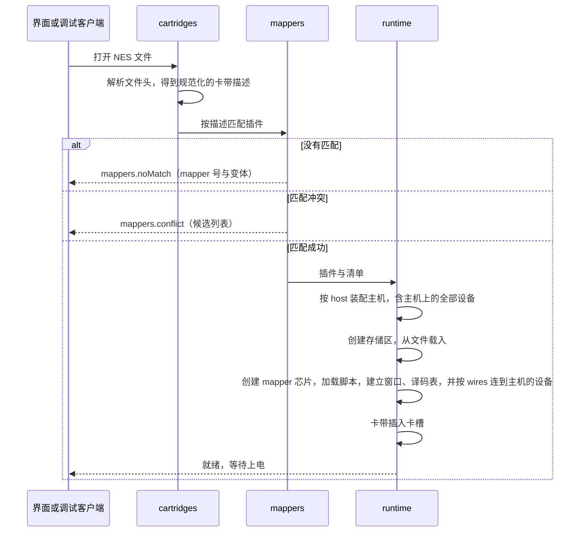

# mapper 插件规范

mapper 插件提供卡带上的 mapper 芯片：声明卡带有哪些存储元件、地址如何译码并连到主机上的设备、要哪种主机，并用脚本实现 mapper 芯片的行为。模拟器程序不内置任何 mapper，更新或增加机型适配只需安装或更新插件。本文写给插件作者，也是核心实现插件宿主的依据。硬件结构见 [02-硬件模块.md](02-硬件模块.md)。

状态说明同 [01-软件架构设计.md](01-软件架构设计.md)。

## 1. 决策

| 决策项 | 结论 | 状态 |
| --- | --- | --- |
| 插件的含义 | 插件就是卡带上的 mapper 芯片：清单描述卡带的元件和连线，脚本实现芯片行为 | 已定 |
| 不内置 | 程序里没有任何内置 mapper，包括 NROM；官方 mapper 以插件形式随安装包预装 | 已定 |
| 主机的选择 | 清单只能按名字选择主机型号（按机型，如 `sb2000`），不能修改芯片内部、主板上的外设与存储 | 已定 |
| 设备 | 软驱控制器、DAC、并口等外设属于主机，由主机型号提供；清单只能写连线，不能创建、修改设备 | 已定 |
| 匹配 | 按 NES 文件头的 mapper 号和变体匹配，规则写在清单里；程序只做通用查询，不认识任何具体机型 | 已定 |
| 脚本语言 | JavaScript（ES2023 模块），推荐用 TypeScript 编写后打包为单个文件 | 拟定 |
| 运行环境 | C++ 核心中的 QuickJS-ng，每个插件一个独立的运行时；不能访问文件、网络与进程，一切外部访问只经宿主对象 `ctx` | 拟定 |
| 调用方式 | 脚本只在寄存器读写、定时事件和复位时被调用，不逐周期回调；译码结果（bank 窗口）由宿主保存并直接使用 | 拟定 |
| 状态可见 | 脚本的内部寄存器必须声明并放在宿主管理的状态对象里，调试服务可随时读写 | 拟定 |
| 接口版本 | 插件接口版本为整数，当前为 `1`；只在破坏性变更时加一 | 拟定 |
| 包格式 | 扩展名 `.vn2m` 的 zip 文件 | 拟定 |

## 2. 概念

- NES 文件是卡带的内容：PRG、CHR、文件头。加载时宿主把它解析成规范化的卡带描述，再按它匹配插件。
- 插件按清单创建卡带：存储芯片和 mapper 芯片，并把清单里的设备连线接到主机的设备上；然后把卡带插入主机的卡槽。
- mapper 芯片的职责与真机一致：响应 CPU 与 PPU 的访问，决定卡槽上的每个地址落在哪个存储芯片的哪个位置，必要时处理寄存器、计时和中断。
- 译码表：宿主按“窗口”保存译码结果。脚本在寄存器写入时修改窗口（如把 `$8000-$9FFF` 指向 PRG 的第 5 个 8K），之后的读写由宿主直接按窗口访问存储区，不再调用脚本。这与真机一致：译码输出只在寄存器写入时变化。

## 3. 插件包

插件包是扩展名为 `.vn2m` 的 zip 文件，根目录包含：

| 文件 | 内容 | 是否必需 |
| --- | --- | --- |
| `manifest.json` | 清单，见第 4 节 | 必需 |
| `main.js` | 脚本，单个 ES 模块，默认导出 `definePlugin(...)` 的结果；不能再引用其他文件；没有寄存器的 mapper 可以没有 | 有脚本逻辑时必需 |
| `icon.png` | 图标，正方形，不小于 64 像素 | 可选 |

- 包内不允许出现其他文件、目录与符号链接；`main.js` 不超过 1 MB，整个包不超过 2 MB。
- 开发时可以直接加载未打包的插件目录（含 `manifest.json` 与 `main.js`），修改后用 `mappers.reload` 重新加载，不用反复打包，见第 7 节。

## 4. 清单

### 4.1 基本字段

| 字段 | 类型 | 说明 |
| --- | --- | --- |
| `id` | 字符串 | 插件标识，小写字母、数字与 `-`，3 到 40 个字符；安装后不能修改 |
| `name` | 字符串 | 显示名称，不超过 40 个字符 |
| `version` | 字符串 | 插件版本，`主.次.修订` |
| `apiVersion` | 整数 | 插件接口版本，当前为 `1` |
| `publisher` | 字符串 | 发布者名称 |
| `description` | 字符串 | 一两句话的说明，可选 |
| `host` | 字符串数组 | 要求的主机型号（按机型），如 `["sb2000"]`；宿主按第一个存在的型号装配 |
| `match` | 数组 | 匹配条件，见第 4.2 节 |

### 4.2 匹配

宿主解析 NES 文件头，得到规范化的卡带描述：

| 字段 | 含义 |
| --- | --- |
| `mapper` | mapper 号 |
| `variant` | 变体：NES 2.0 头取 submapper；旧 iNES 头沿用旧版的约定，取头部第 9 字节右移 1 位（以真实文件核对后定） |
| `prgSize`、`chrSize` | PRG、CHR 的字节数 |
| `mirroring`、`battery`、`trainer` | 头里的镜像方式、电池标志、训练器标志 |
| `crc32Prg`、`crc32All` | PRG 的校验值、PRG 加 CHR 的校验值 |

`match` 的每一项是一组条件，必须写 `mapper`，其余可选：`variant`、`prgSize`、`chrSize`、`crc32Prg`、`crc32All`；写出的条件必须全部满足，任一项满足即匹配。

- 同一个 mapper 号可以对应多台机器：小霸王 SB2000、步步高软驱一号、步步高 98 都是 mapper 171，用变体或校验值区分。可以写成一个插件的多项匹配，也可以每台机器一个插件。
- 多个插件同时匹配时，写出条件更多的优先；条件数相同时，用户在“mapper 插件”页选择的优先；还没有选择时，提示冲突，由用户选择并记住。
- 没有任何插件匹配时不运行，界面提示“缺少 mapper 号 N、变体 V 的插件”，并给出打开“mapper 插件”页的入口。
- 宿主只比较这些规范化字段，不理解它们对应哪台机器。

### 4.3 存储区

`storage` 声明卡带上的存储芯片，每项：

| 字段 | 说明 |
| --- | --- |
| `id` | 存储区标识，同一插件内不重复 |
| `kind` | `rom` 或 `ram` |
| `from` | `rom` 的数据来源：`file.prg` 或 `file.chr`（NES 文件里的数据） |
| `size` | `ram` 的字节数 |
| `battery` | `ram` 是否带电池；带电池时存档文件按卡带保存 |
| `fallback` | 来源为空时改用的存储区，如文件没有 CHR 时用 8K 的 CHR RAM |

- 只声明卡带上的存储区；芯片内与主板上的存储不能在这里声明或修改，见 02 第 5 节。

### 4.4 窗口与初始译码

`windows` 声明可切换的窗口，每项：

| 字段 | 说明 |
| --- | --- |
| `id` | 窗口标识 |
| `bus` | `cpu` 或 `ppu` |
| `range` | 窗口覆盖的地址范围，如 `$8000-$9FFF` |
| `storage` | 窗口访问的存储区 |
| `size` | 一个 bank 的字节数，必须等于窗口大小 |
| `initial` | 复位后指向的 bank，可以是整数，或 `last`、`first` |
| `access` | `r` 或 `rw`；指向 ROM 时只能是 `r` |

- 窗口之间的地址范围不能重叠；没有被窗口或寄存器覆盖的卡槽地址按开放总线处理。
- `nametable` 声明名称表的初始连法：`header`（按文件头）、`horizontal`、`vertical`、`single0`、`single1`、`four`；脚本可以在运行中改。

### 4.5 寄存器与回调范围

`registers` 声明会调用脚本的地址范围，每项：

| 字段 | 说明 |
| --- | --- |
| `bus` | `cpu` 或 `ppu` |
| `range` | 地址范围，如 `$4100-$4107` |
| `read`、`write` | 是否回调读、写 |

- 只有落在声明范围内的读写才调用脚本，其余访问由窗口直接处理；这是性能的保证，也让总线行为可以静态检查。
- 寄存器范围可以与窗口的地址范围重叠：只读窗口（`access` 为 `r`）上的写入转给脚本，读取仍由窗口直接处理。

### 4.6 设备连线

设备属于主机，由主机型号提供；清单不创建设备。`wires` 把卡槽上的地址译码到主机上某个设备的寄存器，每项：

| 字段 | 说明 |
| --- | --- |
| `bus` | `cpu` 或 `ppu` |
| `address` | 地址或地址范围，如 `$4100`、`$4200-$4207` |
| `device` | 主机上的设备标识，如 `fdc`；主机型号没有这个设备时拒绝 |
| `register` | 设备的寄存器号；地址范围时按地址偏移依次对应 |
| `read`、`write` | 是否接读、写 |

- 设备标识、寄存器号与含义由主机型号和设备模块规定，mapper 作者对照设备文档使用；mapper 不能创建设备，也不能改设备的选项。
- 被连线的地址由宿主直接转给设备，不调用脚本；需要条件逻辑的访问不连线，改在 `registers` 里声明范围，由脚本经 `ctx.device` 访问设备。
- `uses` 列出脚本要直接访问的设备标识（字符串数组），脚本只能访问这里和 `wires` 里出现过的设备。

`irq` 声明中断连线，每项 `{ "from": "设备标识.引脚", "to": "cart" }`，表示该设备的中断输出经 mapper 芯片转到卡带的 IRQ 引脚；需要条件控制（如受某个使能位控制）的中断，不在清单里连线，由脚本经 `ctx.irq` 处理。

### 4.7 状态声明

`state` 声明脚本的内部寄存器，每项：`name`、`bits`（位宽）、`description`。脚本只能读写已声明的状态，写入时按位宽截断。调试服务可以读写它们，见 04。

### 4.8 设置项

`settings` 声明用户可调的选项（可选），写法同如见的模型插件设置项：`key`、`label`、`kind`（`text`、`choice`、`switch`）、`default`、`description`。脚本经 `ctx.settings.get(key)` 读取。

## 5. 加载流程



- 经典 FC 的游戏同样要有匹配的插件，所以必须预装 NROM 等常用插件。
- 学习机的固件文件走同一入口：它的 mapper 号和变体匹配到对应插件，插件的 `host` 决定装配学习机主机，不会进入经典机的 CPU 与 PPU。
- 经典机的卡槽上插学习机的卡带，或反过来，不可能发生：主机由插件选择，没有第二条路径。

## 6. 脚本接口

### 6.1 导出

```ts
import { definePlugin } from '@vn2/mapper-sdk';

export default definePlugin({
  reset(ctx, kind) { /* kind 为 'power' 或 'soft'：初始化状态与窗口 */ },
  read(ctx, bus, addr) { /* 返回 0-255；返回 undefined 表示不驱动总线 */ },
  write(ctx, bus, addr, value) { /* 处理寄存器写入 */ },
  timer(ctx, name) { /* 定时事件到期 */ },
});
```

- 四个函数都可选；声明了 `registers` 的读或写，就必须实现对应的函数。
- 函数是同步的，宿主在模拟线程中直接调用；没有 Promise、没有定时器。
- 返回值与参数由宿主校验：读返回值必须是 0 到 255 的整数或 `undefined`，窗口与状态的写入必须合法，否则按插件错误处理。

### 6.2 宿主对象 `ctx`

| 成员 | 说明 |
| --- | --- |
| `ctx.header` | 只读的规范化卡带描述，见第 4.2 节 |
| `ctx.window(id)` | 窗口：`setBank(n)` 切换 bank，`setOffset(bytes)` 按字节偏移，`unmap()` 取消映射（读按开放总线） |
| `ctx.nametable.set(mode)` | 设置名称表连法：`horizontal`、`vertical`、`single0`、`single1`、`four` |
| `ctx.irq` | 卡带的 IRQ 引脚：`assert()` 拉低，`release()` 释放 |
| `ctx.device(id)` | 主机上的设备：`read(reg)`、`write(reg, value)`，设备标识与寄存器号由主机型号和设备模块规定；只能访问 `uses` 和 `wires` 里出现过的设备 |
| `ctx.storage(id)` | 存储区：`size`、`read(offset)`、`write(offset, value)`（ROM 拒绝写） |
| `ctx.timer` | `after(cpuCycles, name)` 登记事件，`cancel(name)` 取消；时间单位是 CPU 周期 |
| `ctx.state` | 已声明状态的读写，如 `ctx.state.prgBank = 5` |
| `ctx.settings.get(key)` | 读取设置项 |
| `ctx.random(max)` | 返回 0 到 `max - 1` 的整数；种子由宿主决定，同一次运行内可重现 |
| `ctx.log.warn(message)` | 写入运行消息日志，一条最长 2000 字节 |

- 脚本不能访问文件、网络、进程、系统时间和 `Math.random`；需要随机数时用 `ctx.random`。
- 宿主对象是脚本与硬件之间的全部接口，所以插件的行为是确定的，同样的输入得到同样的结果，方便测试与调试。

### 6.3 执行限制

| 项 | 限制 |
| --- | --- |
| 运行时内存 | 32 MB |
| 栈 | 256 KB |
| 一次回调的时长 | 超过 50 毫秒即终止，插件报错，模拟器暂停 |
| 定时事件 | 同时最多 16 个 |

- 超出限制或脚本抛出异常时，模拟器暂停并报告 `mappers.scriptError`，写入运行消息日志；调试服务推送 `runtime.error` 事件。
- 回调只发生在寄存器访问、复位和定时事件上，所以脚本不会拖慢普通的程序执行；寄存器访问特别频繁的 mapper（每个周期都访问）不适合用脚本实现，见第 6.4 节。

### 6.4 宿主电路构件（预留）

需要逐周期或监视 PPU 地址线的电路（如按 PPU 地址线 A12 计数的中断计数器），不让脚本逐周期回调，而由宿主提供标准的“电路构件”，清单里声明并连线，脚本只配置参数。首批不做，接口版本 `1` 里没有；加入时提升接口版本。

## 7. 安装与管理

- 预装的官方插件随安装包放在应用的资源目录，只读；用户安装的插件放在用户数据目录的插件文件夹。
- 同一个 `id` 同时存在时，版本高的生效；版本相同时用户安装的优先。
- 用户可以停用任何插件，卸载自己安装的插件；预装的插件只能停用，不能删除。
- 安装时检查：包结构与大小、清单符合 Schema、`apiVersion` 受支持、`host` 中至少有一个存在的主机型号、`wires` 与 `uses` 里的设备在 `host` 的每个主机型号上都存在、`main.js` 能加载并导出声明的函数；不通过则拒绝并说明原因。
- 开发目录：首选项里可以指定“开发中的插件目录”，目录下每个子目录是一个未打包的插件；这些插件优先于同 `id` 的已安装插件，用 `mappers.reload` 重新加载，调试服务也提供同名请求。
- `mappers` 模块的请求（拟定）：`list`、`info`、`install`、`uninstall`、`setEnabled`、`reload`、`match`（按文件头预览匹配结果）。

错误码：`mappers.noMatch`、`mappers.conflict`、`mappers.invalidPackage`、`mappers.hostUnknown`、`mappers.deviceUnknown`、`mappers.scriptError`、`mappers.limitExceeded`。

## 8. SDK 与测试

- SDK 放在 `sdk/`，发布为 npm 包（包名待定，文中暂记为 `@vn2/mapper-sdk`），内容：声明文件（`definePlugin`、`ctx` 与清单的类型，每个类型与字段有中文文档注释）、清单检查、假宿主、命令行工具（`build`、`pack`）。
- 假宿主可以不启动模拟器就测试插件：预设卡带文件头和存储区，模拟寄存器读写，检查窗口、名称表、中断、设备访问与状态；规则与核心一致，修改任一侧时同步另一侧。
- 官方插件在 `plugins/<机型>/`，只经 SDK 的入口引用 SDK，插件之间不互相引用。
- 自动测试只用假宿主，不访问真实设备；整机行为用 `machines/` 的实测程序在核心里验证。

## 9. 首批官方插件

| 插件 | 匹配 | 主机 | 说明 | 状态 |
| --- | --- | --- | --- | --- |
| `nrom` | mapper 0 | `fc` | 没有寄存器，固定映射；用来验证经典 FC 的路径与插件机制 | 拟定 |
| `sb2000` | mapper 171，变体 1 | `sb2000` | 小霸王 SB2000 的固件与整机译码电路 | 待核对 |

- `sb2000` 的清单要点（待核对，依据 `machines/sb2000` 的资料与实测，不在此处写定）：
  - 存储区：BIOS ROM、扩展 RAM、显存。
  - 设备连线：主机上的软驱控制器（设备标识 `fdc`）；旧版实现里 `$4100` 是数据率、`$4101` 是 DOR，`$4200-$4207` 对应控制器的 DMA 与状态寄存器。
  - 软驱中断：控制器每传一个字节置一次中断标志，旧版在 mapper 里按上升沿触发，并受 DOR 位 3 控制；这类条件逻辑放在脚本里。
- 后续插件：步步高软驱一号、步步高 98、裕兴、小霸王 SB97，以及声像磁带的 mapper 172；它们同样是插件，不需要升级程序，所需的设备与主机型号若程序还没有，才需要升级程序。

## 10. 示意

下面是一个带 bank 寄存器的示意 mapper，只展示清单与脚本的写法，地址与取值是占位值：

```json
{
  "id": "demo-bank",
  "name": "示意 mapper",
  "version": "1.0.0",
  "apiVersion": 1,
  "publisher": "示例发布者",
  "host": ["fc"],
  "match": [{ "mapper": 999 }],
  "storage": [
    { "id": "prg", "kind": "rom", "from": "file.prg" },
    { "id": "chr", "kind": "rom", "from": "file.chr", "fallback": { "kind": "ram", "size": 8192 } }
  ],
  "windows": [
    { "id": "prg-low", "bus": "cpu", "range": "$8000-$BFFF", "storage": "prg", "size": 16384, "initial": 0, "access": "r" },
    { "id": "prg-high", "bus": "cpu", "range": "$C000-$FFFF", "storage": "prg", "size": 16384, "initial": "last", "access": "r" }
  ],
  "nametable": "header",
  "registers": [{ "bus": "cpu", "range": "$8000-$FFFF", "write": true }],
  "state": [{ "name": "prgBank", "bits": 8, "description": "低 16K 窗口的 bank 号" }]
}
```

```ts
export default definePlugin({
  reset(ctx) {
    ctx.state.prgBank = 0;
  },
  write(ctx, bus, addr, value) {
    ctx.state.prgBank = value;
    ctx.window('prg-low').setBank(value);
  },
});
```
